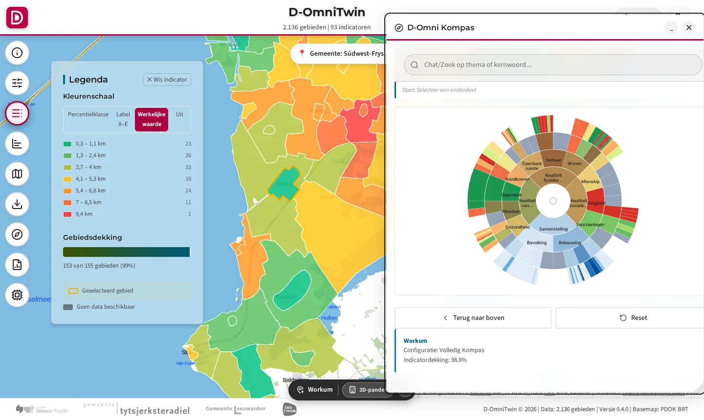
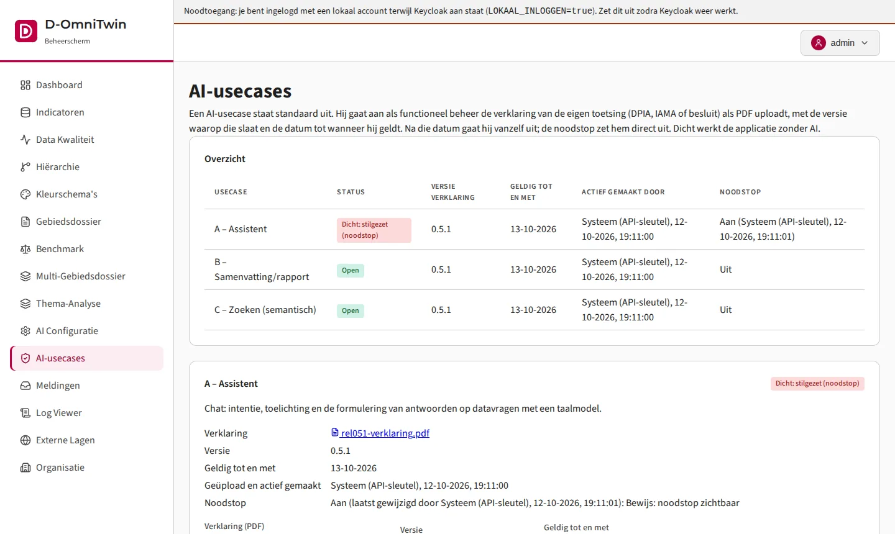
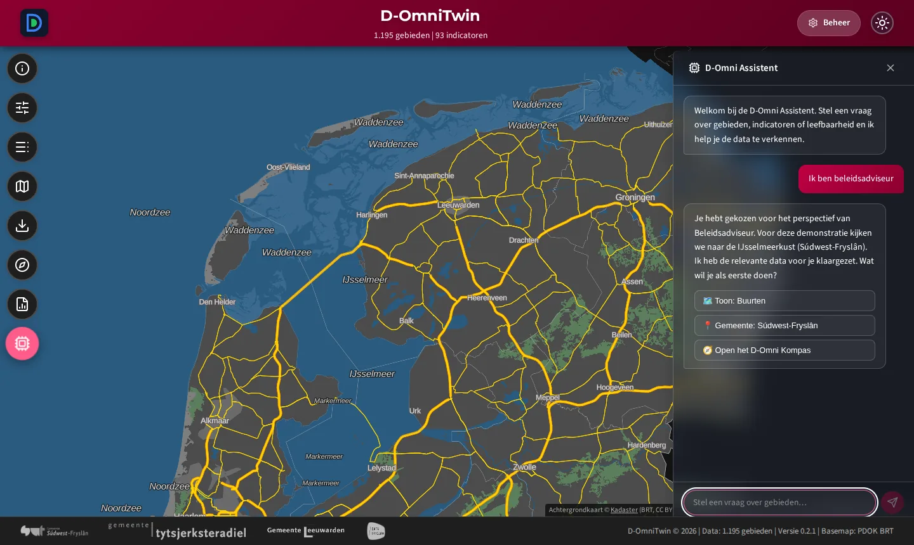
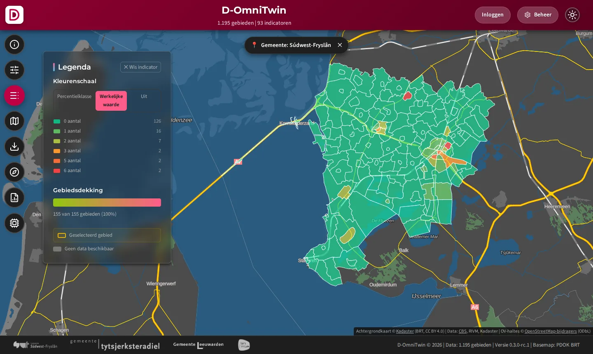
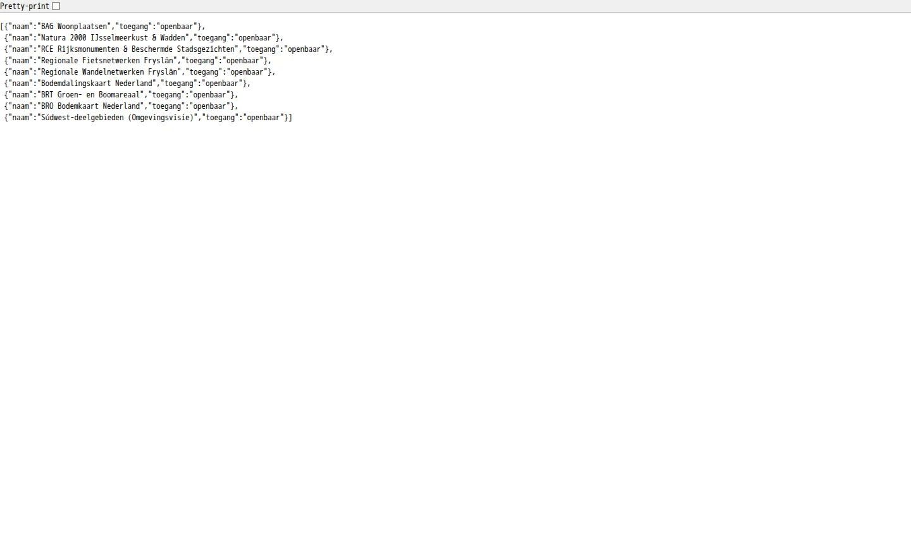
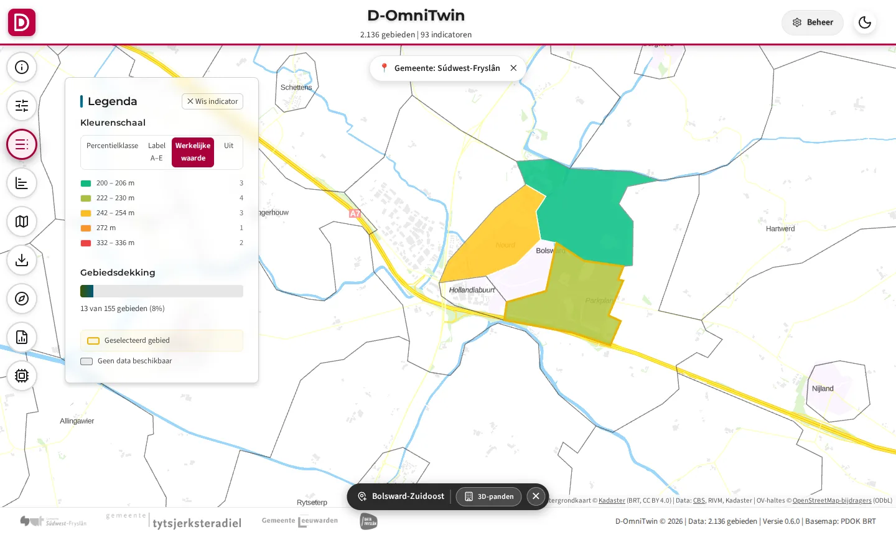
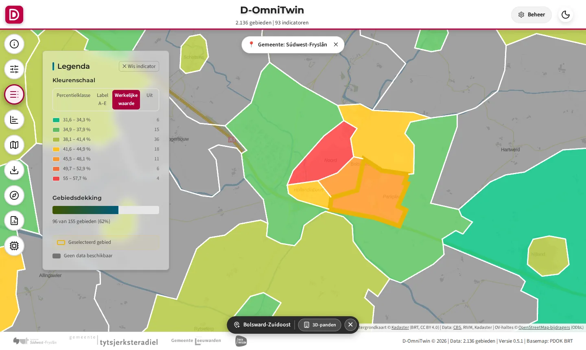
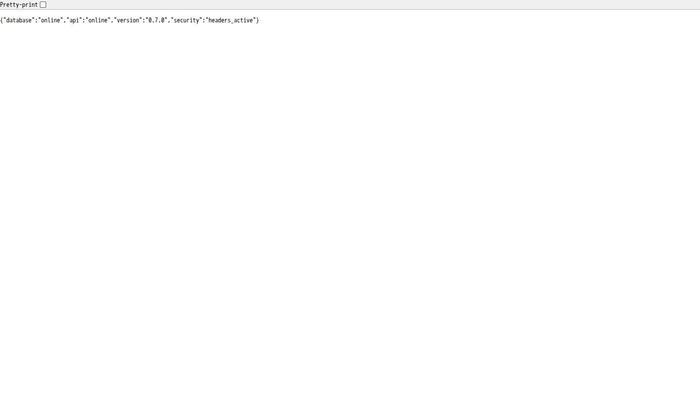

# D-OmniTwin

D-OmniTwin brengt data over de leefomgeving per buurt samen in één beeld: een kaart, het D-Omni Kompas (indicatoren in 12 thema's, vergeleken met een referentiegroep) en rapporten, met een assistent die vragen in gewone taal beantwoordt. Voor gemeenten en partners die werken aan opgaven als energietransitie, klimaatadaptatie, sociale cohesie en brede welvaart. Open source (EUPL 1.2): een open methodiek met referentie-implementatie, geen product of SaaS-dienst.

[](./LICENSE) [](./LICENSE-DOCS)



*Kaart en Kompas voor Workum (use case [Beleidsadviseur](usecases/beleidsadviseur-swf/README.md)).*

De actuele versie staat in [`VERSION`](./VERSION), de wijzigingen in de [CHANGELOG](./CHANGELOG.md). Meer achtergrond, schermen en de opbouw: [D-OmniTwin in het kort](./docs/overzicht.md).

## Snel starten

Vereist: [Docker](https://www.docker.com/) met Docker Compose v2. Met de kant-en-klare images van Docker Hub wordt er niets gebouwd:

```bash
git clone https://github.com/Sudwest-Fryslan/D-OmniTwin.git && cd D-OmniTwin
cp .env.example .env
# Zet in .env:
#   DATABASE_PASSWORD=...   (bijv. openssl rand -hex 24) en bij voorkeur ADMIN_PASSWORD
#   COMPOSE_FILE=docker-compose.yml:docker-compose.images.yml   (Windows: ; in plaats van :)
docker compose pull && docker compose up -d
```

Open **http://localhost** (kaart), **http://localhost/admin/** (beheer, inloggen met `ADMIN_USER` en `ADMIN_PASSWORD`) en **http://localhost/docs** (API). Bij de eerste start laadt de installatie de use cases met open data voor Fryslân.

- **Installatie bij je organisatie** (`.env`, backup, bijwerken, HTTPS, Keycloak): de [installatiegids](./docs/9-beheer/installatie.md). Lees vóór gebruik buiten je eigen netwerk de paragraaf [Beveiliging](./docs/9-beheer/installatie.md#beveiliging).
- **Demo met inloggen** (Keycloak en kant-en-klare accounts): [installatiegids, Demo, test of productie](./docs/9-beheer/installatie.md#26-demo-test-of-productie).
- **Kubernetes:** losse manifests in [`deploy/kubernetes`](./deploy/kubernetes/README.md), uit te rollen met Rancher Fleet of `kubectl apply -k`; een voorbeeld-configrepo staat in [`deploy/voorbeeld-configrepo`](./deploy/voorbeeld-configrepo/README.md).
- **Zelf bouwen of ontwikkelen:** [installatiegids, Ontwikkelmodus](./docs/9-beheer/installatie.md#3-ontwikkelmodus).

## Wat kan het

- **Kaart:** buurten gekleurd op een indicator, met externe kaartlagen en 3D-panden (3DBAG).
- **D-Omni Kompas:** alle indicatoren in thema's, gekleurd met Z-scores ten opzichte van een referentiegroep.
- **Rapporten:** gebiedsdossier, benchmark en deelgebiedsanalyse, met export.
- **D-Omni Assistent:** een chat die kaart en Kompas aanstuurt en datavragen met cijfers uit de database beantwoordt. Het taalmodel draait standaard lokaal; zonder taalmodel werkt de rest gewoon ([AI instellen](./docs/9-beheer/installatie.md#7-llm-optioneel)).
- **Beheeromgeving:** indicatoren, Kompas-indeling, kaartlagen, AI-configuratie, datakwaliteit en logs; inloggen via Keycloak of Entra ID.
- **Data laden:** use cases als installeerbare pakketten en een laad-API voor eigen leveringen ([laad-API](./docs/api/laden/README.md)).
- **Eén instantie per organisatie:** samenwerken door uitwisselen tussen instanties, voorbereid op dataspaces ([mesh van instanties](./docs/2-architectuur/mesh-van-instanties.md)).

## Use cases

Elke use case is een vraag van een gebruiker met de data, de inrichting en het bewijs dat hij werkt (schermen van een verse installatie, gemaakt bij elke release). Overzicht en specificatie: [`usecases/`](./usecases/README.md) en de [Use Case Specificatie](./docs/specificaties/usecase/README.md).

<details>
<summary>Galerij: alle use cases in beeld</summary>

<!-- usecase-galerij:start -->
| | Use case |
|---|---|
| <a href="usecases/ai-compliance/README.md"></a> | **[AI volgens de afspraken: vrijgave, herkenbaar, gelogd en uit te zetten](usecases/ai-compliance/README.md)**<br>Kan ik als functioneel beheerder laten zien dat AI in D-OmniTwin alleen draait na een verklaring, herkenbaar is voor de gebruiker, gelogd wordt zonder gebruikersgegevens en direct uit kan, terwijl de applicatie zonder AI blijft werken? |
| <a href="usecases/beleidsadviseur-swf/README.md"></a> | **[Beleidsadviseur verkent kernen in Súdwest-Fryslân (IJsselmeerkust)](usecases/beleidsadviseur-swf/README.md)**<br>Ik ben beleidsadviseur |
| <a href="usecases/brede-welvaart/README.md"></a> | **[Brede welvaart en functiemenging](usecases/brede-welvaart/README.md)**<br>Hoe staat het met de brede welvaart in Bolsward-Zuidoost vergeleken met de rest van Bolsward? |
| <a href="usecases/cbs-gebiedsindelingen/README.md"></a> | **[CBS-gebiedsindelingen (buurten, wijken, gemeenten) via de laad-API](usecases/cbs-gebiedsindelingen/README.md)**<br>Ik wil de CBS-buurten, -wijken en -gemeenten van Fryslân in D-OmniTwin, met dezelfde codes als het CBS, zodat elke andere use case er waarden aan kan hangen. |
| <a href="usecases/cbs-kerncijfers/README.md"></a> | **[CBS Kerncijfers wijken en buurten via de laad-API](usecases/cbs-kerncijfers/README.md)**<br>Ik wil de CBS Kerncijfers van alle jaargangen sinds 2019 per buurt in D-OmniTwin, als één dataset die elk jaar met één levering wordt bijgewerkt. |
| <a href="usecases/energiearmoede/README.md"></a> | **[Energietransitie en energiearmoede](usecases/energiearmoede/README.md)**<br>Waar in Bolsward is het risico op energiearmoede het grootst? Ik wil weten waar slechte energielabels samengaan met lage inkomens. |
| <a href="usecases/hittestress/README.md"></a> | **[Klimaatadaptatie: hittestress en kwetsbaarheid](usecases/hittestress/README.md)**<br>Ik werk aan hittestress in Bolsward. Welke buurt ligt het verst van een koele plek, en waar wonen relatief de meeste 65-plussers? |
| <a href="usecases/politie-misdrijven/README.md"></a> | **[Politie: geregistreerde misdrijven per buurt via de laad-API](usecases/politie-misdrijven/README.md)**<br>Ik wil het aantal woninginbraken, fietsdiefstallen, diefstallen uit auto's en vernielingen per buurt sinds 2019 in D-OmniTwin. |
| <a href="usecases/rechten-per-laag/README.md"></a> | **[Rechten per laag: interne lagen en indicatoren alleen na inloggen](usecases/rechten-per-laag/README.md)**<br>Ik wil dat een laag of indicator uit een interne bron alleen zichtbaar is voor ingelogde medewerkers (rol lezer of beheerder), ook bij een directe aanroep van de API, en dat open data voor iedereen zichtbaar blijft. |
| <a href="usecases/rivm-gezondheidsmonitor/README.md"></a> | **[RIVM Gezondheidsmonitor per buurt via de laad-API](usecases/rivm-gezondheidsmonitor/README.md)**<br>Ik wil de gezondheidscijfers per buurt (ervaren gezondheid, eenzaamheid, mantelzorg, vrijwilligerswerk, moeite met rondkomen, leefstijl) uit de Gezondheidsmonitor in D-OmniTwin, met de trend sinds 2012. |
| <a href="usecases/sample-bronbibliotheek/README.md"></a> | **[Sample: wat nog niet open is of nog geen adapter heeft (gemarkeerd)](usecases/sample-bronbibliotheek/README.md)**<br>Ik wil de demo's laten werken met de indicatoren waarvoor nog geen open bron met adapter is, zonder dat iemand demodata voor echte cijfers aanziet; met de echte interne bron als die er lokaal is. |
| <a href="usecases/sociale-cohesie/README.md"></a> | **[Zorgzwaarte en sociale cohesie](usecases/sociale-cohesie/README.md)**<br>Ik ben wijkcoördinator in Bolsward-Zuidoost. Hoe staat het met eenzaamheid en vrijwilligerswerk in mijn wijk? |
| <a href="usecases/uitrol-kubernetes/README.md"></a> | **[D-OmniTwin uitrollen op Kubernetes en aantonen dat het werkt](usecases/uitrol-kubernetes/README.md)**<br>Kan ik als platformbeheerder van een organisatie D-OmniTwin met losse, leesbare manifests op ons Kubernetes-cluster uitrollen (bijv. met Rancher Fleet), bijwerken naar een nieuwe versie en aantonen dat de instantie werkt? |
<!-- usecase-galerij:end -->

</details>

## Documentatie

- [docs/INDEX.md](./docs/INDEX.md): overzicht van alle documentatie per domein
- [Installatiegids](./docs/9-beheer/installatie.md) en [beheerhandleiding](./docs/9-beheer/beheerhandleiding.md)
- [D-OmniTwin in het kort](./docs/overzicht.md): functies, schermen en opbouw
- [AGENTS.md](./AGENTS.md): projectfeiten en werkafspraken voor ontwikkelaars
- [CHANGELOG.md](./CHANGELOG.md) en het [releasebeleid](./docs/9-beheer/releasebeleid.md)

## Bijdragen

Werkwijze (issue, branch, pull request, CHANGELOG): [CONTRIBUTING.md](./CONTRIBUTING.md), met de [gedragscode](./CODE_OF_CONDUCT.md). Vragen en ideeën in de [issues](https://github.com/Sudwest-Fryslan/D-OmniTwin/issues). Een kwetsbaarheid gevonden? Meld die privé volgens [SECURITY.md](./SECURITY.md), niet in een openbaar issue.

## Licentie en governance

- **Software:** [European Union Public License 1.2](./LICENSE). De code blijft open; hergebruik, ook in dienstverlening, mag onder dezelfde voorwaarden.
- **Methodiek en documentatie:** [Creative Commons Naamsvermelding 4.0](./LICENSE-DOCS): de methodiek, de Kompas-indeling, de indicatorstructuur en alle documenten in `docs/`.
- **Derden en databronnen:** [NOTICE.md](./NOTICE.md).
- **Governance:** rollen en besluitvorming volgens het OpenWebconcept in [GOVERNANCE.md](./GOVERNANCE.md); onderhoudstermijn in [SUPPORT.md](./SUPPORT.md); metadata in [publiccode.yml](./publiccode.yml).

## Partners

D-OmniTwin is gestart door Gemeente Súdwest-Fryslân en wordt doorontwikkeld met het **Innovatiebudget Digitale Overheid 2026** ([toekenning](https://www.digitaleoverheid.nl/overzicht-van-alle-onderwerpen/innovatie/innovatiebudget/toekenning-innovatiebudget-2026/); september 2026 tot augustus 2027): van referentie-implementatie naar een gevalideerde federatieve voorziening, met pilots bij drie gemeenten.

| Partner | Rol |
|---------|-----|
| Gemeente Súdwest-Fryslân | Initiatiefnemer en inhoudelijk opdrachtgever |
| Gemeente Leeuwarden | Pilotgemeente |
| Gemeente Tytsjerksteradiel | Pilotgemeente |
| Coöperatie DataFryslân | Dataspace-partner (FRLDS) |

Interesse in samenwerking of een pilot? Maak een [issue](https://github.com/Sudwest-Fryslan/D-OmniTwin/issues) of mail naar [geo-groep@sudwestfryslan.nl](mailto:geo-groep@sudwestfryslan.nl). Zie ook [PARTICIPANTS.md](./PARTICIPANTS.md) en het [communicatieplan](./docs/8-communicatie/communicatieplan_subsidie_2026.md).
