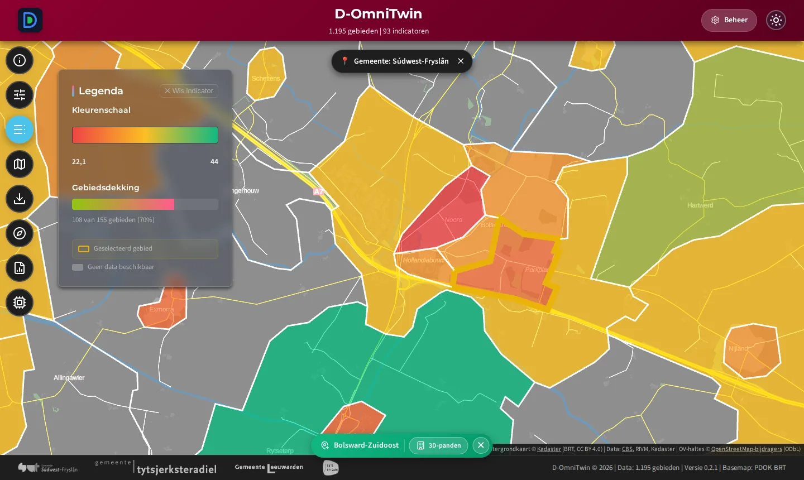
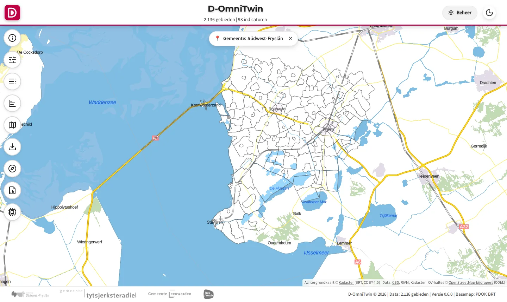
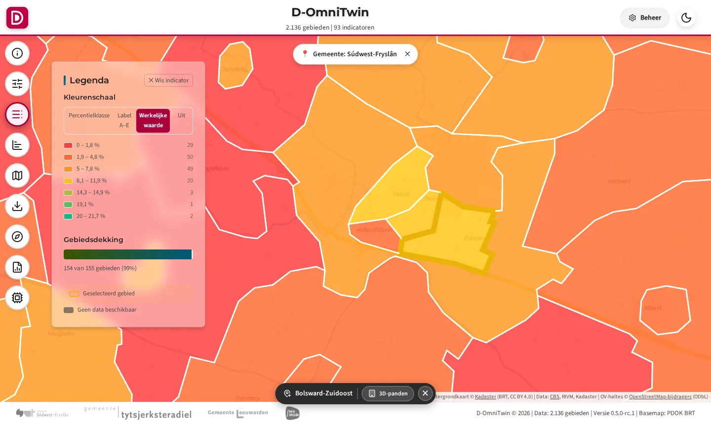
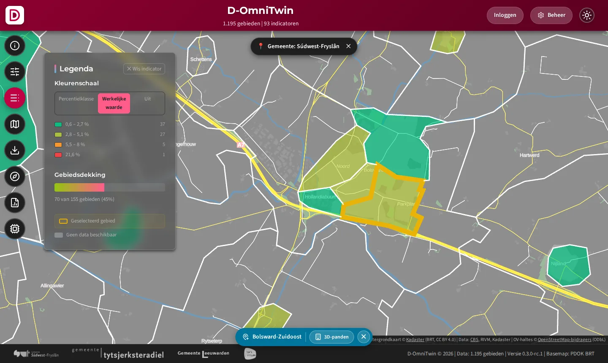
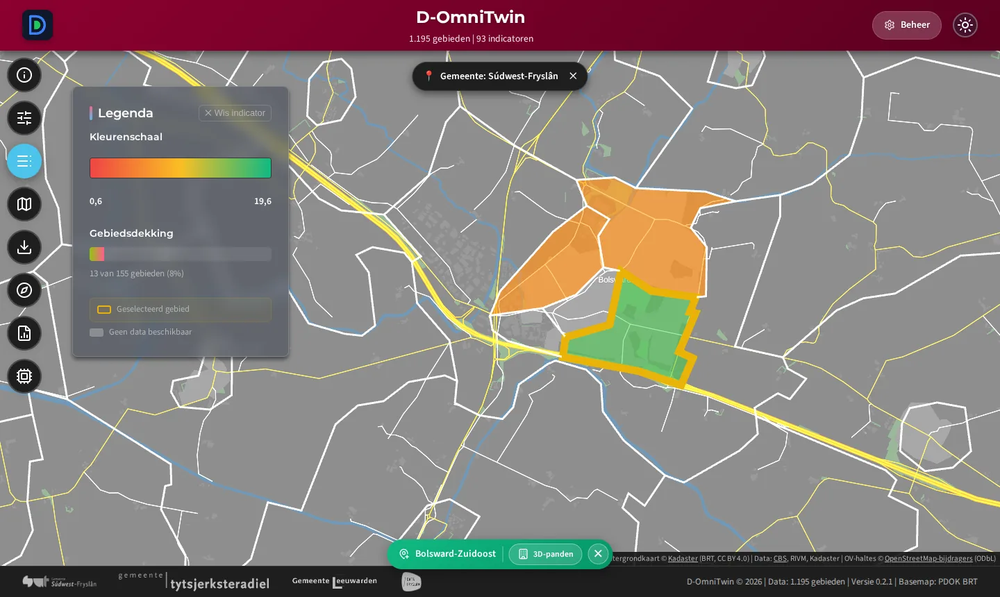
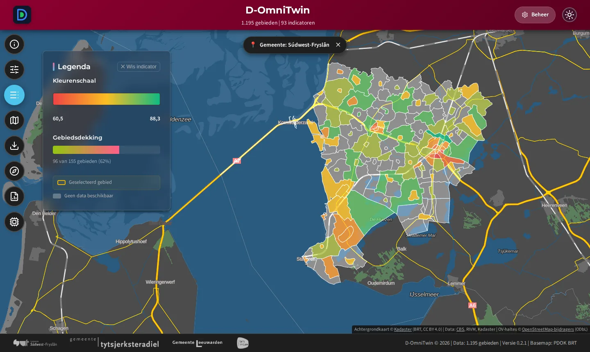

# D-OmniTwin

> Digitale spiegel van de fysieke leefomgeving: indicatoren op buurtniveau op een kaart, in een Kompas en in rapporten. Open source (EUPL 1.2).

**Status:** pre-release, versie 0.2 (het actuele nummer staat in [`VERSION`](./VERSION), de wijzigingen in de [CHANGELOG](./CHANGELOG.md)). Lees vóór gebruik buiten je eigen netwerk de paragraaf [Beveiliging](./docs/9-beheer/installatie.md#beveiliging) van de installatiegids.

[](./LICENSE) [](./LICENSE-DOCS)

---

## Wat is D-OmniTwin?

Gemeenten en provincies werken aan opgaven als energietransitie, klimaatadaptatie, sociale cohesie en brede welvaart. De data daarvoor is er vaak wel, maar verspreid over organisaties en systemen. D-OmniTwin brengt die data per buurt samen in één beeld, voor beleidsmakers, wijkfunctionarissen en inwoners:

- **Kaart** (MapLibre GL, deck.gl, PDOK-achtergrondkaart): buurten gekleurd op een indicator, met externe kaartlagen en 3D-panden (3DBAG).
- **D-Omni Kompas** (D3.js-sunburst): indicatoren in 12 thema's, gekleurd met Z-scores ten opzichte van een referentiegroep.
- **Rapporten:** gebiedsdossier, benchmark en deelgebiedsanalyse, met export.
- **D-Omni Assistent:** een chat die de kaart en het Kompas aanstuurt en datavragen met cijfers uit de database beantwoordt. Het taalmodel draait standaard lokaal (Ollama); zonder taalmodel werkt de rest gewoon.
- **Beheeromgeving** (`/admin`): indicatoren, Kompas-indeling, kaartlagen, prompts, AI-configuratie, datakwaliteit en logs.

D-OmniTwin is bedoeld als **open methodiek met referentie-implementatie**, niet als product of SaaS-dienst. De architectuur is voorbereid op dataspaces (data blijft bij de bron), zoals de Fryslân Data Space (FRLDS).

De repository bevat vijf **use cases** (energiearmoede, hittestress, brede welvaart, sociale cohesie, beleidsadviseur) met data voor 13 buurten in Súdwest-Fryslân, en de CBS-buurten en RIVM-indicatoren voor heel Fryslân. Testbuurt is Bolsward-Zuidoost (BU19000002); een deel van de waarden is demodata.

---

## Snel starten

Vereist: [Docker](https://www.docker.com/) met Docker Compose v2. Ollama is optioneel (alleen voor de AI-chat).

```bash
git clone https://github.com/TLaan/D-OmniTwin.git && cd D-OmniTwin
cp .env.example .env
# Vul in .env DATABASE_PASSWORD in (openssl rand -hex 24) en bij voorkeur ADMIN_PASSWORD
docker compose up -d --build
```

Open daarna **http://localhost**. Alles loopt via Traefik op poort 80.

- Bij de eerste start richt de eenmalige service `db-init` de database in en laadt de use cases uit [`usecases/`](./usecases/README.md) (`LOAD_SAMPLE_DATA=true`, de standaard). Met `false` krijg je het product zonder data.
- **Beheeromgeving:** http://localhost/admin/. Inloggen met `ADMIN_USER` (standaard `admin`) en `ADMIN_PASSWORD`. Laat je `ADMIN_PASSWORD` leeg, dan staat een eenmalig gegenereerd wachtwoord in `docker compose logs db-init`. Met Keycloak aan (`OIDC_ISSUER`) log je in via Keycloak en beheer je gebruikers en rollen daar; zie de [installatiegids](docs/9-beheer/installatie.md#keycloak-optioneel).
- **API-documentatie:** http://localhost/docs.

### Demo proberen (met inloggen)

Wil je zien hoe inloggen werkt, met kant-en-klare accounts? Start een **demo-omgeving** met Keycloak. Alleen op je eigen machine: de wachtwoorden zijn publiek.

```bash
git clone https://github.com/TLaan/D-OmniTwin.git && cd D-OmniTwin
cat > .env <<EOF
DATABASE_PASSWORD=$(openssl rand -hex 24)
COMPOSE_FILE=docker-compose.yml
OMNITWIN_OMGEVING=demo
COMPOSE_PROFILES=keycloak
KEYCLOAK_ADMIN_PASSWORD=$(openssl rand -hex 24)
KEYCLOAK_DB_PASSWORD=$(openssl rand -hex 24)
OIDC_ISSUER=http://localhost/auth/realms/omnitwin
EOF
docker compose up -d --build
```

| Wat | Adres | Hoe |
|-----|-------|-----|
| Kaart (viewer) | http://localhost/ | Open voor iedereen. Rechtsboven *Inloggen* (optioneel). |
| Beheeromgeving | http://localhost/admin/ | Knop **Inloggen met Keycloak**, dan `admin` / `admin`. |
| Gebruikers en rollen | http://localhost/auth/admin/omnitwin/console/ | `admin` / `admin` (ook via het menu rechtsboven in de beheeromgeving). |

Accounts, **alleen bij `OMNITWIN_OMGEVING=demo`**:

| Gebruiker | Wachtwoord | Rollen | Mag |
|-----------|------------|--------|-----|
| `admin` | `admin` | `beheerder`, `gebruikersbeheerder` | beheeromgeving, gebruikers beheren in Keycloak, kaart |
| `gebruiker` | `gebruiker` | `lezer` | kaart (ook als die dichtstaat), geen beheer |

**Kaart dichtzetten** (alleen na inloggen, zoals de huidige SWF-monitor): zet `VIEWER_TOEGANG=inloggen` in `.env` en draai `docker compose up -d`. Dan stuurt http://localhost/ je naar het inlogformulier van Keycloak, en zijn ook de data-API's (`/api/...`, `/api/data`, `/api/geo`) dicht zonder inloggen. Log in als `gebruiker` / `gebruiker` en je ziet de kaart.

In de kaart en de beheeromgeving staat een gele balk *Demo-omgeving — standaardwachtwoorden, niet voor productie*. Zonder `OMNITWIN_OMGEVING` (standaard `productie`) bestaan deze accounts niet, en weigert de installatie een zwak `ADMIN_PASSWORD` zoals `admin`. Meer: [installatiegids, Demo, test of productie](./docs/9-beheer/installatie.md#26-demo-test-of-productie) en [Toegang tot de viewer](./docs/9-beheer/installatie.md#toegang-tot-de-viewer-open-of-dicht).

Voor een installatie bij je organisatie (vereisten, `.env`, backup, bijwerken, HTTPS, beveiliging) volg je de **[installatiegids](./docs/9-beheer/installatie.md)**. Data laden (use cases, laad-API): [installatiegids, Data](./docs/9-beheer/installatie.md#4-data).

---

## Zo ziet het eruit

Schermafbeeldingen van een verse installatie met de use cases, ingezoomd op Bolsward.


*Kaart: buurten gekleurd op een indicator (hier "Afstand tot koele plek"), PDOK-achtergrondkaart.*


*D-Omni Kompas voor Bolsward-Zuidoost: alle indicatoren in thema's, gekleurd ten opzichte van de referentiegroep.*


*D-Omni Assistent: het scenario "Beleidsadviseur" zet kaart en Kompas klaar.*


*Beheerscherm (`/admin`): indicatoren, datakwaliteit, AI-configuratie en rapportage.*

De screenshots maak je opnieuw met [`scripts/docs/maak_screenshots.py`](scripts/docs/maak_screenshots.py).

### Use cases in beeld

Per use case het bewijs dat hij werkt: schermen van een verse installatie met open data, gemaakt door de use-case-uitvoerder bij elke release (`python -m omnitwin.usecases bewijs --alle`, zie de [Use Case Specificatie, Bewijs](docs/specificaties/usecase/README.md#12-bewijs)). Klik op een use case voor alle schermen.

<!-- usecase-galerij:start -->
| | Use case |
|---|---|
| <a href="usecases/beleidsadviseur-swf/README.md"></a> | **[Beleidsadviseur verkent kernen in Súdwest-Fryslân (IJsselmeerkust)](usecases/beleidsadviseur-swf/README.md)**<br>Ik ben beleidsadviseur |
| <a href="usecases/brede-welvaart/README.md"></a> | **[Brede welvaart en functiemenging](usecases/brede-welvaart/README.md)**<br>Hoe staat het met de brede welvaart in Bolsward-Zuidoost vergeleken met de rest van Bolsward? |
| <a href="usecases/cbs-gebiedsindelingen/README.md"></a> | **[CBS-gebiedsindelingen (buurten, wijken, gemeenten) via de laad-API](usecases/cbs-gebiedsindelingen/README.md)**<br>Ik wil de CBS-buurten, -wijken en -gemeenten van Fryslân in D-OmniTwin, met dezelfde codes als het CBS, zodat elke andere use case er waarden aan kan hangen. |
| <a href="usecases/cbs-kerncijfers/README.md"></a> | **[CBS Kerncijfers wijken en buurten via de laad-API](usecases/cbs-kerncijfers/README.md)**<br>Ik wil de CBS Kerncijfers van alle jaargangen sinds 2019 per buurt in D-OmniTwin, als één dataset die elk jaar met één levering wordt bijgewerkt. |
| <a href="usecases/energiearmoede/README.md"></a> | **[Energietransitie en energiearmoede](usecases/energiearmoede/README.md)**<br>Waar in Bolsward is het risico op energiearmoede het grootst? Ik wil weten waar slechte energielabels samengaan met lage inkomens. |
| <a href="usecases/hittestress/README.md"></a> | **[Klimaatadaptatie: hittestress en kwetsbaarheid](usecases/hittestress/README.md)**<br>Ik werk aan hittestress in Bolsward. Welke buurt ligt het verst van een koele plek, en waar wonen relatief de meeste 65-plussers? |
| <a href="usecases/politie-misdrijven/README.md"></a> | **[Politie: geregistreerde misdrijven per buurt via de laad-API](usecases/politie-misdrijven/README.md)**<br>Ik wil het aantal woninginbraken, fietsdiefstallen, diefstallen uit auto's en vernielingen per buurt sinds 2019 in D-OmniTwin. |
| <a href="usecases/rivm-gezondheidsmonitor/README.md"></a> | **[RIVM Gezondheidsmonitor per buurt via de laad-API](usecases/rivm-gezondheidsmonitor/README.md)**<br>Ik wil de gezondheidscijfers per buurt (ervaren gezondheid, eenzaamheid, mantelzorg, vrijwilligerswerk, moeite met rondkomen, leefstijl) uit de Gezondheidsmonitor in D-OmniTwin, met de trend sinds 2012. |
| <a href="usecases/sample-bronbibliotheek/README.md"></a> | **[Sample: wat nog niet open is of nog geen adapter heeft (gemarkeerd)](usecases/sample-bronbibliotheek/README.md)**<br>Ik wil de demo's laten werken met de indicatoren waarvoor nog geen open bron met adapter is, zonder dat iemand demodata voor echte cijfers aanziet; met de echte interne bron als die er lokaal is. |
| <a href="usecases/sociale-cohesie/README.md"></a> | **[Zorgzwaarte en sociale cohesie](usecases/sociale-cohesie/README.md)**<br>Ik ben wijkcoördinator in Bolsward-Zuidoost. Hoe staat het met eenzaamheid en vrijwilligerswerk in mijn wijk? |
<!-- usecase-galerij:end -->

---

## Opbouw

| Onderdeel | Technologie | Via Traefik |
|-----------|-------------|-------------|
| Gateway | Traefik (security-headers op alle routes) | poort 80 op de host |
| Backend | FastAPI, Python-pakket [`src/omnitwin/`](./src/omnitwin/) | `/`, `/api/*`, `/admin/` |
| Data-API | PostgREST, alleen-lezen views in schema `api` | `/api/data` |
| Geo-API | pg_featureserv (OGC API Features) | `/api/geo` |
| Database | PostgreSQL 15 met PostGIS, pgvector en pg_trgm | niet van buiten Docker bereikbaar |
| Frontend | Vanilla JS zonder build-stap (`static/`, `templates/`) | `/` |
| Beheeromgeving | React + TypeScript, gebouwd met Vite naar `static/admin-panel/` | `/admin/` |

```
Browser (kaart, Kompas, chat, beheer)
   │ HTTP, poort 80
   ▼
Traefik ──► /api/data  ► PostgREST       ─┐
        ──► /api/geo   ► pg_featureserv  ─┤
        ──► overig     ► FastAPI-backend ─┤──► PostgreSQL + PostGIS + pgvector
                             │            │
                             └─► taalmodel (Ollama lokaal, optioneel via LiteLLM)
```

Databaseschema, migraties en stuurdata staan in [`db/`](./db/README.md). Technische details: [`AGENTS.md`](./AGENTS.md) en [`docs/2-architectuur/`](./docs/2-architectuur/architecture/ARCHITECTURE_TECHNICAL_OPERATION.md).

---

## AI instellen

De chat en de AI-rapportteksten gebruiken een taalmodel; AI-zoeken gebruikt een meertalig embeddingmodel (`multilingual-e5-small`) dat in de image zit en offline werkt, samen met een synoniemenlijst (`db/stuurdata/synoniemen.json`).

- **Lokaal (standaard):** Ollama op de host, bijvoorbeeld `ollama pull qwen3:30b-instruct` (of kleiner: `qwen3:4b-instruct`). Kies in de beheeromgeving onder **AI Configuratie** de URL `http://host.docker.internal:11434` en het model.
- **OpenAI-compatibel:** in **AI Configuratie** het API-type `OpenAI-compatibel` (vLLM, LM Studio, de `/v1`-API van Ollama of een aanbieder, [ADR 0001](./docs/2-architectuur/adr/0001-llm-koppeling-openai-standaard.md)). Een sleutel zet je als `LLM_API_KEY` in `.env`, nooit in de database.
- **LiteLLM-gateway** (optioneel, `docker compose --profile llm-gateway up -d`): vaste aliassen voor Ollama, Claude, OpenAI en Gemini, wisselen met `scripts/llm/kies_provider.py`.

Met een externe aanbieder verlaten vragen en gebiedsdata de organisatie (AVG, IAMA). Alle stappen: [installatiegids, LLM](./docs/9-beheer/installatie.md#7-llm-optioneel).

---

## Ontwikkelen

- **Met Docker (aanbevolen):** haal in `.env` de regel `COMPOSE_FILE=docker-compose.yml` weg. Dan laadt `docker compose up -d --build` ook `docker-compose.override.yml`: de repository als bind-mount, de database op poort 5433 en het Traefik-dashboard op 8081. Zie [installatiegids, Ontwikkelmodus](./docs/9-beheer/installatie.md#3-ontwikkelmodus).
- **Backend op de host:** Python 3.10 of nieuwer (de image gebruikt 3.11, de CI test 3.11 en 3.12).

  ```bash
  python -m venv .venv && source .venv/bin/activate
  pip install -r requirements.txt
  pip install -e . --no-deps     # pakket omnitwin (src/omnitwin)
  python run_dev.py              # http://localhost:8000, met automatische herstart
  ```

  Gebruik de database uit de ontwikkelmodus (`DATABASE_HOST=localhost`, `DATABASE_PORT=5433` in `.env`).
- **Beheeromgeving:** `cd admin-panel && npm install && npm start` (Vite op poort 3000, `/api` naar poort 8000). `npm run build:static` bouwt naar `static/admin-panel/`; die map gaat mee in de commit.
- **Tests:** `python -m pytest -m unit`. Integratie- en e2e-tests draaien tegen een verse stack, zoals in [`.github/workflows/ci.yml`](./.github/workflows/ci.yml) en [`tests/e2e/README.md`](./tests/e2e/README.md).

Werkwijze (issue, branch, pull request, CHANGELOG): [CONTRIBUTING.md](./CONTRIBUTING.md). Releases: [releasebeleid](./docs/9-beheer/releasebeleid.md).

---

## Samenwerking

D-OmniTwin is gestart door Gemeente Súdwest-Fryslân en wordt doorontwikkeld met het **Innovatiebudget Digitale Overheid 2026** ([toekenning](https://www.digitaleoverheid.nl/overzicht-van-alle-onderwerpen/innovatie/innovatiebudget/toekenning-innovatiebudget-2026/); september 2026 tot augustus 2027): van referentie-implementatie naar een gevalideerde federatieve voorziening, met pilots bij drie gemeenten.

| Partner | Rol |
|---------|-----|
| Gemeente Súdwest-Fryslân | Initiatiefnemer en inhoudelijk opdrachtgever |
| Gemeente Leeuwarden | Pilotgemeente |
| Gemeente Tytsjerksteradiel | Pilotgemeente |
| Coöperatie DataFryslân | Dataspace-partner (FRLDS, iSHARE) |

Interesse in samenwerking of een pilot? Open een [discussie op GitHub](https://github.com/TLaan/D-OmniTwin/discussions) of mail naar [geo-groep@sudwestfryslan.nl](mailto:geo-groep@sudwestfryslan.nl). Zie ook het [communicatieplan](./docs/8-communicatie/communicatieplan_subsidie_2026.md).

Bijdragen: [CONTRIBUTING.md](./CONTRIBUTING.md) en de [gedragscode](./CODE_OF_CONDUCT.md). Een kwetsbaarheid gevonden? Meld die privé volgens [SECURITY.md](./SECURITY.md), niet in een openbaar issue.

---

## Documentatie

| Document | Waarover |
|----------|----------|
| [docs/9-beheer/installatie.md](./docs/9-beheer/installatie.md) | Installatie en beheer (Docker): de installatiegids |
| [docs/9-beheer/beheerhandleiding.md](./docs/9-beheer/beheerhandleiding.md) | Beheer in productie: back-up en herstel, bijwerken, Keycloak, leveringen, incidenten, acceptatie |
| [docs/5-secops/privacy-quickscan.md](./docs/5-secops/privacy-quickscan.md) | Privacy-quickscan: persoonsgegevens, bewaartermijnen, AI |
| [docs/4-ux-design/toegankelijkheid.md](./docs/4-ux-design/toegankelijkheid.md) | Toegankelijkheid: status en conceptverklaring |
| [CHANGELOG.md](./CHANGELOG.md) | Wijzigingen per versie, met migratie-instructies |
| [CONTRIBUTING.md](./CONTRIBUTING.md) | Bijdragen: van issue tot merge |
| [AGENTS.md](./AGENTS.md) | Projectfeiten en werkafspraken voor ontwikkelaars en AI-agents |
| [GOVERNANCE.md](./GOVERNANCE.md) | Rollen en besluitvorming, volgens het OpenWebconcept |
| [SUPPORT.md](./SUPPORT.md) | Onderhoudstermijn en waar je terechtkunt |
| [PARTICIPANTS.md](./PARTICIPANTS.md) | Deelnemende organisaties |
| [SECURITY.md](./SECURITY.md) | Kwetsbaarheden privé melden |
| [CODE_OF_CONDUCT.md](./CODE_OF_CONDUCT.md) | Gedragscode (Contributor Covenant 2.1) |
| [publiccode.yml](./publiccode.yml) | Metadata voor codebase-registers |
| [db/README.md](./db/README.md) | Databaseschema, migraties en stuurdata |
| [usecases/README.md](./usecases/README.md) | De use cases: data, inrichting en teststappen |
| [init_data/README.md](./init_data/README.md) | Brondata (sample en Fryslân) |
| [docs/INDEX.md](./docs/INDEX.md) | Overzicht van de documentatie per domein |
| [docs/archief/](./docs/archief/) | Verouderde documenten (`BUILD.md`, `GETTING_STARTED.md`, `ROADMAP.md`, `TODO.md`, `BUGFIX.md`); taken en bugs staan in de [issues](https://github.com/TLaan/D-OmniTwin/issues) |

---

## Licenties

- **Software:** [European Union Public License 1.2](./LICENSE). De code blijft open; hergebruik, ook in dienstverlening, mag onder dezelfde voorwaarden.
- **Methodiek en documentatie:** [Creative Commons Naamsvermelding 4.0](./LICENSE-DOCS): de D-OmniTwin-methodiek, de Kompas-indeling, de indicatorstructuur en alle documenten in `docs/`.
- **Derden en databronnen:** [NOTICE.md](./NOTICE.md).

*Ontwikkeld door Gemeente Súdwest-Fryslân, met Leeuwarden, Tytsjerksteradiel en DataFryslân.*
