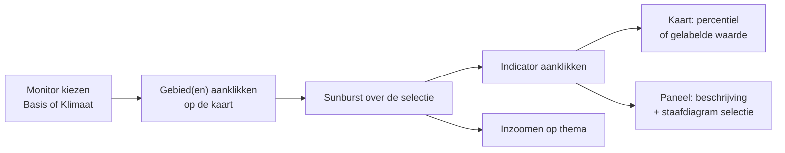
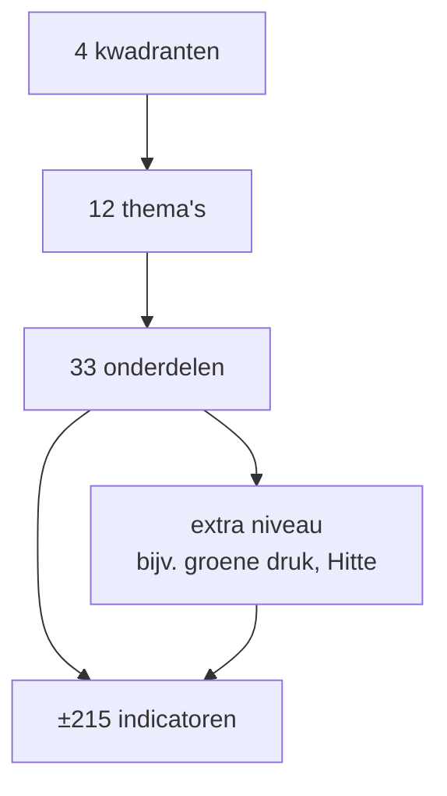

# Functies van de huidige viewer

Stand 02-10-2026. Wat een gebruiker in de huidige gebiedsmonitor kan, vastgesteld door de draaiende viewer door te lopen en aangevuld met de projectdocumentatie. Terug naar [het overzicht](./README.md).

## Overzicht

| Functie | Wat de gebruiker doet | Live gezien |
|---|---|---|
| Monitorkeuze | kiest een monitor in een boom, per gebiedsindeling | ja |
| Kaartselectie | klikt één of meer gebieden aan; tabel met de selectie | ja |
| Sunburst | ziet per selectie 4 kwadranten → 12 thema's → 33 onderdelen → indicatoren, gekleurd | ja |
| Indicator op de kaart | toont één indicator als percentielkaart of met gelabelde waarden | ja |
| Indicatorpaneel | leest de beschrijving en vergelijkt de selectie in een staafdiagram | ja |
| Klimaatmonitor | ziet labels A–E per thema en indicator, op welstandsgebieden × buurt | ja |
| Kaartlagen | zet thematische lagen aan in drie hoofdgroepen | ja |
| Kaartgereedschap | vraagt de monitor op voor de selectie, identify (o.a. BAG-pand), markeringen, tooltip | ja |
| Favorieten | bewaart en verwijdert een selectie | ja |
| Instellingen | bewaart de laatste kaartpositie, per gebruiker | ja |
| Account en rollen | ziet naam en rollen, logt uit; rollen bepalen welke lagen beschikbaar zijn | ja |
| Beheer | configureert monitors en hiërarchie in een aparte beheeromgeving | niet gezien |

## Monitorkeuze

- Een stappenplan "Begin hier": 1. kies een monitor, 2. klik op een gebied in de kaart.
- De monitors staan in een boom, gegroepeerd per gebiedsindeling:
  - **Basis monitor** op CBS-buurten;
  - **Klimaat monitor** op SWF-welstandsgebieden (opgeknipt per CBS-buurt).
- Kiest de gebruiker een monitor, dan laadt de kaart de gebieden van die indeling als vectorlaag.

## Kaartselectie

- Eén of meer gebieden aanklikken (multi-selectie).
- Rechts verschijnt een tabel met de gebieds-id, de code en de naam, met bladeren, verversen en het aantal objecten.
- De selectie is als **favoriet** te bewaren en te verwijderen.
- Een optie "Historische kernen" is in de viewer aanwezig, maar nog niet af.

## Sunburst

- Een zwevend venster dat bij elke selectie ververst. De titel noemt de gekozen gebieden.
- **Opbouw:** 4 kwadranten → 12 thema's → 33 onderdelen → (soms een extra niveau) → ±215 indicatoren. De volledige lijst staat in [indicatoren.md](./indicatoren.md).

- **Kleur:**
  - kwaliteitskwadranten: een divergerende schaal rood → geel → groen op basis van het percentiel;
  - Samenstelling (neutraal, beschrijvend): een blauwe schaal;
  - grijs: geen data voor deze selectie.
- De legenda staat bovenin. Bij een gekozen vak wijst een pijl de waarde aan.
- **Inzoomen** op een thema toont alleen dat thema; de labelwaarde staat tussen haakjes achter de naam. Terug met een pijl omhoog.
- Per knoop kent de viewer: id, naam, type, indicator-UUID, grootte, percentielwaarde en labelwaarde.
- Veel vakken zijn grijs: van de 228 definities hebben er 49 waarden (zie [gegevens.md](./gegevens.md)).

## Indicator op de kaart en indicatorpaneel

Klikt de gebruiker een indicator aan in de sunburst, dan krijgt het vak een omlijning en verschijnen drie knoppen:

| Knop | Kaartweergave |
|---|---|
| **%** | alle gebieden gekleurd naar **percentielindeling** (rood → groen), met het percentiel als label |
| **label** | alle gebieden gekleurd naar **klasse**, met de werkelijke waarde (bijv. meters) als label |
| oog met streep | de indicatorlaag uitzetten |

Onderin staan twee panelen:
- **beschrijving** van de indicator: definitie en bron of norm (bijv. bij afstand tot een koele plek de norm voor de grootte en de afstand);
- **staafdiagram** dat de geselecteerde gebieden vergelijkt.

Gedocumenteerd maar niet (of beperkt) live: een trendlijn per indicator, gemeente- en NL-waarde, eenheid en streefwaarde in het paneel, export, kerncijfers, een themakaart (kaart gekleurd op de themascore) en een kleurenblindvriendelijk palet.

## Klimaatmonitor

- **Gebieden:** welstandsgebieden **opgeknipt per CBS-buurt**. Een gebied heeft een id van de vorm `<volgnummer>-<welstandsgebied>-<buurtcode>`; de kaartselectie toont id, naam en aanduiding.
- **Sunburst:** 3 thema's met samen 10 indicatoren. De kleur hoort bij een **label A–E** per thema en per indicator, niet bij een percentiel.

| Thema | Indicatoren |
|---|---|
| Hemelwateroverlast | waterdiepte op straat, waterdiepte tegen gevel, aandeel water t.o.v. verhard |
| Hittestress | gevoelstemperatuur, afstand tot koele plek, aandeel bladerdek, oppervlak groen per inwoner |
| Droogte | trend GLG naar 2050, GLG kleiweide, GLG veenweide |

UUID's en status: [indicatoren.md](./indicatoren.md#klimaatmonitor). De drempels van de labels zijn niet bekend (zie [methodiek.md](./methodiek.md)).

## Kaartlagen

De lagen volgen de drie vragen van de monitor, aangevuld met de monitorlagen en een ondergrond.

| Groep | Lagen (voorbeelden) | Bron |
|---|---|---|
| Indicatoren | de gekozen indicator en de gebiedsindeling van de monitor | monitorserver |
| **Hoe staat het ervoor?** | de sunburst zelf; de Kompas-lagen per kwadrant (o.a. spoorwegstations en spoorwegen) | monitorserver, GeoServer SWF |
| **Wat speelt er allemaal?** | gemeentelijke projectlocaties (definitief, in planning) uit het beheersysteem openbare ruimte (GeoVisia) | GeoServer SWF |
| **Waar moeten we rekening mee houden?** | ruimtelijke kaders; de klimaatlagen hieronder | GeoServer SWF |
| Klimaatmonitor › Droogte | bodemkaart (klei- en veenweide), GLG, risico paalrot, groen per inwoner | GeoServer SWF |
| Klimaatmonitor › Hittestress | schaduwkaart fiets- en wandelpaden, afstand tot koelte | GeoServer SWF |
| Klimaatmonitor › Hemelwateroverlast | heatmaps wateroverlast op rijbanen en gevellijnen, wateroverlast bebouwd gebied, maaiveldhoogte (AHN4), water tegenover grijs, BGT-waterdeel | GeoServer SWF |
| Overige lagen | gemeentegrens, deelgebieden Omgevingsvisie, dorps- en wijkcoördinatorgebieden, grootgrondbezit SWF | GeoServer SWF |
| Ondergrond | topografie (BRT) of luchtfoto | PDOK |

Samen ±30 thematische lagen. Alleen de leverancier kan nu lagen toevoegen.

## Kaartgereedschap

- De monitor opvragen voor de huidige selectie.
- Kaartinformatie (identify), onder andere van een BAG-pand.
- Gekleurde markeringen (pins).
- Tooltip met de gebiedsnaam en de indicatorwaarde.

## Favorieten, instellingen en rollen

| Functie | Gedrag |
|---|---|
| Favorieten | een selectie van gebieden opslaan, laden en verwijderen; per gebruiker |
| Instellingen | "laatste kaartpositie bewaren en herstellen"; daarnaast onthoudt de viewer zichtbare panelen en de actieve tab. Per gebruiker opgeslagen op de monitorserver |
| Account | naam en rollen uit Keycloak SWF; uitloggen |
| Rollen → laagrechten | een laag die bij de standaardrol "uit" (grijs) staat, is alleen beschikbaar voor ingelogden met de juiste rol. De rollen komen uit Keycloak SWF |

Voor D-OmniTwin: laagrechten horen bij de bron en worden in de API afgedwongen, niet alleen in de viewer (zie [gat-analyse.md](./gat-analyse.md)).

## Beheer

- Een aparte beheeromgeving ("Monitor beheer") voor de monitors, de hiërarchie (kwadrant → thema → onderdeel → indicator) en de classificatie. Niet gezien in de analyse.
- Definities en waarden komen niet via deze beheeromgeving binnen, maar via de push vanuit het DWH (zie [gegevens.md](./gegevens.md#gegevensstroom)).
