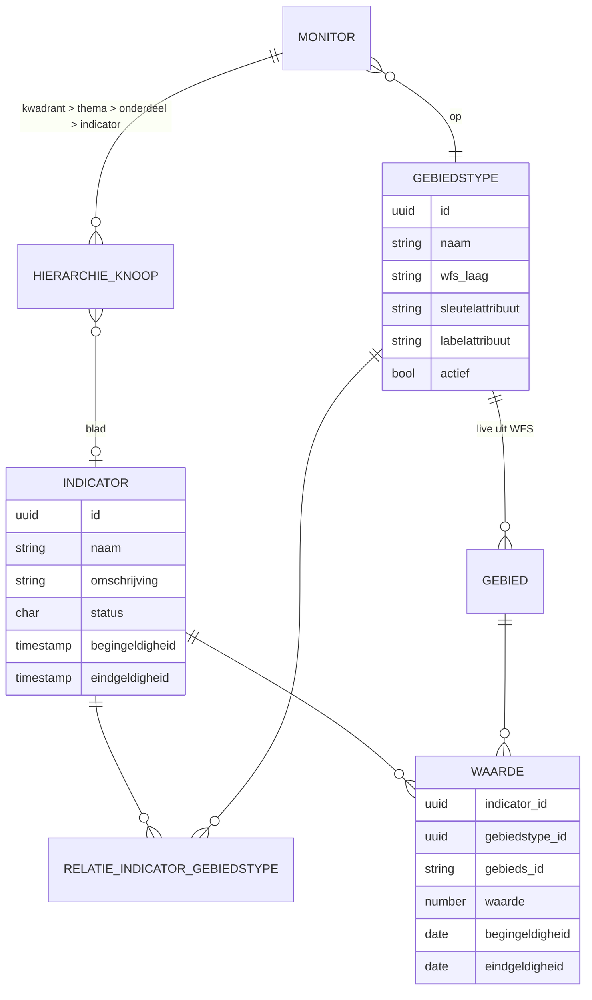
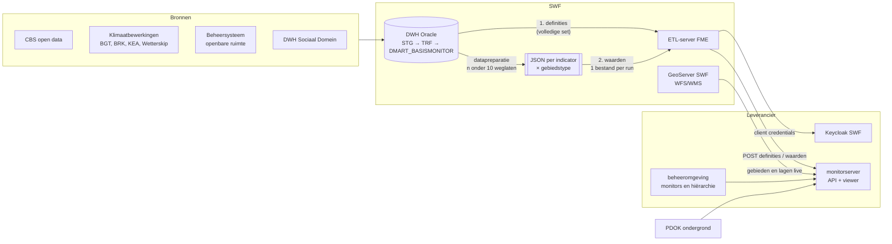

# Gegevens: datamodel, volumes en gegevensstroom

Stand 02-10-2026. Afgeleid uit de push-workspaces, een export van de definities en waarden van de monitor (februari 2026) en de projectdocumentatie. Aantallen, geen meetwaarden. Terug naar [het overzicht](./README.md).

**Kern:**
- De monitor kent **228 indicatordefinities**, **11 gebiedstypes** en **263 relaties** indicator × gebiedstype. **49 indicatoren hebben waarden**: 43.253 waarden op 3 gebiedstypes, jaren 2012–2025.
- De gegevens komen uit het DWH van SWF en gaan in **twee handmatige stappen** naar de monitor: eerst de definities (volledige set), daarna de waarden per indicator × gebiedstype.
- De UUID's van indicatoren en gebiedstypes zijn **dezelfde sleutels** als in D-OmniTwin. De export is dus direct te koppelen.

## Datamodel

| Entiteit | Sleutel | Velden | Aantal (feb. 2026) |
|---|---|---|---|
| Indicator | UUID | naam, omschrijving, status, begin- en eindgeldigheid van de **definitie** | 228: status O 212, A 10, C 5, B 1 |
| Gebiedstype | UUID | naam, WFS-laag, sleutel- en labelattribuut, actief | 11, waarvan 2 actief |
| Gebied | (gebiedstype, gebieds-id) | geometrie en naam komen **live uit de WFS** van GeoServer SWF; de monitor slaat ze niet op | 157 buurten, 273 buurtdelen binnen/buiten de bebouwde kom, 755 welstand × buurt (met waarden) |
| Relatie indicator × gebiedstype | (indicator, gebiedstype) | – | 263 (227 indicatoren; 24 op meer dan één type) |
| Waarde | (indicator, gebiedstype, gebied, jaar) | waarde; begingeldigheid = 1 januari van het jaar; eindgeldigheid leeg | 43.253 (geen dubbelingen op de sleutel) |
| Monitor en hiërarchie | monitor-id | gebiedstype; kwadrant → thema → onderdeel → indicator | 2: Basis (4/12/33/±215), Klimaat (3 thema's, 10 indicatoren) |
| Percentiel en label | berekend door de monitor | percentielwaarde en labelwaarde per knoop | – |
| Favoriet, instelling | gebruiker | selecties, kaartpositie, panelen | – |

**Status:** D-OmniTwin kent C (concept), O (operationeel) en B (beëindigd). De 10 definities met status **A** zijn precies de 10 indicatoren van de Klimaatmonitor; wat A betekent, is een open vraag. Status B is één testdefinitie.

**Twee soorten geldigheid:** de definitie heeft een begin- en eindgeldigheid (SCD in het DWH; 9 definities hebben een einddatum). Een waarde heeft een peildatum (nu altijd 1 januari van het jaar). D-OmniTwin moet die twee uit elkaar houden.

## Gebiedstypes

| Gebiedstype | UUID | Actief | Waarden (feb. 2026) | In D-OmniTwin |
|---|---|---|---|---|
| CBS buurten | `afba67cb-6b38-4723-9c95-102a22d5b38a` | ja | 33.197 | ja, zelfde UUID (CBS Buurten) |
| CBS buurten bebouwde komgrens | `d210c084-506b-48b4-87c9-b7d4bf422553` | nee | 2.370 | UUID bestaat, maar als "Custom Gebied Type": betekenis gelijktrekken |
| CBS wijken | `0fdd1ab2-0963-471d-a47a-d7e080461a30` | nee | – | nee |
| CBS gemeentegrenzen | `1e6b3c18-cec2-42f1-8e71-7a3da8504057` | nee | – | nee (D-OmniTwin heeft een eigen type Gemeente, andere UUID) |
| CBS provinciegrenzen | `e1de90ae-8b31-4dc4-8d3e-132062d4bd12` | nee | – | nee (D-OmniTwin heeft een eigen type Provincie, andere UUID) |
| BAG woonplaats | `c2760b82-13e2-4a12-bd7c-2d6ab1fbdb49` | nee | – | nee |
| ESRI postcode SWF | `e9255451-7476-4413-a712-e920cd2e90a8` | nee | – | nee |
| SWF bebouwde komgrens natuurwet | `92915ac7-fec3-49ac-a0fb-ddb9b8c92317` | nee | – | nee |
| SWF gemeentegrens 1 januari 2018 | `f9e2bd26-6c46-4383-981c-48c97dadc9d6` | nee | – | nee |
| SWF gemeentegrens zonder littens | `82525652-f64d-4db4-9f05-fbf7f6c642c9` | nee | – | nee |
| SWF welstandsgebieden | `29fc9f28-89d9-488b-bf68-2ed176187b21` | ja | 7.686 | ja, zelfde UUID (Welstandsgebieden), zonder geometrie |

- Alleen **CBS buurten** en **SWF welstandsgebieden** hebben een WFS-laag en staan actief. De buurtdelen binnen/buiten de bebouwde kom hebben wel waarden, maar staan inactief en zonder laag.
- **Gebieds-id's per type:**
  - CBS buurten: de CBS-buurtcode (`BU1900xxxx`);
  - buurtdelen bebouwde kom: buurtcode met achtervoegsel voor binnen of buiten de kom (`BU1900xxxx_BBKJ` / `_BBKN`);
  - welstand × buurt: een volgnummer (1–758). Dat is **niet globaal uniek**; in D-OmniTwin is `gebieden.id` dat wel, dus een namespace is nodig.
- **Gebiedsindelingen in de documenten:** het kleinste meetniveau is de CBS-buurt (±152–155 in SWF). De gewenste IGW-hiërarchie is gemeente → IGW-gebied (6 deelgebieden Omgevingsvisie) → wijk → buurt. Andere indelingen: woonplaats, postcode 4/6, 11 clusters, gebiedsteams, woonclusters, coördinatorgebieden. De keuze voor de IGW-indeling ligt nog open.

## Volumes en dekking

| Gebiedstype | Waarden | Indicatoren | Gebieden | Jaren |
|---|---|---|---|---|
| CBS buurten | 33.197 | 48 | 157 | 2012–2025 |
| CBS buurten bebouwde komgrens | 2.370 | 2 | 273 | 2018–2025 |
| SWF welstandsgebieden (× buurt) | 7.686 | 7 | 755 | 2020–2025 |
| **Totaal** | **43.253** | **49** | – | 2012–2025 |

- **Per indicator:** 1–13 jaargangen (mediaan 4), 67–1.117 gebieden, 134–7.508 waarden.
- **Per jaar:** de meeste waarden in 2020 en 2022; 2012–2015 elk ±800–1.150.
- **Omvang:** de definities ±0,1 MB JSON; alle waarden ±7 MB JSON (compact). Bij een volledige vulling (±220 indicatoren) ±200–250 duizend waarden per snapshot.
- **Inhoud van de 49:** vooral CBS (Nabijheid voorzieningen, Gezondheid per wijk en buurt, Kerncijfers wijken en buurten, Misdrijven, Geregistreerde overlast), energielabels en de klimaatindicatoren.
- **Datakwaliteit, relevant voor de validatie bij het laden:**
  - 152 waarden met jaar 0 (één indicator);
  - 2 buurtcodes die niet in de CBS-buurtindeling voorkomen;
  - negatieve waarden alleen bij *Trend GLG naar 2050* (verwacht: een verandering);
  - float-ruis tot 16 decimalen;
  - één dubbele indicatornaam en één testdefinitie in de definities.

Tellingen in de documenten lopen uiteen (211, 215, 217, 221, 228). Het verschil zit in dubbelingen in de inventaris, de klimaatset en concepten. Zie [indicatoren.md](./indicatoren.md).

## Gegevensstroom

| # | Stap | Hoe | Rol | Automatisch |
|---|---|---|---|---|
| 1 | Brondata in het DWH (staging, transformatie) | Pentaho, FME of handmatig | data-engineer DWH | deels |
| 2 | Definities in `DMART_BASISMONITOR`: tabellen `INDICATOREN`, `GEBIEDSTYPEN`, `RELATIE_INDICATOR_GEBIEDSTYPE` | handmatig of SQL; nieuwe indicatoren volgens een vast Excel-patroon (id, naam, status, kwadrant, thema, onderdeel) | data-engineer DWH | nee |
| 3 | **Definities naar de monitor** | één SQL bouwt de volledige set als één JSON-document (drie arrays: indicatoren, gebiedstypen, relaties); FME stuurt dat in één POST | data-engineer DWH | nee |
| 4 | Datapreparatie per indicator | FME/Python maakt per indicator × gebiedstype één JSON-bestand; waarden op minder dan 10 waarnemingen worden weggelaten | data-engineer DWH | nee |
| 5 | **Waarden naar de monitor** | FME leest één bestand en stuurt het als array in één POST; per bestand een aparte run | data-engineer DWH | nee |
| 6 | Monitors, hiërarchie en classificatie | beheeromgeving van de monitor | ontwikkelaar/leverancier, functioneel beheerder SWF | nee |
| 7 | Referentielagen | externe WMS/WFS as-is; eigen vectordata via GeoServer SWF; toevoegen kan alleen de leverancier | ontwikkelaar/leverancier | nee |
| 8 | Controle | scripts lezen alle definities en waarden terug en vergelijken met een voortgangslijst per indicator (stoplichten) | data-engineer DWH | nee |

**Kenmerken van de huidige stroom:**
- **Volgorde:** eerst definities, dan waarden (een waarde verwijst naar een bestaande indicator en gebiedstype). Die volgorde zit niet in een orkestratie; het zijn twee los gestarte workspaces.
- **Handmatig:** er is geen planning. Elke stap wordt met de hand gestart; voor de waarden is dat één run per indicator × gebiedstype (in de export 57 combinaties, gemiddeld ±760 en maximaal ±5.900 waarden per run).
- **Geen retry, geen idempotentiesleutel, geen controle van het antwoord.** Wat er gebeurt als dezelfde levering twee keer komt (upsert, vervangen of dubbel), is onbekend. Een fout breekt de run af; de foutmelding staat alleen in het FME-log.
- **Lezen gaat via dezelfde API:** per resource is er een leesvariant (definities terug, waarden terug) naast de laadvariant. De voortgangsscripts gebruiken die.
- **Frequentie van de bronnen:** meestal jaarlijks (CBS), soms eenmalig (klimaatbewerkingen). De rapportage in de gebiedscyclus is 2× per jaar.

### Payloads

**Definities** (één object, volledige snapshot):

| Array | Velden | Bron in `DMART_BASISMONITOR` |
|---|---|---|
| `indicatoren` | `id` (UUID), `naam`, `omschrijving`, `status`, `begingeldigheid`, `eindgeldigheid` | `INDICATOREN` |
| `gebiedstypen` | `id` (UUID), `naam`, `wfs`, `typenames`, `sleutel`, `label`, `actief` | `GEBIEDSTYPEN` |
| `relaties` | `indicator_id`, `gebiedstype_id` | `RELATIE_INDICATOR_GEBIEDSTYPE` |

**Waarden** (array, één indicator × gebiedstype per verzoek):

| Veld | Type | Opmerking |
|---|---|---|
| `indicator_id` | UUID | moet als definitie bestaan |
| `gebiedstype_id` | UUID | bepaalt welk sleutelattribuut bij `gebieds_id` hoort |
| `gebieds_id` | tekst | buurtcode, buurtcode met kom-achtervoegsel of welstand-volgnummer |
| `waarde` | getal | afgerond op 2 decimalen |
| `begingeldigheid` | `JJJJ-01-01` | peildatum = 1 januari van het jaar; de monitor maakt er een jaar van |
| `eindgeldigheid` | leeg | altijd leeg |

### Wat de push níet levert

| Ontbreekt | Waar het nu vandaan komt | Gevolg voor D-OmniTwin |
|---|---|---|
| Geometrie en naam van gebieden | live uit de WFS van GeoServer SWF, per gebiedstype (laag, sleutel- en labelattribuut) | geometrie laden als eigen profiel *gebiedsindeling* (GeoPackage), niet live koppelen |
| Kompas-hiërarchie (kwadrant → thema → onderdeel) en de twee monitors | beheeromgeving van de monitor | vullen uit de DWH-indicatorenlijst en de voortgangslijst, of uit een database-export van de monitor |
| Eenheid, richting (hoger is beter of slechter), bron, code | niet in de push; deels in de omschrijving | per indicator aanvullen; nodig voor de kleurrichting |
| `n` (aantal waarnemingen) | de ETL laat waarden met n<10 weg | kolom `n` en een drempel bij publicatie; anders de vlag "onderdrukt in de bron" |
| Percentiel en label | de monitor rekent zelf | D-OmniTwin rekent zelf (zie [methodiek.md](./methodiek.md)) |
| Drempels voor de labels A–E | onbekend | navragen |

## Afbeelding op D-OmniTwin

| Monitor | D-OmniTwin (`db/schema/schema_latest.sql`) | Past |
|---|---|---|
| indicator `id`, `naam`, `omschrijving` | `indicatoren.uuid`, `naam`, `omschrijving` | ja; 30 van de 228 UUID's staan al in de repo |
| indicator `status` | `indicatoren.status` (C/O/B) | deels: A komt niet voor |
| indicator `begingeldigheid`/`eindgeldigheid` | idem | ja |
| gebiedstype `id`, `naam` | `gebiedstypes` | ja voor CBS buurten en welstand; WFS-metadata en `actief` ontbreken |
| relatie | `indicator_gebiedstype_relaties` | ja, één-op-één |
| `gebieds_id` | `gebieden.id` (globaal uniek) | welstand-volgnummers krijgen een prefix; buurtdelen bebouwde kom vragen geometrie |
| `waarde`, `begingeldigheid` | `gebied_data.waarde`, `jaar` (of `datum` bij een echte peildatum) | ja; jaar 0 afwijzen |
| hiërarchie en monitors | `kompas_configuraties` → `kompas_titels` → `kompas_themas` → `kompas_onderdelen` → `kompas_indicator_mapping` | ja, structureel |
| labels A–E | `kompas_indicator_scoring_regels` (`threshold_based`, `thresholds`) | ja, structureel; drempels onbekend |
| `n` | – | ontbreekt in beide; voorgesteld in [#205](https://github.com/Sudwest-Fryslan/D-OmniTwin/issues/205) |
