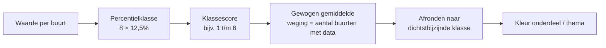

# Methodiek: percentielklassen, labels en kleine aantallen

Stand 02-10-2026. Hoe de huidige monitor waarden vergelijkt en kleurt, en hoe dat zich verhoudt tot de Z-score-methodiek van D-OmniTwin ([#66](https://github.com/TLaan/D-OmniTwin/issues/66), [zscore_methodiek.md](../../3-data-engineering/zscore_methodiek.md)). Bron: de methodiekdocumenten van SWF en de draaiende viewer. Terug naar [het overzicht](./README.md).

**Kern:** SWF koos bewust voor **percentielklassen van 12,5%** in plaats van Z-scores, met een **gewogen klasse-aggregatie** naar thema, en voor indicatoren met een norm voor **labels A–E**. Waarden op minder dan 10 waarnemingen worden **in de ETL weggelaten**. Advies: maak de classificatie per kompasprofiel instelbaar (percentielklasse, Z-score, label), op één referentiefunctie.

**Stand 03-10-2026:** advies 1 (deels: `zscore` en `percentiel_8`, nog geen `label`), 2 (deels: rangorde over de referentiegroep; de klassengrenzen staan nog in code, niet in stuurdata), 3 en 7 zijn ingevoerd in [#255](https://github.com/TLaan/D-OmniTwin/issues/255), met een aanname over de rekenwijze tot [#222](https://github.com/TLaan/D-OmniTwin/issues/222) antwoord geeft. Zie [percentielklasse_methodiek.md](../../3-data-engineering/percentielklasse_methodiek.md).

## De huidige monitor

### Percentielklassen per indicator

- Per indicator en per peildatum worden de buurten van SWF in **8 klassen van 12,5%** verdeeld: de grenzen zijn de percentielen 12,5, 25, …, 87,5 over de buurten met een waarde in dat jaar.
- Klassenamen zijn beschrijvend ("percentiel 0–12,5"), geen letters.
- **Eerst normaliseren** naar een vergelijkbare grootheid: % groen, niet m² groen.
- De viewer toont een percentielwaarde per vak. Of dat de klasse is of een continu percentiel, is niet vastgesteld.
- **Kleur:** rood → geel → groen voor kwaliteitsthema's (richting per indicator: hoger is beter of slechter), blauw voor Samenstelling (neutraal), grijs bij geen data.

**Waarom geen Z-scores (onderbouwing SWF):** bij ±155 buurten, waarvan niet elke indicator voor elke buurt data heeft, en met sterke uitschieters valt met Z-scores bijna alles in −1..1 en ontstaan waarden boven |3|. De schaal wordt scheef. Percentielen geven spreiding. SWF vergeleek op de kaart Z-scores (8 klassen), kwartielen (4), kwartielen met uitschieters (6) en "halverwege"-kwartielen (5) en koos de percentielklassen.

### Aggregatie naar onderdeel en thema

- Elke klasse krijgt een score (bijv. 0–12,5 → 1 … 87,5–100 → 6; middenklassen samengevoegd).
- Het onderdeel of thema is het **gewogen gemiddelde** van de klassescores. De weging is het **aantal buurten met data** per indicator (of een weging van de gebruikersgroep).
- De uitkomst wordt afgerond naar de dichtstbijzijnde klasse. Voorbeeld uit de methodiek: scores 1, 3 en 4 op 88, 100 en 155 buurten geven 2,9.

### Labels A–E

- Indicatoren met een **norm of streefwaarde** krijgen een label in plaats van een rangorde. Dat is de systematiek van de Klimaatmonitor: een label **A–E per indicator en per thema**.
- **De drempels per label zijn niet bekend**: ze staan niet in de documentatie en niet in de push. Ook hoe het themalabel ontstaat (slechtste indicator, gemiddelde) is onbekend.
- De documentatie noemt wel normen en klassen (zie [indicatoren.md](./indicatoren.md#klimaatmonitor)), bijv. een koele plek binnen 300 m en waterdiepte in klassen van 5–10 tot >30 cm.

### Kleine aantallen (n<10)

- Een waarde die op **minder dan 10 waarnemingen** steunt (bijv. huishoudens), wordt niet getoond.
- Dat gebeurt **in de ETL**: het record wordt weggelaten. Het aantal waarnemingen (`n`) gaat niet mee in de push. In de viewer is een onderdrukte waarde niet te onderscheiden van een ontbrekende (beide grijs).
- Bij onttrekking uit het DWH wordt gepseudonimiseerd.

### Referentiegroep en tijd

- Referentiegroep: de buurten van SWF, per peildatum. Geen landelijke referentie; een NL-waarde in het indicatorpaneel is als wens genoemd.
- Een waarde hoort bij een jaar (peildatum 1 januari). De definitie heeft een eigen geldigheid.

### Inconsistenties in de documentatie

- Eén document noemt "donkergroen = beste 20%, rood = slechtste 20%". Dat past niet bij 8 klassen van 12,5%.
- De live legenda suggereert een continu percentiel. Hoe de monitor precies rekent, moet uit de database-export of de leverancier komen.

## Vergelijking met D-OmniTwin

| Aspect | Huidige monitor | D-OmniTwin (#66) |
|---|---|---|
| Maat per indicator | percentielklasse (8 × 12,5%) of label A–E | Z-score (continu), kleur in klassen |
| Gevoeligheid voor uitschieters | laag (rangorde) | hoger (gemiddelde en standaarddeviatie), zeker bij ±150 buurten |
| Interpretatie | "hoort bij de 12,5% laagste buurten van SWF" | "x standaarddeviaties onder het gemiddelde" |
| Afstand tot het gemiddelde zichtbaar | nee | ja |
| Aggregatie naar thema | gewogen gemiddelde van klassescores (weging = aantal buurten met data) | gemiddelde van Z-scores, richting gecorrigeerd |
| Referentiegroep | SWF-buurten per peildatum | gebiedstype + gemeente, zelfde jaar, zonder waterbuurten; minimaal 5 gebieden, anders het recentste jaar |
| Kleine aantallen | waarde niet tonen bij n<10 (in de ETL) | minimaal 5 gebieden in de referentiegroep; geen onderdrukking per waarde |
| Streefwaarden | labels A–E (klimaat) | richting per indicator; `kompas_indicator_scoring_regels` kent `threshold_based`, maar zonder SWF-drempels |

## Advies

1. **Classificatie per kompasprofiel instelbaar:** `percentielklasse` (standaard voor het SWF-profiel), `zscore` en `label`. Gebruik voor alle drie dezelfde referentiefunctie uit #66 (gebiedstype + gemeente, zelfde jaar, zonder waterbuurten). Zo blijft de vergelijking navolgbaar en is er één plek voor de referentiegroep.
2. **Percentielklasse reproduceerbaar berekenen** met een rangfunctie (`percent_rank` of `cume_dist`) over de referentiegroep. Leg de klassengrenzen (12,5%) en de klassescores vast in stuurdata, niet in code.
3. **Klasse-aggregatie** (gewogen met het aantal gebieden met data) als tweede aggregatiemethode naast het Z-gemiddelde. Alleen dan zijn de themakleuren gelijk aan die van de huidige monitor. Leg per profiel vast welke methode geldt.
4. **Z-scores blijven** voor rapporten en de AI-uitleg ("hoeveel wijkt dit af"), maar niet als enige kleurmaat in het SWF-profiel.
5. **Labels A–E** als `threshold_based`-scoringsregel per indicator (klassengrenzen plus labels). Het themalabel volgens de regel die SWF bevestigt.
6. **Onderdrukking per waarde:** kolom `n` bij elke waarde, met een instelbare drempel (SWF: 10). Onderdrukken in de API, niet alleen in de viewer, en zichtbaar maken als "onderdrukt" (anders dan "geen data"). Ontbreekt `n`, dan de vlag "onderdrukt in de bron". Dit hoort bij de governance van de bron ([#182](https://github.com/TLaan/D-OmniTwin/issues/182)) en de laad-API ([#205](https://github.com/TLaan/D-OmniTwin/issues/205)).
7. **Kleurenblindveilig palet** ook voor de percentielkleuring; rood-geel-groen is dat niet.
8. **Valideren:** neem 3 buurten (o.a. Bolsward-Zuidoost, BU19000002) en 10 indicatoren, en vergelijk klasse en kleur in D-OmniTwin met de huidige monitor. Dat is het bewijs voor "gelijkwaardig" (alleen als vergelijkingsresultaat vastleggen, zonder buurtwaarden in de repo).
