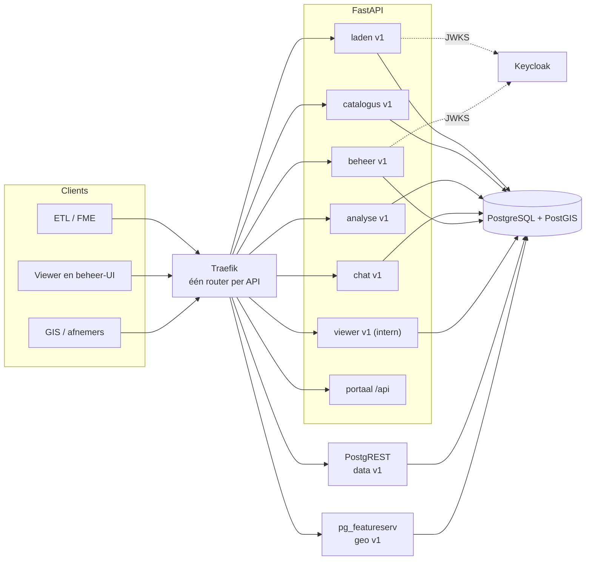

# API-landschap van D-OmniTwin

Welke API's D-OmniTwin aanbiedt, voor wie, volgens welke standaard en met welke autorisatie. Besluit: [ADR 0005](adr/0005-gescheiden-apis-per-doel.md). De eerste API die volgens dit model wordt gebouwd is de [laad-API](../api/laden/README.md) ([ADR 0004](adr/0004-een-ingang-voor-vullen.md)).

Status: voorgesteld, doel voor 0.3.0 en verder. Huidige stand: [§ 6](#6-huidige-stand-021).

## 1. Uitgangspunten

- **Eén API per doel**, niet één API voor alles. Elke API heeft een eigen basispad `/api/<naam>/v1`, een eigen `openapi.json`, eigen autorisatie, een eigen versie en een eigen wijzigingslog.
- **Standaard waar die bestaat:** OGC API Features voor geo, DCAT-AP-NL voor de catalogus, Frictionless en GeoPackage voor leveringen. Voor de rest de **NL GOV REST API Design Rules 2.1** (Logius), inclusief de modules Geospatial en Transport Security, en het **NL GOV OAuth-profiel**.
- **Zo min mogelijk eigen code:** PostgREST en pg_featureserv blijven de lees-API's voor data en geo; FastAPI alleen voor wat zij niet kunnen.
- **Los deploybaar:** elke API heeft een eigen Traefik-router. Een API kan later naar een eigen container zonder dat de URL verandert.
- **Nederlands:** padnamen en velden in het Nederlands, meervoud, kebab-case (ADR `/core/interface-language`, `/core/naming-collections`).

## 2. De API's

| API | Basispad | Doel | Gebruikers | Standaard | Autorisatie (Keycloak) | Nu → doel |
|---|---|---|---|---|---|---|
| **laden** | `/api/laden/v1` | datasets registreren (DCAT) en leveringen laden: waarnemingen, definities, gebiedsindelingen, kaartlagen | ETL's van bronhouders (FME, Python), interne ETL, beheerder | NL GOV ADR 2.1; DCAT-AP-NL 3 / GeoDCAT-AP 3; Frictionless Data Package; GeoPackage 1.4; RFC 9457 | machines: client credentials, client-rol `dataset:{datasetId}:laden` of `datasets:laden`; registreren: realm-rol `beheerder` | ontbreekt (vullen gaat direct in de database) → [ontwerp](../api/laden/openapi.yaml) |
| **catalogus** | `/api/catalogus/v1` | wat is er: datasets, distributies, dataservices (de API's zelf) | afnemers, dataportalen, API-register, dataspace-partners | DCAT-AP-NL 3 (JSON-LD, Turtle); later DSP Catalog Protocol | anoniem voor open datasets; realm-rol `lezer` voor beperkte | ontbreekt → gevuld uit de registraties van de laad-API |
| **data** | `/api/data/v1` | indicatoren, gebieden en waarden lezen (tabellen, filters) | frontend, analisten, andere gemeenten, federatie | NL GOV ADR 2.1 via PostgREST-conventies | anoniem (`web_anon`); later JWT met realm-rol `lezer` en RLS | PostgREST op `/api/data` zonder versie, Swagger 2.0 → `/api/data/v1`, OAS 3.0-spec, `API-Version` |
| **geo** | `/api/geo/v1` | geo-objecten lezen: gebieden, kaartlagen | kaart, GIS-pakketten (QGIS), andere gemeenten | OGC API Features Part 1 (+ Part 2 CRS); ADR-module Geospatial | anoniem voor open collecties; beperkte collecties via forwardAuth (oauth2-proxy) | pg_featureserv op `/api/geo` → `/api/geo/v1` |
| **analyse** | `/api/analyse/v1` | berekeningen: Kompas-scores, Z-scores, kaartklassen, rapporten, benchmark | frontend, rapportgebruikers | NL GOV ADR 2.1 | anoniem met rate-limit; ingelogd voor beperkte indicatoren | `/api/kompas`, `/api/report`, deel van `/api/gebiedsmonitor` |
| **chat** | `/api/chat/v1` | AI: chat, semantisch zoeken, samenvattingen | frontend | NL GOV ADR 2.1; LLM-koppeling volgens ADR 0001 | anoniem met strikte rate-limit (#203), uit te zetten per installatie | `/api/chat`, `/api/ai`, LLM-delen van `/api/report` |
| **beheer** | `/api/beheer/v1` | inrichting: indicatoren, Kompas-indeling, prompts, LLM, kaartlagen, logs, datacontrole | beheer-UI, beheerscripts | NL GOV ADR 2.1 | mensen: code + PKCE via `omnitwin-web`, realm-rol `beheerder`; scripts: machineclient met realm-rol `beheerder` (vervangt `X-Admin-Key`) | `/api/admin/*`, `/api/visualisatie/admin/*` |
| **viewer** (intern) | `/api/viewer/v1` | ondersteuning van de eigen frontend: paletten, externe kaartlagen, 3D BAG-proxy | alleen de eigen frontend | NL GOV ADR 2.1 waar zinvol; geen stabiliteitsbelofte naar derden | anoniem | `/api/visualisatie`, `/api/externe-lagen`, `/api/3dbag` |

Niet als API: de viewer (`/`), de beheer-UI (`/beheer`, nu `/admin`), Keycloak (`/auth`, PR #216), de login-routes van de UI, `/health` en `/.well-known/security.txt`.

## 3. Gemeenschappelijke afspraken

| Afspraak | Invulling | ADR-regel |
|---|---|---|
| Versie | major in het pad (`/v1`); volledige versie (semver) in header `API-Version` op elke response; eigen versie per API, los van de applicatieversie | `/core/uri-version`, `/core/version-header`, `/core/semver` |
| Specificatie | OpenAPI 3.0.3 op `/api/<naam>/v1/openapi.json`, anoniem, `Access-Control-Allow-Origin: *`, met `info.contact` en `securitySchemes`. De bron staat in `docs/api/<naam>/openapi.yaml` (specificatie eerst, code volgt) | `/core/doc-openapi`, `/core/publish-openapi`, `/core/doc-openapi-contact` |
| Wijzigingslog | per API in `docs/api/<naam>/README.md`, sectie Wijzigingen; breuk = nieuwe major | `/core/changelog` |
| Fouten | Problem Details (RFC 9457), `application/problem+json`; geen interne fouttekst, wel een correlatie-id | RFC 9457; Logius-linterregel `use-problem-schema` |
| Naamgeving | Nederlands, meervoud, kebab-case, geen trailing slash; JSON-velden `lowerCamelCase`, datakolommen in leveringen `snake_case` (gelijk aan de database) | `/core/interface-language`, `/core/naming-collections`, `/core/no-trailing-slash` |
| Methoden | alleen standaard HTTP-methoden, met hun betekenis (POST voor zoekvragen alleen als GET niet kan) | `/core/http-methods` |
| Uitfaseren | `Deprecation` (RFC 9745) en `Sunset` (RFC 8594) op oude paden, met `Link` naar de opvolger; minimaal één minor-release overgang | `/core/deprecation-schedule`, `/core/transition-period` |
| Transport | HTTPS buiten de stack (TLS bij Traefik of de proxy van de organisatie), HSTS, security-headers; geen gevoelige gegevens in de URI | `/core/transport/tls`, `/core/transport/security-headers`, `/core/transport/cors`, `/core/transport/no-sensitive-uris` |
| Geo | invoer in RD (EPSG:28992) of WGS84; uitvoer volgens OGC API Features met `crs`/`bbox-crs`; GeoJSON alleen als uitvoer | `/core/geospatial`, module Geospatial |
| Linten | elke `openapi.yaml` 0 errors met de Logius-ruleset (Spectral); zie AGENTS.md | – |

## 4. Autorisatie (Keycloak)

Realm `omnitwin`, achter Traefik op `/auth` (issuer `<basis>/auth/realms/omnitwin`); inrichting in `deploy/keycloak/realm-omnitwin.json` (PR #216). Een organisatie met een eigen IdP (Entra) koppelt dat aan deze realm.

| Client | Soort | Gebruikt door | Rollen |
|---|---|---|---|
| `omnitwin-web` | public, code + PKCE (S256) | viewer en beheer-UI (BFF of PKCE in de browser: nog te kiezen bij de UI-login) | realm-rollen `beheerder` en `lezer` (`lezer` is standaard) |
| `omnitwin-api` | resource (geen login) | doelgroep (`aud`, via audience-mapper) van alle API-tokens; draagt de laadrollen | client-rollen `datasets:laden` (alle datasets) en `dataset:<id>:laden` (één dataset, bijv. `dataset:voorbeeld:laden`) |
| één machineclient per afnemer (voorbeeld `etl-voorbeeld`) | confidential, alleen client credentials, service account, geen refresh-token | ETL van een bronhouder, interne ETL, beheerscripts | zo smal mogelijk: meestal één `dataset:<id>:laden` |

- Machineclients: nu `client_secret_post`/`client_secret_basic` (FME kan niet anders), later `private_key_jwt` als voorkeur (NL GOV OAuth-profiel). Token 5 minuten geldig, secret nooit in de repo of in een workspace-standaardwaarde.
- FastAPI valideert tokens zelf (JWKS van de realm, `iss`, `aud`, `exp`, rol). Realm-rollen staan in `realm_access`, client-rollen van `omnitwin-api` in `resource_access`. PostgREST krijgt dezelfde JWKS voor ingelogd lezen. pg_featureserv kent geen auth: beperkte collecties via Traefik-forwardAuth.
- Traefik routeert en begrenst, maar beslist niet over rechten per dataset.

## 5. Documentatie en routering

**Portaal op `/api`.** Een statische pagina (geserveerd door de backend, lokale Swagger UI-assets) met:
- een tabel van alle API's: doel, basispad, versie, status, link naar de spec;
- één Swagger UI met een keuzelijst van alle specs (`urls`), inclusief de OGC-landingspagina van `geo`;
- voor machines: `/.well-known/api-catalog` (RFC 9727, `application/linkset+json`) met per API `service-desc` (de spec) en `service-doc` (het portaal).

`/docs` en `/openapi.json` in de root verdwijnen: `/docs` geeft één release een `308` naar `/api`. De catalogus-API beschrijft de API's ook als `dcat:DataService`, zodat ze in het API-register van developer.overheid.nl kunnen (#128).

**Traefik.** Eén router per API; de oude paden worden in Traefik herschreven naar de nieuwe, met uitfaseringsheaders. FastAPI kent dan alleen de nieuwe paden.

| Router | Regel | Middleware | Service |
|---|---|---|---|
| `laden` | `PathPrefix(/api/laden/v1)` | `security-headers`, `laden-limieten` (`buffering.maxRequestBodyBytes` 200 MB, `rateLimit` per client) | backend (later eigen container) |
| `catalogus` | `PathPrefix(/api/catalogus/v1)` | `security-headers` | backend |
| `data` | `PathPrefix(/api/data/v1)` | `security-headers`, strip `/api/data/v1`, `api-version-data` (zet `API-Version`) | postgrest |
| `geo` | `PathPrefix(/api/geo/v1)` | `security-headers`, `api-version-geo` | pg_featureserv (basispad `/api/geo/v1`) |
| `analyse`, `beheer`, `viewer` | `PathPrefix(/api/<naam>/v1)` | `security-headers` | backend |
| `chat` | `PathPrefix(/api/chat/v1)` | `security-headers`, `chat-limiet` | backend |
| `portaal` | `Path(/api)` of `Path(/.well-known/api-catalog)` | `security-headers` | backend |
| `alias-<oud>` (één release) | oude prefix, bijv. `PathPrefix(/api/admin)` | `replacePathRegex` naar het nieuwe pad, `uitfasering` (`Deprecation`, `Sunset`, `Link`) | zelfde service |
| `keycloak` (profiel `keycloak`) | `PathPrefix(/auth)` | `keycloak-headers` | keycloak |
| `backend` | `PathPrefix(/)` (laagste prioriteit) | `security-headers` | backend |

Sinds PR #216 hangen de security-headers per router (`security-headers@file`), niet meer op het entrypoint; elke nieuwe API-router moet ze dus zelf noemen (een unittest bewaakt dat).

## 6. Huidige stand (0.2.1)

- Eén FastAPI-spec op `/openapi.json` met Swagger UI op `/docs`, beide in de root; geen `securitySchemes`, ook HTML-routes in de spec; geen versie in het pad of een `API-Version`-header.
- Daarnaast PostgREST (`/api/data`, Swagger 2.0, proxy-URI vast op `localhost`) en pg_featureserv (`/api/geo`, eigen OpenAPI) zonder verwijzing naar elkaar.
- `/api` geeft een welkomst-JSON met 2 van de ±12 routergroepen.
- Beheer-API achter sessie of één gedeelde `X-Admin-Key`; geen machine-identiteit per afnemer.
- Geen schrijf-API voor data: alle vulling gaat als database-eigenaar.

Inventaris met bewijs: [RFC D-OmniTwin vullen, § 2](rfc-vullen-van-d-omnitwin.md#2-huidige-stand).

## 7. Migratie

| Nu | Wordt | Hoe |
|---|---|---|
| `/docs`, `/openapi.json` | portaal `/api`, per API `/api/<naam>/v1/openapi.json` | `/docs` → 308 naar `/api` (één release) |
| `/api` (welkomst-JSON) | portaal; JSON-index via `/.well-known/api-catalog` | – |
| `/api/gebiedsmonitor/*` | lijsten (gebieden, indicatoren) → `data`; `kaart_data` (Z-score, klassen) → `analyse` (`kaart-data`) | alias in Traefik |
| `/api/kompas/*` | `/api/analyse/v1/kompas/*` | alias |
| `/api/report/*` | `/api/analyse/v1/rapporten/*`; samenvattingen met LLM → `chat` | alias |
| `/api/chat`, `/api/ai/*` | `/api/chat/v1/*` | alias |
| `/api/admin/*`, `/api/visualisatie/admin/*`, `/api/admin/externe-lagen/*`, `/api/admin/data-controle/*`, `/api/admin/dashboard/*` | `/api/beheer/v1/*` | alias; admin-panel direct naar het nieuwe pad |
| `/api/admin/auth/*` | inloggen via Keycloak (`omnitwin-web`, code + PKCE); `/auth` is van Keycloak | bij de UI-login (vervolg op PR #216) |
| `POST /api/admin/externe-lagen/upload` | `POST /api/laden/v1/datasets/{id}/leveringen` (profiel `kaartlaag`) | upload blijft één release voor de beheer-UI |
| `/api/visualisatie/*`, `/api/externe-lagen/*`, `/api/3dbag/*` | `/api/viewer/v1/*` | alias |
| `/api/data/*` | `/api/data/v1/*` | alias; `PGRST_SERVER_PROXY_URI` uit de publieke URL |
| `/api/geo/*` | `/api/geo/v1/*` | alias |
| directe database-scripts (`scripts/import_metingen.py`, `laad_usecase.py`) | laad-API (HTTP of dezelfde functie in-process) | #182 fase 4 |

Volgorde: eerst de laad-API (nieuw, geen alias nodig) en het portaal; daarna beheer (met Keycloak); dan data/geo (alleen routering); als laatste analyse/chat/viewer (frontend-paden aanpassen).

## 8. Bekende afwijkingen en open punten

- **FastAPI genereert OpenAPI 3.1**, de Logius-linter eist 3.0.x. Daarom is de spec de bron (`docs/api/<naam>/openapi.yaml`, 3.0.3) en toetst een test of de FastAPI-routes ermee overeenkomen, in plaats van de gegenereerde spec te publiceren.
- **PostgREST** levert alleen een Swagger 2.0-spec. Voor `data` komt een eigen OAS 3.0-spec (gegenereerd uit de views in schema `api`, of met de hand) en zet Traefik de `API-Version`-header.
- **pg_featureserv**: OGC API Features is zelf de standaard; de ADR-linter is daar niet het criterium. Te toetsen: ondersteuning van `crs`/`bbox-crs` (Part 2) en het basispad met versie.
- `viewer` is bewust intern: geen stabiliteitsbelofte, wel dezelfde conventies.
- **`GET /api/organisatie`** (#231): de eigen organisatie van de instantie (naam, gemeentecodes, contact, logo's), publiek en alleen-lezen. Tijdelijk een los pad; gaat op in de catalogus-API als beschrijving van de aanbieder (`dct:publisher`, `dcat:contactPoint`).
