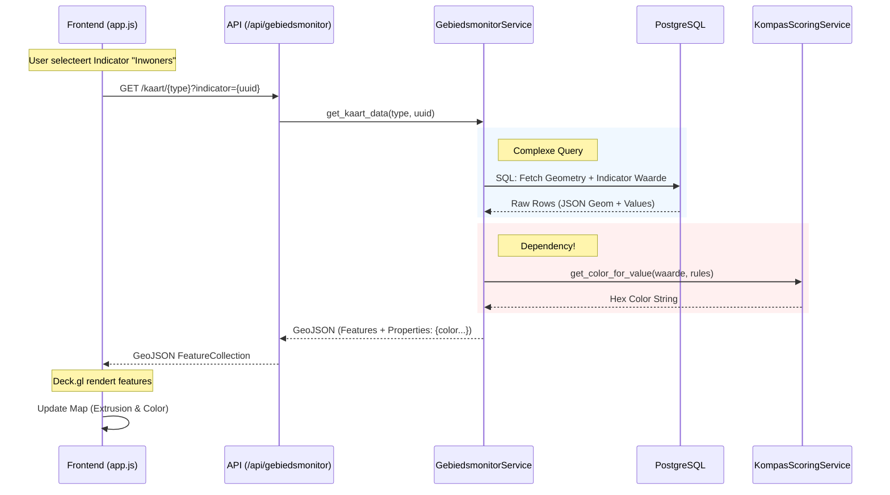
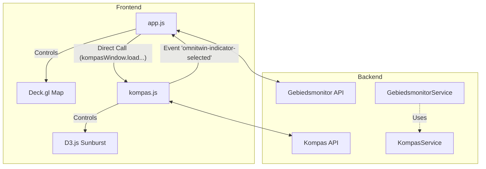
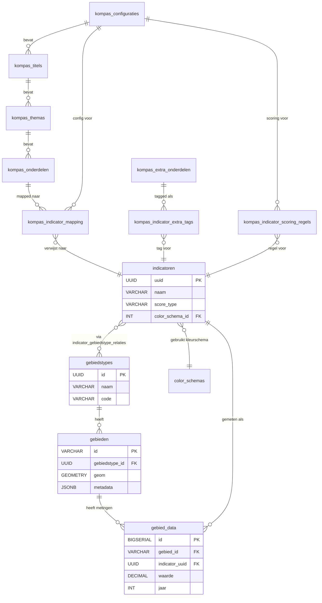

# Architecture & Technical Operation
**D-OmniTwin Project**

Dit document dient als de **fundamentele blauwdruk** (backbone) voor de technische werking van de D-OmniTwin applicatie. Het beschrijft de interactie tussen de frontend (visualisatie), backend (API & logica) en datalaag (opslag & import).

Doel: Inzicht geven in de complexiteit om spaghetti-code te voorkomen en toekomstige uitbreidingen te valideren.

---

## 1. High-Level Overzicht

De applicatie is opgebouwd volgens een **Gelaagde Architectuur (Layered Architecture)** met een scheiding tussen presentatie, logica en data.

| Laag | Technologie | Verantwoordelijkheid |
| :--- | :--- | :--- |
| **Frontend** | Vanilla JS, Deck.gl, D3.js | Interactieve 3D kaart, Sunburst visualisatie, UI State Management. |
| **API Laag** | FastAPI (Python) | Routing, Validatie (Pydantic), HTTP responses. |
| **Service Laag** | Python Classes | Business Logica, Complexe Data Transformaties, Koppeling tussen domeinen. |
| **Data Laag** | PostgreSQL + PostGIS | Opslag van Geometrie, CBS Data, Configuraties. |
| **Ingestion** | Python Scripts | Import van ruwe data (CSV, API) naar Database. |

---

## 2. Interactie Diagrammen (The "Spaghetti" Map)

Deze diagrammen tonen hoe de componenten met elkaar praten.

### A. Core Data Flow: Van Database naar Kaart
Hoe komt een 3D gebouw op het scherm met de juiste kleur?



### B. Component Interaction: Map <-> Kompas
Hoe werken de twee hoofdschermen samen? **Hier ligt een risico op sterke koppeling.**



---

## 3. Technische Diepgang per Laag

### 3.1 Frontend Backbone
De frontend leunt zwaar op globale `state` objecten.
*   **Bestand:** `static/js/app.js`
*   **Structuur:** Een groot `state` object beheert alles (huidig gebied, layers, tokens).
*   **Risico:** Naarmate features groeien, kan dit `state` object onbeheersbaar worden.
*   **Koppeling:** `app.js` weet *te veel* van `kompas.js`. Het roept direct methoden aan (`window.kompasViz.loadGebiedData`). Als we `kompas.js` hernoemen of refactoren, breekt `app.js`.
    *   *Advies:* Gebruik alleen Events (pub/sub) voor communicatie tussen modules.

### 3.2 Backend Services
De backend logica zit in `services/`.
*   **GebiedsmonitorService:**
    *   Verantwoordelijk voor het bouwen van zware GeoJSON objecten.
    *   Bevat **embedded SQL queries**. Dit is krachtig voor performance (PostGIS functies), maar maakt onderhoud lastiger dan een ORM.
    *   **Cruciaal Punt:** Deze service heeft een afhankelijkheid naar `KompasScoringService` voor het bepalen van kleuren. Dit is een *harde koppeling*.

### 3.3 Data Ingestion Backbone
Scripts in `scripts/` zijn de bron van waarheid.
*   `import_cbs_data.py`: Haalt ruwe data.
*   `import_geometrie.py`: Vult de `gebieden` tabel.
*   `import_kompas_hierarchie.py`: Bepaalt de structuur van de Sunburst.
*   **Let op:** De visualisatie (Kompas) hangt direct af van de data die door `import_kompas_hierarchie.py` in de DB is gezet. Als dit script faalt, is het Kompas leeg.

---

## 4. Knelpunten & Risico Analyse (Spaghetti Watch)

Hier projecteren we toekomstige problemen.

### 🔴 Risico 1: SQL in Application Code
In `gebiedsmonitor_service.py` staan SQL queries van 50+ regels hard-coded als strings.
*   **Probleem:** Naarmate we meer filters toevoegen (bijv. "filter op jaar" of "filter op bron"), wordt deze string-manipulatie complex en foutgevoelig.
*   **Oplossing:** Overweeg op termijn een Query Builder of verplaats complexe queries naar Database Views (`CREATE VIEW ...`).

### 🟠 Risico 2: Frontend "God Object"
`app.js` regelt map, UI, theming, routing én communicatie met sub-modules.
*   **Probleem:** "Spaghetti" ontstaat als we hier nog 3 modules (bijv. "Mobility", "Energy") aan toevoegen.
*   **Oplossing:** Modulariseer `app.js`. Maak een `MapController`, `UIController`, en `EventBus` apart.

### 🟡 Risico 3: Data Consistentie (UUIDs)
Het systeem leunt zwaar op UUIDs om data aan gebieden te koppelen.
*   **Probleem:** Als een CBS update gebiedscodes wijzigt (wat jaarlijks gebeurt), breken de relaties.
*   **Oplossing:** De huidige `import_geometrie.py` moet robuust zijn voor updates (upserts) en historie behouden.

---

## 5. Aanbevelingen voor Doorontwikkeling

Wil je flexibel blijven? Houd je aan deze regels:

1.  **Frontend Loosely Coupled:**
    *   Mag: `kompas.js` stuurt een event `Selected`.
    *   Niet Doen: `kompas.js` roept `app.updateMap()` aan.
2.  **Database als API:**
    *   Gebruik Database Views om complexe joins (zoals gebied + data + score) voor te bereiden. Laat Python simpeler queries doen (`SELECT * FROM view_gebied_kaart`).
3.  **Configuratie Gestuurd:**
    *   Ga door met het opslaan van structuur (Thema/Onderdeel) in de database (`kompas_configuraties`). Hard-code geen categorieën in de frontend.

Dit document evolueert mee met de applicatie.

## 6. Versie 1.1 Architecture Update (27-01-2026)

Op 27-01-2026 is de architectuur gemoderniseerd om de in sectie 4 genoemde risico's aan te pakken.

### A. Frontend: Event Bus (Decoupling)
De communicatie tussen modules (`app.js` en `kompas.js`) verloopt nu volledig via een **Event Bus** (`state.eventBus` / `window.EventBus`).
*   **Oud:** `app.js` riep direct `kompasWindow.loadData()` aan.
*   **Nieuw:**
    *   `kompas.js` *publiceert* `INDICATOR_SELECTED` wanneer een gebruiker klikt.
    *   `app.js` *abonneert* op `INDICATOR_SELECTED` en update de kaart.
    *   **Voordeel:** Modules zijn onafhankelijk. Je kunt het Kompas vervangen door een tabel zonder `app.js` aan te passen.

### B. Backend: SQL Views (Simplification)
De "spaghetti SQL strings" in `gebiedsmonitor_service.py` zijn vervangen door Database Views.
*   **Nieuwe Views:** `vw_gebied_kaart_basis`, `vw_gebied_indicator_actueel`, `v_kompas_hierarchie`.
*   **Logica:** De database handelt nu de joins en filtering (bijv. watergebieden) af.
*   **Python:** De Python service voert nu simpele `SELECT * FROM view WHERE ...` queries uit.
*   **Water Filter:** Filtering van watergebieden gebeurt nu centraal in de View definitie (`metadata->>'water'`), waardoor alle endpoints direct profiteren.

---

## 7. Database Schema Overview (Update: 3 februari 2026)

### 7.1 Current Database Statistics

| Metric | Count |
|--------|-------|
| **Core Tables** | 15 |
| **Database Views** | 7 (incl. PostGIS system views) |
| **Spatial Indexes** | 2 (GIST) |
| **Foreign Key Constraints** | 12 |

**Recent Changes (Sprint 5B):**
- ✅ Removed legacy table: `configuratie_instanties`
- ✅ Removed unused views: `v_indicatoren_actueel`, `v_gebieden_met_data`, `v_gebied_data_overzicht`
- ✅ Consolidated schema files → `data/schema_latest.sql`

### 7.2 Entity Relationship Diagram (ERD)



**Diagram Legend:**
- `||--o{` : One-to-Many
- `}o--||` : Many-to-One
- `}o--o{` : Many-to-Many (via junction table)

### 7.3 Core Tables

**Gebiedsmonitor Layer (4 tables):**
- `gebiedstypes` - Gebiedsindelingen (CBS Buurten, Wijken)
- `gebieden` - Gebieden met PostGIS geometrie
- `indicatoren` - KPI metadata (naam, eenheid, score_type)
- `gebied_data` - Feitelijke metingen (~50k+ rows)

**Kompas Hiërarchie Layer (8 tables):**
- `kompas_configuraties` - Master configuraties
- `kompas_titels` - Level 1 hiërarchie
- `kompas_themas` - Level 2 hiërarchie  
- `kompas_onderdelen` - Level 3 hiërarchie
- `kompas_extra_onderdelen` - Level 4 tags
- `kompas_indicator_mapping` - Indicator ↔ Onderdeel
- `kompas_indicator_extra_tags` - Indicator ↔ Tags (M2M)
- `kompas_indicator_scoring_regels` - Scoring logic

**Admin Layer (2 tables):**
- `color_schemas` - Kleurschema's voor visualisatie
- `indicator_gebiedstype_relaties` - Indicator ↔ Gebiedstype (M2M)

**PostGIS System Table:**
- `spatial_ref_sys` - Spatial reference systems

### 7.4 Database Views (Performance Optimalisatie)

| View | Purpose |
|------|---------|
| `vw_gebied_kaart_basis` | GeoJSON basis (excl. water areas) |
| `vw_gebied_indicator_actueel` | Most recent value per indicator |
| `v_kompas_hierarchie` | Complete hierarchy (all configs) |
| `v_kompas_config_stats` | Statistics per configuration |
| `v_admin_indicatoren` | Admin view with all metadata |
| `v_polariteiten` | Codelijst polariteit van indicatoren (hoger/lager is beter, neutraal; #120) |

**System Views (PostGIS):**
- `geography_columns`, `geometry_columns`

---

**Document Updates:**
- **Last Major Revision:** 27 januari 2026 (v1.1 Event Bus + SQL Views)
- **Last Table Inventory Update:** 3 februari 2026 (Sprint 5B Database Cleanup)

---

## 8. Architectuurmodel Samenvatting (Quick Reference)

> **Doelgroep:** Nieuwe ontwikkelaars, data scientists en technisch geïnteresseerde stakeholders.  
> **Doel:** Een beknopt overzicht van het gehanteerde architectuurmodel en de onderliggende patronen.

### 8.1 Gehanteerd Architectuurmodel: Gelaagde Architectuur (Layered Architecture)

D-OmniTwin is gebouwd op een **klassieke Gelaagde Architectuur** met 5 lagen, waarbij elke laag een strikte verantwoordelijkheid heeft en alleen met de aangrenzende laag communiceert:

```
┌─────────────────────────────────────────────────────┐
│  FRONTEND (Presentatielaag)                         │
│  Vanilla JS · Deck.gl (3D Kaart) · D3.js (Kompas)   │
├─────────────────────────────────────────────────────┤
│  API LAAG                                           │
│  FastAPI (Python) · Pydantic Validatie · Routing    │
├─────────────────────────────────────────────────────┤
│  SERVICE LAAG                                       │
│  Python Classes · Business Logica · Transformaties  │
├─────────────────────────────────────────────────────┤
│  DATA LAAG                                          │
│  PostgreSQL + PostGIS · Views · Spatial Index       │
├─────────────────────────────────────────────────────┤
│  INGESTION (ETL)                                    │
│  Python Scripts · CBS · RIVM · BAG · RVO            │
└─────────────────────────────────────────────────────┘
```

### 8.2 Aanvullende Architectuurpatronen

Naast het basis layered model zijn drie aanvullende patronen bewust toegepast (geïmplementeerd in v1.1, januari 2026):

| Patroon | Toepassing in D-OmniTwin | Waarom |
|---------|--------------------------|--------|
| **Event Bus / Pub-Sub** | `app.js` ↔ `kompas.js` communiceren via `window.EventBus` | Losse koppeling — modules zijn vervangbaar zonder andere code te breken |
| **Database-as-API (SQL Views)** | `vw_gebied_kaart_basis`, `v_kompas_hierarchie`, etc. | Complexe joins zitten in de DB; Python queries blijven simpel en onderhoudbaar |
| **Config-Driven UI** | Kompas-structuur (Titels/Thema's/Onderdelen) staat in de database, niet hardcoded in de frontend | De Sunburst visualisatie past zich automatisch aan als de database-configuratie wijzigt |

### 8.3 Toekomstvisie: Federatieve Orkestratielaag (Sprint 17-20)

De lange-termijn richting (vastgelegd in de Aanvraag Innovatiebudget Digitale Overheid 2026) is een evolutie naar een architectuurmodel dichter bij **Service-Oriented Architecture (SOA)**:

- D-OmniTwin wordt de **Interactie- en Servicelaag** bovenop externe Data Spaces (FRLDS / FDS).
- Data blijft bij de bron; D-OmniTwin orchestreert en vertaalt (WFS, OData, SPARQL → Kompas-structuur).
- Het Kompas evolueert van een statische DB-configuratie naar een **dynamische, federatieve interface**.

```
┌──────────────────────┐
│  D-OmniTwin          │  ← Interactielaag (Kompas + Kaart + AI)
│  (Orchestrator)      │
└──────────┬───────────┘
           │ Orkestreert
    ┌──────┴──────┐
    ▼             ▼
[FRLDS]        [FDS]        ← Externe Data Spaces (data blijft bij de bron)
[Gemeente]     [RIVM/CBS]
```

Zie `BRAINDUMP.md` → *"D-OmniTwin als Dataspace Orchestrator"* en `docs/2-architectuur/architecture/frlds_in_dataspace_landschap_herijkt_visiedocument.md` voor de volledige visie.

---

**Sectie toegevoegd:** 2026-04-08 | **Door:** Project-manager skill (Antigravity)
