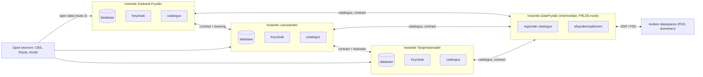
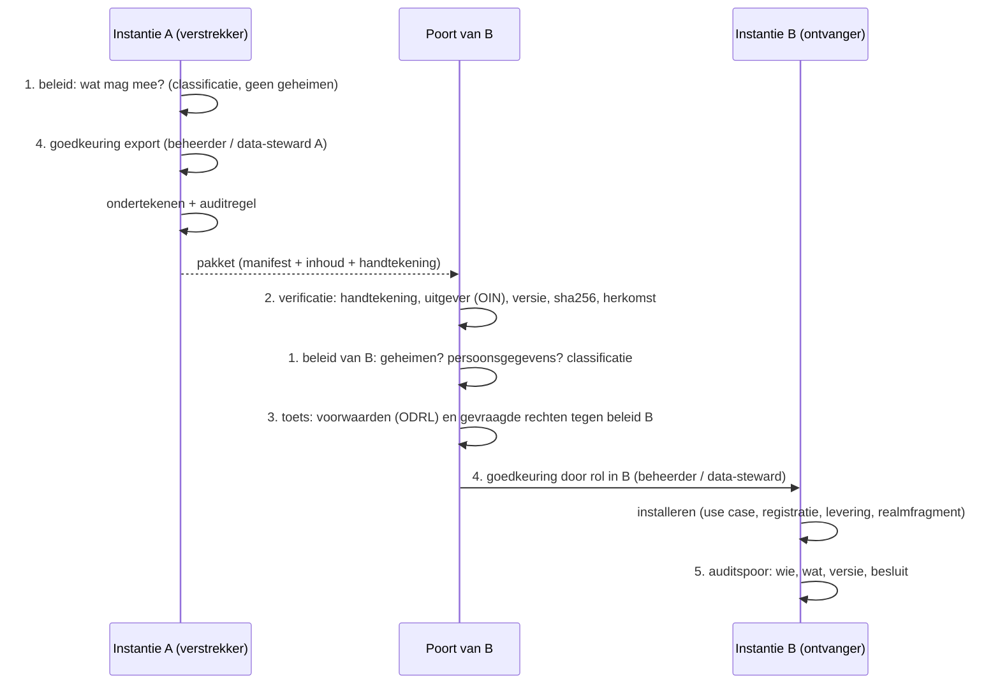

# Architectuur: een mesh van autonome D-OmniTwin-instanties

Besluit: [ADR 0007](adr/0007-geen-multi-tenancy-mesh-van-instanties.md). Status: voorgesteld. Issue: #231.

## 1. In het kort

- **Geen multi-tenancy.** Elke organisatie (gemeente, DataFryslân, een toekomstige deelnemer) heeft een **eigen D-OmniTwin-instantie**: eigen database, eigen Keycloak, eigen beheer, eigen verantwoordelijkheid.
- **Samenwerken is uitwisselen.** Instanties bieden elkaar datasets, diensten en use cases aan, onder een afspraak. Zo ontstaat een **mesh**: geen centrum, wel gedeelde standaarden.
- **Alles is data.** Wat een instantie inricht (use cases, datasets, profielen, rollen, contacten, contracten) is in een open formaat te exporteren en te importeren. Ook contracten en afspraken.
- **Elke uitwisseling gaat door een poort.** Security en governance van de verstrekkende en de ontvangende partij keuren goed: beleid, verificatie, toets, goedkeuring, auditspoor.
- **Nu nog niet verbonden, wel zo opgezet.** In 0.3.0 gelden de ontwerpregels; export/import komt in 0.4.0, verbinden in 0.5.0.

Wat bedoeld wordt, in één zin: *D-OmniTwin is geen platform waar organisaties op draaien, maar software die elke organisatie zelf draait, en die zo gebouwd is dat organisaties elkaar data, inrichting en diensten kunnen aanbieden onder eigen regie.*

## 2. Deelnemers en rollen

| Deelnemer | Rol in de mesh | Eigen instantie | Biedt aan (voorbeelden) | Neemt af (voorbeelden) |
|---|---|---|---|---|
| **Gemeente** (Súdwest-Fryslân, Leeuwarden, Tytsjerksteradiel, …) | data-eigenaar en afnemer | ja | eigen monitordata, gebiedsindelingen, use cases, Kompas-profielen | CBS/PDOK, regionale datasets, use cases van andere gemeenten |
| **DataFryslân** | data-intermediair (DGA), regionale node van FRLDS: catalogus, bemiddeling, afspraken, eigen dataproducten | ja | regionale dataproducten, catalogus van Friese aanbieders, standaardafspraken (sjablonen voor ODRL-policies en contracten) | aanbod van gemeenten voor regionale analyses (onder contract) |
| **Open bronnen** (CBS, PDOK, RIVM, Klimaateffectatlas) | aanbieder van open data, geen deelnemer met een instantie | nee | open datasets en API's | – |
| **Toekomstige deelnemers** (provincie, waterschap, woningcorporatie, GGD, kennisinstelling) | aanbieder en/of afnemer | ja, of een eigen connector | domeindata (zorg, wonen, water) | indicatoren en analyses |
| **Verwerker/leverancier** | beheert een instantie *namens* één organisatie | nee (beheert die van de opdrachtgever) | – | – |

Elke pijl is een afspraak tussen twee autonome partijen, niet een gedeelde database. DataFryslân is een knooppunt dat bemiddelt en een regionale catalogus biedt, geen verplichte tussenstap: twee gemeenten kunnen ook rechtstreeks een afspraak maken.

## 3. Alles is data

Alles wat een instantie inricht, is een bestand of record in een open formaat, met een identificatie (URI), een versie en een uitgever. Daarmee kan het mee naar een andere instantie, mits de [portabiliteitspoort](#4-de-portabiliteitspoort) het goedkeurt.

| Item | Formaat / standaard | Export → import | Versie | Ondertekening | Mag **niet** mee | Stand nu |
|---|---|---|---|---|---|---|
| **Use case** (app) | `usecase.json` + `README.md` + `datasets/*.json` ([usecases/](../../usecases/README.md), ADR 0003) | map of pakket → `python -m omnitwin.usecases installeer` | semver in manifest | pakket (0.4.0) | code, secrets, wachtwoorden (#218), meetwaarden die te downloaden zijn | declaratief, exporteerbaar als map |
| **Datasetregistratie + laadprofiel** | DCAT-AP-NL 3 / GeoDCAT-AP (JSON-LD) + laadprofiel ([laad-API](../api/laden/openapi.yaml), ADR 0004) | `GET /datasets/{id}` → `POST /datasets` | `dct:modified`, versie per publicatie | pakket | credentials naar de bron | ontworpen, in bouw (#205) |
| **Bron (dataproduct)** | `bron.json` (DCAT) + `contract.yaml` (ODCS) + mapping (ADR 0002, PR #184) | map of pakket | semver | pakket | toegangsgegevens, interne paden | voorgesteld |
| **Gegevens (leveringen)** | GeoPackage, Frictionless Data Package, CSV | `…/versies/{versie}/bestand` → `POST …/leveringen` | versie per publicatie, sha256 | sha256 nu; handtekening later | waarden onder de n-drempel; persoonsgegevens zonder grondslag | ontworpen (ADR 0004) |
| **Indicatordefinities en begrippen** | profiel `definities`; SKOS (NL-SBB) voor begrippen | levering profiel `definities` | per levering | pakket | – | ontworpen |
| **Kompas-profiel / inrichting** | JSON (hiërarchie, indicatoren met UUID, richting, gewichten), later SKOS-collecties | export als bestand → import via beheer of use case (`swf-kompasprofiel`) | semver | pakket | seriële database-ID's (zie § 7) | alleen in database; export ontbreekt |
| **Kaartlagen en paletten** | profiel `kaartlaag` (GeoPackage) + stijl (JSON; later OGC SLD/SE of MapLibre-stijl); paletten als JSON | levering of bestand | per levering | pakket | interne service-URL's met credentials | deels in database; export ontbreekt |
| **Rollen en rechten** | Keycloak-realmfragment (rollen, clients zonder secret, groepen) en/of ODRL-policy per dataset | partial export → partial import (Keycloak) | semver van het fragment | pakket | client-secrets, wachtwoorden, gebruikers, sessies, sleutels | realm in `deploy/keycloak/` (PR #216) |
| **Actoren van een use case** | `actoren` in `usecase.json` (soort, rollen) (#225) | met de use case | met de use case | met de use case | wachtwoorden en secrets: altijd lokaal gegenereerd | voorstel |
| **Contacten en organisaties** | DCAT `dcat:contactPoint` als vCard; organisaties als `foaf:Organization` / W3C ORG met OIN als identificatie | met registratie, bron of use case | met het item | met het item | namen en e-mail van personen; alleen functionele contactpunten | `publiccode.yml`, DCAT `dct:publisher` |
| **Contracten en afspraken** | ODRL-policy (aanbod, overeenkomst), later DSP Contract Agreement of FSC-contract; dienstafspraken (beschikbaarheid, ondersteuning) als JSON | als pakket naast het aanbod; bij DSP/FSC via het protocol | per policy, onveranderlijk na ondertekening | verplicht (beide partijen) | – (een contract is per definitie gedeeld) | ontbreekt |
| **API-catalogus** | DCAT `dcat:DataService`, OpenAPI per API, `/.well-known/api-catalog` (RFC 9727) (ADR 0005) | ophalen → opnemen in eigen catalogus | `API-Version` | – (gepubliceerd) | interne API's | ontworpen |
| **Herkomst en bewijs** | PROV-O (via leveringen en `data_lineage`), `bewijs.json` van use cases | met de levering of use case | per levering / release | met het item | logregels met persoonsgegevens | deels |
| **Instellingen van de instantie** | `.env` (`omnitwin.config`) | niet als pakket: per instantie | – | – | alles wat geheim is | per instantie |

Twee grenzen:
- **Geheimen gaan nooit mee.** Wachtwoorden, client-secrets, API-sleutels, privésleutels worden op de ontvangende instantie opnieuw gemaakt.
- **Persoonsgegevens gaan alleen mee met grondslag en contract.** De standaard is: niet. Kleine aantallen worden bij de ingang al onderdrukt (ADR 0004, `minimumN`).

## 4. De portabiliteitspoort

Export en import zijn een besluit van security en governance, niet een kopieeractie. Elke uitwisseling (pakket, levering, contract) loopt door dezelfde vijf stappen. Bij export doorloopt de verstrekkende partij stap 1, 4 en 5; bij import de ontvangende partij alle vijf.

**Minimale metadata van elk portabel pakket** (manifest; een pakket zonder deze velden wordt geweigerd):

| Veld | Inhoud | Standaard |
|---|---|---|
| `uitgever` | organisatie + OIN | `dct:publisher`, W3C ORG |
| `id` | URI, stabiel over instanties | `dct:identifier` |
| `versie` | semver | `owl:versionInfo` / `dcat:version` |
| `ondertekening` | handtekening over manifest en inhoud (sha256 per bestand) | JWS of Sigstore/cosign; later PKIoverheid |
| `licentie` en `voorwaarden` | licentie en ODRL-policy | `dct:license`, `odrl:hasPolicy` |
| `herkomst` | waar het vandaan komt, afgeleid van wat | PROV-O (`prov:wasDerivedFrom`, `prov:wasAttributedTo`) |
| `classificatie` | open, beperkt of intern; bevat wel/geen persoonsgegevens | `dct:accessRights` |
| `contactpunt` | functioneel contactpunt | `dcat:contactPoint` (vCard) |

Uitvoering: de poort is één service in de kern met een **eigen API-ingang** (beheer) en een **auditlog** in de database; goedkeuring met de Keycloak-rol `beheerder` (later een aparte rol `data-steward`). De toets op voorwaarden begint eenvoudig (lijst van toegestane licenties en classificaties) en wordt later een ODRL-evaluatie.

## 5. Diensten en contracten tussen instanties

| Onderdeel | Wat | Standaard | In D-OmniTwin |
|---|---|---|---|
| **Aanbod** | datasets, diensten (API's) en use cases die een instantie anderen aanbiedt | DCAT-AP-NL (`dcat:Dataset`, `dcat:DataService`) | catalogus = JSON-LD-weergave van de registraties (ADR 0004/0005); later ook use cases |
| **Catalogus** | vindbaar maken | DSP Catalog Protocol; FSC Directory; regionale catalogus bij DataFryslân | eigen catalogus per instantie; DataFryslân verzamelt |
| **Afspraak** | wie mag wat, met welk doel, hoe lang | ODRL-policy (aanbod → overeenkomst); FSC-contract (ondertekend door beide peers) | policy per dataset in de registratie; contract als portabel item |
| **Uitwisseling** | transport en onderhandeling | DSP (catalogus, contract, transfer) en/of FSC (Inway/Outway, mTLS, contracten, logging) | #32, #33: DSP voor catalogus/contract, FSC als transport waar nodig |
| **Identiteit organisatie** | wie is de andere partij | OIN, PKIoverheid-certificaat (FSC), iSHARE-certificaat (eORI/OIN) | OIN in de instellingen van de instantie; certificaat per instantie |
| **Identiteit medewerker** | wie werkt er namens de organisatie | eigen IdP (Entra) of eHerkenning; tussen instanties identity brokering in Keycloak of OpenID Federation | gebruiker van B logt in bij A via de Keycloak van B (broker), met de rollen die A toekent |
| **Herkomst** | wat kwam waarvandaan, onder welke afspraak | PROV-O, FSC-transactielog | leveringen en versies (ADR 0004) met verwijzing naar het contract |

**De vulroutes van ADR 0004 tussen instanties:**

| Route | Tussen instanties | Afspraak |
|---|---|---|
| **1 Push** | instantie A levert een afgesproken set aan de laad-API van B, met een machineclient in de Keycloak van B (rol `dataset:<id>:laden`) | contract: welke dataset, hoe vaak, welke voorwaarden; B registreert de dataset met A als `dct:publisher` |
| **2 Interne ETL** | niet tussen instanties | – |
| **3 Virtualisatie** | B bevraagt de `data`/`geo`-API van A en cachet als levering, als de policy dat toestaat | policy staat cache toe, met termijn |
| **4 Federatie** | B stelt een vraag aan A via de connector; het antwoord wordt niet opgeslagen | contract per vraagsoort; geen opslag tenzij toegestaan |

Vergelijken over gemeentegrenzen (Kompas, Z-scores) gaat via route 1 of 3: de referentiegroep moet lokaal staan (RFC vullen, § 7.2).

## 6. Achtergrond: wat de begrippen betekenen

| Begrip | Kern | Wat we ervan overnemen |
|---|---|---|
| **Data mesh** (Dehghani) | vier principes: domeineigenaarschap, data als product, self-serve platform, federatieve computationele governance | elke organisatie is een "domein" met een eigen instantie; bronnen zijn dataproducten (ADR 0002); D-OmniTwin is het self-serve platform dat iedereen zelf draait; governance = gedeelde standaarden en policies, automatisch getoetst (schema's, poort) |
| **Dataspace** (IDSA RAM 4, Gaia-X) | autonome deelnemers met een connector, catalogus, contractonderhandeling en gebruiksbeleid; datasoevereiniteit: de eigenaar bepaalt het gebruik | elke instantie is een deelnemer; catalogus in DCAT, beleid in ODRL |
| **Dataspace Protocol** (Eclipse) | Catalog, Contract Negotiation en Transfer Process over HTTPS; DCAT + ODRL | het protocol tussen instanties (0.5.0, #32) |
| **FSC** (Logius/VNG) | peers met Manager, Directory, Inway, Outway; ondertekende contracten, mTLS met PKIoverheid, transactielog; GDI-standaard sinds december 2024 | transport en contract tussen overheden (#33) |
| **Common Ground, Digikoppeling** | gegevens bij de bron, API's, gescheiden lagen; standaard voor koppelvlakken tussen overheden | bron blijft bron; API's per doel (ADR 0005) |
| **iSHARE** | trust framework: identificatie, authenticatie en autorisatie van organisaties (certificaten, delegatie) | optie voor organisatie-identiteit en delegatie, o.a. bij FRLDS |
| **Federatief Datastelsel (FDS)** | landelijk stelsel om overheidsdata federatief te delen, met afspraken over catalogus, toegang en verantwoording | doel om op aan te sluiten; geen centrale opslag |
| **Data Governance Act** | regels voor data-intermediairs (neutraal, gescheiden van eigen dataproducten, aangemeld) en hergebruik van beschermde overheidsdata | DataFryslân bemiddelt en biedt een catalogus; dat is een andere rol dan een gemeente-instantie hosten |
| **OIN, PKIoverheid, eHerkenning** | identificatie van overheidsorganisaties; certificaten voor machines; inlogmiddel voor medewerkers namens een organisatie | OIN in elk pakket en elke instantie; PKIoverheid voor FSC; eHerkenning of eigen IdP voor medewerkers |
| **Identity brokering / OpenID Federation** | een IdP vertrouwt een andere IdP; in OpenID Federation via ondertekende verklaringen in een hiërarchie | medewerkers van B werken in A zonder account bij A |
| **Configuratie als data** (GitOps, Kubernetes CRD's, Helm, OCI-artefacten) | gewenste toestand declaratief en versiebeheerd; uitbreiden met eigen resourcetypen; pakketten met afhankelijkheden; ondertekende artefacten in een registry | use cases zijn al declaratieve pakketten met versie en afhankelijkheden (#218); het pakketformaat kan een OCI-artefact worden, ondertekend met cosign |

## 7. Wat dit betekent voor wat we nu bouwen (0.3.0)

**Ontwerpregels** (toetsen bij elke PR):

- [ ] Geen `tenant_id`, `organization_id` of RLS per organisatie; geen rollen per gemeente.
- [ ] Geen hardcoded organisatie in code: geen gemeentecode als standaard, geen organisatienaam, logo, kleuren of contact in templates of code. Dat is inrichting (instellingen of database).
- [ ] Geen hardcoded provincie: ook "Fryslân" is inrichting.
- [ ] Identificatie met UUID of URI. Nooit een serieel `id` als externe sleutel in een API, een export of een use case.
- [ ] Elke nieuwe inrichting heeft een export in een open formaat (en een import, uiterlijk in 0.4.0).
- [ ] Contactgegevens als data (`dcat:contactPoint`), functioneel, zonder persoonsnamen.
- [ ] Eén Keycloak per instantie; geen gedeelde realm tussen organisaties.
- [ ] Use cases zonder organisatie-specifieke code; organisatie-specifieke adapters heten naar het formaat, niet naar de organisatie.
- [ ] Geheimen nooit in een exporteerbaar item.

## 8. Toets van de huidige repo

Gezocht in `src/`, `static/js/`, `templates/`, `admin-panel/src/`, `db/`, `deploy/`, `usecases/`, `scripts/` (2 oktober 2026). **Er is geen multi-tenancy in de code**: geen `tenant`, `organisatie_id` of RLS; `gebieden.gemeente_code` is alleen een gebiedskenmerk en filter. De Keycloak-realm heeft platte rollen zonder organisatie-aannames. Wel staat SWF (1900) en Fryslân op veel plekken vast, en zijn een paar seriële ID's extern zichtbaar.

| # | Bevinding | Plaats | Ernst | Voorstel |
|---|---|---|---|---|
| 1 | Multi-tenancy-datamodel gepland: `organizations`, `organization_id`, RLS | #34, `docs/STATE.md`, `docs/8-communicatie/overleg_leidraad_externen_2026-08-24.md`, `docs/3-data-engineering/etl_dataspace_gap_analyse.md` (§ open punten) | hoog | laten vervallen; Keycloak, BFF en PostgREST-beveiliging blijven, per instantie |
| 2 | Gemeentecode `1900` als standaard in API en service | `src/omnitwin/routers/report.py` (`Field('1900')`), `src/omnitwin/services/report_service.py` (4 methodes, plus terugval op `'1900'` als een gebied geen gemeente heeft) | hoog | verplicht maken of afleiden uit de gekozen gebieden; terugval wordt een fout |
| 3 | `'1900'` als terugval in de UI | `static/js/app.js` (rapport), `admin-panel/src/pages/DeelgebiedPage.tsx`, `MultiGebiedPage.tsx`, `ThemaAnalysePage.tsx`; label "⌀ Gemeente SWF" | hoog | standaardgemeente uit de instellingen van de instantie; label uit de gemeentenaam |
| 4 | Gepubliceerde geo-functie werkt alleen voor SWF | `db/schema/07_postgisftw_functions.sql` (`buurten_in_deelgebied`: `gemeente_code = '1900'`) | hoog | gemeente als parameter, of de deelgebieden als gewone gebiedsindeling (profiel `gebiedsindeling`) |
| 5 | SWF-specifieke tabel en stuurdata in het kernschema | `omgevingsvisie_deelgebieden` (`db/schema/schema_latest.sql`), chatscenario "IJsselmeerkust" in `db/stuurdata/` | midden | naar een use case (`swf-gebiedsindelingen`) en een gewone gebiedsindeling |
| 6 | Vaste partnerlogo's in de viewer | `templates/index.html` (footer: SWF, Tytsjerksteradiel, Leeuwarden, DataFryslân) | hoog | logo's en organisatie als inrichting (instellingen of database), zoals het beeldmerk al is |
| 7 | Omgevingsvariabelen met organisatienaam als allowlist | `src/omnitwin/bronadapters/__init__.py` (`TOEGESTANE_MAPPEN`), `usecases/dataset.schema.json` (patroon), `src/omnitwin/usecases.py` | hoog | generieke namen (bijv. `OMNITWIN_BRON_MAP_<NAAM>` of een lijst in de instellingen); `SWF_*` als alias |
| 8 | Adapters en paden met organisatienaam | `swf-dump`, `swf-json`, `swf-monitor-v1`, `/compat/swf-monitor/` | midden | formaat-namen (bijv. `monitor-json-v1`); de compat-paden blijven tijdelijk (ADR 0004) |
| 9 | "Fryslân" als vaste referentie en tekst | `report_service.py` en `zscore_referentie.py` (modus `fryslan`, label "Provincie Fryslân"), `BenchmarkMode` in `admin-panel/src/types/index.ts`, `templates/index.html` ("Selecteer een Friese gemeente"), kaartstart in `static/js/app.js`, `ov_haltes` (CHECK `FR`/`GR`/`DR`) | midden | modus `regio` met naam en gebiedsset uit de inrichting; kaartstart uit de gebieden |
| 10 | Fallbacklijst Friese gemeenten in de frontend, met twee afwijkende codes | `static/js/app.js` (`FRIESE_GEMEENTEN`: De Fryske Marren, Smallingerland) | midden | weghalen; de lijst komt uit de database |
| 11 | Seriële ID's extern | `/api/kompas/1/hierarchie` vast in `static/js/app.js`; `config_id: int = 1` in `admin.py`/`dashboard.py`; `laag_id`, `palette_id`, `profiel_id` in API-paden | hoog (Kompas), midden (rest) | UUID of `code` naast `id`; export en import op UUID; `standaard_config_id` gebruiken |
| 12 | Generieke CBS-use cases met `dct:spatial` van SWF | `usecases/cbs-gebiedsindelingen/datasets/*.json`, `usecases/cbs-kerncijfers/datasets/cbs-kerncijfers.json` | laag | ruimtelijke dekking als parameter of variant van de use case |
| 13 | Demo-use cases alleen op SWF-buurten | `brede-welvaart`, `energiearmoede`, `hittestress`, `sociale-cohesie` | laag | prima als demo; later een variant voor een tweede gemeente als bewijs van uitwisselbaarheid |
| 14 | Kompas-profiel, kaartlagen en paletten zonder export | database (`kompas_configuraties`, `externe_kaartlagen`, `color_schemas`) | midden | export/import in 0.4.0 (§ 3), te beginnen met het Kompas-profiel (#20 vraag 4) |

Geen bevinding: e-mail- of contactgegevens van één organisatie in code, SWF-variabelen in `.env.example` of `docker-compose*.yml`, organisatie-hostnamen. Het `users`-model en `api_keys` hebben geen organisatiekolom.

## 9. Fasering

| Versie | Wat | Concreet |
|---|---|---|
| **0.3.0** | principes en ontwerpregels | ADR 0007; regels in `AGENTS.md`; bij nieuw werk (laad-API, Keycloak, use cases) geen nieuwe organisatie-aannames; use cases en datasetregistraties zijn al exporteerbare bestanden; de hoge bevindingen uit § 8 als eigen issues |
| **0.4.0** | semantiek, catalogus, portabiliteit | catalogus (DCAT-AP-NL) met datasets, API's en use cases; begrippenkader (SKOS); **export/import van inrichting als ondertekend pakket** (Kompas-profiel, kaartlagen, realmfragment, contacten) met de **portabiliteitspoort** (beleid, verificatie, toets, goedkeuring, auditspoor); OIN en contactpunt als instellingen van de instantie |
| **0.5.0** | verbinden | connector: DSP (catalogus, contract) en/of FSC (transport) (#32, #33); **contracten tussen instanties** als ODRL-overeenkomst, ondertekend, portabel; federatieve identiteit (identity brokering tussen Keycloaks, eHerkenning); herkomst met verwijzing naar het contract; route 1 en 4 tussen instanties |
| **1.0** | aantoonbaar een mesh | minstens twee organisaties met een eigen instantie die onder contract data, inrichting en een use case uitwisselen, door de poort, met auditspoor; aangesloten op of aansluitbaar op FRLDS (DataFryslân) en FDS |

## 10. Bronnen

- Data mesh, de vier principes: https://martinfowler.com/articles/data-mesh-principles.html
- IDSA Reference Architecture Model 4: https://docs.internationaldataspaces.org/ids-knowledgebase/ids-ram-4
- Eclipse Dataspace Protocol: https://eclipse-dataspace-protocol-base.github.io/DataspaceProtocol/
- Gaia-X: https://gaia-x.eu/
- FSC Core (Logius): https://gitdocumentatie.logius.nl/publicatie/fsc/core/
- Digikoppeling: https://www.logius.nl/domeinen/gegevensuitwisseling/digikoppeling
- Common Ground: https://commonground.nl/
- iSHARE Trust Framework: https://framework.ishare.eu/
- Federatief Datastelsel: https://federatief.datastelsel.nl/
- Data Governance Act, Verordening (EU) 2022/868: https://eur-lex.europa.eu/eli/reg/2022/868/oj
- DataFryslân: https://www.datafryslan.nl/
- OIN: https://www.logius.nl/domeinen/toegang/organisatie-identificatienummer
- PKIoverheid: https://www.logius.nl/domeinen/toegang/pkioverheid
- eHerkenning: https://www.eherkenning.nl/
- Keycloak identity brokering: https://www.keycloak.org/docs/latest/server_admin/#_identity_broker
- Keycloak import en export van realms: https://www.keycloak.org/server/importExport
- OpenID Federation 1.0: https://openid.net/specs/openid-connect-federation-1_0.html
- OAuth 2.0 Token Exchange (RFC 8693): https://www.rfc-editor.org/rfc/rfc8693
- ODRL Information Model 2.2: https://www.w3.org/TR/odrl-model/
- DCAT 3: https://www.w3.org/TR/vocab-dcat-3/
- DCAT-AP-NL 3.0: https://docs.geostandaarden.nl/dcat/dcat-ap-nl30/
- vCard in RDF: https://www.w3.org/TR/vcard-rdf/
- W3C Organization Ontology: https://www.w3.org/TR/vocab-org/
- PROV-O: https://www.w3.org/TR/prov-o/
- OpenGitOps: https://opengitops.dev/
- Kubernetes custom resources: https://kubernetes.io/docs/concepts/extend-kubernetes/api-extension/custom-resources/
- ORAS (OCI-artefacten): https://oras.land/docs/
- Sigstore cosign, andere artefacten ondertekenen: https://docs.sigstore.dev/cosign/signing/other_types/
