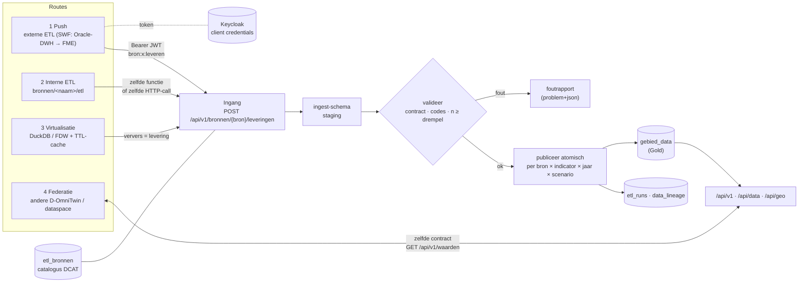

# RFC: D-OmniTwin vullen — één ingang voor push, interne ETL, virtualisatie en federatie

- Status: voorstel (ter bespreking Eduard / Taeke)
- Datum: 2026-10-01
- Versie van de code: 0.2.0 (`origin/main`, 080065f); de draaiende dev-stack is 0.1.0 met dezelfde routes
- Raakt: #195 (0.3.0), #182 fase 4 / ADR 0002 (PR #184), #20, #32, #33, #34, #65, #123, #128, #137, #201, #203
- Uitwerking: ADR 0004 ([`adr/0004-een-ingang-voor-vullen.md`](adr/0004-een-ingang-voor-vullen.md)) en architectuurbeschrijving ([`vullen-van-d-omnitwin.md`](vullen-van-d-omnitwin.md))

---

## 1. Samenvatting en advies

**Advies in één zin:** elke route die data in D-OmniTwin brengt, levert een **levering** aan in **één datacontract** (de *waarneming*: gebied, indicator-UUID, jaar of peildatum, scenario, waarde, n, kwaliteit), via **één ingang** per bron (`POST /api/v1/bronnen/{bron}/leveringen`, OAuth2 client credentials via Keycloak, rol `bron:{bron}:leveren`); de levering landt in een **staging-schema `ingest`**, wordt in de database **gevalideerd** (contract, codes, n-drempel), **atomisch gepubliceerd** per bron × indicator × jaargang × scenario naar `gebied_data`, en vastgelegd in **`etl_runs` / `data_lineage`** en de **catalogus** (`etl_bronnen`, DCAT-AP-NL).



Kernpunten:

1. **Het contract is het product, niet de transportvorm.** Dezelfde waarneming-structuur is uploadformaat (route 1/2), cache-formaat (route 3) en lees-/federatieformaat (route 4). Formaat op de lijn: Frictionless Data Package met CSV (verplicht te ondersteunen) en Parquet (optioneel); bron-contract in ODCS met een Table Schema voor de kolommen.
2. **De logica zit in PostgreSQL** (staging, set-based validatie, publicatie, lineage) als SQL-functies in schema `ingest`. De HTTP-ingang in FastAPI is dun: authenticatie, bestand naar `COPY`, status. Zo kan later ook PostgREST of een interne job dezelfde functies aanroepen, en blijft eigen code klein.
3. **Autorisatie per bron, uit Keycloak.** Machines: client credentials (bij voorkeur `private_key_jwt`), client-rol `bron:{bron}:leveren`. Mensen: authorization code + PKCE via de backend (BFF, HttpOnly-cookie). De gedeelde `X-Admin-Key` is géén ingang voor data.
4. **API-indeling met versie:** `/api/v1/...` (publiek lezen, beheer, bronnen/leveringen), PostgREST onder `/api/data`, OGC API Features onder `/api/geo`; documentatie op één plek (`/api/docs`), OpenAPI op `/api/v1/openapi.json` (NL GOV API Design Rules).
5. **0.3.0 = route 1 minimaal werkend voor de SWF-monitor** (contract, staging, validatie met n-drempel, publicatie, lineage, Keycloak-machine-auth). Virtualisatie en federatie krijgen alleen hun aansluitpunt; geen bouw.

---

## 2. Huidige stand

### 2.1 Inventaris API's en autorisatie

Traefik (`docker-compose.yml:19-39`) luistert op poort 80. Routering op padprefix: `/api/data` → PostgREST, `/api/geo` → pg_featureserv, al het andere (`PathPrefix(/)`) → FastAPI (`docker-compose.yml:84,118,139`).

| API / pad | Component | Doel | L/S | Auth | Gebruiker |
|---|---|---|---|---|---|
| `/`, `/static/*`, `/admin/*` (SPA) | FastAPI | frontend, beheer-UI | L | geen (UI); beheer-API achter sessie | browser |
| `/docs`, `/openapi.json` | FastAPI | Swagger UI + spec van FastAPI | L | anoniem | ontwikkelaar |
| `/api` | FastAPI | "welkom"-JSON, noemt 2 van de ±12 API's | L | anoniem | – |
| `/api/gebiedsmonitor/*` | FastAPI | gebieden, indicatoren, `kaart_data` | L | anoniem | frontend |
| `/api/kompas/*` | FastAPI | Kompas-hiërarchie, scores, benchmark (POST) | L | anoniem | frontend |
| `/api/report/*` | FastAPI | rapporten, ook LLM-narratief (`report.py:99`) | L (POST = query) | anoniem (besluit #65) | frontend, publiek |
| `/api/chat` | FastAPI | chat, roept LLM aan | L (POST) | anoniem, geen rate limit (#203) | frontend |
| `/api/ai/*`, `/api/3dbag/*`, `/api/visualisatie/*`, `/api/externe-lagen/*` | FastAPI | zoeken, 3D, paletten, kaartlagen | L | anoniem | frontend |
| `/api/admin/*`, `/api/visualisatie/admin/*`, `/api/admin/externe-lagen/*`, `/api/admin/data-controle/*` | FastAPI | beheer: indicatoren, prompts, LLM, logs, lagen, dedup | L+S | `vereis_admin`: sessie-cookie **of** gedeelde `X-Admin-Key` (`auth.py:91-121`) | beheer-UI, scripts |
| `/api/admin/auth/*` | FastAPI | login/logout/me | S | wachtwoord (bcrypt) → sessie 12 u | beheer-UI |
| `/api/data/*` | PostgREST v16.4 | views in schema `api` (6 views, 1 functie) | L | anoniem `web_anon`; **geen JWT geconfigureerd** (`docker-compose.yml:111-115`) | frontend, tests |
| `/api/geo/*` | pg_featureserv | OGC API Features Part 1 (2 collecties + `postgisftw`-functie) | L | anoniem `featureserv`; pg_featureserv kent geen auth | frontend (kaart) |
| database (5432/5433) | PostgreSQL | **alle schrijfpaden voor data**: `ETL/`, `scripts/`, `init_data/scripts/` | S | DB-eigenaar (`DATABASE_USER`) | ontwikkelaars, db-init |

### 2.2 Wat er mis of rommelig is

| # | Bevinding | Bewijs |
|---|---|---|
| 1 | **Geen API om data (waarden) te leveren.** Vullen kan alleen direct in de database als eigenaar (upsert met `ON CONFLICT`). Een externe ETL heeft dus het eigenaarswachtwoord nodig. | `scripts/import_metingen.py:47-56`, `init_data/scripts/laad_usecase.py:105-117` |
| 2 | Het enige upload-endpoint is voor **kaartlagen**, niet voor indicatoren: `POST /api/admin/externe-lagen/upload` (GPKG/GeoJSON). Leest het hele bestand in geheugen vóór de 50 MB-check, overschrijft een gelijknamig bestand zonder melding, schrijft in de containermap `data-upload/` (geen volume, #201), geen herkomst. Niet bruikbaar voor een ETL. | `externe_lagen.py:43,624-669` (r. 645-652) |
| 3 | **Eén gedeelde sleutel = volledige beheerder.** `X-Admin-Key` geeft `is_admin` zonder identiteit, scope of rotatie per client; logs zien alleen `API_SCRIPT`. Tabel `api_keys` bestaat maar wordt niet gelezen. | `auth.py:110-114`, `schema_latest.sql:2677-2687` |
| 4 | CORS staat header `X-API-Key` toe, de code leest `X-Admin-Key`. | `main.py:160` vs `auth.py:110` |
| 5 | **Swagger UI in de root (`/docs`) en spec op `/openapi.json`**, buiten `/api`. Drie losse specs zonder portaal: FastAPI (OAS 3), PostgREST (`/api/data/`, Swagger 2.0), pg_featureserv (`/api/geo/api`). | `main.py:269-279`; `curl http://localhost/docs` → 200, `/api/docs` → 404 |
| 6 | **De spec toont geen autorisatie** (`components.securitySchemes` ontbreekt), en HTML-routes (`/`, `/admin/{catchall}`) staan in de spec. | `http://localhost/openapi.json`; `main.py:231,239` |
| 7 | **Geen versie in het pad**, geen `API-Version`-header; `/api` noemt `docs` en `openapi` in de root. | `main.py:281-295`; NL GOV ADR `/core/uri-version`, `/core/version-header` |
| 8 | Padnaamgeving door elkaar: `/api/admin/...` naast `/api/visualisatie/admin/...`; `kaart_data` (underscore), Engels en Nederlands gemengd (`buildings`, `history`, `stats`, `top-buurten`). | `gebiedsmonitor.py:141`, `bag3d.py:430`, `kompas.py:177`, `dashboard.py:22` |
| 9 | PostgREST-proxy-URI vast op `http://localhost/api/data`: verkeerde links in de spec op elke andere host. | `docker-compose.yml:115` |
| 10 | **Datamodel mist velden voor de SWF-push:** geen `n`, geen leverings-/run-verwijzing, `bron` is vrije tekst. | `schema_latest.sql:307-321` |
| 11 | **Tegenstrijdige unieke sleutels**: `unq_gebied_indicator_jaar (gebied_id, indicator_uuid, jaar)` zónder `scenario_id`, naast `unique_measurement_jaar (…, jaar, scenario_id)`. Scenario's voor hetzelfde jaar kunnen daardoor niet naast `current` bestaan. | `schema_latest.sql:1959-2001` |
| 12 | `gebied_data` → `indicatoren` met `ON DELETE CASCADE`: een indicator verwijderen wist zijn data zonder spoor. | `schema_latest.sql:2508` |
| 13 | `etl_bronnen`, `etl_runs`, `data_lineage` bestaan alleen op papier. | `docs/3-data-engineering/etl_dataspace_gap_analyse.md:154-221` |
| 14 | Documentatie loopt achter: STATE.md noemt PostgREST "volledig open" (opgelost in #57) en verwijst naar een niet-bestaande Keycloak-spec; AGENTS.md beschrijft nog API-key-auth voor de beheer-UI (sinds #65 alleen sessie). | `docs/STATE.md:64-66,100`; `AGENTS.md:132` |

**Wat goed is:** PostgREST draait met eigen rollen en alleen schema `api` (`R__api_rollen.sql`); pg_featureserv met een alleen-lezen rol; alle `/api/admin/*` achter één dependency; sessietokens gehasht; Swagger-assets lokaal; security-headers centraal in Traefik. Daar bouwt dit voorstel op voort.

---

## 3. De vier vulroutes in één model

### 3.1 Gemeenschappelijk contract: de waarneming

Eén rij = één waarde van één indicator voor één gebied op één moment in één scenario.

| Veld | Type | Verplicht | Regel |
|---|---|---|---|
| `gebied_code` | tekst | ja | bestaande `gebieden.id` (CBS-code `BU…`/`WK…`/`GM…` of eigen code met prefix, bijv. `SWF-WS-012`) |
| `gebiedstype` | tekst | nee | code uit `gebiedstypes`; controle dat het gebied van dat type is |
| `indicator_uuid` | uuid | ja | bestaat in `indicatoren` **en** staat in het contract van de bron |
| `jaar` | geheel getal | één van beide | peiljaar |
| `peildatum` | datum (ISO 8601) | één van beide | peildatum; SWF-monitor levert dit |
| `scenario` | tekst | nee | standaard `current` |
| `waarde` | decimaal | ja | binnen `min_waarde`/`max_waarde` van de indicator |
| `n` | geheel getal | volgens contract | aantal waarnemingen/respondenten; verplicht als het contract een `minimum_n` heeft |
| `kwaliteit` | code | nee | `definitief`, `voorlopig`, `geschat` |
| `opmerking` | tekst | nee | vrij, max 500 tekens |

`bron` zit niet in de rij: die volgt uit de URL en het token. Sleutel binnen een levering: `gebied_code + indicator_uuid + (jaar|peildatum) + scenario`. Dit is een Frictionless Table Schema (`waarneming.schema.json`), dezelfde vorm als `init_data/sample/datapackage.json` (resource `sample-indicatoren`) al gebruikt.

Het **bron-contract** (ODCS, `bronnen/<naam>/contract.yaml`, ADR 0002) zegt per bron: welke indicatoren, welke gebiedstypen, eenheid, actualiteit, `minimum_n` en onderdrukkingsregel, vervangmodus, en toegang (open/beperkt/intern).

### 3.2 Eén pijplijn

```
levering ─▶ ingest.leveringen + ingest.regels      (staging, COPY)
         ─▶ ingest.valideer(levering)              (set-based SQL)
              • schema/typen          • gebied bestaat (en type klopt)
              • indicator in contract  • dubbele sleutels
              • bereik min/max         • n ≥ minimum_n, anders onderdrukken
         ─▶ ingest.publiceer(levering)             (één transactie)
              • per plak (bron × indicator × jaar|peildatum × scenario):
                oude rijen van déze bron weg, nieuwe erin  (modus 'vervang')
                of upsert                                 (modus 'aanvullen')
              • gebied_data.levering_id gezet
              • etl_runs bijgewerkt, data_lineage per plak
              • stats/Z-score-referentie ververst (bestaande actie herbereken-statistieken)
         ─▶ staging-regels met ruwe n<drempel-waarden verwijderd (dataminimalisatie)
```

Lineage (aanpassing op #20): `data_lineage` per **plak**, niet per rij. `gebied_data` krijgt `levering_id`; daarmee is elke waarde herleidbaar naar levering → run → bron → client (PROV-O: levering = `prov:Entity`, run = `prov:Activity`, client/ETL = `prov:Agent`). Een tabel met één lineage-rij per waarde verdubbelt `gebied_data` en breekt bij vervangen.

### 3.3 Per route

| Route | Wie start | Ingang | Validatie/publicatie | Lineage-agent | Catalogus |
|---|---|---|---|---|---|
| **1 Push** | externe ETL (FME, Python, Airflow bij de bronhouder) | HTTP `POST /api/v1/bronnen/{bron}/leveringen` | `ingest.*` | Keycloak-client (`azp`) | bron staat in `etl_bronnen`, contract vooraf |
| **2 Interne ETL** | job in D-OmniTwin (`bronnen/<naam>/etl`, cron/db-init/container) | in-process `omnitwin.ingest.lever()` (dezelfde functie als de router) of als eigen container via HTTP met eigen client | `ingest.*` | service-account `d-omnitwin-etl` | idem |
| **3 Virtualisatie** | verversing bij TTL-verloop of op verzoek | de "ETL" is een query (DuckDB/FDW); resultaat = levering | `ingest.*`; TTL in `etl_bronnen` | `virtualisatie:<bron>` | bron met `ontsluiting.vorm = virtueel` |
| **4 Federatie** | gebruiker vraagt gebied/indicator die elders woont | geen opslag; `GET /api/v1/waarden` bij de andere installatie, zelfde contract terug | contract-validatie op het antwoord; niet publiceren in `gebied_data` (of alleen als cache als de policy dat toestaat) | remote installatie | bron met `ontsluiting.vorm = extern`, DCAT/DSP-catalogus |

---

## 4. Route 1 in detail

### 4.1 Ontwerp van de ingang

Hulpbron: **leveringen** onder een **bron** (Nederlands, meervoud, kebab-case; NL GOV ADR `/core/naming-collections`, `/core/interface-language`).

| Methode en pad | Doel | Rol |
|---|---|---|
| `GET /api/v1/bronnen` | catalogus (JSON; JSON-LD/DCAT-AP-NL met `Accept: application/ld+json`) | anoniem voor open bronnen |
| `GET /api/v1/bronnen/{bron}` | metadata + ontsluitingsblok | idem |
| `GET /api/v1/bronnen/{bron}/contract` | ODCS-contract + Table Schema | `bron:{bron}:leveren` of open |
| `POST /api/v1/bronnen/{bron}/leveringen` | nieuwe levering | `bron:{bron}:leveren` |
| `GET /api/v1/bronnen/{bron}/leveringen` | lijst (filter `status`, `sinds`) | `bron:{bron}:leveren` of beheerder |
| `GET /api/v1/bronnen/{bron}/leveringen/{id}` | status, aantallen, links | idem |
| `GET /api/v1/bronnen/{bron}/leveringen/{id}/fouten` | foutrapport per regel (JSON of CSV) | idem |
| `POST /api/v1/bronnen/{bron}/leveringen/{id}/publicatie` | proeflevering alsnog publiceren | idem |
| `DELETE /api/v1/bronnen/{bron}/leveringen/{id}` | levering intrekken (vorige plak terug) — **later** | beheerder |

**Request** `POST …/leveringen`:

- Body, één van:
  - `text/csv` (UTF-8, komma, kopregel volgens Table Schema) — **basis**, werkt uit elke FME/curl;
  - `application/zip` met een Data Package (`datapackage.json` + CSV of Parquet; meerdere resources);
  - `application/vnd.apache.parquet`;
  - `application/json` (array van waarnemingen, max 10.000 rijen; voor kleine pushes).
- Query: `modus=vervang|aanvullen` (standaard uit contract, meestal `vervang`), `proef=true` (alleen valideren).
- Headers: `Authorization: Bearer <jwt>`, `Idempotency-Key: <uuid>` (aanbevolen), optioneel `Content-Digest: sha-256=…` (RFC 9530), optioneel `Prefer: wait=60` (RFC 7240) om synchroon op het resultaat te wachten.

**Response:** `202 Accepted`, `Location: /api/v1/bronnen/{bron}/leveringen/{id}`, body:

```json
{
  "id": "0b8e…", "bron": "swf-monitor", "status": "ontvangen",
  "modus": "vervang", "proef": false, "sha256": "…",
  "links": { "self": "…/leveringen/0b8e…", "fouten": "…/leveringen/0b8e…/fouten" }
}
```

Met `Prefer: wait` en een kleine levering: `200` met de eindstatus.

**Statussen:** `ontvangen → gevalideerd | afgekeurd → gepubliceerd`; `proef` eindigt in `gevalideerd`; later `ingetrokken`.

**Status-body (voorbeeld):**

```json
{
  "id": "0b8e…", "status": "gepubliceerd",
  "aantallen": { "gelezen": 41210, "geldig": 41180, "onderdrukt_n": 30, "fout": 0,
                 "gepubliceerd": 41180, "vervangen": 40977 },
  "plakken": [ { "indicator_uuid": "…", "jaar": 2025, "scenario": "current", "rijen": 412 } ],
  "ontvangen_op": "2026-10-01T20:01:12Z", "gepubliceerd_op": "2026-10-01T20:01:19Z",
  "client": "swf-dwh-fme"
}
```

**Fouten:** RFC 9457 Problem Details (`application/problem+json`, NL GOV ADR `/core/error-handling/problem-details`). Leveringsniveau (401/403/413/415/422/409) direct; regelniveau in `/fouten`:

```json
{ "type": "https://…/problemen/n-onder-drempel", "regel": 1834,
  "veld": "n", "waarde": 7, "melding": "n < 10: waarde onderdrukt" }
```

**Idempotentie:** dezelfde `Idempotency-Key` of dezelfde `sha256` binnen 24 uur voor dezelfde bron → dezelfde levering terug (`200`, geen tweede publicatie). Twee leveringen tegelijk op dezelfde plakken: de tweede wacht (advisory lock per bron) of krijgt `409`.

**Atomiciteit:** een levering wordt helemaal of niet gepubliceerd. Fouten ≥ 1 → `afgekeurd` (geen gedeeltelijke publicatie), tenzij het contract `fouttolerantie` toestaat. Onderdrukte n-waarden zijn geen fout.

**Limieten (instelbaar):** 200 MB per levering (Traefik `buffering.maxRequestBodyBytes` op deze route), 5 mln rijen, 10 leveringen per minuut per client (Traefik `rateLimit`), stream naar schijf → `COPY`, geen volledig bestand in geheugen (anders dan nu bij de upload, bevinding 2).

**n-drempel (SWF: n < 10):** regel in het contract (`minimum_n: 10`, `bij_onderschrijding: onderdrukken|afkeuren`). Advies: **onderdrukken bij de ingang**: de waarde komt niet in `gebied_data`; de staging-rij wordt na publicatie verwijderd; het aantal staat in de status. Daarmee ziet geen API, rapport of LLM de waarde. Aandachtspunt: **secundaire onthulling** bij aggregatie over meerdere buurten (multi-gebied, Kompas over selectie): aggregatie gebruikt alleen gepubliceerde waarden, en een aggregaat over een selectie waarvan één buurt onderdrukt is, moet zelf ook n ≥ drempel halen.

### 4.2 FastAPI-ingang of PostgREST-schema `ingest`?

| | **A. FastAPI-router + SQL-functies (advies)** | **B. PostgREST-schema `ingest` met JWT + RLS** |
|---|---|---|
| Eigen code | router (±200 regels) + JWT-check; logica in SQL | alleen SQL (views, RLS, functies) + PostgREST-config |
| Formaten | CSV, Data Package (zip), Parquet, JSON | CSV en JSON (PostgREST bulk insert); geen zip/Parquet |
| Grote bestanden | streamen naar `COPY` | één request = één transactie in PostgREST; geen streaming naar schijf |
| Async + status | ja (202 + status) | synchroon; status via aparte tabel/RPC |
| Proef/dry-run | `proef=true` | `Prefer: tx=rollback` (kan, met `db-tx-end=commit-allow-override`) |
| Idempotentie | header + hash | zelf in RPC te bouwen |
| Auth | JWT via JWKS (PyJWT), rol per bron | `jwt-role-claim-key` + RLS op `request.jwt.claims`; JWKS als statische waarde in config (rotatie = herladen) |
| Spec/docs | in de `/api/v1`-spec | aparte Swagger 2.0 |
| Klantvriendelijkheid | één call | 3-4 calls (start, regels, valideer, publiceer) |

**Advies: A**, met de kern in SQL-functies (`ingest.start_levering`, `ingest.valideer`, `ingest.publiceer`). Dat volgt de stack-lijn "Python alleen voor maatwerk": de router doet alleen wat PostgREST niet kan (bestandsformaten, streaming, async, idempotentie). B blijft mogelijk: dezelfde functies zijn later via PostgREST te publiceren als iemand per se zonder FastAPI wil leveren.

### 4.3 Autorisatie met Keycloak

**Machines (route 1 en 2):**

- Per afnemer een **confidential client** met service account, alleen grant `client_credentials`, clientauthenticatie bij voorkeur `private_key_jwt` (geen gedeeld geheim; past bij het NL GOV OAuth-profiel), tokens kort geldig (5 min).
- Rollen als **client-rollen op de resource-client `d-omnitwin-api`**: `bron:swf-monitor:leveren`, `bron:cbs-kerncijfers:leveren`, `beheer`. Audience-mapper zodat `aud` = `d-omnitwin-api`.
- FastAPI valideert het token zelf (JWKS van de realm, gecachet; `iss`, `aud`, `exp`, rol). Eén dependency `vereis_rol("bron:{bron}:leveren")`. De databaseverbinding van de ingang is een eigen rol `ingest_schrijver` met alleen `EXECUTE` op `ingest.*` (niet de eigenaar).
- Lineage krijgt `azp` (client-id) en `sub` mee.

**Mensen (beheer-UI, ingelogde viewer):** authorization code + PKCE, afgehandeld door de backend (BFF): tokens blijven server-side, de browser krijgt alleen een HttpOnly-sessiecookie (zoals nu). Rollen uit Keycloak (`beheer`, `lezen-beperkt`) vervangen `users.is_admin`. Dit is #34/#195; de ingang hangt er niet van af.

**PostgREST:** blijft voor anoniem lezen (`web_anon`). Voor ingelogd lezen (beperkte lagen, #195): `PGRST_JWT_SECRET` = JWKS van de realm, `PGRST_JWT_ROLE_CLAIM_KEY` naar een claim die op een databaserol mapt (bijv. `.d_omnitwin_db_rol` via een Keycloak-mapper → `web_ingelogd`), RLS op `request.jwt.claims`. Niet nodig voor 0.3.0-vulling.

**pg_featureserv:** heeft geen eigen authenticatie. Open collecties blijven anoniem. Beperkte geo-lagen: een tweede route (`/api/geo-beperkt`) met Traefik **forwardAuth** naar oauth2-proxy (Keycloak), of via een PostgREST/FastAPI-view. Traefik OSS heeft geen ingebouwde OIDC-middleware; forwardAuth + oauth2-proxy is de standaardoplossing.

**Traefik:** routeert en begrenst (body-limit, rate-limit, later TLS/mTLS of FSC-inway ervoor). Geen forward-auth vóór FastAPI: FastAPI weet per bron wat mag, Traefik niet.

**`X-Admin-Key`:** blijft tijdelijk voor beheerscripts, niet voor leveringen; uitfaseren zodra Keycloak-clients er zijn (#34).

### 4.4 Hoe route 2 dezelfde ingang gebruikt

```python
# bronnen/cbs-kerncijfers/etl/laad.py  (schets)
pakket = maak_datapackage(download_cbs(...))         # waarnemingen volgens contract
lever(bron="cbs-kerncijfers", pakket=pakket,          # omnitwin.ingest.lever: zelfde code als de router
      modus="vervang", agent="etl:cbs-kerncijfers")
```

Draait de ETL als eigen container of bij een andere organisatie, dan is het dezelfde HTTP-call met een eigen client. `laad_usecase.py`/`laad_cbs.py` gaan in #182 fase 4 via `lever()` in plaats van eigen `INSERT … ON CONFLICT`.

---

## 5. API-indeling en URL's

### 5.1 Voorstel

| Pad | Wat | Component | Auth | Traefik |
|---|---|---|---|---|
| `/` | viewer | FastAPI | anoniem; optioneel ingelogd (BFF-cookie) | `PathPrefix(/)` (laagste prioriteit) |
| `/beheer/` (nu `/admin/`) | beheer-UI | FastAPI (statisch) | BFF-sessie, rol `beheer` | idem |
| `/auth/` | login/callback/logout (BFF) | FastAPI | – | idem |
| `/api/v1/` | publieke lees-API: `gebieden`, `indicatoren`, `kompas`, `rapporten`, `chat`, `waarden` | FastAPI | anoniem (rate-limit op LLM-routes) of ingelogd | `PathPrefix(/api/v1)` |
| `/api/v1/bronnen/…` | catalogus + leveringen (ingest) | FastAPI | lezen open; schrijven `bron:{bron}:leveren` | idem + middleware `ingest-limieten` op `…/leveringen` |
| `/api/v1/beheer/…` (nu `/api/admin/…`) | beheer-API | FastAPI | rol `beheer` (sessie of token) | idem |
| `/api/v1/openapi.json` | spec van `/api/v1` | FastAPI | anoniem, CORS open (ADR `/core/publish-openapi`) | idem |
| `/api/data/` | PostgREST (schema `api`) | PostgREST | anoniem; later JWT | `PathPrefix(/api/data)` + strip |
| `/api/geo/` | OGC API Features | pg_featureserv | anoniem (alleen open collecties) | `PathPrefix(/api/geo)` |
| `/api/docs` | **portaal**: één Swagger UI met keuzelijst (D-OmniTwin v1, Data, Geo) + links naar OGC-landingspagina | FastAPI (statisch) | anoniem | idem |
| `/health`, `/api/v1/health` | gezondheid | FastAPI | anoniem | – |
| `/.well-known/security.txt` | RFC 9116 | FastAPI | anoniem | – |

Regels (NL GOV API Design Rules 2.x, waar zinvol):

- Major-versie in het pad (`/api/v1`), volledige versie in header `API-Version: 0.3.0` (`/core/uri-version`, `/core/version-header`).
- OpenAPI in de basis van de API (`/api/v1/openapi.json`), met `securitySchemes` (`oauth2` clientCredentials + authorizationCode met Keycloak-URL's), `servers` en `info.contact` (`/core/doc-openapi-contact`).
- Nederlands, meervoud, kebab-case (`kaart-data`, niet `kaart_data`), geen trailing slash.
- Problem Details voor fouten; geen interne fouttekst naar buiten (#203).
- Oude paden (`/api/gebiedsmonitor`, `/api/admin`, `/docs`) één minor-release als alias met `Deprecation`/`Sunset`-header (`/core/deprecation-schedule`, `/core/transition-period`); `/docs` → 308 naar `/api/docs`.
- PostgREST en pg_featureserv houden hun eigen conventies (OGC API = eigen standaard, ADR geo-module); versioneren bij een breuk via een nieuw schema (`api_v2`) of basispad.
- `PGRST_SERVER_PROXY_URI` en de pg_featureserv-basis-URL uit een instelling (`OMNITWIN_PUBLIC_URL`), niet vast op `localhost`.

### 5.2 Waarom niet één API?

Drie soorten clients met verschillende eisen: (1) browser/viewer — lezen, anoniem, snel; (2) beheer — mensen, schrijven op configuratie; (3) machines — schrijven op data, per bron. Daarnaast twee **standaard**-API's (PostgREST-lezen, OGC API Features) die we niet zelf bouwen. Eén basispad `/api/v1` voor alles wat FastAPI doet, met autorisatie per subpad, en de standaard-API's ernaast, is de eenvoudigste indeling die de verschillen recht doet.

---

## 6. Standaardoplossingen — afweging

| Optie | Wat het oplost | Past bij ons? | Nadelen |
|---|---|---|---|
| **OGC API – Features Part 4 (CRUD)** | Schrijven van features per collectie via POST/PUT/PATCH/DELETE | **Nee, nu niet.** Nog draft (1.0.0-draft.2), pg_featureserv en GeoServer implementeren het niet; per-feature, geen bulk/jaargang-semantiek | Geen atomische plak-vervanging, geen n-drempel; zou eigen implementatie vergen |
| **OGC SensorThings API** | Tijdreeksen van sensoren (Thing/Datastream/Observation) | **Nee** voor indicatoren; **ja** als later sensordata (hittestress, luchtkwaliteit) binnenkomt (FROST-server als bron, route 3) | Ander model (observations per sensor), zwaar voor jaarcijfers |
| **PostgREST als schrijf-API (JWT + RLS)** | Schrijven zonder eigen code, rechten in de database | **Deels.** Goed als tweede ingang op dezelfde `ingest`-functies; zie 4.2 | Geen zip/Parquet/streaming/async; JWKS-rotatie handmatig |
| **Frictionless Data Package / Table Schema** | Zelfbeschrijvend pakket (metadata + schema + CSV/Parquet), validatie met `frictionless` | **Ja: het leveringsformaat.** Al gebruikt voor de sample (#86) | Python-lib is groot; validatie liever in SQL, lib alleen voor parsen |
| **Open Data Contract Standard (ODCS v3)** | Datacontract: schema, kwaliteit, SLA, eigenaar, toegang | **Ja: het bron-contract** (ADR 0002) | Jong; we gebruiken een subset en vertalen naar Table Schema |
| **CSV/Parquet + `COPY` naar staging** | Snelle bulk-load, set-based validatie in SQL | **Ja: de kern van de ingang** | Staging-schema en opschonen zelf regelen |
| **CloudEvents / webhooks** | Notificatie "levering gepubliceerd" naar afnemers | **Later**, als uitgaande notificatie (bijv. cache leegmaken bij federatiepartner) | Niet nodig voor vullen |
| **Kafka / Redpanda** | Stromende data, buffering | **Nee.** Te zwaar voor jaarcijfers bij een gemeente | Extra infrastructuur en beheer |
| **Singer / Meltano / Airbyte** | Kant-en-klare connectoren (taps) naar bestemmingen (targets) | **Optioneel later:** een "target-omnitwin" is een dunne wrapper om de ingang. Interne ETL kan Meltano-taps gebruiken als bron-ETL | Airbyte is zwaar (k8s/temporal); Singer-ecosysteem wisselend onderhouden |
| **dbt** | SQL-transformaties met tests en lineage | **Bij de bronhouder of in een bron-ETL**, niet in de kern (Gold leest alleen het contract) | Extra tool; voor onze transformaties (deling, factor) volstaat SQL |
| **NL GOV REST API Design Rules** | Eenduidige overheids-API's (versie, fouten, OAS) | **Ja**, voor `/api/v1` (en API-register, #128) | Wat werk aan bestaande paden (aliassen) |
| **NL GOV OAuth-profiel** | Afspraken voor OAuth2 in de overheid | **Ja**, via Keycloak (client credentials met `private_key_jwt`, code + PKCE) | Keycloak-inrichting per installatie |
| **Common Ground** | Gegevens bij de bron, componenten, API's | **Ja, als uitgangspunt**: push is "kopie met contract en herkomst"; federatie (route 4) is "bij de bron" | Spanning: Kompas/Z-score heeft lokaal een referentiegroep nodig |
| **FSC** (Federatieve Service Connectiviteit) | Contracten, identiteit (PKIoverheid), mTLS, logging tussen organisaties; op de pas-toe-of-leg-uit-lijst | **Ja voor route 4** en voor push tussen organisaties als het transport dat vraagt (Inway vóór `/api/v1/bronnen`) — #33 | Inway/Outway/Manager beheren; niet nodig binnen één organisatie |
| **iSHARE / DSP** | iSHARE: vertrouwensraamwerk; DSP: catalogus- en contractprotocol (DCAT/ODRL) | **DSP voor catalogus/contract (route 4)**, zoals #32 voorstelt; iSHARE niet (#32) | DSP nog geen ISO; DSP+FSC is geen bestaand profiel |
| **DCAT-AP-NL** | Catalogus van datasets/dataservices | **Ja**: `GET /api/v1/bronnen` als JSON-LD (#63) | Mapping per bron bijhouden |
| **Virtualisatie: DuckDB / FDW / Trino / Drill** | Bij de bron bevragen zonder ETL | **DuckDB (in-process) of `ogr_fdw`/`pg_duckdb`** voor route 3; Trino/Drill te zwaar | Prestaties en beschikbaarheid hangen van de bron af |

---

## 7. Routes 3 en 4

### 7.1 Route 3 — virtualisatie met caching

- **Wanneer wel:** grote of snel veranderende bronnen waarvan we alleen een aggregaat of een uitsnede nodig hebben (energielabels per pand → percentage per buurt, 3D BAG, Parquet/GeoParquet op een objectstore, OData van CBS bij verse jaargangen).
- **Wanneer niet:** als de bron traag/onbetrouwbaar is voor interactief gebruik, of als de licentie geen kopie verbiedt maar de bron geen query-interface heeft (dan gewoon route 2).
- **Tool:** **DuckDB** in-process (leest CSV/Parquet/HTTP/S3, SQL, geen server) als standaard; `ogr_fdw` voor WFS/OGC API in PostgreSQL; `pg_duckdb` als het in de database moet. Geen Trino/Drill: een cluster voor een gemeente is te veel.
- **Caching = publiceren.** De virtuele bron is een ETL die een query is. Bij TTL-verloop (in `etl_bronnen`) of op verzoek wordt het resultaat een levering via dezelfde `ingest`-functies. Voordeel: dezelfde validatie, n-drempel en lineage; Kompas/Z-score werken op lokale data. Alleen echt on-demand (zonder kopie) voor viewer-lagen die niet in berekeningen gaan, met een eenvoudige TTL-cache in de backend.
- **Autorisatie/doelbinding:** credentials naar de bron staan in secrets (niet in `etl_bronnen.auth_config` als platte tekst); `bron.json` legt doelbinding en toegang vast; het resultaat erft de toegang van de bron (open/beperkt).

### 7.2 Route 4 — federatie

- **Wanneer wel:** data die de bron niet mag verlaten (privacy, eigenaarschap), of gebieden van een andere gemeente die zelf een D-OmniTwin draait (vergelijken over gemeentegrenzen).
- **Wanneer niet:** de eigen Kompas-berekeningen. Z-scores vragen een referentiegroep met alle waarden; dat over het netwerk doen is traag en lekt meer dan nodig. Dan: route 1 (de andere partij pusht een afgesproken set) of route 3 (cache, als de policy dat toestaat).
- **Hoe:** D-OmniTwin publiceert `GET /api/v1/waarden?indicator=…&gebied=…&jaar=…` in **hetzelfde waarneming-contract**, plus de catalogus (`/api/v1/bronnen`, DCAT; later DSP Catalog Protocol). De backend is de orchestrator (#20 niveau 2): per bron met `ontsluiting.vorm = extern` gaat de vraag naar de connector van die bron.
- **Autorisatie en doelbinding:** binnen één organisatie client credentials of token exchange (RFC 8693, Keycloak) met de gebruikerscontext; tussen organisaties via **FSC** (contract per dienst, PKIoverheid, logging van elke transactie, doelbinding in het contract) en later **DSP** (ODRL-policy per dataset). Het antwoord wordt niet in `gebied_data` opgeslagen, tenzij de policy een cache toestaat.

---

## 8. Fasering

### 8.1 0.3.0 — minimaal voor de SWF-monitor-vulling

| # | Titel | Eén regel |
|---|---|---|
| 1 | `docs(adr): 0004 één ingang voor het vullen` | ADR 0004 + architectuurbeschrijving vastleggen (status voorgesteld) |
| 2 | `feat(db): gebied_data klaar voor leveringen` | migratie V023: kolommen `n`, `levering_id`; `unq_gebied_indicator_jaar` vervangen door sleutel mét scenario; `ON DELETE RESTRICT` naar indicatoren |
| 3 | `feat(db): bronnenregister, runs en lineage (minimaal #20)` | `etl_bronnen`, `etl_runs`, `data_lineage` (per plak) als migratie |
| 4 | `feat(db): schema ingest met valideer- en publiceerfuncties` | staging-tabellen, set-based validatie, atomische publicatie per plak, rol `ingest_schrijver` |
| 5 | `feat(data): waarneming-contract en bron-contract` | Table Schema `waarneming.schema.json`, ODCS-subset met `minimum_n`; voorbeeldbron `swf-monitor` |
| 6 | `feat(api): POST /api/v1/bronnen/{bron}/leveringen` | CSV + Data Package, 202 + status + fouten, `proef`, `Idempotency-Key`, Problem Details |
| 7 | `feat(auth): Keycloak-tokens voor machines` | JWT-validatie via JWKS in FastAPI, client-rol `bron:{bron}:leveren`; realm-export als voorbeeld; Keycloak als compose-profiel |
| 8 | `feat(privacy): n-drempel bij publicatie en aggregatie` | onderdrukken bij n < drempel, staging opschonen, aggregaten over selecties toetsen |
| 9 | `feat(api): /api/v1 met docs-portaal op /api/docs` | prefix, `API-Version`-header, `securitySchemes`, oude paden als alias met `Deprecation`; `/docs` → `/api/docs` |
| 10 | `feat(deploy): Traefik-limieten voor de ingang en publieke URL` | body-limit en rate-limit op `…/leveringen`; `PGRST_SERVER_PROXY_URI` uit `OMNITWIN_PUBLIC_URL` |
| 11 | `feat(usecase): swf-gebiedsmonitor gevuld via de ingang` | use case laadt (demo-)waarden via `lever()`; integratietest met een test-client en een push met n < 10 |
| 12 | `docs(beheer): aansluiten van een externe ETL` | handleiding: client aanvragen, token halen, CSV pushen (curl, Python, FME HTTPCaller) |
| 13 | `refactor(etl): use-case- en CBS-laden via lever()` | `laad_usecase.py`/`laad_cbs.py` schrijven niet meer zelf in `gebied_data` (#182 fase 4) |

### 8.2 Later (0.4.0 en verder)

| Titel | Eén regel |
|---|---|
| `feat(api): catalogus als DCAT-AP-NL (JSON-LD)` | `GET /api/v1/bronnen` met `Accept: application/ld+json` (#63) |
| `feat(api): leveringen intrekken` | `DELETE …/leveringen/{id}` zet de vorige plak terug (historie in `gebied_data_historie`) |
| `feat(api): gebiedsindelingen leveren` | GeoPackage/GeoJSON voor eigen indelingen (welstandsgebieden) via dezelfde pijplijn |
| `feat(api): Parquet en GeoParquet als leveringsformaat` | grotere leveringen sneller |
| `feat(auth): PostgREST met Keycloak-JWT en RLS` | ingelogd lezen van beperkte views |
| `feat(geo): beperkte lagen achter forwardAuth` | tweede pg_featureserv-route met oauth2-proxy (#195 laagrechten) |
| `feat(api): GET /api/v1/waarden in het waarneming-contract` | basis voor federatie en hergebruik door anderen |
| `feat(etl): virtualisatie met DuckDB en TTL` | virtuele bron die bij verversing een levering doet |
| `feat(events): CloudEvent bij publicatie` | webhook naar afnemers/federatiepartners |
| `feat(federatie): FSC-inway voor leveringen en waarden` | #33; transport tussen organisaties |
| `feat(federatie): DSP-catalogus en contract` | #32 fase 1-2 |
| `chore(auth): X-Admin-Key uitfaseren` | na Keycloak voor mensen en machines (#34) |
| `feat(etl): Singer/Meltano-target voor D-OmniTwin` | alleen bij vraag van bronhouders |

---

## 9. Open vragen en beslispunten

| # | Vraag | Voorstel |
|---|---|---|
| 1 | **n-drempel: onderdrukken bij de ingang of bij de weergave?** Eén drempel (10) of per indicator? Secundaire onderdrukking bij aggregatie? | Bij de ingang, per indicator in het contract (standaard 10), aggregaten ook toetsen |
| 2 | **Compatibiliteit met de huidige SWF-push.** Kan de SWF-ETL (FME) het nieuwe formaat sturen, of bieden we tijdelijk een adapter-ingang die het bestaande pushformaat (UUID, gebiedscode, peildatum, waarde, n) vertaalt naar een levering? | Nieuw formaat is bewust dicht bij het bestaande; adapter alleen als FME-aanpassing niet lukt. Taeke: veldnamen en auth van de huidige push opvragen |
| 3 | **Eerste vulling via de dump (Ronald) of via push?** | Dump omzetten naar Data Packages en via de ingang laden: dan is de ingang meteen getest |
| 4 | **Peildatum of jaar** als tijd-as voor de monitor? | Beide toestaan (zoals de CHECK nu); Kompas gebruikt jaar; peildatum → jaar afleiden voor trends? |
| 5 | **Keycloak: wiens realm?** SWF-realm (Entra-koppeling loopt af in december) of een eigen realm per installatie? | Realm per installatie instelbaar; voor SWF de SWF-realm; meegeleverde Keycloak alleen als compose-profiel |
| 6 | **Rollen per bron, of per bron én gemeente** (multi-tenancy, #34)? | Per bron nu; gemeente als extra claim later |
| 7 | **FastAPI-ingang (A) of PostgREST-ingest (B)?** | A, met logica in SQL |
| 8 | **Padnamen in het Nederlands** (`bronnen`, `leveringen`, `beheer`) en hernoemen van `/api/admin` → `/api/v1/beheer`, `/admin` → `/beheer` | Ja, met één release overgangstermijn |
| 9 | **Vervangmodus**: vervangt een levering de hele plak (bron × indicator × jaar × scenario) of alleen de geleverde gebieden? | Hele plak (`vervang`) als standaard; `aanvullen` expliciet |
| 10 | **Wie beheert de bron-contracten** van niet-open bronnen (SWF-enquêtes, leefstijlsegmenten met licentievraag)? Staan die contracten in de publieke repo? | Contract-sjabloon in de repo; contracten van interne bronnen in een aparte (interne) config-map of repo |
| 11 | **Indicatordefinities:** komen de 215 indicatoren (UUID's gedeeld met de monitor) via het contract mee, of via de stuurdata? | Via de stuurdata/bron-contract (beheer), niet via de push: een levering met een onbekende UUID wordt afgekeurd |
