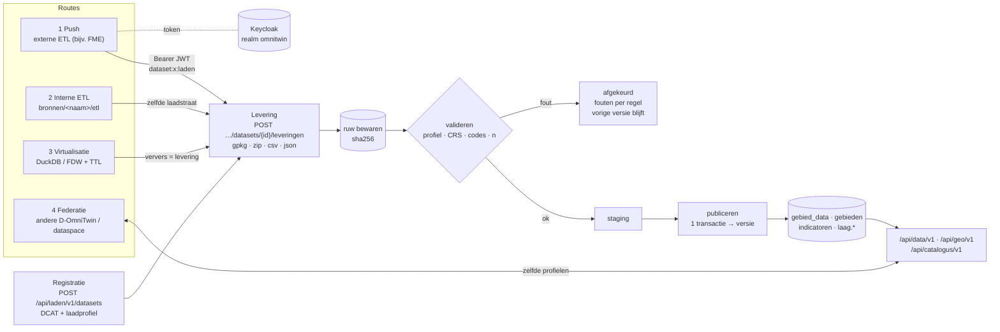

# RFC: D-OmniTwin vullen — registratie, leveringen en de laad-API

- Status: voorstel (ter bespreking Eduard / Taeke)
- Datum: 2026-10-01, herzien 2026-10-02
- Versie van de code: 0.2.1 (`origin/main`); § 2 is opgesteld op 0.2.0 met dezelfde routes
- Raakt: #195 (0.3.0), #182 fase 4 / ADR 0002 (PR #184), #20, #32, #33, #34, #65, #123, #128, #137, #201, #203; Keycloak PR #216
- Uitwerking: ADR 0004 ([`adr/0004-een-ingang-voor-vullen.md`](adr/0004-een-ingang-voor-vullen.md)), ADR 0005 ([`adr/0005-gescheiden-apis-per-doel.md`](adr/0005-gescheiden-apis-per-doel.md)), architectuur ([`vullen-van-d-omnitwin.md`](vullen-van-d-omnitwin.md)), [API-landschap](api-landschap.md) en de [laad-API-specificatie](../api/laden/openapi.yaml)

**Herziening 02-10.** De eerste versie ging uit van één *waarneming*-contract en één ingang per bron onder `/api/v1/bronnen/{bron}/leveringen`. Na de aanvulling "Dataset Registry + Bulk Loader" op #205 en de analyse van de huidige SWF-push is dat verbreed: **registratie per dataset** (DCAT-AP-NL/GeoDCAT-AP + laadprofiel), **leveringen als pakket** (GeoPackage of Data Package) en **profielen** (`waarnemingen` is er één van). De API's zijn gescheiden per doel (ADR 0005); de laad-API staat op `/api/laden/v1`. § 2 is ongewijzigd; § 6 en 7 zijn bijgewerkt op het nieuwe model.

---

## 1. Samenvatting en advies

**Advies in één zin:** D-OmniTwin accepteert **datasets als pakket**: een dataset wordt eenmalig **geregistreerd** (DCAT-AP-NL/GeoDCAT-AP met een laadprofiel), een ETL levert per verversing een **volledige snapshot** als GeoPackage of Data Package-zip aan via de **laad-API** (`POST /api/laden/v1/datasets/{datasetId}/leveringen`, OAuth2 client credentials via Keycloak, rol `dataset:{datasetId}:laden`), en D-OmniTwin **bewaart het bestand ruw**, **valideert** het tegen het profiel (inclusief n-drempel), laadt het in **staging** en **publiceert atomisch** als nieuwe **versie**; bij een fout blijft de vorige versie actief.



Kernpunten:

1. **Drie verantwoordelijkheden gescheiden:** registratie (wat is de dataset: DCAT), levering (wat zit erin: GeoPackage/Data Package) en laden (laad deze levering nu: de laad-API). Laadinstructies staan in het laadprofiel, niet in DCAT.
2. **Profielen in plaats van één contract:** `waarnemingen` (indicatorwaarden), `definities` (indicatoren, gebiedstypen, relaties), `gebiedsindeling` (gebieden met geometrie), `kaartlaag` (vrije features). Tabulair als Frictionless Table Schema. Een adapter (`swf-monitor-v1`) vertaalt het huidige SWF-formaat.
3. **GeoPackage boven GeoJSON** voor aanlevering: RFC 7946 is altijd WGS84, gemeentelijke data staat in RD (EPSG:28992). GeoJSON blijft de uitvoer van de geo-API.
4. **Eén laad-API, gescheiden van de andere API's** (ADR 0005): eigen basispad, eigen spec (OAS 3.0.3, 0 errors met de Logius-ruleset), eigen versie, rollen uit Keycloak.
5. **De logica zit in PostgreSQL** (schema `laden`): staging, set-based validatie, publicatie, versies. De FastAPI-router is dun.
6. **0.3.0 = de SWF-monitor gevuld via de laad-API**, met de adapter zodat FME alleen URL en client wijzigt, en de eerste vulling uit de dump via dezelfde weg. Virtualisatie en federatie krijgen alleen hun aansluitpunt.

---

## 2. Huidige stand

### 2.1 Inventaris API's en autorisatie

Traefik (`docker-compose.yml:19-39`) luistert op poort 80. Routering op padprefix: `/api/data` → PostgREST, `/api/geo` → pg_featureserv, al het andere (`PathPrefix(/)`) → FastAPI (`docker-compose.yml:84,118,139`).

| API / pad | Component | Doel | L/S | Auth | Gebruiker |
|---|---|---|---|---|---|
| `/`, `/static/*`, `/admin/*` (SPA) | FastAPI | frontend, beheer-UI | L | geen (UI); beheer-API achter sessie | browser |
| `/docs`, `/openapi.json` | FastAPI | Swagger UI + spec van FastAPI | L | anoniem | ontwikkelaar |
| `/api` | FastAPI | "welkom"-JSON, noemt 2 van de ±12 API's | L | anoniem | – |
| `/api/gebiedsmonitor/*` | FastAPI | gebieden, indicatoren, `kaart_data` | L | anoniem | frontend |
| `/api/kompas/*` | FastAPI | Kompas-hiërarchie, scores, benchmark (POST) | L | anoniem | frontend |
| `/api/report/*` | FastAPI | rapporten, ook LLM-narratief (`report.py:99`) | L (POST = query) | anoniem (besluit #65) | frontend, publiek |
| `/api/chat` | FastAPI | chat, roept LLM aan | L (POST) | anoniem, geen rate limit (#203) | frontend |
| `/api/ai/*`, `/api/3dbag/*`, `/api/visualisatie/*`, `/api/externe-lagen/*` | FastAPI | zoeken, 3D, paletten, kaartlagen | L | anoniem | frontend |
| `/api/admin/*`, `/api/visualisatie/admin/*`, `/api/admin/externe-lagen/*`, `/api/admin/data-controle/*` | FastAPI | beheer: indicatoren, prompts, LLM, logs, lagen, dedup | L+S | `vereis_admin`: sessie-cookie **of** gedeelde `X-Admin-Key` (`auth.py:91-121`) | beheer-UI, scripts |
| `/api/admin/auth/*` | FastAPI | login/logout/me | S | wachtwoord (bcrypt) → sessie 12 u | beheer-UI |
| `/api/data/*` | PostgREST v16.4 | views in schema `api` (6 views, 1 functie) | L | anoniem `web_anon`; **geen JWT geconfigureerd** (`docker-compose.yml:111-115`) | frontend, tests |
| `/api/geo/*` | pg_featureserv | OGC API Features Part 1 (2 collecties + `postgisftw`-functie) | L | anoniem `featureserv`; pg_featureserv kent geen auth | frontend (kaart) |
| database (5432/5433) | PostgreSQL | **alle schrijfpaden voor data**: `ETL/`, `scripts/`, `init_data/scripts/` | S | DB-eigenaar (`DATABASE_USER`) | ontwikkelaars, db-init |

### 2.2 Wat er mis of rommelig is

| # | Bevinding | Bewijs |
|---|---|---|
| 1 | **Geen API om data (waarden) te leveren.** Vullen kan alleen direct in de database als eigenaar (upsert met `ON CONFLICT`). Een externe ETL heeft dus het eigenaarswachtwoord nodig. | `scripts/import_metingen.py:47-56`, `init_data/scripts/laad_usecase.py:105-117` |
| 2 | Het enige upload-endpoint is voor **kaartlagen**, niet voor indicatoren: `POST /api/admin/externe-lagen/upload` (GPKG/GeoJSON). Leest het hele bestand in geheugen vóór de 50 MB-check, overschrijft een gelijknamig bestand zonder melding, schrijft in de containermap `data-upload/` (geen volume, #201), geen herkomst. Niet bruikbaar voor een ETL. | `externe_lagen.py:43,624-669` (r. 645-652) |
| 3 | **Eén gedeelde sleutel = volledige beheerder.** `X-Admin-Key` geeft `is_admin` zonder identiteit, scope of rotatie per client; logs zien alleen `API_SCRIPT`. Tabel `api_keys` bestaat maar wordt niet gelezen. | `auth.py:110-114`, `schema_latest.sql:2677-2687` |
| 4 | CORS staat header `X-API-Key` toe, de code leest `X-Admin-Key`. | `main.py:160` vs `auth.py:110` |
| 5 | **Swagger UI in de root (`/docs`) en spec op `/openapi.json`**, buiten `/api`. Drie losse specs zonder portaal: FastAPI (OAS 3), PostgREST (`/api/data/`, Swagger 2.0), pg_featureserv (`/api/geo/api`). | `main.py:269-279`; `curl http://localhost/docs` → 200, `/api/docs` → 404 |
| 6 | **De spec toont geen autorisatie** (`components.securitySchemes` ontbreekt), en HTML-routes (`/`, `/admin/{catchall}`) staan in de spec. | `http://localhost/openapi.json`; `main.py:231,239` |
| 7 | **Geen versie in het pad**, geen `API-Version`-header; `/api` noemt `docs` en `openapi` in de root. | `main.py:281-295`; NL GOV ADR `/core/uri-version`, `/core/version-header` |
| 8 | Padnaamgeving door elkaar: `/api/admin/...` naast `/api/visualisatie/admin/...`; `kaart_data` (underscore), Engels en Nederlands gemengd (`buildings`, `history`, `stats`, `top-buurten`). | `gebiedsmonitor.py:141`, `bag3d.py:430`, `kompas.py:177`, `dashboard.py:22` |
| 9 | PostgREST-proxy-URI vast op `http://localhost/api/data`: verkeerde links in de spec op elke andere host. | `docker-compose.yml:115` |
| 10 | **Datamodel mist velden voor de SWF-push:** geen `n`, geen leverings-/run-verwijzing, `bron` is vrije tekst. | `schema_latest.sql:307-321` |
| 11 | **Tegenstrijdige unieke sleutels**: `unq_gebied_indicator_jaar (gebied_id, indicator_uuid, jaar)` zónder `scenario_id`, naast `unique_measurement_jaar (…, jaar, scenario_id)`. Scenario's voor hetzelfde jaar kunnen daardoor niet naast `current` bestaan. | `schema_latest.sql:1959-2001` |
| 12 | `gebied_data` → `indicatoren` met `ON DELETE CASCADE`: een indicator verwijderen wist zijn data zonder spoor. | `schema_latest.sql:2508` |
| 13 | `etl_bronnen`, `etl_runs`, `data_lineage` bestaan alleen op papier. | `docs/3-data-engineering/etl_dataspace_gap_analyse.md:154-221` |
| 14 | Documentatie loopt achter: STATE.md noemt PostgREST "volledig open" (opgelost in #57) en verwijst naar een niet-bestaande Keycloak-spec; AGENTS.md beschrijft nog API-key-auth voor de beheer-UI (sinds #65 alleen sessie). | `docs/STATE.md:64-66,100`; `AGENTS.md:132` |

**Wat goed is:** PostgREST draait met eigen rollen en alleen schema `api` (`R__api_rollen.sql`); pg_featureserv met een alleen-lezen rol; alle `/api/admin/*` achter één dependency; sessietokens gehasht; Swagger-assets lokaal; security-headers centraal in Traefik. Daar bouwt dit voorstel op voort.

---

## 3. De vier vulroutes in één model

### 3.1 Registratie, levering, laden

| Onderdeel | Vraag | Standaard | Wanneer |
|---|---|---|---|
| **Registratie** | Wat is deze dataset en hoe wordt hij geladen? | DCAT-AP-NL 3, voor geo GeoDCAT-AP 3 (JSON-LD); laadprofiel | eenmalig, en bij wijziging |
| **Levering** | Wat zit er in deze aanlevering? | GeoPackage 1.4, of Frictionless Data Package (zip met `datapackage.json`, CSV of GeoPackage, later (Geo)Parquet), optioneel `dcat.jsonld`; CSV of JSON voor kleine tabulaire leveringen | per verversing |
| **Laden** | Laad deze levering nu | laad-API, modus `vervangen` | per levering |

Profielen en hun contracten: [`docs/api/laden/profielen/`](../api/laden/profielen/README.md). Het profiel `waarnemingen` is het oude waarneming-contract, aangevuld met `bron`:

| Veld | Type | Verplicht | Regel |
|---|---|---|---|
| `gebied_code` | tekst | ja | bestaande `gebieden.id` (CBS-code of eigen code met prefix, bijv. `WS728`) |
| `gebiedstype` | code of UUID | nee | controle dat het gebied van dat type is |
| `indicator_uuid` | uuid | ja | bestaat en is gekoppeld aan het gebiedstype |
| `jaar` / `peildatum` | geheel getal / datum | precies één | |
| `scenario` | tekst | nee | standaard `current` |
| `waarde` | decimaal | ja | binnen `min_waarde`/`max_waarde` |
| `n` | geheel getal | volgens de dataset | n < `minimumN` → onderdrukt; leeg alleen bij `bijOntbrekendeN: bron-onderdrukt` |
| `kwaliteit` | `definitief`/`voorlopig`/`geschat` | nee | |
| `bron`, `opmerking` | tekst | nee | |

### 3.2 Eén laadstraat

```
levering ─▶ ruw bewaren                       (volume, onveranderlijk, sha256; idempotentie op sleutel en hash)
         ─▶ valideren                         (pakket/GeoPackage leesbaar, schema volgens profiel, CRS,
                                               codes bestaan, dubbele sleutels, plausibel aantal, n-drempel)
         ─▶ staging                           (laden.staging_*, COPY; GeoPackage via fiona)
         ─▶ publiceren                        (één transactie: vervangbereik weg, nieuw erin,
                                               levering_id gezet, nieuwe versie, catalogus bijgewerkt,
                                               Z-score-referentie ververst)
         ─▶ staging opschonen                 (ook de onderdrukte n-waarden: dataminimalisatie)
```

Herkomst: elke waarde heeft `levering_id`; een levering heeft dataset, client (`azp`), sha256, aantallen en het ruwe bestand. PROV-O: levering = `prov:Entity`, laadrun = `prov:Activity`, client = `prov:Agent`. OpenLineage is een optie voor technische lineage (ETL-job → levering → tabel).

### 3.3 Per route

| Route | Wie start | Ingang | Lineage-agent | Catalogus |
|---|---|---|---|---|
| **1 Push** | externe ETL (FME, Python, Airflow) | `POST /api/laden/v1/datasets/{id}/leveringen` | Keycloak-client (`azp`) | registratie vooraf |
| **2 Interne ETL** | job in D-OmniTwin (`bronnen/<naam>/etl`) | in-process dezelfde laadstraat, of HTTP met een eigen machineclient | job of machineclient | idem |
| **3 Virtualisatie** | TTL-verloop of op verzoek | de "ETL" is een query (DuckDB/FDW); resultaat = levering | `virtualisatie:<dataset>` | registratie met TTL |
| **4 Federatie** | gebruiker vraagt data die elders woont | geen levering; `data`/`geo`-API van de andere installatie, zelfde profielen | andere installatie | DCAT-AP-NL, later DSP |

---

## 4. Route 1 in detail: de laad-API

### 4.1 Ontwerp

Volledige specificatie: [`docs/api/laden/openapi.yaml`](../api/laden/openapi.yaml), toelichting en voorbeelden: [`docs/api/laden/README.md`](../api/laden/README.md).

| Methode en pad (onder `/api/laden/v1`) | Doel | Rol |
|---|---|---|
| `POST /datasets` | registreren (DCAT JSON-LD + laadprofiel) | `beheerder` |
| `GET /datasets`, `GET /datasets/{datasetId}` | registraties, actuele versie, laatste levering | `beheerder`, `datasets:laden` of de datasetrol |
| `PUT`/`PATCH /datasets/{datasetId}` | beschrijving wijzigen (profiel vast na eerste publicatie) | `beheerder` |
| `POST /datasets/{datasetId}/leveringen` | volledige snapshot aanbieden | `dataset:{datasetId}:laden` of `datasets:laden` |
| `GET /datasets/{datasetId}/leveringen` | historie | idem of `beheerder` |
| `GET /leveringen/{leveringId}` | status, aantallen, versie, sha256, fouten | idem |
| `GET /datasets/{datasetId}/versies`, `…/versies/{versie}/bestand` | versies; het geleverde bestand terug (export, back-up) | idem |
| `GET /profielen`, `/profielen/{profielId}` | contracten | anoniem |
| `…/compat/swf-monitor/monitor_api/…` | spiegel van de huidige SWF-push en -back-up | datasetrollen `swf-monitor-*` |

Keuzes:

- **Body:** `application/geopackage+sqlite3`, `application/zip` (Data Package), `text/csv`, `application/json`, of `multipart/form-data` met deel `bestand` en optioneel `dcat`. Gestreamd naar het volume, niet in het geheugen.
- **Asynchroon met synchrone optie:** standaard `202` + `Location`; `wacht=true` wacht tot de time-out (standaard 60 s) en geeft `201` of `422`. FME kan slecht pollen; de compatibiliteitsingang is altijd synchroon.
- **`alleenValideren=true`** voor een proefrun; eindstatus `gevalideerd`.
- **Idempotentie:** header `Idempotency-Key` (IETF-draft), aanbevolen `{datasetId}-{peilmoment}`; dezelfde sleutel en inhoud → `200` met de bestaande levering; andere inhoud → `422`. Zonder sleutel: een bestand gelijk aan de actuele versie geeft geen nieuwe versie.
- **Alleen `vervangen` in v1**, met een vervangbereik uit het laadprofiel (hele dataset, of bijv. per indicator × gebiedstype voor de SWF-pushes). `append`/`upsert` later.
- **Fouten:** Problem Details (RFC 9457); een afgekeurde levering heeft `fouten` per regel met `resource`, `regel`, `veld` (de eerste 1000), zonder de waarde te herhalen.
- **Statussen:** `ontvangen → bezig → gepubliceerd | gevalideerd | afgekeurd | mislukt`.
- **Limieten:** 200 MB (JSON 20 MB), 10 leveringen per minuut per client, in Traefik.
- **n-drempel:** `minimumN` per dataset (SWF: 10), `bijNOnderDrempel: onderdrukken` (standaard) of `afkeuren`; ontbrekende n alleen bij `bijOntbrekendeN: bron-onderdrukt` (de SWF-push heeft geen n). Secundaire onthulling: aggregaten gebruiken alleen gepubliceerde waarden en toetsen zelf ook.

### 4.2 FastAPI-ingang of PostgREST?

| | **A. FastAPI-router + SQL-functies (advies)** | **B. PostgREST-schema met JWT + RLS** |
|---|---|---|
| Eigen code | router + JWT-check; logica in SQL | alleen SQL + config |
| Formaten | GeoPackage, zip, CSV, JSON, multipart | CSV en JSON; geen zip/GeoPackage |
| Grote bestanden | streamen naar schijf en `COPY` | één request = één transactie |
| Async + status | ja | nee |
| Ruw bewaren, sha256, idempotentie | ja | zelf bouwen in RPC |
| Spec | eigen OAS 3.0.3 | Swagger 2.0 |

**Advies: A**, met de kern in SQL-functies (`laden.valideer`, `laden.publiceer`). B blijft mogelijk als tweede ingang op dezelfde functies.

### 4.3 Autorisatie met Keycloak

Realm `omnitwin` op `/auth` (PR #216):

- **Machines:** per afnemer een confidential client met service account, alleen `client_credentials`, zonder refresh-token, token 5 minuten. Clientauthenticatie nu `client_secret_post`/`client_secret_basic` (FME), later `private_key_jwt` (NL GOV OAuth-profiel). Client-rollen op resource-client `omnitwin-api`: `dataset:{datasetId}:laden` of `datasets:laden`. `omnitwin-api` staat via een audience-mapper in `aud`. Voorbeeld in de realm: `etl-voorbeeld` met `dataset:voorbeeld:laden`.
- **Mensen:** public client `omnitwin-web`, code + PKCE (S256); realm-rollen `beheerder` (registreren, beheer) en `lezer` (standaard).
- **FastAPI** valideert het token zelf (JWKS van de realm, `iss`, `aud`, `exp`, rol); één dependency `vereis_rol(...)` voor alle API's. De laad-API verbindt met een eigen databaserol `laden_schrijver` (alleen `EXECUTE laden.*`).
- **PostgREST** blijft anoniem lezen; ingelogd lezen later met dezelfde JWKS en RLS. **pg_featureserv** kent geen auth: beperkte collecties via forwardAuth (oauth2-proxy).
- **`X-Admin-Key`** is geen ingang voor data en wordt uitgefaseerd (#34).

### 4.4 SWF-monitor: adapter `swf-monitor-v1`

De huidige SWF-push bestaat uit twee stappen: een definities-snapshot (indicatoren, gebiedstypen, relaties) en daarna per indicator × gebiedstype een array met waarden (`indicator_id`, `gebiedstype_id`, `gebieds_id`, `waarde`, `begingeldigheid`, `eindgeldigheid`), zonder n. De huidige API heeft per resource ook een `GET` die als back-up wordt gebruikt.

D-OmniTwin spiegelt die paden onder `/api/laden/v1/compat/swf-monitor/monitor_api/…`, synchroon. Elke `POST` wordt een gewone levering op `swf-monitor-definities` of `swf-monitor-waarden` (vervangbereik indicator × gebiedstype); de `GET`'s geven de actuele versie terug in het SWF-formaat. FME wijzigt alleen het tokenendpoint, de client en het begin van de URL. Mapping en overstap: [`swf-monitor-v1.md`](../api/laden/profielen/swf-monitor-v1.md). Daarna: één Data Package per run in plaats van ±57 losse aanroepen.

### 4.5 Hoe route 2 dezelfde laadstraat gebruikt

```python
# bronnen/cbs-kerncijfers/etl/laad.py  (schets)
pakket = maak_datapackage(download_cbs(...))          # resource 'waarnemingen' volgens het profiel
lever("cbs-kerncijfers-buurten", pakket,              # omnitwin.laden.lever: dezelfde code als de router
      agent="etl:cbs-kerncijfers")
```

Draait de ETL als eigen container of bij een andere organisatie, dan is het dezelfde HTTP-call met een eigen machineclient. `laad_usecase.py`/`laad_cbs.py` gaan in #182 fase 4 via `lever()`.

---

## 5. API-indeling en URL's

Uitgewerkt in het [API-landschap](api-landschap.md) en besloten in [ADR 0005](adr/0005-gescheiden-apis-per-doel.md): **gescheiden API's per doel**, elk met een eigen basispad `/api/<naam>/v1`, eigen `openapi.json`, eigen versie (`API-Version`) en eigen rollen.

| API | Basispad | Standaard | Nu |
|---|---|---|---|
| laden | `/api/laden/v1` | NL GOV ADR 2.1, DCAT-AP-NL/GeoDCAT-AP, Frictionless, GeoPackage | ontbreekt |
| catalogus | `/api/catalogus/v1` | DCAT-AP-NL | ontbreekt |
| data | `/api/data/v1` | NL GOV ADR via PostgREST | `/api/data` |
| geo | `/api/geo/v1` | OGC API Features | `/api/geo` |
| analyse | `/api/analyse/v1` | NL GOV ADR | `/api/kompas`, `/api/report`, deel `/api/gebiedsmonitor` |
| chat | `/api/chat/v1` | NL GOV ADR | `/api/chat`, `/api/ai` |
| beheer | `/api/beheer/v1` | NL GOV ADR | `/api/admin/*` |
| viewer (intern) | `/api/viewer/v1` | NL GOV ADR waar zinvol | `/api/visualisatie`, `/api/externe-lagen`, `/api/3dbag` |

Documentatie op één plek: portaal `/api` met alle specs en `/.well-known/api-catalog` (RFC 9727); `/docs` in de root verdwijnt. Oude paden één minor-release via Traefik herschreven, met `Deprecation`/`Sunset`.

Dit vervangt het eerdere voorstel van één `/api/v1` met autorisatie per subpad: één spec en één versie voor publiek lezen, beheer en laden koppelt hun levenscyclus en maakt losse deployment moeilijker.

---

## 6. Standaardoplossingen — afweging

| Optie | Wat het oplost | Past bij ons? | Nadelen |
|---|---|---|---|
| **OGC API – Features Part 4 (CRUD)** | Schrijven van features per collectie via POST/PUT/PATCH/DELETE | **Nee, nu niet.** Nog draft (1.0.0-draft.2), pg_featureserv en GeoServer implementeren het niet; per-feature, geen bulk/jaargang-semantiek | Geen atomische plak-vervanging, geen n-drempel; zou eigen implementatie vergen |
| **OGC SensorThings API** | Tijdreeksen van sensoren (Thing/Datastream/Observation) | **Nee** voor indicatoren; **ja** als later sensordata (hittestress, luchtkwaliteit) binnenkomt (FROST-server als bron, route 3) | Ander model (observations per sensor), zwaar voor jaarcijfers |
| **PostgREST als schrijf-API (JWT + RLS)** | Schrijven zonder eigen code, rechten in de database | **Deels.** Goed als tweede ingang op dezelfde `ingest`-functies; zie 4.2 | Geen zip/Parquet/streaming/async; JWKS-rotatie handmatig |
| **Frictionless Data Package / Table Schema** | Zelfbeschrijvend pakket (metadata + schema + CSV/Parquet), validatie met `frictionless` | **Ja: een leveringsvorm** (Data Package-zip), naast GeoPackage. Al gebruikt voor de sample (#86) | Python-lib is groot; validatie liever in SQL, lib alleen voor parsen |
| **Open Data Contract Standard (ODCS v3)** | Datacontract: schema, kwaliteit, SLA, eigenaar, toegang | **Optioneel**: het laadprofiel en DCAT dekken wat nu nodig is; ODCS kan de bron-kant (ADR 0002) beschrijven | Jong; extra formaat naast DCAT en Table Schema |
| **GeoPackage 1.4 (OGC)** | Eén bestand met geo- en gewone tabellen, met CRS | **Ja: de standaard leveringsvorm voor geodata** (en bruikbaar voor tabellen) | Binair; validatie met fiona/GDAL |
| **CSV/Parquet + `COPY` naar staging** | Snelle bulk-load, set-based validatie in SQL | **Ja: de kern van de ingang** | Staging-schema en opschonen zelf regelen |
| **CloudEvents / webhooks** | Notificatie "levering gepubliceerd" naar afnemers | **Later**, als uitgaande notificatie (bijv. cache leegmaken bij federatiepartner) | Niet nodig voor vullen |
| **Kafka / Redpanda** | Stromende data, buffering | **Nee.** Te zwaar voor jaarcijfers bij een gemeente | Extra infrastructuur en beheer |
| **Singer / Meltano / Airbyte** | Kant-en-klare connectoren (taps) naar bestemmingen (targets) | **Optioneel later:** een "target-omnitwin" is een dunne wrapper om de ingang. Interne ETL kan Meltano-taps gebruiken als bron-ETL | Airbyte is zwaar (k8s/temporal); Singer-ecosysteem wisselend onderhouden |
| **dbt** | SQL-transformaties met tests en lineage | **Bij de bronhouder of in een bron-ETL**, niet in de kern (Gold leest alleen het contract) | Extra tool; voor onze transformaties (deling, factor) volstaat SQL |
| **NL GOV REST API Design Rules** | Eenduidige overheids-API's (versie, fouten, OAS) | **Ja**, voor alle API's (ADR 0005; en API-register, #128) | Wat werk aan bestaande paden (aliassen) |
| **NL GOV OAuth-profiel** | Afspraken voor OAuth2 in de overheid | **Ja**, via Keycloak (client credentials met `private_key_jwt`, code + PKCE) | Keycloak-inrichting per installatie |
| **Common Ground** | Gegevens bij de bron, componenten, API's | **Ja, als uitgangspunt**: push is "kopie met contract en herkomst"; federatie (route 4) is "bij de bron" | Spanning: Kompas/Z-score heeft lokaal een referentiegroep nodig |
| **FSC** (Federatieve Service Connectiviteit) | Contracten, identiteit (PKIoverheid), mTLS, logging tussen organisaties; op de pas-toe-of-leg-uit-lijst | **Ja voor route 4** en voor push tussen organisaties als het transport dat vraagt (Inway vóór `/api/laden/v1`) — #33 | Inway/Outway/Manager beheren; niet nodig binnen één organisatie |
| **iSHARE / DSP** | iSHARE: vertrouwensraamwerk; DSP: catalogus- en contractprotocol (DCAT/ODRL) | **DSP voor catalogus/contract (route 4)**, zoals #32 voorstelt; iSHARE niet (#32) | DSP nog geen ISO; DSP+FSC is geen bestaand profiel |
| **DCAT-AP-NL / GeoDCAT-AP** | Beschrijving van datasets en dataservices | **Ja: de registratie** (`POST /api/laden/v1/datasets`) en de catalogus-API (#63) | Laadinstructies passen er niet in: apart laadprofiel |
| **Virtualisatie: DuckDB / FDW / Trino / Drill** | Bij de bron bevragen zonder ETL | **DuckDB (in-process) of `ogr_fdw`/`pg_duckdb`** voor route 3; Trino/Drill te zwaar | Prestaties en beschikbaarheid hangen van de bron af |

---

## 7. Routes 3 en 4

### 7.1 Route 3 — virtualisatie met caching

- **Wanneer wel:** grote of snel veranderende bronnen waarvan we alleen een aggregaat of een uitsnede nodig hebben (energielabels per pand → percentage per buurt, 3D BAG, Parquet/GeoParquet op een objectstore, OData van CBS bij verse jaargangen).
- **Wanneer niet:** als de bron traag/onbetrouwbaar is voor interactief gebruik, of als de licentie geen kopie verbiedt maar de bron geen query-interface heeft (dan gewoon route 2).
- **Tool:** **DuckDB** in-process (leest CSV/Parquet/HTTP/S3, SQL, geen server) als standaard; `ogr_fdw` voor WFS/OGC API in PostgreSQL; `pg_duckdb` als het in de database moet. Geen Trino/Drill: een cluster voor een gemeente is te veel.
- **Caching = publiceren.** De virtuele bron is een ETL die een query is. Bij TTL-verloop (in de registratie) of op verzoek wordt het resultaat een levering via dezelfde laadstraat. Voordeel: dezelfde validatie, n-drempel en lineage; Kompas/Z-score werken op lokale data. Alleen echt on-demand (zonder kopie) voor viewer-lagen die niet in berekeningen gaan, met een eenvoudige TTL-cache in de backend.
- **Autorisatie/doelbinding:** credentials naar de bron staan in secrets (niet in `etl_bronnen.auth_config` als platte tekst); de registratie (`dct:accessRights`) legt toegang vast; het resultaat erft de toegang van de bron (open/beperkt).

### 7.2 Route 4 — federatie

- **Wanneer wel:** data die de bron niet mag verlaten (privacy, eigenaarschap), of gebieden van een andere gemeente die zelf een D-OmniTwin draait (vergelijken over gemeentegrenzen).
- **Wanneer niet:** de eigen Kompas-berekeningen. Z-scores vragen een referentiegroep met alle waarden; dat over het netwerk doen is traag en lekt meer dan nodig. Dan: route 1 (de andere partij pusht een afgesproken set) of route 3 (cache, als de policy dat toestaat).
- **Hoe:** D-OmniTwin publiceert gepubliceerde datasets via de `data`- en `geo`-API in **dezelfde profielen**, plus de catalogus (`/api/catalogus/v1`, DCAT-AP-NL; later DSP Catalog Protocol). De backend is de orchestrator (#20 niveau 2): per bron met `ontsluiting.vorm = extern` gaat de vraag naar de connector van die bron.
- **Autorisatie en doelbinding:** binnen één organisatie client credentials of token exchange (RFC 8693, Keycloak) met de gebruikerscontext; tussen organisaties via **FSC** (contract per dienst, PKIoverheid, logging van elke transactie, doelbinding in het contract) en later **DSP** (ODRL-policy per dataset). Het antwoord wordt niet in `gebied_data` opgeslagen, tenzij de policy een cache toestaat.

---

## 8. Implementatieplan

### 8.1 0.3.0 — de SWF-monitor gevuld via de laad-API

In volgorde; elk een eigen issue en PR.

| # | Titel | Inhoud |
|---|---|---|
| 1 | `docs(architectuur): laad-API en API-landschap vaststellen` | ADR 0004 en 0005 naar *aanvaard*; spec `docs/api/laden/openapi.yaml` als bron (deze PR) |
| 2 | `feat(db): schema laden — datasets, leveringen, versies, staging` | migratie: `laden.datasets`, `laden.leveringen`, `laden.versies`, `laden.fouten`, stagingtabellen per profiel; rol `laden_schrijver` met alleen `EXECUTE laden.*` |
| 3 | `feat(db): gebied_data en gebiedstypes klaar voor leveringen` | `gebied_data`: `n`, `n_status`, `levering_id`; unieke sleutel met scenario, `unq_gebied_indicator_jaar` weg; `RESTRICT` naar `indicatoren`. `gebiedstypes`: `actief`, `metadata` |
| 4 | `feat(deploy): volume voor ruwe leveringen en Traefik-router laden` | volume `leveringen` met bewaartermijn; router `PathPrefix(/api/laden/v1)` met `security-headers`, body-limit 200 MB en rate-limit |
| 5 | `feat(auth): JWT-validatie met Keycloak` | JWKS van realm `omnitwin`, `iss`/`aud`/`exp`, `vereis_rol()` voor client- en realm-rollen; issuer configureerbaar (vervolg op PR #216) |
| 6 | `feat(laden): validators per profiel` | `waarnemingen` (CSV, JSON, Data Package), `definities` (drie resources), `gebiedsindeling` en `kaartlaag` (GeoPackage via fiona, CRS 28992/4326); set-based checks in SQL; fouten als Problem Details |
| 7 | `feat(laden): loader vervangen` | laadstraat ruw → valideren → staging → publiceren in één transactie; vervangbereik; versies; n-drempel; idempotentie (sleutel + sha256); serialisatie per dataset |
| 8 | `feat(api): router laden/v1 met eigen spec` | registratie, leveringen, status, versies, profielen; `/api/laden/v1/openapi.json` uit de spec; `API-Version`; Problem Details; `wacht=true`; contracttest spec ↔ routes |
| 9 | `feat(laden): adapter swf-monitor-v1` | vertaling definities en waarden, compatibiliteitspaden (`POST` inlezen, `GET` back-up), synchroon |
| 10 | `feat(data): eerste vulling uit de SWF-dump` | definities en waarden van de dump via de adapter laden (afwijkingen zoals jaar 0 en onbekende buurtcodes komen als fouten terug); use case `swf-gebiedsmonitor` met integratietest (n-drempel, afkeuring, idempotentie) |
| 11 | `chore(ci): Spectral-lint van de API-specificaties` | commando staat in AGENTS.md; in de CI zodra er Actions-minuten zijn (#200) |
| 12 | `feat(api): portaal /api en api-catalog` | overzicht en Swagger UI met alle specs, `/.well-known/api-catalog`, `/docs` → 308 |
| 13 | `docs(beheer): externe ETL aansluiten` | client aanvragen, token halen, leveren (curl, Python, FME HttpCaller), status lezen |
| 14 | `refactor(etl): use-case- en CBS-laden via de laadstraat` | `laad_usecase.py`/`laad_cbs.py` schrijven niet meer zelf in `gebied_data` (#182 fase 4) |

### 8.2 Later (0.4.0 en verder)

| Titel | Eén regel |
|---|---|
| `feat(api): catalogus/v1 (DCAT-AP-NL)` | registraties als catalogus, ook de API's als `dcat:DataService` (#63, #128) |
| `refactor(api): beheer/v1, data/v1, geo/v1, analyse/v1, chat/v1` | nieuwe basispaden met aliassen (ADR 0005) |
| `feat(laden): kaartlaag-upload in het beheer via de laad-API` | vervangt `POST /api/admin/externe-lagen/upload` (#201) |
| `feat(laden): append en upsert` | naast `vervangen` |
| `feat(laden): leveringen intrekken` | vorige versie terugzetten |
| `feat(laden): GeoParquet en Parquet` | grotere leveringen |
| `feat(auth): private_key_jwt voor machineclients` | NL GOV OAuth-profiel |
| `feat(auth): PostgREST met Keycloak-JWT en RLS`, `feat(geo): beperkte lagen achter forwardAuth` | ingelogd lezen (#195) |
| `feat(etl): virtualisatie met DuckDB en TTL` | virtuele bron die bij verversing een levering doet |
| `feat(lineage): OpenLineage-events` | technische lineage naast de leveringen |
| `feat(federatie): FSC-inway en DSP-catalogus` | #33, #32 |
| `chore(auth): X-Admin-Key uitfaseren` | na Keycloak voor mensen en machines (#34) |

---

## 9. Open vragen en beslispunten

| # | Vraag | Voorstel |
|---|---|---|
| 1 | **n-drempel:** bij de ingang of bij de weergave? Per dataset of per indicator? Secundaire onderdrukking? | **Besloten (02-10):** bij de ingang, per dataset (`minimumN`, standaard 10), met afwijking per indicator (`minimumNPerIndicator`). Secundaire onderdrukking: nog open |
| 2 | **SWF-push:** adapter of FME aanpassen? | Adapter `swf-monitor-v1` met compatibiliteitspaden; daarna één Data Package per run |
| 3 | **Eerste vulling:** de dump via de laad-API? | Ja, via de adapter: dan is de ingang meteen getest |
| 4 | **Peildatum of jaar** | Beide; `JJJJ-01-01` uit de SWF-push wordt `jaar` |
| 5 | **Keycloak-realm** | Realm `omnitwin` per installatie (PR #216); de SWF-IdP (Entra) koppelen aan die realm |
| 6 | **Rollen per dataset, of ook per gemeente** (#34)? | Per dataset nu; gemeente als extra claim later |
| 7 | **FastAPI (A) of PostgREST (B) als ingang?** | A, met logica in SQL |
| 8 | **Padnamen in het Nederlands, gescheiden API's** | Ja (ADR 0005), met één release overgang |
| 9 | **Vervangbereik** | Per dataset in het laadprofiel; standaard de hele dataset, SWF-waarden per indicator × gebiedstype |
| 10 | **Contracten van niet-open bronnen** (enquêtes, leefstijlsegmenten): in de publieke repo? | Profielen en sjablonen in de repo; registraties staan in de database van de installatie, niet in git |
| 11 | **Indicatordefinities:** via de push of via beheer? | Via een eigen dataset met profiel `definities` (de SWF-snapshot); onbekende UUID's in waarden worden afgekeurd |
| 12 | **Status `A`** in de SWF-definities | Betekenis navragen; tot dan afkeuren |
| 13 | **Bewaartermijn ruwe leveringen** | **Besloten (02-10):** altijd de laatste 10 versies, oudere tot 1 jaar, afgekeurde 30 dagen; instelbaar |

| 14 | **Catalogus** als eigen API of weergave? | **Besloten (02-10):** eerst JSON-LD-weergave van `laden/datasets`; `catalogus/v1` pas bij een tweede bron van metadata |