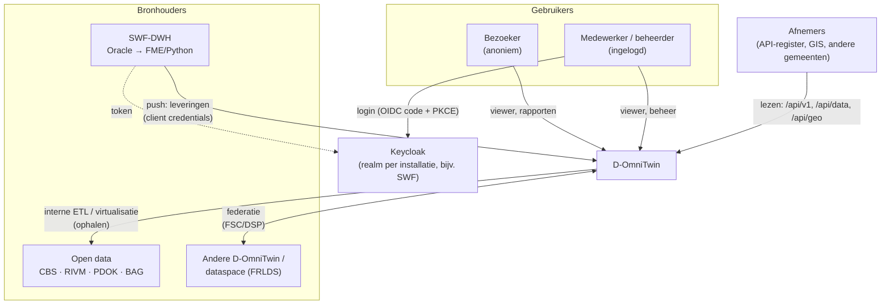
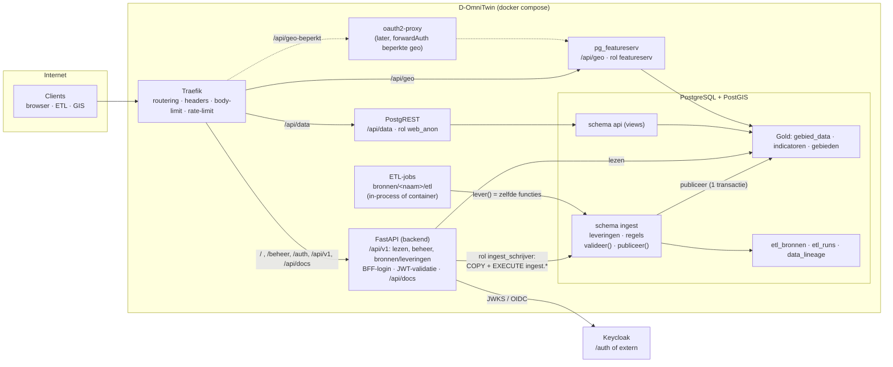
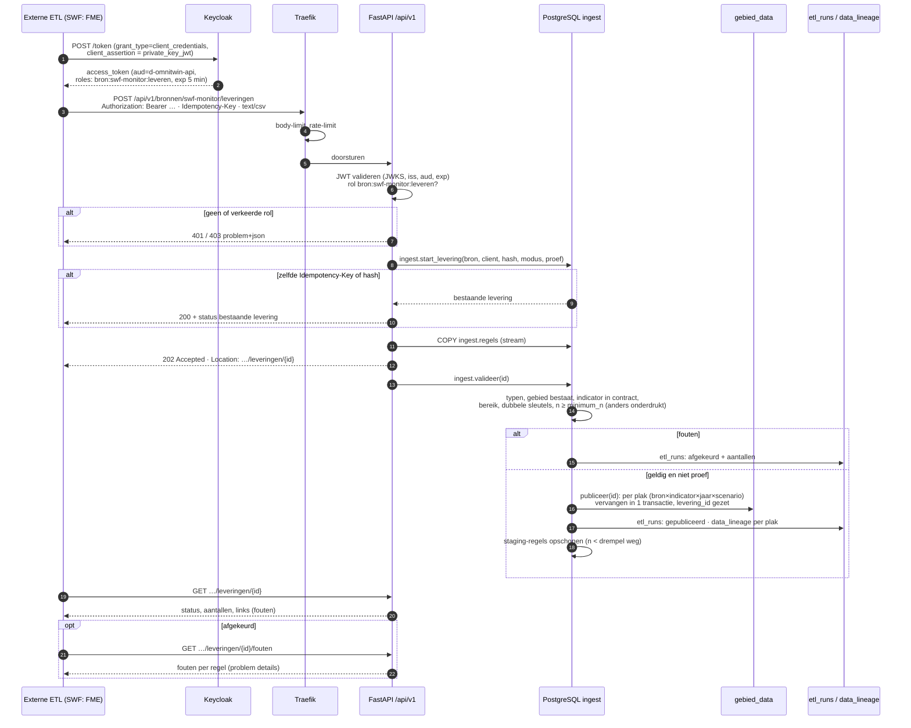
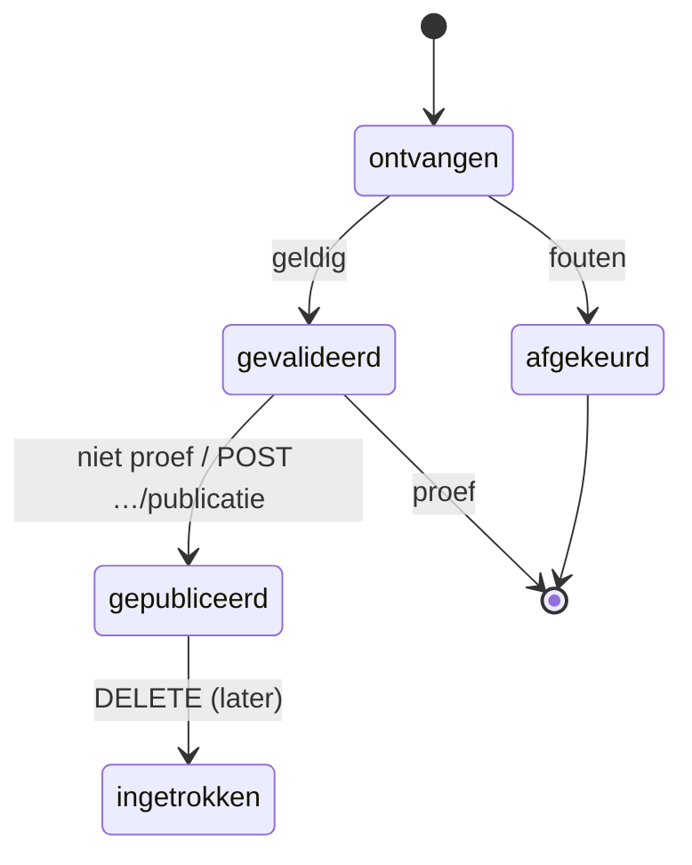
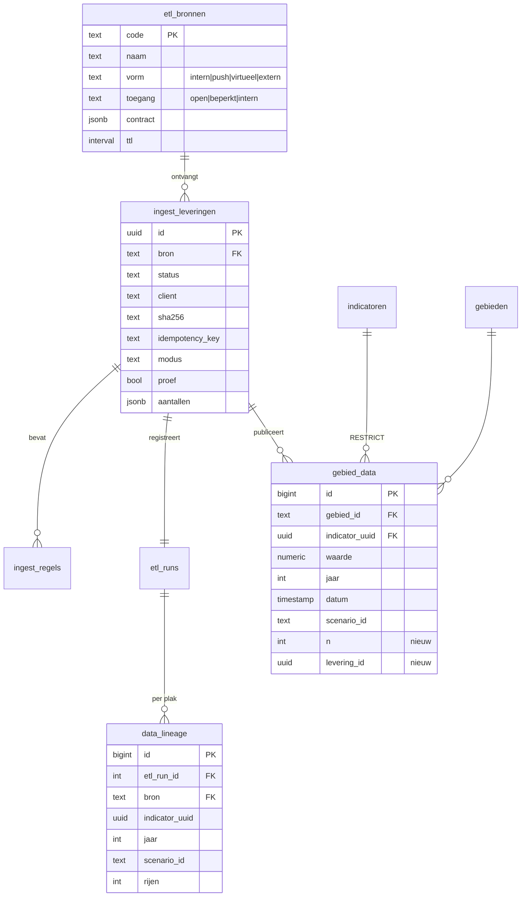

# Architectuur: D-OmniTwin vullen

Hoe data in D-OmniTwin komt: componenten, gegevensstromen, API-indeling en autorisatie. Besluit: [ADR 0004](adr/0004-een-ingang-voor-vullen.md). Bouwt voort op [ADR 0002](adr/0002-databronnen-als-dataproduct.md) (databronnen als dataproduct).

Status: voorgesteld, doelbeeld voor 0.3.0 en verder. Wat er nu (0.2.0) staat, staat in [Huidige stand](#8-huidige-stand-020).

## 1. In het kort

- Vier routes vullen D-OmniTwin: **push** door een externe ETL, **interne ETL** (bron als dataproduct), **virtualisatie** met cache en **federatie**.
- Alle routes gebruiken **één datacontract** (de *waarneming*) en, waar data wordt opgeslagen, **één ingang**: `POST /api/v1/bronnen/{bron}/leveringen`.
- Een levering gaat door **staging → validatie → publicatie** in PostgreSQL (schema `ingest`) en wordt vastgelegd in `etl_runs` en `data_lineage`.
- **Keycloak** regelt identiteit: client credentials voor machines (rol per bron), authorization code + PKCE voor mensen.
- **Traefik** routeert en begrenst; FastAPI, PostgREST en pg_featureserv leveren de API's.

## 2. Context

## 3. Containers

| Container | Verantwoordelijkheid voor vullen | Eigen code |
|---|---|---|
| Traefik | TLS (of achter een TLS-proxy), padroutering, security-headers, `buffering.maxRequestBodyBytes` en `rateLimit` op de ingang; later FSC-inway ervoor | config |
| Keycloak | identiteit, clients, rollen `bron:{bron}:leveren`, `beheer`; tokens | realm-config |
| FastAPI | ingang (`/api/v1/bronnen/…`): token valideren, rol per bron, bestand streamen naar staging, status en foutrapport; BFF-login voor mensen; docs-portaal | dun |
| ETL-jobs | interne ETL en virtualisatie; leveren via `lever()` | per bron (ADR 0002) |
| PostgreSQL `ingest` | staging, validatie, n-drempel, atomische publicatie, lineage | SQL-functies |
| PostgREST | anoniem lezen van `api`-views; later ingelogd lezen (JWT + RLS) | geen |
| pg_featureserv | OGC API Features (lezen); kent geen auth | geen |

## 4. Gegevensstromen

### 4.1 Het contract: de waarneming

| Veld | Type | Verplicht |
|---|---|---|
| `gebied_code` | tekst (`gebieden.id`) | ja |
| `gebiedstype` | code | nee |
| `indicator_uuid` | uuid | ja |
| `jaar` / `peildatum` | geheel getal / datum | één van beide |
| `scenario` | tekst, standaard `current` | nee |
| `waarde` | decimaal | ja |
| `n` | geheel getal | volgens bron-contract |
| `kwaliteit` | `definitief` / `voorlopig` / `geschat` | nee |
| `opmerking` | tekst | nee |

De bron volgt uit de URL en het token. Schema: Frictionless Table Schema; bron-contract: ODCS (`bronnen/<naam>/contract.yaml`) met o.a. toegestane indicatoren, gebiedstypen, `minimum_n` en vervangmodus.

### 4.2 Push-levering (route 1)

### 4.3 De andere routes

| Route | Stroom | Verschil met push |
|---|---|---|
| 2 Interne ETL | job → `omnitwin.ingest.lever(bron, pakket)` → zelfde `ingest`-functies | geen HTTP (in-process) of HTTP met eigen service-account (`d-omnitwin-etl`) |
| 3 Virtualisatie | TTL verlopen → query op de bron (DuckDB, `ogr_fdw`) → resultaat als levering | de "ETL" is een query; viewer-lagen buiten berekeningen alleen on-demand met TTL-cache, zonder publicatie |
| 4 Federatie | vraag → orchestrator (FastAPI) → `GET /api/v1/waarden` bij de andere installatie (FSC/DSP) → antwoord in hetzelfde contract | geen opslag in `gebied_data`, tenzij de ODRL-policy een cache toestaat; niet voor Z-score-berekeningen |

### 4.4 Statussen van een levering

## 5. API-indeling, URL's en autorisatie

| Pad | Methoden | Wat | Auth | Component |
|---|---|---|---|---|
| `/` | GET | viewer | anoniem; ingelogd via BFF-cookie | FastAPI |
| `/beheer/` | GET | beheer-UI (nu `/admin/`) | BFF-sessie, rol `beheer` | FastAPI |
| `/auth/login`, `/auth/callback`, `/auth/logout` | GET/POST | OIDC code + PKCE (BFF) | – | FastAPI ↔ Keycloak |
| `/api/v1/gebieden`, `/indicatoren`, `/kompas/…`, `/rapporten/…` | GET (POST voor complexe queries) | publiek lezen | anoniem of ingelogd | FastAPI |
| `/api/v1/chat`, `/api/v1/rapporten/…/samenvatting` | POST/GET | LLM-functies | anoniem met rate-limit (#203) | FastAPI |
| `/api/v1/waarden` | GET | waarden in het waarneming-contract (federatie, later) | anoniem voor open bronnen; token voor beperkte | FastAPI |
| `/api/v1/bronnen`, `/api/v1/bronnen/{bron}` | GET | catalogus (JSON, JSON-LD DCAT-AP-NL) | anoniem (open bronnen) | FastAPI |
| `/api/v1/bronnen/{bron}/contract` | GET | ODCS + Table Schema | open of `bron:{bron}:leveren` | FastAPI |
| `/api/v1/bronnen/{bron}/leveringen` | POST, GET | levering aanbieden, lijst | `bron:{bron}:leveren` (client credentials) | FastAPI |
| `/api/v1/bronnen/{bron}/leveringen/{id}` (`/fouten`, `/publicatie`) | GET, POST | status, foutrapport, proef publiceren | `bron:{bron}:leveren` | FastAPI |
| `/api/v1/beheer/…` | alle | beheer-API (nu `/api/admin/…`) | rol `beheer` | FastAPI |
| `/api/v1/openapi.json` | GET | spec met `securitySchemes` | anoniem, CORS open | FastAPI |
| `/api/docs` | GET | portaal: Swagger UI met keuze D-OmniTwin v1 / Data / Geo | anoniem | FastAPI (statisch) |
| `/api/data/…` | GET | PostgREST, schema `api` | anoniem `web_anon`; later JWT + RLS | PostgREST |
| `/api/geo/…` | GET | OGC API Features (open collecties) | anoniem | pg_featureserv |
| `/api/geo-beperkt/…` (later) | GET | beperkte geo-lagen | forwardAuth (oauth2-proxy, Keycloak) | Traefik + pg_featureserv |
| `/health`, `/.well-known/security.txt` | GET | beheer, RFC 9116 | anoniem | FastAPI |

Conventies (NL GOV API Design Rules): major-versie in het pad, header `API-Version`, OpenAPI op `<basis>/openapi.json`, Nederlandse meervoudige namen in kebab-case, Problem Details voor fouten, geen trailing slash, oude paden één release als alias met `Deprecation`/`Sunset`.

### 5.1 Traefik-routering (schets)

| Router | Regel | Middleware | Service |
|---|---|---|---|
| `ingest` | `PathRegexp(^/api/v1/bronnen/[^/]+/leveringen)` | `security-headers`, `ingest-limieten` (body 200 MB, rate-limit per client-IP) | backend |
| `postgrest` | `PathPrefix(/api/data)` | `security-headers`, strip `/api/data` | postgrest |
| `pg_featureserv` | `PathPrefix(/api/geo)` | `security-headers` | pg_featureserv |
| `backend` | `PathPrefix(/)` (laagste prioriteit) | `security-headers` | backend |

### 5.2 Rollen en rechten

| Wie | Keycloak | Mag | Databaserol |
|---|---|---|---|
| Bezoeker | – | publiek lezen | `web_anon` (PostgREST), backend-leesrol |
| Medewerker | gebruiker, rol `lezen-beperkt` | ook beperkte lagen/indicatoren | later `web_ingelogd` (PostgREST JWT) |
| Beheerder | gebruiker, rol `beheer` | configuratie, bronnen, leveringen inzien/intrekken | backend-beheerrol |
| Externe ETL | confidential client, service account, rol `bron:{bron}:leveren` | leveren aan die bron, eigen leveringen inzien | `ingest_schrijver` (alleen `EXECUTE ingest.*`) |
| Interne ETL | service account `d-omnitwin-etl`, rollen per bron | idem | idem |
| Federatiepartner | client (via FSC-contract) | `GET /api/v1/waarden` voor afgesproken bronnen | backend-leesrol |

## 6. Relatie met ADR 0002 (databronnen als dataproduct)

| ADR 0002 | Invulling in deze architectuur |
|---|---|
| Bron = dataproduct met `bron.json`, `contract.yaml`, `etl/`, `schema.sql`, `tests/` | `contract.yaml` (ODCS) is de validatiebasis van de ingang; `bron.json` (DCAT-AP-NL) voedt `/api/v1/bronnen`; `etl/` levert via `lever()` |
| "Een bron levert waarden in de vorm van `gebied_data`" | precies gemaakt als het waarneming-contract; levering = eenheid van publicatie |
| Governance op de bron (toegang, doelbinding, minimale aantallen, autorisatie) | `minimum_n` en toegang uit het contract worden afgedwongen in `ingest.valideer`; autorisatie = Keycloak-rol `bron:{bron}:leveren` |
| Register `etl_bronnen`, runs `etl_runs`, herkomst `data_lineage` (#20) | ingevuld; `data_lineage` per plak, `gebied_data.levering_id` per waarde |
| Drie vormen: in-process, container, extern/dataspace | in-process en container gebruiken dezelfde ingang (route 2), extern = push (route 1) of federatie (route 4) |
| Catalogus exporteerbaar (JSON-LD) | `GET /api/v1/bronnen` met `Accept: application/ld+json` |
| Eigen schema per bron (`bron_<naam>`, #137) | blijft mogelijk voor bron-specifieke tabellen; de Gold-publicatie loopt altijd via `ingest` |

Verschil met ADR 0002: daar is de bron vooral een pakket dat D-OmniTwin zelf draait. Hier kan de bron ook **buiten** D-OmniTwin draaien (bij de bronhouder) en levert ze via dezelfde ingang; het contract en de catalogus blijven in D-OmniTwin.

## 7. Datamodel (wijzigingen)

Plus: unieke sleutel `(gebied_id, indicator_uuid, jaar, scenario_id)` en `(…, datum, scenario_id)`; de sleutel `unq_gebied_indicator_jaar` zonder scenario vervalt.

## 8. Huidige stand (0.2.0)

- Geen ingang voor waarden: scripts schrijven als database-eigenaar direct in `gebied_data` (`scripts/import_metingen.py`, `init_data/scripts/laad_usecase.py`).
- Upload alleen voor kaartbestanden (`POST /api/admin/externe-lagen/upload`, naar de containermap `data-upload/`).
- Machine-auth: één gedeelde `X-Admin-Key` met volledige beheerrechten; `api_keys` ongebruikt.
- API zonder versie (`/api/gebiedsmonitor`, `/api/admin`, …); Swagger UI op `/docs`, spec op `/openapi.json` zonder `securitySchemes`; drie losse specs.
- PostgREST en pg_featureserv alleen anoniem lezen; geen JWT.
- `etl_bronnen`, `etl_runs`, `data_lineage` nog niet aanwezig.

Details en bewijs: RFC "D-OmniTwin vullen", hoofdstuk 2.

## 9. Kwaliteitseisen

| Eis | Hoe |
|---|---|
| Veiligheid | geen DB-credentials buiten de stack; rol per bron; korte tokens; `private_key_jwt`; eigen databaserol voor de ingang |
| Privacy | n-drempel bij de ingang; staging opschonen; aggregaten toetsen |
| Herleidbaarheid | `levering_id` per waarde; runs en lineage per plak; client in de registratie |
| Betrouwbaarheid | atomische publicatie per plak; idempotent; proef-modus |
| Prestaties | streamen naar `COPY`; set-based validatie; limieten in Traefik |
| Herbruikbaarheid | open standaarden (Data Package, ODCS, DCAT-AP-NL, NL GOV ADR/OAuth, FSC/DSP); geen SWF-specifieke code in de kern |
