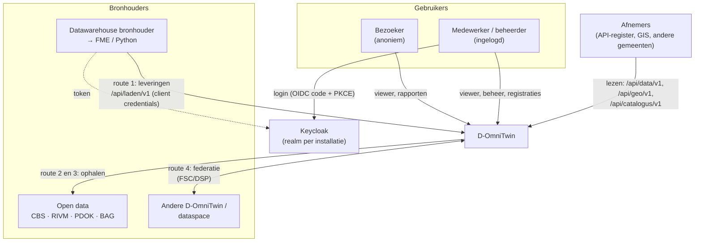
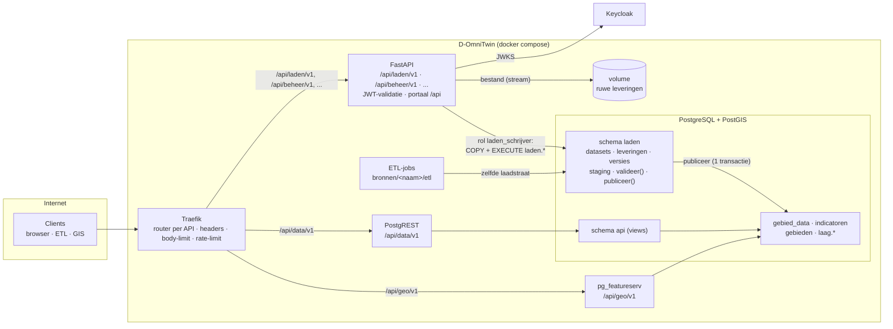
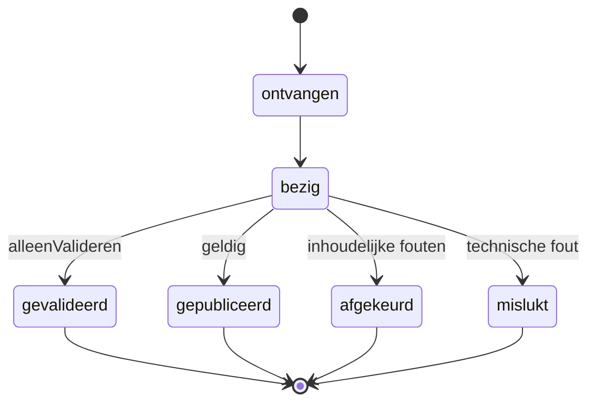
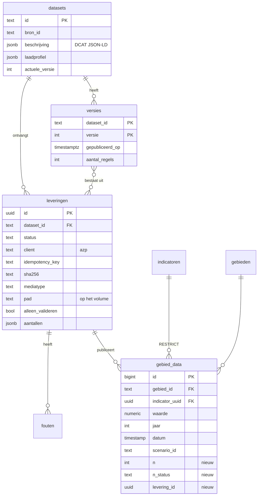

# Architectuur: D-OmniTwin vullen

Hoe data in D-OmniTwin komt: registratie, leveringen, laadstraat, autorisatie en de vier vulroutes. Besluiten: [ADR 0004](adr/0004-een-ingang-voor-vullen.md) (vullen via registratie en leveringen) en [ADR 0005](adr/0005-gescheiden-apis-per-doel.md) (gescheiden API's per doel). Bouwt voort op ADR 0002, databronnen als dataproduct ([PR #184](https://github.com/TLaan/D-OmniTwin/pull/184)). Specificatie: [laad-API](../api/laden/README.md). Plaats tussen de andere API's: [API-landschap](api-landschap.md).

Status: voorgesteld, doelbeeld voor 0.3.0 en verder. Wat er nu staat: [§ 8](#8-huidige-stand-021).

## 1. In het kort

- D-OmniTwin accepteert **datasets als pakket**, niet losse records. Een ETL levert een volledige snapshot; D-OmniTwin valideert en publiceert hem in één keer als nieuwe **versie**.
- **Registratie** (wat is de dataset: DCAT-AP-NL/GeoDCAT-AP, plus een laadprofiel) is gescheiden van **levering** (GeoPackage of Data Package-zip, CSV of JSON) en **laden**.
- Eén ingang: de laad-API, `/api/laden/v1`. Elke dataset heeft een **profiel**: `waarnemingen`, `definities`, `gebiedsindeling` of `kaartlaag`. Een adapter (`swf-monitor-v1`) vertaalt de huidige SWF-push.
- Laadstraat: **ruw bewaren → valideren → staging → atomisch publiceren**. Bij een fout blijft de vorige versie actief.
- **Keycloak** regelt identiteit: client credentials voor machines (rol per dataset), code + PKCE voor mensen. **Traefik** routeert en begrenst.

## 2. Context



## 3. Containers



| Container | Rol bij vullen | Eigen code |
|---|---|---|
| Traefik | TLS (of achter de proxy van de organisatie), router per API, `buffering.maxRequestBodyBytes` en `rateLimit` op `/api/laden/v1` | config |
| Keycloak | realm `omnitwin`: clients `omnitwin-web`, `omnitwin-api`, machineclients; rollen `dataset:{id}:laden`, `datasets:laden`, `beheerder`, `lezer`; tokens | realm-config |
| FastAPI | laad-API: token en rol controleren, bestand naar het volume streamen (sha256), laadstraat starten, status | dun |
| Volume `leveringen` | ruwe bestanden, onveranderlijk, met bewaartermijn | – |
| PostgreSQL `laden` | registraties, leveringen, versies, staging, validatie, n-drempel, atomische publicatie | SQL-functies |
| ETL-jobs | interne ETL en virtualisatie, leveren via dezelfde laadstraat | per bron (ADR 0002) |
| PostgREST, pg_featureserv | lezen van gepubliceerde data | geen |

## 4. Gegevensstromen

### 4.1 Registratie

Eén keer per dataset, en bij een wijziging van de beschrijving. Een beheerder (realm-rol `beheerder`) doet `POST /api/laden/v1/datasets` met:

- `beschrijving`: DCAT-AP-NL/GeoDCAT-AP als JSON-LD (titel, beschrijving, uitgever, toegang, licentie, thema, dekking);
- `laadprofiel`: profiel, eventueel adapter, sleutelvelden, vervangbereik, `minimumN`, `bijNOnderDrempel`, `bijOntbrekendeN`, plausibiliteit, en voor geodata de featuretabel en het sleutel- en labelveld.

Daarna maakt de beheerder in Keycloak de client-rol `dataset:{datasetId}:laden` op `omnitwin-api` aan en kent die toe aan de leverende client. Profielen: [`docs/api/laden/profielen/`](../api/laden/profielen/README.md).

### 4.2 Levering (route 1)

```mermaid
sequenceDiagram
  autonumber
  participant E as ETL (bijv. FME)
  participant K as Keycloak
  participant T as Traefik
  participant F as Laad-API (FastAPI)
  participant V as Volume
  participant S as PostgreSQL laden
  participant G as gebied_data / gebieden / laag.*

  E->>K: POST /token (client_credentials,<br/>client_secret_post; later private_key_jwt)
  K-->>E: access_token (aud=omnitwin-api,<br/>rol dataset:swf-monitor-waarden:laden, 5 min)
  E->>T: POST /api/laden/v1/datasets/swf-monitor-waarden/leveringen<br/>Bearer · Idempotency-Key · application/zip
  T->>T: body-limit, rate-limit
  T->>F: doorsturen
  F->>F: JWT (JWKS, iss, aud, exp), rol voor deze dataset?
  alt geen of verkeerde rol
    F-->>E: 401 / 403 problem+json
  end
  F->>S: zelfde Idempotency-Key of sha256 al bekend?
  alt herhaling
    F-->>E: 200 + bestaande levering
  end
  F->>V: bestand streamen, sha256 berekenen (ruw bewaren)
  F->>S: levering registreren (ontvangen)
  F-->>E: 202 Accepted · Location: /api/laden/v1/leveringen/{id}
  F->>S: valideer(id): pakket, schema volgens profiel, CRS,<br/>codes, dubbele sleutels, plausibiliteit, n-drempel
  S->>S: staging vullen (COPY; GeoPackage via fiona)
  alt fouten
    S->>S: status afgekeurd, fouten per regel, vorige versie blijft
  else geldig en niet alleenValideren
    S->>G: publiceer(id): vervangbereik vervangen in 1 transactie,<br/>levering_id gezet, n < drempel niet gepubliceerd
    S->>S: nieuwe versie, staging opschonen, catalogus bijwerken
  end
  loop tot status klaar (of direct met wacht=true)
    E->>F: GET /api/laden/v1/leveringen/{id}
    F-->>E: status, aantallen, versie, sha256, fouten
  end
```

Met `wacht=true` blijft de verbinding open tot de levering klaar is (of tot de time-out): dan `201` of `422` in plaats van `202`. Dat is voor FME het eenvoudigst, omdat pollen daar omslachtig is.

### 4.3 Statussen



### 4.4 De vier vulroutes

| Route | Stroom | Ingang | Verschil met push |
|---|---|---|---|
| **1 Push** | ETL bij de bronhouder → `POST …/leveringen` | HTTP, client credentials, rol per dataset | – |
| **2 Interne ETL** | job in D-OmniTwin (`bronnen/<naam>/etl`) → zelfde laadstraat | in-process (dezelfde functie als de router) of HTTP met een eigen machineclient (zoals `etl-voorbeeld`) | geen netwerk nodig; dezelfde validatie, versies en herkomst |
| **3 Virtualisatie** | TTL verlopen → query op de bron (DuckDB, `ogr_fdw`) → resultaat als levering | als route 2 | de "ETL" is een query; alleen viewer-lagen buiten berekeningen worden zonder kopie on-demand gecachet |
| **4 Federatie** | vraag → orchestrator → `data`/`geo`-API van de andere installatie (FSC/DSP) → antwoord in hetzelfde profiel | geen levering; catalogus in DCAT-AP-NL | geen opslag, tenzij de policy een cache toestaat (dan: een levering via route 2) |

### 4.5 SWF-monitor

De huidige SWF-push (definities-snapshot, daarna waarden per indicator × gebiedstype) loopt via de adapter [`swf-monitor-v1`](../api/laden/profielen/swf-monitor-v1.md). D-OmniTwin spiegelt de huidige paden onder `/api/laden/v1/compat/swf-monitor/…`, synchroon, zodat FME alleen de basis-URL en de client wijzigt. Intern zijn het gewone leveringen op `swf-monitor-definities` en `swf-monitor-waarden`. De `GET`-varianten (back-up) geven de actuele versie terug in het SWF-formaat. Ontbrekende `n` krijgt de vlag `bron-onderdrukt`. Daarna kan SWF overstappen op één Data Package per run in plaats van ±57 losse aanroepen.

## 5. Autorisatie

| Wie | Keycloak | Mag | Databaserol |
|---|---|---|---|
| Bezoeker | – | publiek lezen (`data`, `geo`, `analyse`) | `web_anon`, backend-leesrol |
| Medewerker | gebruiker, realm-rol `lezer` | ook beperkte datasets en lagen | later `web_ingelogd` (PostgREST-JWT) |
| Beheerder | gebruiker, realm-rol `beheerder` | registraties, leveringen inzien, beheer-API | backend-beheerrol |
| Externe ETL | machineclient, client-rol `dataset:{datasetId}:laden` | leveren aan die dataset, eigen leveringen inzien | `laden_schrijver` (alleen `EXECUTE laden.*`) |
| Interne ETL | eigen machineclient, rollen per dataset of `datasets:laden` | idem | idem |
| Federatiepartner | client via FSC-contract | lezen van afgesproken datasets | backend-leesrol |

Paden en rollen per operatie: [`openapi.yaml`](../api/laden/openapi.yaml). Clients en realm: [API-landschap § 4](api-landschap.md#4-autorisatie-keycloak).

## 6. Relatie met ADR 0002 (databronnen als dataproduct)

| ADR 0002 | Invulling |
|---|---|
| Bron = dataproduct met `bron.json`, `contract.yaml`, `etl/`, `schema.sql`, `tests/` | een bron levert één of meer datasets; `bron.json` (DCAT) wordt de `beschrijving` van de registratie, `contract.yaml` het laadprofiel; `etl/` levert via de laadstraat |
| "Een bron levert waarden in de vorm van `gebied_data`" | profiel `waarnemingen`; daarnaast `definities`, `gebiedsindeling`, `kaartlaag` |
| Governance op de bron (toegang, doelbinding, minimale aantallen) | `dct:accessRights` in de beschrijving; `minimumN` in het laadprofiel; rol per dataset in Keycloak |
| Register `etl_bronnen`, runs `etl_runs`, herkomst `data_lineage` (#20) | `laden.datasets`, `laden.leveringen`, `laden.versies`; `gebied_data.levering_id` per waarde |
| Catalogus exporteerbaar (JSON-LD) | de registraties, via de catalogus-API |

## 7. Datamodel (schets)



Verder: unieke sleutel `(gebied_id, indicator_uuid, jaar, scenario_id)` en `(…, datum, scenario_id)`; de sleutel `unq_gebied_indicator_jaar` zonder scenario vervalt; `gebiedstypes` krijgt `actief` en `metadata`; kaartlagen krijgen een tabel per dataset in schema `laag`.

## 8. Huidige stand (0.2.1)

- Geen ingang voor data: scripts schrijven als database-eigenaar direct in `gebied_data` (`scripts/import_metingen.py`, `init_data/scripts/laad_usecase.py`).
- Upload alleen voor kaartbestanden in het beheer (`POST /api/admin/externe-lagen/upload`).
- Machine-auth: één gedeelde `X-Admin-Key` met volledige beheerrechten.
- Eén FastAPI-spec in de root (`/docs`, `/openapi.json`), zonder versie en `securitySchemes`; PostgREST en pg_featureserv los daarvan.
- Geen registratie, versies of herkomst per levering.

Details en bewijs: [RFC D-OmniTwin vullen, § 2](rfc-vullen-van-d-omnitwin.md#2-huidige-stand).

## 9. Kwaliteitseisen

| Eis | Hoe |
|---|---|
| Veiligheid | geen database-credentials buiten de stack; rol per dataset; korte tokens; `private_key_jwt` waar mogelijk; eigen databaserol voor de laad-API; limieten in Traefik |
| Privacy | n-drempel bij de ingang; staging opschonen; aggregaten toetsen; geen persoonsgegevens in leveringen |
| Herleidbaarheid | ruw bestand met sha256; `levering_id` per waarde; versies en historie per dataset; client in de levering |
| Betrouwbaarheid | atomische publicatie; vorige versie blijft bij een fout; idempotent; `alleenValideren` |
| Prestaties | streamen naar schijf en `COPY`; set-based validatie; asynchroon met `wacht=true` als optie |
| Herbruikbaarheid | open standaarden (DCAT-AP-NL, GeoDCAT-AP, Frictionless, GeoPackage, NL GOV ADR/OAuth, RFC 9457); geen SWF-specifieke code in de kern (alleen een adapter) |
