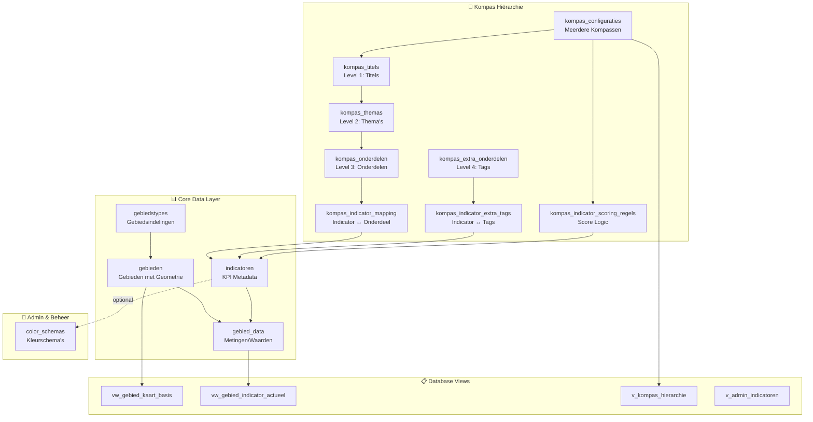
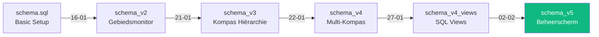
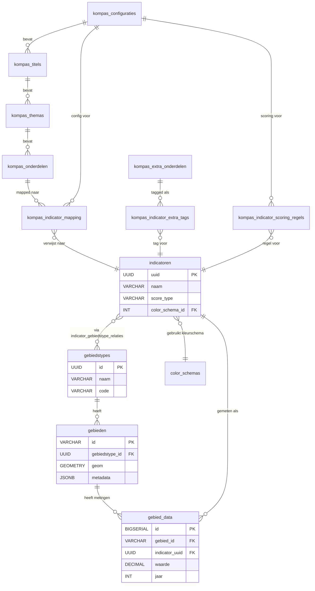
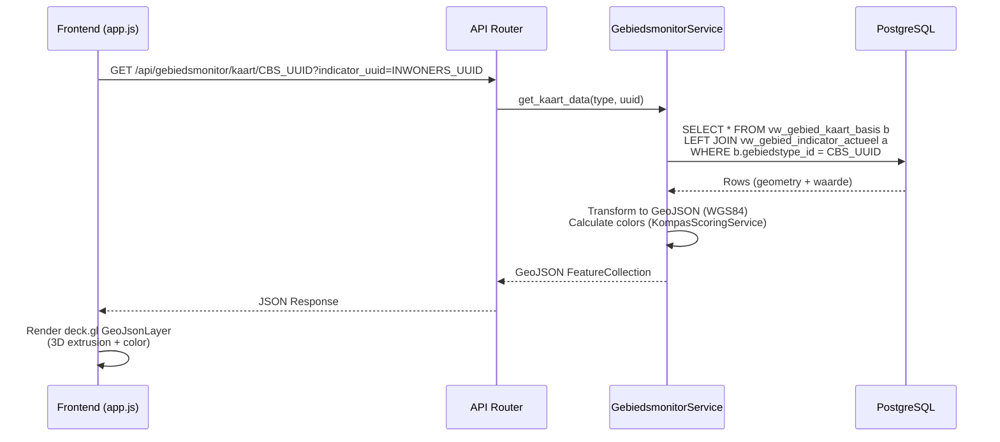
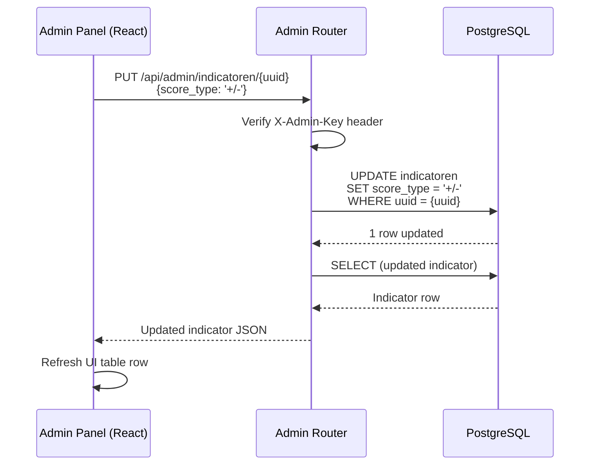
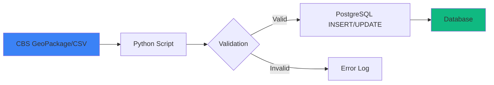

# D-OmniTwin Data Architectuur & Legacy Cleanup Plan

**Versie:** 1.0  
**Datum:** 3 februari 2026  
**Auteur:** Database Architect & Engineer

---

## Inhoudsopgave

1. [Executive Summary](#1-executive-summary)
2. [Huidige Database Structuur](#2-huidige-database-structuur)
3. [Schema Evolutie & Versies](#3-schema-evolutie--versies)
4. [Tabellen Inventaris & Gebruik](#4-tabellen-inventaris--gebruik)
5. [Relaties & Dependencies](#5-relaties--dependencies)
6. [Frontend ↔ Database Mapping](#6-frontend--database-mapping)
7. [Admin Panel ↔ Database Mapping](#7-admin-panel--database-mapping)
8. [Import Scripts & Data Vulling](#8-import-scripts--data-vulling)
9. [Legacy Componenten & Cleanup Voorstellen](#9-legacy-componenten--cleanup-voorstellen)
10. [Toekomst: API voor Data Vulling](#10-toekomst-api-voor-data-vulling)

---

## 1. Executive Summary

### Kernbevindingen

D-OmniTwin gebruikt **PostgreSQL 15+ met PostGIS extensie** en heeft een gestructureerde database architectuur die bestaat uit **5 schema versies** (base → v2 → v3 → v4 → v5). De database bevat:

- **20 core tabellen** (actief in gebruik)
- **6 database views** voor performance optimalisatie
- **5 hiërarchische tabellen** voor Kompas visualisatie
- **3 beheer tabellen** voor admin functionaliteit

### Status

✅ **Strengths:**
- Goede scheiding tussen geometrie, metadata en metingen
- Spatial indexing geïmplementeerd (PostGIS GIST)
- Database views reduceren complexiteit in Python code
- UUID-based foreign keys voor toekomstbestendigheid

⚠️ **Attention Points:**
- **1 legacy tabel** geïdentificeerd: `configuratie_instanties` (minimaal gebruik)
- Sommige tabellen hebben **overlappende verantwoordelijkheden** (zie sectie 9)
- Import scripts zijn **batch-based**, geen API beschikbaar

### Aanbevelingen Samenvatting

1. **Verwijder** `configuratie_instanties` tabel (vervangen door `kompas_configuraties`)
2. **Consolideer** schema files naar één `schema_latest.sql`
3. **Implementeer** API endpoints voor data upload (zie sectie 10)
4. **Archive** oude schema versies naar `data/backups/archive/`

---

## 2. Huidige Database Structuur

### 2.1 Overzicht



### 2.2 Technische Specificaties

| Component | Waarde |
|-----------|--------|
| **Database Engine** | PostgreSQL 15.x |
| **Spatial Extension** | PostGIS 3.4+ |
| **Coördinatensysteem** | EPSG:28992 (RD New) voor opslag<br/>EPSG:4326 (WGS84) voor API output |
| **Total Tables** | 20 tabellen + 6 views |
| **Data Volume** | ~1,721 gebieden, ~226 indicatoren |
| **Spatial Indexes** | 2 GIST indexes (geom + centroid) |

---

## 3. Schema Evolutie & Versies

### 3.1 Versie Geschiedenis

| Versie | Bestand | Datum | Doel |
|--------|---------|-------|------|
| **Base** | `schema.sql` | jan 2026 | Initiele opzet (simpel) |
| **v2** | `schema_v2_gebiedsmonitor.sql` | 16 jan 2026 | Gebiedsmonitor integratie |
| **v3** | `schema_v3_kompas.sql` | 21 jan 2026 | Kompas hiërarchie (5 levels) |
| **v4** | `schema_v4_multi_kompas.sql` | 22 jan 2026 | Multi-kompas configuratie systeem |
| **v4 Views** | `schema_v4_views.sql` | 27 jan 2026 | Backend simplification views |
| **v5** | `schema_v5_beheerscherm.sql` | feb 2026 | Beheerscherm (score types, kleurschema's) |

### 3.2 Schema Migratie Flow



> ⚠️ **Opmerking:** Elke versie is **additief** (ADD/ALTER statements), niet destructief. Oude tabellen blijven bestaan.

---

## 4. Tabellen Inventaris & Gebruik

### 4.1 Core Tabellen (Essentieel)

#### 4.1.1 Gebiedstypen & Geometrie

| Tabel | Rijen | Primair Gebruik | Status |
|-------|-------|-----------------|--------|
| **gebiedstypes** | ~3 | Definitie van gebiedsindelingen (CBS Buurten, Wijken, etc.) | ✅ ACTIEF |
| **gebieden** | ~1,721 | Gebieden met PostGIS geometrie (MultiPolygon) | ✅ ACTIEF |

**Frontend Gebruik:**
- `GET /api/gebiedsmonitor/gebiedstypes` → Dropdown selectie
- `GET /api/gebiedsmonitor/kaart/{type_id}` → GeoJSON voor 3D kaart

**Kolommen van Belang:**
```sql
gebieden:
  - id (PK)                         -- CBS code (bijv. "BU19000000")
  - gebiedstype_id (FK)             -- Link naar gebiedstypes
  - geom (GEOMETRY)                 -- RD New (28992)
  - geom_centroid (GEOMETRY)        -- Auto-calculated
  - metadata (JSONB)                -- Extra properties (water=JA filtering!)
```

---

#### 4.1.2 Indicatoren & Metingen

| Tabel | Rijen | Primair Gebruik | Status |
|-------|-------|-----------------|--------|
| **indicatoren** | ~226 | KPI metadata (naam, eenheid, bron, score_type) | ✅ ACTIEF |
| **gebied_data** | ~50,000+ | Feitelijke metingen per gebied/indicator/jaar | ✅ ACTIEF |

**Frontend Gebruik:**
- `GET /api/gebiedsmonitor/indicatoren` → Dropdown selectie
- `GET /api/gebiedsmonitor/kaart/{type}?indicator_uuid={uuid}` → Data voor kleuring

**Kolommen van Belang:**
```sql
indicatoren:
  - uuid (PK, UUID)                 -- Unieke identifier
  - naam (VARCHAR)                  -- "Inwoners", "Gemiddeld inkomen"
  - score_type (VARCHAR)            -- '+/+', '+/-', '-/+', '-/-' (sinds v5)
  - color_schema_id (FK)            -- Link naar kleurschema (sinds v5)
  - admin_notes (TEXT)              -- Beheerscherm notities (sinds v5)

gebied_data:
  - gebied_id (FK)                  -- Link naar gebieden
  - indicator_uuid (FK)             -- Link naar indicatoren
  - waarde (DECIMAL)                -- De meting
  - jaar (INTEGER)                  -- Jaartal (2023, 2024, etc.)
  - scenario_id (VARCHAR)           -- 'current', 'scenario_2050'
```

---

### 4.2 Kompas Tabellen (Sunburst Visualisatie)

| Tabel | Rijen | Niveau | Status |
|-------|-------|--------|--------|
| **kompas_configuraties** | ~2 | Master | ✅ ACTIEF |
| **kompas_titels** | ~10 | Level 1 (Buitenste ring) | ✅ ACTIEF |
| **kompas_themas** | ~20 | Level 2 | ✅ ACTIEF |
| **kompas_onderdelen** | ~40 | Level 3 | ✅ ACTIEF |
| **kompas_extra_onderdelen** | ~10 | Level 4 (Tags) | ✅ ACTIEF |
| **kompas_indicator_mapping** | ~226 | Indicator ↔ Onderdeel | ✅ ACTIEF |
| **kompas_indicator_extra_tags** | ~50 | Indicator ↔ Tags (Many-to-Many) | ✅ ACTIEF |
| **kompas_indicator_scoring_regels** | ~0 | Score regels (toekomstig) | ⏳ LEEG |

**Frontend Gebruik:**
- `GET /api/kompas/{config_id}/hierarchie` → D3.js Sunburst data
- `GET /api/kompas/{config_id}/gebied/{id}` → Kompas met waarden voor 1 gebied

**Hiërarchie Structuur:**
```
Configuratie → Titel → Thema → Onderdeel → Indicator
                                   ↓
                            Extra Onderdeel (Tags)
```

---

### 4.3 Admin & Beheer Tabellen

| Tabel | Rijen | Primair Gebruik | Status |
|-------|-------|-----------------|--------|
| **color_schemas** | ~4 | Kleurschemas voor kaart/kompas | ✅ ACTIEF |
| **indicator_gebiedstype_relaties** | ~500 | Welke indicator geldt voor welk gebiedstype | ✅ ACTIEF |

**Admin Panel Gebruik:**
- `GET /api/admin/color-schemas` → Dropdown in indicator editor
- `PUT /api/admin/indicatoren/{uuid}` → Update score_type, color_schema_id

---

### 4.4 Database Views (Performance Optimalisatie)

| View | Doel | Gebruikt Door |
|------|------|---------------|
| **vw_gebied_kaart_basis** | GeoJSON basis (excl. water) | `GebiedsmonitorService.get_kaart_data()` |
| **vw_gebied_indicator_actueel** | Meest recente waarde per indicator | `GebiedsmonitorService.get_kaart_data()` |
| **v_kompas_hierarchie** | Complete hiërarchie (alle configs) | `KompasService.get_hierarchie()` |
| **v_kompas_config_stats** | Statistieken per configuratie | `KompasService.get_configuraties()` |
| **v_admin_indicatoren** | Admin view met alle metadata | `AdminRouter.get_indicatoren()` |
| **v_polariteiten** | Codelijst polariteit (#120, vervangt v_score_types) | `AdminRouter.get_polariteiten()` |

> 💡 **Performance Tip:** Views bevatten complexe JOINs en filtering, waardoor Python code simpeler en sneller is.

---

### 4.5 Legacy / Minimaal Gebruik

| Tabel | Status | Reden | Actie |
|-------|--------|-------|-------|
| **configuratie_instanties** | 🟡 LEGACY | Vervangen door `kompas_configuraties` (v4) | ⚠️ VERWIJDEREN |

---

## 5. Relaties & Dependencies

### 5.1 Entity Relationship Diagram (ERD)



### 5.2 Foreign Key Constraints

| Child Table | Column | Parent Table | On Delete |
|-------------|--------|--------------|-----------|
| gebieden | gebiedstype_id | gebiedstypes | RESTRICT |
| gebied_data | gebied_id | gebieden | CASCADE |
| gebied_data | indicator_uuid | indicatoren | CASCADE |
| indicatoren | color_schema_id | color_schemas | (none) |
| kompas_titels | config_id | kompas_configuraties | CASCADE |
| kompas_themas | titel_id | kompas_titels | CASCADE |
| kompas_onderdelen | thema_id | kompas_themas | CASCADE |
| kompas_indicator_mapping | onderdeel_id | kompas_onderdelen | CASCADE |
| kompas_indicator_mapping | indicator_uuid | indicatoren | CASCADE |

> ⚠️ **RESTRICT vs CASCADE:** Gebiedstypes kunnen niet verwijderd worden als gebieden nog bestaan. Indicator verwijdering triggert cascade delete van metingen.

---

## 6. Frontend ↔ Database Mapping

### 6.1 Frontend Applicatie (Main App)

**Technologie:** Vanilla JavaScript + deck.gl + D3.js  
**Main Files:** `static/js/app.js`, `static/js/kompas.js`

#### Gebruikte Tables (via API)

| Feature | API Endpoint | Tabellen | Views |
|---------|-------------|----------|-------|
| **Gebiedstype Selectie** | `GET /api/gebiedsmonitor/gebiedstypes` | gebiedstypes, gebieden | - |
| **Indicator Selectie** | `GET /api/gebiedsmonitor/indicatoren` | indicatoren, indicator_gebiedstype_relaties | - |
| **3D Kaart (GeoJSON)** | `GET /api/gebiedsmonitor/kaart/{type}?indicator_uuid={uuid}` | - | vw_gebied_kaart_basis, vw_gebied_indicator_actueel |
| **Kompas Hiërarchie** | `GET /api/kompas/{config}/hierarchie` | - | v_kompas_hierarchie |
| **Kompas voor Gebied** | `GET /api/kompas/{config}/gebied/{id}` | kompas_*, gebied_data | - |

#### Data Flow Example: 3D Kaart Renderen



---

### 6.2 Frontend: Kompas Interactie

| User Actie | API Call | Tabellen | Effect |
|------------|----------|----------|--------|
| Gebied klikken op kaart | `GET /api/kompas/1/gebied/{id}` | kompas_*, gebied_data | Sunburst update met kleuren |
| Indicator klikken in Kompas | (Frontend event) | - | Kaart herlaadt met nieuwe indicator |

**Kritieke Observatie:**
- Frontend gebruikt **ALLEEN API endpoints**, geen directe database queries
- Alle database complexiteit zit in **Services** (`services/gebiedsmonitor_service.py`, `services/kompas_service.py`)
- Views reduceren query complexiteit aanzienlijk (was 50+ regels SQL, nu 5 regels)

---

## 7. Admin Panel ↔ Database Mapping

### 7.1 Admin Panel (Beheerscherm)

**Technologie:** React + TypeScript + React Router  
**Main Files:** `admin-panel/src/`

#### Gebruikte Tables (via Admin API)

| Feature | API Endpoint | Tabellen | Mutaties |
|---------|-------------|----------|----------|
| **Indicator Lijst** | `GET /api/admin/indicatoren` | indicatoren, color_schemas | - |
| **Indicator Bewerken** | `PUT /api/admin/indicatoren/{uuid}` | indicatoren | UPDATE |
| **Polariteiten** | `GET /api/admin/polariteiten` | - (view) | - |
| **Kleurschemas** | `GET /api/admin/color-schemas` | color_schemas | - |
| **Hiërarchie Boom** | `GET /api/admin/hierarchie/tree` | kompas_titels, kompas_themas, kompas_onderdelen, kompas_indicator_mapping | - |

#### Data Flow Example: Indicator Score Type Wijzigen



---

### 7.2 Beheerscherm: Welke Tabellen NIET Gebruikt

> **Belangrijk:** Het admin panel heeft **GEEN directe toegang** tot:
> - `gebieden` (Geography data → Main app only)
> - `gebied_data` (Measurements → via Main app API)
> - `gebiedstypes` (Managed via SQL migrations)

**Reden:** Admin panel is **metadata-only**. Data upload gebeurt via Python scripts (zie sectie 8).

---

## 8. Import Scripts & Data Vulling

### 8.1 Huidige Import Mechanisme (Batch Scripts)

**Locatie:** `scripts/`  
**Methode:** Python scripts (command-line execution)

| Script | Doel | Tabellen | Frequentie |
|--------|------|----------|-----------|
| **import_geometrie.py** | Import CBS GeoPackage → gebieden | gebieden, gebiedstypes | 1x per jaar (CBS update) |
| **import_cbs_data.py** | Import CBS indicatoren + data | indicatoren, gebied_data | Maandelijks |
| **import_kompas_hierarchie.py** | Import Kompas structuur vanuit CSV | kompas_* | 1x (configuratie) |
| **import_extra_indicatoren.py** | Import extra indicator metadata | indicatoren | Ad-hoc |
| **import_metingen.py** | Import metingen vanuit CSV | gebied_data | Weekly |
| **enrich_metadata.py** | Verrijk gebieden met extra metadata | gebieden (metadata JSONB) | Ad-hoc |

### 8.2 Data Flow: Import Proces



### 8.3 Import Script Dependencies

**Vereiste Packages:**
```python
# requirements.txt
pandas
geopandas
sqlalchemy
psycopg2-binary
openpyxl
```

**Execution Example:**
```bash
# Geometrie importeren
python scripts/import_geometrie.py data/CBS_BUURTEN_2024.gpkg

# CBS data importeren
python scripts/import_cbs_data.py --jaar 2024

# Kompas structuur importeren
python scripts/import_kompas_hierarchie.py data/indicator_testlijst.csv
```

### 8.4 Kritieke Observatie: Geen API voor Data Upload

> ⚠️ **Huidige Situatie:** Alle data import gebeurt via **command-line scripts**.  
> ⏳ **Toekomst:** API endpoints voor data upload (zie sectie 10).

**Implicaties:**
- ❌ Niet web-based (admin panel kan geen data uploaden)
- ❌ Geen real-time validatie feedback
- ✅ Wel transactioneel veilig (rollback bij fouten)
- ✅ Wel batch processing mogelijk (grote bestanden)

---

## 9. Legacy Componenten & Cleanup Voorstellen

### 9.1 Legacy Tabel: `configuratie_instanties`

**Status:** 🟡 **DEPRECATED** (sinds schema v4)

**Oorspronkelijke Functie:**
- Multi-tenant support (verschillende gemeenten/domeinen)
- Opslag van "volledige boomstructuur configuratie" in JSONB

**Waarom Legacy:**
- Vervangen door `kompas_configuraties` (v4) met flexibeler model
- JSONB configuratie is vervangen door relationele tabellen (kompas_titels, kompas_themas, etc.)
- **Geen** referenties meer vanuit andere tabellen

**Huidige Gebruik:**
```sql
SELECT COUNT(*) FROM configuratie_instanties;
-- Resultaat: waarschijnlijk 0 of 1 (legacy seed data)
```

**Actie:** ⚠️ **VERWIJDEREN**

```sql
-- Verificatie: Check foreign keys
SELECT 
    tc.table_name, 
    kcu.column_name
FROM information_schema.table_constraints AS tc 
JOIN information_schema.key_column_usage AS kcu
  ON tc.constraint_name = kcu.constraint_name
WHERE tc.constraint_type = 'FOREIGN KEY' 
  AND kcu.table_name = 'configuratie_instanties';
-- Verwachting: 0 resultaten

-- Safe drop
DROP TABLE IF EXISTS configuratie_instanties CASCADE;
```

---

### 9.2 Overlappende Verantwoordelijkheden

#### 9.2.1 `kompas_indicator_mapping` vs `indicator_gebiedstype_relaties`

**Observatie:**
- `kompas_indicator_mapping`: Indicator ↔ Kompas Onderdeel (voor Sunburst visualisatie)
- `indicator_gebiedstype_relaties`: Indicator ↔ Gebiedstype (welke indicatoren gelden voor CBS Buurten vs Wijken)

**Zijn deze beide nodig?**
- ✅ **JA**: Verschillende use cases
  - Kompas mapping = **visualisatie hiërarchie**
  - Gebiedstype relaties = **data filtering** (niet alle indicatoren hebben data voor alle gebiedstypes)

**Actie:** ✅ **BEHOUDEN (geen overlap)**

---

#### 9.2.2 `kompas_indicator_scoring_regels` vs `indicatoren.score_type`

**Observatie:**
- `indicatoren.score_type`: Simpele '+/+', '+/-', '-/+', '-/-' (sinds v5)
- `kompas_indicator_scoring_regels`: Complexe threshold-based scoring (toekomstig)

**Zijn deze beide nodig?**
- ⏳ **TOEKOMSTIG**: `score_type` is **versimpelde versie** voor MVP
- In de toekomst: migratie naar `scoring_regels` voor granulaire controle

**Actie:** ✅ **BEHOUDEN (toekomstbestendige opzet)**

---

### 9.3 Ongebruikte Kolommen

Na analyse van code en queries:

| Tabel | Kolom | Status | Reden | Actie |
|-------|-------|--------|-------|-------|
| indicatoren | `code` | 🟡 MINIMAAL | Kort code veld (bijv. 'VEILIG_01'), niet gebruikt in frontend | ⏳ BEHOUDEN (potentieel nuttig) |
| indicatoren | `min_waarde`, `max_waarde` | 🟡 MINIMAAL | Voor drempelwaarden, niet gebruikt in huidige logica | ⏳ BEHOUDEN (toekomstig) |
| gebied_data | `scenario_id` | 🟢 ACTIEF | Default 'current', maar wel gebruikt voor toekomstscenario's | ✅ BEHOUDEN |
| gebied_data | `kwaliteit` | 🟡 MINIMAAL | 'betrouwbaar', 'geschat', etc. - niet gebruikt in UI | ⏳ BEHOUDEN (metadata) |

**Conclusie:** Geen kolommen te verwijderen. Alles heeft potentiële toekomstige waarde.

---

### 9.4 Schema Files Cleanup

**Probleem:** 7 schema files (base, v2, v3, v4, v4_views, v5) maken onderhoud complex.

**Voorstel:** 📁 **Consolideer naar `schema_latest.sql`**

**Nieuwe Structuur:**
```
data/
├── schema_latest.sql              ← Volledige schema (v5 = current state)
├── migrations/
│   ├── 001_initial.sql            ← Base schema
│   ├── 002_gebiedsmonitor.sql     ← v2 changes
│   ├── 003_kompas.sql             ← v3 changes
│   ├── 004_multi_kompas.sql       ← v4 changes
│   ├── 005_views.sql              ← v4_views
│   ├── 006_beheerscherm.sql       ← v5 changes
└── backups/
    └── archive/
        ├── schema.sql             ← Move old base here
        ├── schema_v2_gebiedsmonitor.sql
        └── ...
```

**Voordeel:**
- ✅ Nieuwe installatie: run `schema_latest.sql`
- ✅ Migratie: run migrations sequentieel
- ✅ Rollback: duidelijke versie historie

---

### 9.5 Views: Zijn ze allemaal nodig?

**Analyse van Views:**

| View | Query Count (grep `.py`) | Status |
|------|--------------------------|--------|
| vw_gebied_kaart_basis | 3 | ✅ ACTIEF |
| vw_gebied_indicator_actueel | 2 | ✅ ACTIEF |
| v_kompas_hierarchie | 2 | ✅ ACTIEF |
| v_kompas_config_stats | 1 | ✅ ACTIEF |
| v_admin_indicatoren | 0 | 🟡 ONGEBRUIKT |
| v_polariteiten | 1 | ✅ ACTIEF |
| v_indicatoren_actueel | 0 | 🟡 ONGEBRUIKT |
| v_gebieden_met_data | 0 | 🟡 ONGEBRUIKT |
| v_gebied_data_overzicht | 0 | 🟡 ONGEBRUIKT |

**Actie:** ⚠️ **OPTIONEEL CLEANUP**

```sql
-- Verwijder ongebruikte views (backup eerst!)
DROP VIEW IF EXISTS v_indicatoren_actueel CASCADE;
DROP VIEW IF EXISTS v_gebieden_met_data CASCADE;
DROP VIEW IF EXISTS v_gebied_data_overzicht CASCADE;
-- v_admin_indicatoren: bewaren (admin panel toekomstige features)
```

---

## 10. Toekomst: API voor Data Vulling

### 10.1 Visie

**DOEL:** Vervanging van batch scripts door **web-based upload API** voor:
1. CSV upload (metingen)
2. GeoJSON/GeoPackage upload (geometrie)
3. Excel upload (indicator metadata)

**Voordelen:**
- ✅ User-friendly (admin panel interface)
- ✅ Real-time validatie feedback
- ✅ Access control (API key of session-based)
- ✅ Audit logging (wie uploadde wat wanneer)

---

### 10.2 Roadmap: API Implementatie

**FASE 1: Upload Endpoints (Sprint 7)** - 2 weken

```python
# routers/upload.py
@router.post("/api/upload/csv/metingen")
async def upload_metingen(
    file: UploadFile,
    _: bool = Depends(verify_admin_key)
):
    """Upload CSV met metingen (gebied_data)"""
    # 1. MIME type validation
    # 2. Parse CSV (pandas)
    # 3. Validate foreign keys (gebied_id, indicator_uuid exist?)
    # 4. Transactioneel insert (rollback bij fout)
    # 5. Return result (succes + error rows)
    ...

@router.post("/api/upload/geojson/gebieden")
async def upload_geojson(
    file: UploadFile,
    gebiedstype_id: UUID,
    _: bool = Depends(verify_admin_key)
):
    """Upload GeoJSON met nieuwe gebieden"""
    # 1. Validate GeoJSON structure
    # 2. Transform to RD New (28992) if needed
    # 3. Calculate centroids
    # 4. Upsert gebieden table
    ...
```

**FASE 2: Async Processing (Sprint 7)** - 1 week

**Probleem:** Grote bestanden (10,000+ rows) blocken HTTP request.

**Oplossing:** Background task queue (Celery of RQ)

```python
# Background worker
@celery_app.task
def process_csv_upload(file_path: str, user_id: str):
    # 1. Parse CSV
    # 2. Validate
    # 3. Insert in batches (1000 rows/batch)
    # 4. Update job status in jobs table
    ...

# API endpoint
@router.post("/api/upload/csv/async")
async def upload_csv_async(file: UploadFile):
    # 1. Save file to temp storage
    # 2. Create job record
    # 3. Queue background task
    # 4. Return job_id
    return {"job_id": "abc123"}

# Status endpoint
@router.get("/api/jobs/{job_id}")
async def get_job_status(job_id: str):
    return {
        "status": "processing",  # "pending", "processing", "completed", "failed"
        "progress": 45,          # Percentage
        "errors": []
    }
```

**FASE 3: Validatie Pipeline (Sprint 7)** - 1 week

**Validation Layers:**
1. **File Level:** MIME type, size limit, encoding
2. **Schema Level:** Kolommen aanwezig, data types correct
3. **Business Logic:** Foreign keys exist, waarden binnen min/max
4. **Security:** Virus scan (ClamAV), SQL injection prevention

**Error Handling:**
- ❌ File-level fouten: reject immediate (HTTP 400)
- ⚠️ Row-level fouten: partial import + error report

```python
# Error report example
{
    "total_rows": 10000,
    "successful": 9850,
    "failed": 150,
    "errors": [
        {"row": 42, "error": "gebied_id 'BU99999999' niet gevonden"},
        {"row": 103, "error": "waarde '999999' buiten range (0-100)"}
    ]
}
```

---

### 10.3 Frontend: Upload UI (Admin Panel)

**Component:** `admin-panel/src/pages/DataUpload.tsx`

**Features:**
- 📁 Drag-drop file upload
- 📊 Preview data table (eerste 10 rijen)
- ✅ Column mapping wizard (CSV kolommen → database kolommen)
- 📈 Progress bar (voor async uploads)
- 📋 Error report download (CSV met fouten)

---

### 10.4 Migratie Strategie: Scripts → API

**STAP 1:** API endpoints bouwen (parallel aan scripts)  
**STAP 2:** Admin panel UI implementeren  
**STAP 3:** Testing periode (beide methoden beschikbaar)  
**STAP 4:** Deprecate scripts (verplaats naar `scripts/legacy/`)  

**Timeline:**
- Sprint 7: API endpoints + async processing (3 weken)
- Sprint 8: Admin panel UI (2 weken)
- Sprint 9: Testing + migratie (1 week)

---

### 10.5 API Specificatie (OpenAPI Preview)

```yaml
paths:
  /api/upload/csv/metingen:
    post:
      summary: Upload measurements CSV
      security:
        - AdminKey: []
      requestBody:
        content:
          multipart/form-data:
            schema:
              type: object
              properties:
                file:
                  type: string
                  format: binary
                indicator_uuid:
                  type: string
                  format: uuid
                jaar:
                  type: integer
      responses:
        200:
          description: Upload successful
          content:
            application/json:
              schema:
                type: object
                properties:
                  job_id:
                    type: string
                  status:
                    type: string
        400:
          description: Validation error
```

---

## Samenvatting Actiepunten

### Kortetermijn (Deze Sprint)

| Actie | Type | Impact | Effort |
|-------|------|--------|--------|
| Verwijder `configuratie_instanties` tabel | CLEANUP | 🟢 Low | 30 min |
| Archive oude schema files naar `data/backups/archive/` | CLEANUP | 🟢 Low | 15 min |
| Creëer `schema_latest.sql` (consolidatie) | CLEANUP | 🟡 Medium | 2 uur |
| Verwijder ongebruikte views (v_indicatoren_actueel, etc.) | CLEANUP | 🟢 Low | 30 min |

### Middellange Termijn (Sprint 7-8)

| Actie | Type | Impact | Effort |
|-------|------|--------|--------|
| Implementeer `/api/upload/*` endpoints | FEATURE | 🔴 High | 2 weken |
| Background task queue (Celery/RQ) | INFRA | 🔴 High | 1 week |
| Admin panel upload UI | FEATURE | 🟡 Medium | 1 week |
| Migratie scripts → API | MIGRATION | 🔴 High | 1 week |

### Lange Termijn (Sprint 9+)

| Actie | Type | Impact | Effort |
|-------|------|--------|--------|
| Deprecate batch scripts | CLEANUP | 🟡 Medium | 3 dagen |
| Monitoring & alerting voor uploads | INFRA | 🟡 Medium | 1 week |

---

**Document Versie:** 1.0  
**Laatste Update:** 3 februari 2026  
**Volgende Review:** Na Sprint 7 (API implementatie)
