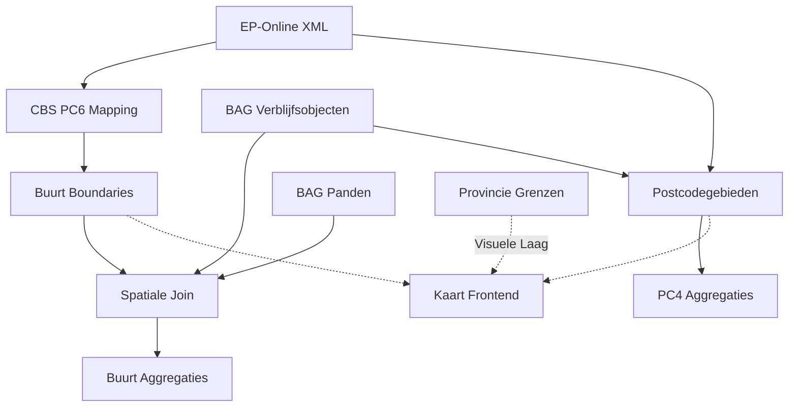

# Dataset Metadata: Nieuwe Bronnen D-OmniTwin

**Datum:** 10-02-2026  
**Status:** Sprint 5B Data Expansie  
**Versie:** 1.0

---

## Overzicht

Dit document beschrijft de metadata van 4 nieuwe datasets die beschikbaar zijn voor integratie in D-OmniTwin:

1. **BAG Fryslân** - Gebouwkenmerken (prioriteit: MEDIUM-HOOG)
2. **Bestuurlijke Postcodegebieden** - Administratieve grenzen (prioriteit: MEDIUM)
3. **CBS PC6-Huisnummer Koppeling** - Adres matching (prioriteit: HOOG)
4. **EP-Online Energielabels** - RVO energielabels (prioriteit: ZEER HOOG, ✅ geïmporteerd)

---

## 1. BAG Fryslân (Basisregistratie Adressen en Gebouwen)

### Algemene Metadata

| Eigenschap | Waarde |
|------------|--------|
| **Bron** | Kadaster - BAG (via PDOK) |
| **URL** | https://www.pdok.nl/datasets/basisregistratie-adressen-en-gebouwen |
| **Licentie** | CC0 1.0 (Publiek Domein) |
| **Update Frequentie** | Maandelijks (automatisch via PDOK) |
| **Geografisch Bereik** | Provincie Fryslân |
| **Datum Dataset** | Februari 2026 (meest recente PDOK extract) |
| **Formaat** | GeoPackage (.gpkg) |
| **Coördinatensysteem** | RD New (EPSG:28992) |

### Bestanden

#### 1.1 Verblijfsobjecten (`cleaned_bag_data_verblijfsobject.gpkg`)

| Eigenschap | Detail |
|------------|--------|
| **Bestandsgrootte** | 114 MB |
| **Aantal records** | ~280.000 verblijfsobjecten |
| **Geometrie type** | Point (centroïd van object) |
| **Gebruik** | Gebruiksdoel aggregaties, woonfunctie voor huishoudens telling |

**Data Dictionary:**

| Kolom | Type | Beschrijving | Voorbeeld |
|-------|------|--------------|-----------|
| `identificatie` | TEXT | Uniek BAG VBO ID | 0081010000000001 |
| `gebruiksdoel` | TEXT | Functie van verblijfsobject | woonfunctie, winkelfunctie, kantoorfunctie |
| `woonfunctie` | BOOLEAN | Is dit een woning? | true/false |
| `oppervlakte` | INTEGER | Gebruiksoppervlak in m² | 120 |
| `status` | TEXT | Status in BAG registratie | Verblijfsobject in gebruik |
| `pand_id` | TEXT | Koppeling naar pand | 0081100000000001 |
| `geometry` | POINT | Locatie centroïd | POINT(182000 560000) |

**Aggregatie Potentie:**
- **Buurt niveau:** Percentage woonfunctie, mix gebruiksdoelen, gemiddelde oppervlakte
- **PC4 niveau:** Regionaal overzicht functiemix voor grotere gebieden

#### 1.2 Panden (`bag_data_bag_pand.gpkg`)

| Eigenschap | Detail |
|------------|--------|
| **Bestandsgrootte** | 308 MB |
| **Aantal records** | ~170.000 panden |
| **Geometrie type** | Polygon (pand contour) |
| **Gebruik** | Bouwjaar voor energie-transitie analyses |

**Data Dictionary:**

| Kolom | Type | Beschrijving | Voorbeeld |
|-------|------|--------------|-----------|
| `identificatie` | TEXT | Uniek BAG Pand ID | 0081100000000001 |
| `bouwjaar` | INTEGER | Oorspronkelijk bouwjaar | 1932 |
| `status` | TEXT | Status pand | Pand in gebruik |
| `oppervlakte` | FLOAT | Oppervlak pand polygon (m²) | 850.5 |
| `geometry` | POLYGON | Pand contour | POLYGON(...) |

**Indicator Gebruik:**
- **Gemiddeld bouwjaar woningen** per buurt/PC4
- **Percentage woningen voor 1945** (vooroorlogse bouw, energie-inefficiënt)
- **Bouwjaar spreiding** voor inzicht in vervangingsbehoefte

#### 1.3 Ligplaatsen (`cleaned_bag_data_ligplaats.gpkg`)

| Eigenschap | Detail |
|------------|--------|
| **Bestandsgrootte** | 408 KB |
| **Aantal records** | ~500 ligplaatsen |
| **Geometrie type** | Polygon |
| **Gebruik** | Classificatie woonvormen (woonboten) |

**Data Dictionary:**

| Kolom | Type | Beschrijving |
|-------|------|--------------|
| `identificatie` | TEXT | Uniek BAG Ligplaats ID |
| `status` | TEXT | Status |
| `geometry` | POLYGON | Ligplaats contour |

#### 1.4 Standplaatsen (`cleaned_bag_data_standplaats.gpkg`)

| Eigenschap | Detail |
|------------|--------|
| **Bestandsgrootte** | 1.5 MB |
| **Aantal records** | ~1.200 standplaatsen |
| **Geometrie type** | Polygon |
| **Gebruik** | Classificatie woonvormen (woonwagens) |

**Data Dictionary:** (Vergelijkbaar met Ligplaatsen)

### Kwaliteit & Beperkingen

- ✅ **Volledigheid:** 100% coverage Fryslân (wettelijk verplichte registratie)
- ✅ **Actualiteit:** Maandelijkse updates via PDOK
- ⚠️ **Bouwjaar:** Sommige panden hebben historisch geschat bouwjaar (voor 1850)
- ⚠️ **Gebruiksdoel:** Meerdere gebruiksdoelen mogelijk per VBO (comma-separated)

---

## 2. Bestuurlijke Postcodegebieden

### Algemene Metadata

| Eigenschap | Waarde |
|------------|--------|
| **Bron** | CBS Geografische Indelingen / Kadaster |
| **Licentie** | Open Data |
| **Update Frequentie** | Jaarlijks |
| **Formaat** | GeoPackage (.gpkg) |
| **Coördinatensysteem** | RD New (EPSG:28992) |

### Bestanden

#### 2.1 Postcodegebieden Fryslân (`postcodegebieden_fryslan.gpkg`)

| Eigenschap | Detail |
|------------|--------|
| **Bestandsgrootte** | 29 MB |
| **Aantal records** | ~950 PC4 gebieden |
| **Geometrie type** | MultiPolygon |
| **Gebruik** | **NIEUW AGGREGATIENIVEAU** - PC4 analyses |

**Data Dictionary:**

| Kolom | Type | Beschrijving | Voorbeeld |
|-------|------|--------------|-----------|
| `pc4` | TEXT | Postcode 4-cijfers | 8888 |
| `pc4_code` | TEXT | Volledige PC4 met prefix | PC48888 |
| `gemeente_code` | TEXT | CBS gemeentecode | GM0081 |
| `gemeente_naam` | TEXT | Gemeentenaam **(VEREIST voor zoekingang!)** | Súdwest-Fryslân |
| `geometry` | MULTIPOLYGON | PC4 gebied contour | MULTIPOLYGON(...) |

**Gebruik:**
- Import als **nieuw aggregatieniveau** in `gebieden` tabel (`gebiedstype_id = 'PC4'`)
- **Zoekingang:** Gemeentenaam (NIET PC4-code search)
- **Koppeling:** `parent_id` = gemeente_code voor filtering
- **Frontend:** Aggregatieniveau dropdown (Buurt/Wijk/PC4/Gemeente)
- Aggregatie van BAG/CBS/EP-Online data op postcode niveau
- Cross-gemeente analyses (PC4 gebieden overschrijden soms gemeentegrenzen)

> [!IMPORTANT]
> **PC4 Implementatie:**
> - Frontend behoudt gemeentesearch (zoals nu)
> - Dropdown selecteert aggregatieniveau (Buurt → Wijk → PC4 → Gemeente)
> - Gebruiker kiest: "Súdwest-Fryslân" + aggregatie "PC4" → toont PC4 polygonen
> - **GEEN** directe PC4-code zoekfunctie

#### 2.2 Gemeenten Fryslân (`Gemeenten_Fryslân.gpkg`)

| Eigenschap | Detail |
|------------|--------|
| **Bestandsgrootte** | 1.1 MB |
| **Aantal records** | 18 gemeenten |
| **Gebruik** | Referentie grenzen (reeds als GM gebiedstype aanwezig) |

#### 2.3 Provincie Fryslân (`Provincie_Fryslân.gpkg`)

| Eigenschap | Detail |
|------------|--------|
| **Bestandsgrootte** | 217 KB |
| **Aantal records** | 1 provincie |
| **Gebruik** | **VISUELE KAARTLAAG** - geen aggregatieniveau, wel context |

**Frontend Toepassing:**
- Toon provinciegrens als overlay laag op kaart (zwarte contour lijn)
- Geen data aggregatie op dit niveau
- Visuele context voor gebruikers die alleen Fryslân bekijken

---

## 3. CBS PC6-Huisnummer → Buurt Koppeling

### Algemene Metadata

| Eigenschap | Waarde |
|------------|--------|
| **Bron** | CBS - Geografische Indelingen |
| **URL** | https://www.cbs.nl/nl-nl/dossier/nederland-regionaal/geografische-data/gegevens-per-postcode |
| **Licentie** | CBS Open Data Licentie |
| **Update Frequentie** | Jaarlijks (augustus) |
| **Datum Dataset** | 01-08-2025 (v2025) |
| **Formaat** | ZIP archief met CSV's + afgeleide JSON |
| **Dekking** | Heel Nederland (7.4 miljoen adressen) |

### Bestanden

#### 3.1 PC6-Buurt Mapping (`pc6_buurt_mapping.json`)

| Eigenschap | Detail |
|------------|--------|
| **Bestandsgrootte** | 440 KB |
| **Format** | JSON (key-value pairs) |
| **Aantal mappings** | ~430.000 PC6 codes |
| **Gebruik** | **Primaire lookup** voor EP-Online en adres matching |

**Structuur:**
```json
{
  "8888AA": "00981101",
  "8888AB": "00981102",
  ...
}
```

- **Key:** PC6 code (6-cijferig postcode)
- **Value:** CBS buurtcode (8 cijfers)

**Gebruik in Scripts:**
- ✅ **Reeds actief in:** `import_energielabels.py` (regel 59-64)
- Toekomstig gebruik: Alle adres-matching scripts (BAG koppeling, externe bronnen)

#### 3.2 CBS Bronbestand (`2025-cbs-pc6huisnr20250801_buurt.zip`)

| Eigenschap | Detail |
|------------|--------|
| **Bestandsgrootte** | 22 MB (compressed), 257 MB (extracted CSV) |
| **Aantal records** | 7.4 miljoen adres-regels (landelijk) |
| **Gebruik** | Backup validatie, granulaire PC6+huisnummer lookup |

**Extracted bestanden:**

| Bestand | Grootte | Beschrijving |
|---------|---------|--------------|
| `pc6hnr20250801_gwb.csv` | 257 MB | Hoofdbestand: PC6 + huisnummer → Buurt/Wijk/Gemeente |
| `buurt_2025.csv` | 400 KB | Buurtnamen lookup |
| `wijk_2025.csv` | 84 KB | Wijknamen lookup |
| `gem_2025.csv` | 6 KB | Gemeentenamen lookup |

**Data Dictionary (pc6hnr20250801_gwb.csv):**

| Kolom | Type | Beschrijving | Voorbeeld |
|-------|------|--------------|-----------|
| `PC6` | TEXT | 6-cijferige postcode | 8888AA |
| `Huisnummer` | INTEGER | Huisnummer | 42 |
| `Buurt2025` | TEXT | CBS buurtcode (8 cijfers) | 00981101 |
| `Wijk2025` | TEXT | CBS wijkcode | 009811 |
| `Gemeente2025` | TEXT | CBS gemeentecode | 0098 |

### Update Procedure

**Frequentie:** Jaarlijks (augustus release)

**Stappen:**
1. Download nieuwe dataset van CBS website (augustus)
2. Extract ZIP naar `data/cbs_pc6_huisnr_buurt/extracted/`
3. Run script: `scripts/generate_pc6_mapping.py` (creates JSON from CSV)
4. Valideer Fryslân coverage: check aantal PC6 vs vorig jaar
5. Herstart services die mapping gebruiken (cache refresh)

---

## 4. EP-Online Energielabels (RVO)

### Algemene Metadata

| Eigenschap | Waarde |
|------------|--------|
| **Bron** | RVO (Rijksdienst voor Ondernemend Nederland) - EP-Online |
| **URL** | https://www.ep-online.nl/PublicData |
| **Licentie** | Open Data (Creative Commons Zero) |
| **Update Frequentie** | Halfjaarlijk (februari + augustus) |
| **Datum Dataset** | 02-02-2026 versie 4 |
| **Formaat** | XML (zeer groot bestand) |
| **Bestandsgrootte** | 7.9 GB (XML) |
| **Dekking Landelijk** | 6.1 miljoen energielabels |
| **Dekking Fryslân** | ~167.000 adressen (57.6% van huishoudens) |

### Import Status

| Aspect | Status |
|--------|--------|
| **Import uitgevoerd** | ✅ 09-02-2026 |
| **Script** | `scripts/import_energielabels.py` (271 regels) |
| **Techniek** | Streaming XML parser (iterparse) |
| **Verwerktijd** | ~45 minuten (7.9GB bestand) |
| **Indicatoren aangemaakt** | 2 (Gemiddeld label, Aantal labels) |

### Bestand

#### 4.1 RVO XML Dataset (`v20260202_v4_xml.xml`)

**Extractie Filters (toegepast tijdens import):**
- **Gebouwklasse = 'W'** (Woonfunctie, exclusief Utiliteit)
- **Postcode in Fryslân** (via PC6 mapping naar Friese buurten)
- **Energieklasse valid** (A++++ t/m G, exclusief 'U'nknown labels)

### Data Dictionary

**XML Structuur (per Pandcertificaat):**

| XML Element | Type | Beschrijving | Voorbeeld |
|-------------|------|--------------|-----------|
| `Postcode` | TEXT | 6-cijferige postcode | 8888AA |
| `Huisnummer` | INTEGER | Huisnummer |42 |
| `Energieklasse` | TEXT | Label classificatie | B |
| `Gebouwklasse` | TEXT | W=Woning, U=Utiliteit | W |
| `Opnamedatum` | DATE | Datum label opname | 2024-05-12 |
| `RegistratieDatum` | DATE | Registratiedatum | 2024-05-15 |

**Energieklasse Mapping:**

| Label | Numerieke Waarde | Kleur (advies) |
|-------|------------------|----------------|
| A+++++ | 1.0 | Donkergroen |
| A++++ | 1.5 | Groen |
| A+++ | 2.0 | Lichtgroen |
| A++ | 2.5 | Geelgroen |
| A+ | 3.0 | Geel |
| A | 3.5 | Lichtoranje |
| B | 4.0 | Oranje |
| C | 5.0 | Donkeroranje |
| D | 6.0 | Lichtrood |
| E | 7.0 | Rood |
| F | 8.0 | Donkerrood |
| G | 9.0 | Zwart |

### Geïmporteerde Indicatoren

#### Indicator 1: Gemiddeld energielabel

| Eigenschap | Waarde |
|------------|--------|
| **UUID** | (zie database) |
| **Code** | `gemiddeld_energielabel` |
| **Eenheid** | labelklasse (A++++ - G) |
| **Interpretatie** | -=- (lager getal = beter) |
| **Aggregatie Methode** | AVG(numerieke waarde) per buurt, conversie terug naar label |
| **Kompas Dimensie** | Wonen → Technische Kwaliteit → Energie |

**Voorbeeld Berekening:**
```
Buurt X heeft: 10x label B (4.0), 15x label C (5.0), 5x label A (3.5)
Gemiddelde: (10*4.0 + 15*5.0 + 5*3.5) / 30 = 4.33
→ Afgerond label: B (want 4.0 < 4.33 < 5.0)
```

#### Indicator 2: Aantal energielabels (Definitief/Voorlopig)

| Eigenschap | Waarde |
|------------|--------|
| **Code** | `aantal_energielabels_definitief`, `aantal_energielabels_voorlopig`, `aantal_energielabels_totaal` |
| **Eenheid** | aantal |
| **Interpretatie** | +=+ (meer = betere data coverage) |
| **Definitie** | **Definitief:** Status 'Bestaand' of 'Oplevering'<br>**Voorlopig:** Status 'Vergunningsaanvraag'<br>**Totaal:** Som van beiden |

#### Indicator 3: Energielabel Coverage

| Eigenschap | Waarde |
|------------|--------|
| **Code** | `pct_energielabel_coverage` |
| **Eenheid** | % |
| **Berekening** | `(aantal_energielabels_definitief / huishoudens_bag_woonfunctie) * 100` |
| **Doel** | Inzicht in datadichtheid voor betrouwbaarheidsoordeel |

### Kwaliteit & Dekking

| Aspect | Resultaat |
|--------|-----------|
| **Landelijke dekking** | ~40% van woningen |
| **Fryslân dekking** | 57.6% (hoger dan landelijk gemiddelde!) |
| **Ontbrekende data** | Oude woningen zonder recent energielabel, nieuwbouw nog niet geregistreerd |
| **Data kwaliteit** | Hoog (wettelijk verplichte certificering bij verkoop/verhuur) |

### Update Procedure (Halfjaarlijks)

**Frequentie:** Februari + Augustus (RVO publicatie schema)

**Stappen:**
1. Download nieuwe XML van RVO EP-Online portal
2. Plaats in `data/ep-online/extracted_vYYYYMMDD_v4_xml/`
3. Update `import_energielabels.py` met nieuwe bestandsnaam (regel 233)
4. Run import script: `python scripts/import_energielabels.py`
5. Verificatie:
   - Check aantal buurten met data (target: ~900 van 965)
   - Check gemiddelde label Fryslân (verwacht: B-C range)
6. Update indicator metadata: `bron = 'RVO EP-Online YYYYMM'`

### Koppeling met BAG

**Optie A: Huishoudens Denominateur** (✅ Prioriteit gebruiker)
```sql
-- Bereken % huishoudens met energielabel per buurt
SELECT 
  b.id AS gebied_id,
  COUNT(CASE WHEN vbo.woonfunctie = true THEN 1 END) AS huishoudens_bag,
  gd_labels.waarde AS aantal_labels,
  (gd_labels.waarde / COUNT(CASE WHEN vbo.woonfunctie = true THEN 1 END) * 100) AS percentage_met_label
FROM gebieden b
LEFT JOIN bag_verblijfsobjecten vbo ON ST_Within(vbo.geometry, b.geometry)
LEFT JOIN gebied_data gd_labels ON gd_labels.gebied_id = b.id
  AND gd_labels.indicator_uuid = '<uuid_aantal_labels>'
WHERE b.id LIKE 'BU%'
GROUP BY b.id, gd_labels.waarde;
```

**Optie B: Directe PC4 Aggregatie**
- EP-Online postcode → Postcodegebied direct
- Vermijd tussenlaag CBS PC6→Buurt
- Sneller voor regionale analyses

---

## Relaties Tussen Datasets



**Legenda:**
- **Solide lijnen:** Data transformaties
- **Stippellijnen:** Visuele presentatie

---

## Next Steps

1. **BAG Import Script:** Ontwikkel `import_bag_indicators.py` (Sprint 5C)
2. **PC4 Gebiedstype:** Add to `gebiedstypes` tabel, import postcodegebieden
3. **Provinciegrens Laag:** Frontend component voor overlay lijn
4. **Cross-Dataset Validatie:** Check of BAG huishoudens ≈ CBS huishoudens

---

**Documentatie Versie:** 1.0  
**Laatste Update:** 10-02-2026  
**Beheerder:** D-OmniTwin Team
