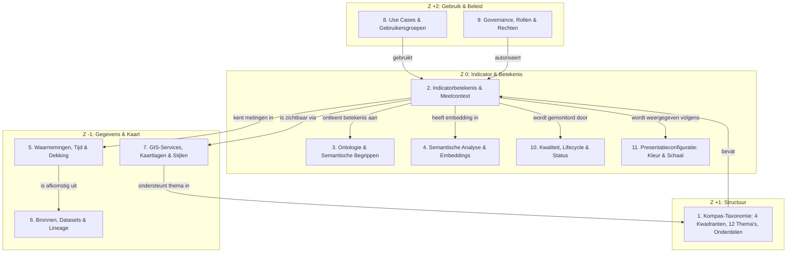

# Concept & Visie: Kompas Taxonomie Studio
**Visueel & relatiegericht beheer van de Kompas-taxonomie, 3D-vectorruimte, ontologie en gegevenscontext**

**Datum:** 21 november 2026  
**Initiatiefnemer:** Taeke van der Laan (CDO, Súdwest-Fryslân)  
**Status:** Concept / RFC / Epic (Issue #535)  
**Versie:** 2.0 — uitgebreid met 3D-vectorruimte, vrije X/Y/Z-assen, ontologische begrippen en 11 conceptuele domeinen  
**Doel-mijlpaal:** 0.8.0 / Later  
**Locatie:** `docs/4-ux-design/concept-visueel-taxonomie-indicatorenbeheer.md`  
**Aanvullende review:** [`docs/7-projectmanagement/taxonomie-kompas-beheer/aanvullende-review-kompas-taxonomie-studio-v2-ontologie.md`](../7-projectmanagement/taxonomie-kompas-beheer/aanvullende-review-kompas-taxonomie-studio-v2-ontologie.md)

---

## 1. Aanleiding & Kernidee

In het huidige beheerpaneel (`admin-panel/`) zijn drie nauw verwante onderdelen historisch als losse pagina's opgezet:
1. **Indicatoren** (`/admin/indicatoren`): een platte tabel met ~267 indicatoren, zoekbalk, paginering en een editor voor metadata, polariteit en ontologie.
2. **Hiërarchie** (`/admin/hierarchie`): een D3 collapsible tree van de Kompas-taxonomie (Configuratie → Titels/Kwadranten → Thema's → Onderdelen → Indicatoren), maar puur als leesweergave zonder bewerkmogelijkheden.
3. **Data Kwaliteit** (`/admin/data-kwaliteit`): deduplicatie van indicatoren (`deduplicatie_service.py`), data lineage checks en aggregatie-audits.

### Het Inzicht
In werkelijkheid is een indicator geen losstaande rij in een platte tabel. Een indicator ontleent zijn betekenis en maatschappelijke context aan de **taxonomie van het Kompas**:
```
[4 Kwadranten] → [12 Thema's] → [Onderdelen] → [Indicatoren]
```
Daarnaast staat een indicator in een rijk netwerk van onderlinge relaties met:
- **Ontologische begrippen en entiteitswaarden:** formele betekenissen uit begrippenstelsels (SKOS/OWL) die vastleggen wát er gemeten wordt.
- **Semantische vectoren (embeddings):** 384-dimensionale representaties (`indicator_embeddings`) die inhoudelijke verwantschap en overlappende meetdefinities signaleren.
- **Feitelijke waarnemingen:** metingen over tijd (jaren/peildata) en geografisch niveau (gemeente, wijk, buurt).
- **Bronnen en GIS-lagen:** dataleveranciers (CBS, RIVM, Kadaster) en geografische kaartlagen (WMS, WFS, SLD).
- **Gebruikersgroepen en use cases:** beleidsterreinen, doelgroepen en specifieke toepassingen.
- **Governance en lifecycle:** eigenaarschap, toegangsclassificatie (`openbaar` / `intern`), validatiestatus en datakwaliteit.

Het doel van de **Kompas Taxonomie Studio** is om dit volledige netwerk in samenhang beheersbaar te maken. Niet door primair meer visuele assen toe te voegen, maar door **één consistent informatiemodel** te hanteren en daarop meerdere doelgerichte perspectieven (2D hiërarchie, relationele graaf, tabel, en verkennende 3D-vectorruimte) aan te bieden.

---

## 2. Visuele Modellen: 2D Productiekern en Drie 3D-Perspectieven

De studio biedt verschillende visualisaties, elk afgestemd op een specifieke beheer- of analysetaak:

```
┌────────────────────────────────────────────────────────────────────────┐
│                        Kompas Taxonomie Studio                         │
├──────────────────────────────────────────┬─────────────────────────────┤
│  PERSPECTIEF:                            │    CONTEXTUELE INSPECTOR    │
│  [ Sunburst | Radial | Tabel | 3D-Lagen ]│                             │
│                                          │  Geselecteerd object:       │
│           (Kwadrant Fysiek)              │  Indicator: Energiearmoede  │
│               /        \                 │                             │
│         (Milieu)     (Wonen)             │  • Taxonomie: Wonen > Ond.  │
│          /    \         /    \           │  • Ontologie: [Energie]     │
│        (Ond)  (Ond)   (Ond)  (Ond)       │  • Meetdefinitie & eenheid  │
│                        /                 │  • Polariteit: lager_beter  │
│                   [Energiearm]           │  • Semantisch: 92% verwant  │
│                                          │  • GIS: WMS Kaartlaag #14   │
│  [+] Zoom / Filter op status / lagen     │  • Data: CBS (2020-2024)    │
│  [ Status: ⚠️ Duplicaat | 🔵 Draft ]    │  [ Opslaan ] [ Valideren ]  │
└──────────────────────────────────────────┴─────────────────────────────┘
```

### 2.1 De 2D Productiekern (Toegankelijk en Efficiënt)
Voor dagelijks beheer en conformiteit met WCAG 2.1 AA blijft de 2D-omgeving de canonieke interface:
1. **Zoomable Sunburst / Radial Wheel:**
   - Sluit 1-op-1 aan bij de vormentaal van het D-Omni Kompaswiel in de viewer.
   - Binnenring: de 4 hoofdkwadranten.
   - Ring 2: de 12 thematische taartpunten.
   - Ring 3: de functionele onderdelen.
   - Buitenste ring: de individuele indicatoren met kwaliteitsbadges.
2. **Collapsible Radial Tree (Bol-hiërarchie):**
   - Knooppunten als bollen die uitwaaieren of inklappen; toont hiaten en de omvang per thema.
3. **Gesynchroniseerde Tabel (Lijstweergave):**
   - Volledig toetsenbord-toegankelijk met ARIA-attributen.
   - Directe tweerichtingssynchronisatie: selectie in de tabel licht op in de visualisatie en vice versa.

### 2.2 Drie 3D-Visualisatieperspectieven

| Modus | Beschrijving & Functie | Architecturale Beoordeling |
|---|---|---|
| **Modus A — Semantische 3D-Vectorruimte** | Indicatoren geprojecteerd als puntenwolk op basis van vector-embeddings (UMAP/PCA). Nabijheid duidt op inhoudelijke verwantschap. | **Behouden als analysefunctie.** 3D-coördinaten zijn afgeleid (geen canoniek dataveld). Cosine similarity levert kandidaten; menselijke validatie beslist. |
| **Modus B — Gelaagde 3D-Architectuur** | Horizontaal het Kompas; over de Z-as worden de contextuele lagen getoond (gebruik bovenaan, Kompas in het midden, GIS/bronnen onderaan). | **Verder uitwerken als prototype.** Krachtig inzicht in de relatieketen van beleidsvraag tot kaartlaag en databron. |
| **Modus C — Vrije Multi-As Analyse** | De beheerder kiest zelf dimensies voor X, Y en Z (bijv. Thema × Polariteit × Kleurschema) om anomalieën te detecteren. | **Parkeren voor latere fase.** Veel dimensies zijn categorisch; analyse en mutatie moeten strikt gescheiden blijven. |

---

## 3. Het Informatiemodel: De 11 Conceptuele Domeinen

Het belangrijkste architectuurprincipe luidt:
> **Het informatiemodel is leidend; de visualisatie volgt.** Relaties moeten inhoudelijk verklaarbaar en controleerbaar zijn in de database, ook wanneer de 3D-weergave uitstaat.

Om te voorkomen dat eigenschappen, configuraties en entiteiten door elkaar lopen, onderscheidt het model 11 conceptuele domeinen:



### Onderscheid in het model:
1. **Entiteiten:** Objecten met een eigen identiteit (kwadrant, thema, onderdeel, indicator, ontologisch begrip, dataset, kaartlaag, use case).
2. **Relaties:** Betekenisvolle verbindingen met een expliciet type, bron en validatiestatus (`bevat`, `operationaliseert`, `wordt_geleverd_door`, `is_semantisch_verwant_aan`, `visualiseert`).
3. **Eigenschappen:** Kenmerken van een entiteit (naam, code, polariteit, eenheid, meetdefinitie).
4. **Waarnemingen:** Concrete meetwaarden gekoppeld aan indicator, periode (jaar/kwartaal), gebied (gemeente/wijk/buurt) en bron.
5. **Presentatieconfiguratie:** Regels voor kleurpaletten, klassengrenzen, drempelwaarden en symbolen.

---

## 4. Ontologie en Semantische Begrippen

Ontologie is een expliciete, formele betekenislaag — **geen synoniem voor vector-embeddings**:
- Een **embedding** berekent overeenkomst tussen tekststrings via AI (`sentence-transformers/all-MiniLM-L6-v2` op 384 dimensies).
- Een **ontologisch begrip** legt de formele bestuurlijke of maatschappelijke betekenis vast (bijv. SKOS-concept "Energiearmoede" gekoppeld aan domeinen Wonen, Inkomen en Duurzaamheid).

### Twee niveaus van ontologische koppeling:
1. **Indicatorniveau:** De indicator als geheel adresseert één of meerdere begrippen in een begrippenstelsel.
2. **Waarden- of categorieniveau:** Een gecodeerde waarde of klasse binnen een indicator (bijv. energielabels A t/m G, of woningtypen) verwijst naar een ontologisch begrip.

### Uitgangspunt bij implementatie:
- **Bestaande data eerst inventariseren:** Bestaande velden en codes behouden; niet overschrijven of forceren in een generieke tekststring.
- **Herkomst en stabiele ID's:** Gebruik URI's of concept-ID's waar aanwezig.
- **Ontologie zichtbaar in de Inspector:** Direct inzicht in gekoppelde concepten, begripsrelaties (breder/smaller) en validatiestatus.

---

## 5. Semantische Deduplicatie en Verwantschap

Het voorstel om `cosine similarity` te benutten voor het signaleren van doublures wordt als volgt ingericht:

```
Embedding berekenen (384d)
  → Cosine similarity berekenen tussen indicatorenparen
  → Signaleringsregel (bijv. score > 0,85)
  → Kandidaat verschijnt in inspector met contextuele vergelijking
  → Menselijke beoordeling door beheerder:
      ├── [ Semantisch verwant ] (raakvlakken, verschillende meetdefinitie)
      ├── [ Mogelijk dubbel ] (nader onderzoek nodig naar bron/methode)
      └── [ Bevestigd duplicaat ] (dezelfde meetbetekenis; actie in Data Kwaliteit)
```

**Belangrijke waarborgen:**
- Similarity is een **signaal**, geen autonoom besluit. Er vindt nooit automatische deactivering of samenvoeging plaats zonder beheerder.
- Indicatoren worden vergeleken op een representatieve tekst: naam, meetdefinitie, eenheid, populatie en methode (rekening houdend met modeltruncatie).
- Testen op Nederlandstalige gemeentelijke terminologie vóór definitieve drempelwaarden worden vastgesteld.

---

## 6. Harmonisatie van de Beheertabbladen

### A. Samenvoegen: `Indicatoren` + `Hiërarchie` → `Taxonomie Studio`
De twee historische beheerpagina's smelten samen:
- **Visualisatiepaneel:** Keuze tussen Sunburst, Hiërarchische Bol-graaf en (verkennend) 3D-Lagen.
- **Geïntegreerde Tabel:** Filters op thema, status, datadekking en ontologie; bulkbewerkingen.
- **Contextuele Inspector:** Past zich dynamisch aan op het geselecteerde niveau (kwadrant, thema, onderdeel, indicator of kaartlaag).

### B. Relatie met `Data Kwaliteit`
- **Data Kwaliteit blijft een zelfstandig audit- en reconciliatiescherm:** Ontdubbelen van datasets, controleren van aggregaties en herstellen van datalijnen vergen gespecialiseerde interfaces.
- **Kwaliteitsmarkers lichten op in de Taxonomie Studio:**
  - ⚠️ **Geel:** Kandidaat-duplicaat gesignaleerd via embeddings (linkt direct naar reconciliatieworkflow).
  - ⚪ **Grijs:** Geen meetdata beschikbaar voor actieve gebieden.
  - 🔴 **Rood:** Gedeactiveerd (`is_actief = false`, conform #526).
  - 🔵 **Blauw:** Ontologiekoppeling nog in concept (`draft`).

---

## 7. Technische Architectuur & API

1. **Frontend (React 19 + TypeScript):**
   - Gehuisvest in `admin-panel/src/pages/TaxonomieStudioPage.tsx`.
   - Modulaire weergavecomponenten met D3.js (2D Sunburst/Tree) en Three.js / Deck.gl (voor de verkennende 3D-lagen).
   - Server-state en caching via TanStack Query (`/api/admin/kompas/tree`, `/api/admin/kompas/graph`).
2. **Backend API (FastAPI + PostgreSQL/PostGIS + pgvector):**
   - `GET /api/admin/kompas/graph`: Levert knooppunten en gevalideerde relaties.
   - `GET /api/admin/kompas/semantiek/kandidaten`: Haalt similarity-kandidaten op boven een drempelwaarde.
   - `PUT /api/admin/kompas/relaties/{id}`: Valideren, afwijzen of wijzigen van relaties door een geautoriseerde beheerder.
3. **Toegankelijkheid (WCAG 2.1 AA):**
   - De tabelweergave biedt 100% functionele dekking met volledige toetsenbordnavigatie en schermlezerondersteuning. 3D is nooit de enige route naar beheerfuncties.

---

## 8. Gefaseerde Roadmap

| Stap | Onderwerp | Scope & Resultaat | Mijlpaal |
|---|---|---|---|
| **Stap 1** | **Conceptueel informatiemodel** | Vaststellen van de 11 domeinen, relatietypen, cardinaliteiten en inventarisatie van bestaande ontologievelden. | Later / 0.8.0 |
| **Stap 2** | **2D-Productieomgeving (Studio)** | Samenvoegen van Indicatoren en Hiërarchie; Sunburst/Graaf + gesynchroniseerde tabel + Contextuele Inspector. | 0.8.0 |
| **Stap 3** | **Semantische Proef** | Validatie van embeddings op Nederlandstalige gemeentelijke data; workflow voor kandidaat-doublures. | 0.8.0 |
| **Stap 4** | **3D-Prototype Gelaagde Architectuur** | Beproeving van Modus B (Z-as koppellagen) op concrete gebruikerstaken rondom datalijn en beleidscontext. | Later |
| **Stap 5** | **Multidimensionale Analyse (Modus C)** | Vrije assenverkenning voor geavanceerde kwaliteits- en configuratie-audits. | Later |

---

## 9. Referenties & Documentatie

- **GitHub Issue:** [#535 (RFC / Epic)](https://github.com/Sudwest-Fryslan/D-OmniTwin/issues/535)
- **Aanvullende Inhoudelijke Review:** [`docs/7-projectmanagement/taxonomie-kompas-beheer/aanvullende-review-kompas-taxonomie-studio-v2-ontologie.md`](../7-projectmanagement/taxonomie-kompas-beheer/aanvullende-review-kompas-taxonomie-studio-v2-ontologie.md)
- **D-Omni Kompaswiel & Visualisatie:** `static/js/kompas.js`, `src/omnitwin/services/kompas_service.py`
- **Embedding & Deduplicatie:** `src/omnitwin/services/ai_search_service.py`, `src/omnitwin/services/deduplicatie_service.py`
- **Data-infrastructuur:** PostgreSQL 15 met PostGIS en `pgvector`
