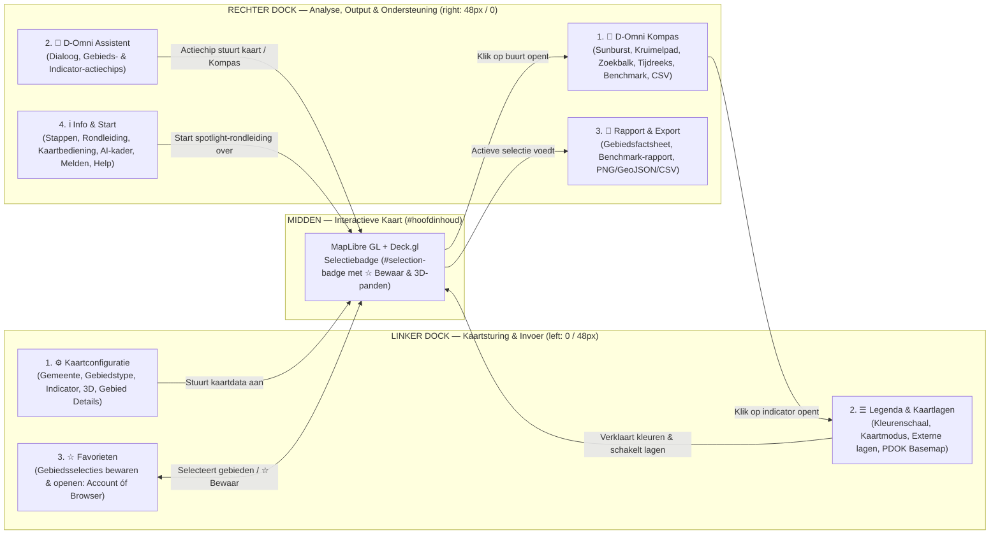

# Architectuur- & Uitvoeringsplan #525 — Drieluik-navigatie, Vaste Randtabs en Samengevoegde Docks

**Opdrachtgever:** Taeke van der Laan (Product Owner / CDO)  
**Architectuur:** Eduard Witteveen / D-OmniTwin Team  
**Issue:** [#525](https://github.com/Sudwest-Fryslan/D-OmniTwin/issues/525) (K1 — mijlpaal `0.7.0 — UX en toegankelijkheid`)  
**Gerelateerde issues:** [#444](https://github.com/Sudwest-Fryslan/D-OmniTwin/issues/444) (Rechter dock), [#466](https://github.com/Sudwest-Fryslan/D-OmniTwin/issues/466) (Soepele gebiedsselectie & `getFreezone`), [#258](https://github.com/Sudwest-Fryslan/D-OmniTwin/issues/258) (Favorieten), [#442](https://github.com/Sudwest-Fryslan/D-OmniTwin/issues/442)/[#532](https://github.com/Sudwest-Fryslan/D-OmniTwin/issues/532) (Rondleiding), [#527](https://github.com/Sudwest-Fryslan/D-OmniTwin/issues/527) (K2 — Kaartlagen groeperen), [#528](https://github.com/Sudwest-Fryslan/D-OmniTwin/issues/528) (K3 — Aanbevolen kaartlagen), [#529](https://github.com/Sudwest-Fryslan/D-OmniTwin/issues/529) (K4 — WMS-lagen & legenda)  
**Bronreview:** [`docs/7-projectmanagement/ux-design/review_ontwerpkeuze_navigatie_D-OmniTwin_issue_525.md`](../7-projectmanagement/ux-design/review_ontwerpkeuze_navigatie_D-OmniTwin_issue_525.md)  
**Status:** Geïmplementeerd — vastgestelde UX-fundatie voor 0.7.0  
**Datum:** 21 november 2026

---

## 1. Aanleiding en Ontwerpfilosofie

Bij het uitwerken van issue **#525** (*Legenda en kaartlagen samenvoegen tot één linker dock op volledige hoogte en breedte*) kwamen drie samenhangende knelpunten in de huidige viewer-layout naar voren:

1. **Verbroken functie- en richtingsverwachting:**  
   In de huidige interface staan alle 8 ronde bedieningsknoppen in één verticale kolom aan de linkerzijde (`.tab-bar`), terwijl *D-Omni Kompas* en *D-Omni Assistent* hun venster aan de **rechterzijde** (`#rechter-dock`) openen. Daardoor staan in dezelfde linkerkolom soms twee knoppen tegelijk actief (één voor links, één voor rechts) en bestaat er dubbele bediening met de tabs bovenin het rechter dock.
2. **Vermenging van functiesoorten:**  
   Invoer/kaartsturing (*Kaartconfiguratie*, *Legenda*, *Kaartlagen*, *Mijn favorieten*), analyse/output (*Kompas*, *Rapport*, *Exporteren*) en ondersteuning (*Assistent*, *Info & Start*) zitten nu door elkaar aan de linkerkant. Bovendien zijn *Rapport* (1 knop) en *Exporteren* (3 knoppen) te dun voor twee aparte top-level panelen, en zat *Mijn favorieten* (een selectie-/invoerfunctie) verstopt bovenin het *Info & Start*-paneel.
3. **Visuele onrust en kaartverlies bij volle dock-hoogte:**  
   De huidige losse ronde knoppen zweven op `left: 10px` met het linker paneel op `left: 80px` (`top: 100px`, `width: 360px`). Wanneer het linker paneel dezelfde volledige hoogte (`top: 80px; bottom: 35px`) en breedte (`clamp(440px, 30vw, 560px)`) krijgt als het rechter dock, ontstaat óf overlap met de zwevende knoppen, óf een onrustige tussenstrook over de kaart. Tegelijkertijd is een doorlopende verticale balk over de volledige schermhoogte ongewenst omdat die de kaart inkadert.

### De Oplossing in twee stappen
Conform de ontwerpreview splitsen we het vraagstuk in:
- **Fase A — Functionele Architectuur:** Een strikte ordening van alle functies op basis van hun rol in het drieluik (**Links = Kaartsturing & Invoer**, **Midden = Kaart**, **Rechts = Analyse, Output & Ondersteuning**).
- **Fase B — Visuele & Technische Architectuur:** Compacte, afgebogen **vaste randtabs aan de buitenste schermrand** (`left: 0` en `right: 0`, **zonder** doorlopende verticale balk), met native tooltip (`title`) en zonder over het venster uitklappende tekst. Beide dock-vensters sluiten strak aan op `left: 0` / `right: 0` (geen kaartkier meer naast de vensters), met de randtabs erbovenop en bovenin vrijgehouden ruimte rond de tabknoppen zodat visuele elementen eronder (Kompas-cirkel, trendgrafiek, lijsten) de volledige vensterbreedte benutten.

---

## 2. Vastgestelde Ontwerpbesluiten

| # | Onderwerp | Besluit |
|---|---|---|
| **B1** | **Functionele verdeling Links vs. Rechts** | **Links** bevat uitsluitend *Kaartsturing & Invoer* (3 tabs). **Rechts** bevat uitsluitend *Analyse, Output & Ondersteuning* (4 tabs). Elke functie heeft exact één vaste plek aan de zijde waar het paneel opent. |
| **B2** | **Samenvoegen Legenda & Kaartlagen (Links, Tab 2)** | `#panel-legenda` en `#panel-layers` worden samengevoegd in `#panel-legenda` (*Legenda & Kaartlagen*). Vaste opbouw: **1. Indicator-legenda** → **2. Externe kaartlagen** → **3. Achtergrondkaart (PDOK)**. Opent automatisch bij startkaart én bij klik op een indicator in het Kompas. |
| **B3** | **Favorieten als eigen 3e tab Links (Ingelogd én Anoniem)** | *Mijn favorieten* (`#mijn-favorieten`) wordt losgekoppeld van *Info & Start* en krijgt een eigen 3e linker randtab: **`☆ Favorieten`** (`#panel-favorieten`). Beschikbaar voor **zowel ingelogde gebruikers** (via `/api/mijn/favorieten` op `sub` in de database) **als niet-ingelogde gebruikers** (via `localStorage` in de browser). |
| **B4** | **Samenvoegen Rapport & Export (Rechts, Tab 3)** | *Rapport Output* en *Data Exporteren* worden samengevoegd tot één volwaardig tabblad **`Rapport & Export`** in het rechter dock (bovenaan *Gebiedsrapportage / Factsheet*, daaronder *Data Exporteren: PNG, GeoJSON, CSV*). |
| **B5** | **Info & Start naar Rechts (Rechts, Tab 4)** | *Info & Start* (Welkom, 3 stappen, *Start interactieve rondleiding*, Kaartbediening, AI-uitleg, *Feedback of afwijking melden*, *Volledige Handleiding*) verhuist naar de 4e tab van het rechter dock. |
| **B6** | **Vensters strak tegen de schermrand + randtabs erop** | De dock-vensters sluiten zonder kaartkier strak aan op de buitenste schermrand (`left: 0` en `right: 0`). De vaste randtabs liggen op `z-index: 220` **bovenop** het geopende venster (`48px` breed, geen verticale balk onder de tabs). De bovenkant van elk dock houdt rekening met de ruimte van de tabs (`--randtab-header-inset` / `--randtab-body-inset`), terwijl brede visuele inhoud eronder (Kompas-cirkel, trendgrafiek, lijsten) de volledige vensterbreedte benut. |
| **B7** | **Compacte afgebogen Chrome-tabvorm (tooltip i.p.v. tekstuitklap)** | We stappen af van de losse ronde knoppen. De randtabs blijven altijd compact (`48px`, alleen Lucide-icoon) met een afgebogen tabvorm; de browser-tooltip (`title` / `aria-label`) en venstertitel geven de naam al direct weer, zodat de tab bij hover/focus alleen een subtiel kleuraccent krijgt en niet over de vensterinhoud uitklapt. |
| **B8** | **Opruiming dubbele tabs in gedockte kopbalk** | Omdat `#rechter-dock` nu door de 4 vaste rechter randtabs wordt bediend, vervalt de dubbele horizontale tabrij in `.dock-header` (die toont alleen nog de actieve paneeltitel + `[↗ Losmaken]` + `[✕ Sluiten]`). In het losgekoppelde zwevende venster (`#kompas-window`) blijft de horizontale tabrij wél behouden. |

---

## 3. Fase A — Functionele Architectuur van het Drieluik



### 3.1 Detailindeling Linker Dock (`#linker-dock` / `.panel-container`)

| Tab # | Naam & `aria-label` | `data-panel` ( + alias) | Paneel-ID | Exacte inhoud (van boven naar beneden) |
|---|---|---|---|---|
| **L1** | `Kaartconfiguratie` | `controls` | `#panel-controls` | 1. **Kopbalk:** Titel *"Kaartconfiguratie"* + sluitknop `[✕]`<br>2. **Gemeente** (`#gemeente-combobox-wrapper`, `#gemeente-input`, `#gemeente-listbox`, `#gemeente-code`)<br>3. **Gebiedstype** (`#gebiedstype-select`, `#gebiedstype-count`)<br>4. **Indicator** (`#indicator-section`, `#indicator-search`, `#indicator-accordion`, `#indicator-coverage`, `#indicator-select`)<br>5. **Visualisatie** (`#enable-3d`, `#extrusie-controls`/`#height-scale`, `#show-all`) + knop `#toon-kaart-btn`<br>6. **Gebied Details** (`#gebied-info`, `#active-indicator-badge`, `#gebied-details`, `#gebied-empty-state`) |
| **L2** | `Legenda & Kaartlagen` | `legenda` *(alias: `layers`)* | `#panel-legenda` | 1. **Kopbalk:** Titel *"Legenda & Kaartlagen"* + `#reset-indicator-btn` (*✕ Wis indicator*) + sluitknop `[✕]`<br>2. **Sectie 1 — Indicator-legenda:** `#legenda-content`, `#color-scale-container`, `#kaart-modus` (`percentiel`, `label`, `waarde`, `uit`), `#legenda-modus-uit`, `#color-gradient-bar`, `.legenda-labels`, `#legenda-klassen`, `#coverage-fill`, `#coverage-text`, `#legenda-hints`<br>3. **Sectie 2 — Externe kaartlagen:** `#externe-lagen-sectie` met voorbereide plek voor `#aanbevolen-lagen-list` (#528) en `#externe-lagen-list` (#527/#529)<br>4. **Sectie 3 — Achtergrondkaart:** `#mapbox-style-select` (PDOK Basemap) en `#basemap-opacity` / `#opacity-value` |
| **L3** | `Favorieten` | `favorieten` | `#panel-favorieten` | 1. **Kopbalk:** Titel *"Favorieten"* + sluitknop `[✕]`<br>2. **Opslagstatus-banner (`#mijn-opslag-status`):**<br>   - *Ingelogd:* `"Gekoppeld aan uw account"`<br>   - *Niet-ingelogd:* `"Bewaard in deze browser (lokaal). Log in om favorieten op uw account te bewaren."`<br>3. **Selectie bewaren (`#mijn-favorieten`):** invoerveld `#mijn-favoriet-naam` + knop `#mijn-bewaar-selectie` (*Bewaar selectie*) + statusmelding `#mijn-melding`<br>4. **Bewaard overzicht:** lege-staat `#mijn-favorieten-leeg` en lijst `#mijn-favorieten-lijst` (elke favoriet selecteert en zoomt via `CHAT_GEBIEDEN_TONEN`) |

### 3.2 Detailindeling Rechter Dock (`#rechter-dock`)

| Tab # | Naam & `aria-label` | `data-panel` / `data-dock-tab` (+ alias) | Paneel-ID | Exacte inhoud (van boven naar beneden) |
|---|---|---|---|---|
| **R1** | `D-Omni Kompas` | `kompas` | `#dock-panel-kompas` | 1. **Sunburst-sectie (`#kompas-viz-section`):** `#btn-toggle-sunburst` (*— Cirkel inklappen*), configuratiekiezer `#kompas-config-container`, `#kompas-container`, `#kompas-zoom-out`, `#kompas-reset`<br>2. **Navigatie:** `#kompas-breadcrumb`, `#kompas-ai-search` + `#kompas-search-results`, `#kompas-selected-areas`, `#kompas-info`<br>3. **Indicator-detailpaneel (`#kompas-details-panel`):** `#details-title`/`#ip-naam`, `#kompas-trend-chart`, `#timeslider-container`, `#details-value`, `#details-trend`, tabs `#tab-definitie`/`#tab-ontologie`, `#details-bron`/`#details-jaar`, `#kompas-benchmark-section` (`#ip-grafiek`, `#ip-gemiddelde`, `#ip-bronnen`), `#ip-csv` (*CSV downloaden*) en `#kompas-meld-btn` (*Afwijking melden*) |
| **R2** | `D-Omni Assistent` | `chat` (`id="chat-toggle-btn"`) | `#dock-panel-chat` | 1. **Subheader:** Titel + `#chat-meld-btn`<br>2. **Berichten (`#chat-messages`):** welkomstbericht met `#chat-start-tour-btn` (*🧭 Geef me een rondleiding*), antwoorden met AI-label en actiechips (`[📊 Bekijk in Kompas]`)<br>3. **Invoerbalk:** `#chat-input` en `#chat-send-btn` |
| **R3** | `Rapport & Export` | `rapport` *(alias: `export`)* | `#dock-panel-rapport` | 1. **Sectie 1 — Gebiedsrapportage (`#panel-rapport`):** uitleg, `#rapport-gebied-info` (*Status: ...*), primaire knop `#open-rapport-btn` (*Open Rapportkeuze* → Gebiedsfactsheet bij 1 gebied, Benchmark bij >1 gebied)<br>2. **Sectie 2 — Data Exporteren (`#panel-export`):** `#export-screenshot-btn` (*Screenshot Kaart PNG*), `#export-geojson-btn` (*Download GeoJSON*), `#export-csv-btn` (*Download CSV*) |
| **R4** | `Info & Start` | `info` | `#dock-panel-info` | 1. **Welkom & 3 stappen:** *1. Kies gemeente*, *2. Kies indicator*, *3. Bekijk het Kompas*<br>2. **Rondleiding:** primaire knop `#info-tour-btn` (*Start interactieve rondleiding*)<br>3. **Kaartbediening:** Pannen (`Drag`), Zoomen (`Scroll`), Roteren (`Ctrl+Drag`)<br>4. **AI & Terugmelden:** link `/static/ai.html` + knop `#info-meld-btn` (*Feedback of afwijking melden*)<br>5. **Handleiding:** link `/static/help.html` (*Volledige Handleiding*) |

---

## 4. Fase B — Visuele Architectuur: Vaste Randtabs & Cleane Vensterranden

### 4.1 Ruimtelijke opbouw (Geen verticale schermbalk, randtabs blijven vast staan)

```text
┌──────────────────────────────────────────────────────────────────────────────────────────┐
│ [D]                                  D-OmniTwin                        [Beheer] [☀/🌙]   │
├────┬─────────────────────────┬────────────────────────────┬─────────────────────────┬────┤
│ ⚙  │    Kaartconfiguratie [✕]│                            │[↗][✕] D-Omni Kompas     │ 🧭 │ ← top: 80px (randtabs liggen bovenop dock)
├────┤                         │                            │                         ├────┤
│ ☰  │                         │                            │                         │ 🤖 │
├────┤  LINKER DOCK            │           KAART            │  RECHTER DOCK           ├────┤
│ ☆  │  left: 0                │                            │  right: 0               │ 📄 │
└────┤  top: 80px; bottom:35px │   100% vrije schermrand    │  top: 80px; bottom:35px ├────┤
     │  width: clamp(380px,    │   zonder kier naast        │  width: clamp(440px,    │ ℹ  │
     │         24vw, 440px)    │   geopende docks           │         30vw, 560px)    └────┘
     │                         │                            │                         
     │  (Volle breedte voor    │                            │  (Volle breedte voor    
     │   lijsten onder tabs)   │   [● Workum | ☆ Bewaar]    │   Kompas & trendlijn)   
     └─────────────────────────┴────────────────────────────┴─────────────────────────
```

### 4.2 De 5 visuele ontwerpregels

1. **Vaste positie aan de schermrand (`left: 0` en `right: 0`):**
   - Linker tabgroep (`#left-tab-bar`): `position: fixed; left: 0; top: 80px; z-index: 220;` — bevat exact 3 tabs (totale hoogte `3 × 44px + 2 × 6px = 144px`).
   - Rechter tabgroep (`#right-tab-bar`): `position: fixed; right: 0; top: 80px; z-index: 220;` — bevat exact 4 tabs (totale hoogte `4 × 44px + 3 × 6px = 194px`).
   - Onder die `144px` (links) en `194px` (rechts) is er **géén balk of achtergrondelement**: de kaart loopt daar bij gesloten dock volledig vrij door tot aan de schermrand (`left: 0` / `right: 0`).
2. **Eerste tab exact in lijn met de kopbalk (`top: 80px`) en bovenin-inzetruimte:**
   - De kopbalk (`.dock-header`) van zowel `#linker-dock` als `#rechter-dock` begint op `top: 80px` en heeft `min-height: 44px`.
   - De kopbalk en de bovenste elementen in de scrollbare body krijgen aan de tabzijde extra inzetruimte (`--randtab-header-inset` en `--randtab-body-inset`) zodat titel, actieknoppen (`[↗]`, `[✕]`) en bovenste formulieronderdelen vrij blijven van de tabknoppen. Visualisaties en lijsten onder de tabrij (zoals Kompas-sunburst en trendlijn) benutten de volle vensterbreedte.
3. **Vensters strak tegen de schermrand (`left: 0` en `right: 0`):**
   - Linker dock (`.panel-container`): `position: fixed; left: 0; top: 80px; bottom: 35px; width: var(--dock-width);` met `border-left: none` en `border-radius: 0 var(--border-radius) var(--border-radius) 0`.
   - Rechter dock (`#rechter-dock`): `position: fixed; right: 0; top: 80px; bottom: 35px; width: var(--dock-width);` met `border-right: none` en `border-radius: var(--border-radius) 0 0 var(--border-radius)`.
   - Wanneer een dock sluit, schuift het achter zijn randtabs naar buiten (`transform: translateX(calc(-100% - 24px))` links; `transform: translateX(calc(100% + 24px))` rechts), terwijl de 3 linker en 4 rechter randtabs rustig op `left: 0` en `right: 0` blijven staan.
4. **Compacte afgebogen Chrome-tabvorm met native tooltip:**
   - **In rust:** elke tab is `48px` breed en `44px` hoog, met een subtiel afgebogen kaartzijde (`border-radius: 0 14px 14px 0` links; `14px 0 0 14px` rechts) en het herkenbare `22×22px` Lucide-icoon gecentreerd.
   - **Actieve tab:** krijgt `background: var(--tab-active-bg); color: var(--tab-active-text); border-color: var(--tab-active-border);` zodat direct zichtbaar is welk tabblad in het linker en rechter dock geopend is.
   - **Bij hover of toetsenbordfocus (`:hover`, `:focus-visible`):** de tab blijft compact `48px` breed en krijgt een subtiel kleur- en schaduwaccent (plus focusring bij toetsenbordnavigatie); de functienaam verschijnt via de native browser-tooltip (`title`) en staat direct in de vensterkopbalk.
5. **Uniforme Kopbalk in beide Docks:**
   - Zowel `#linker-dock` als `#rechter-dock` heeft bovenaan een `.dock-header` (`44px` hoog):
     - **Linker dock header:** `<h3 id="linker-dock-titel" class="dock-header-title">Legenda & Kaartlagen</h3>` + rechts in de header `#reset-indicator-btn` (alleen zichtbaar wanneer tab `legenda` én een indicator actief zijn) + sluitknop `#linker-dock-close` (`✕`).
     - **Rechter dock header:** `<h3 id="rechter-dock-titel" class="dock-header-title">D-Omni Kompas</h3>` + rechts in de header `#dock-btn-detach` (`↗ Losmaken`) + sluitknop `#dock-btn-close` (`✕`).

---

## 5. Technische Relaties per Onderwerp en Actie

Onderstaande matrix en deeluitwerkingen beschrijven voor elk onderdeel **welke bestanden, functies, DOM-selectors, EventBus-events en tests** met elkaar verbonden zijn.

### 5.1 Overzichtsmatrix van Technische Relaties

| # | Onderwerp / Actie | Betrokken Bestanden | Kernfuncties & Events | Geraakte Selectors / ID's |
|---|---|---|---|---|
| **T1** | **Randtabs & Dock-routing (Links vs. Rechts)** | `templates/index.html`<br>`static/js/app.js`<br>`static/css/styles.css` | `setupTabBar()`<br>`togglePanel(panelId)`<br>`closeLinkerDock()`<br>`openRechterDock(tab)`<br>`closeRechterDock(manual)`<br>`switchDockTab(tab)` | `#left-tab-bar`, `#right-tab-bar`<br>`.tab-button[data-panel="..."]`<br>`#chat-toggle-btn`<br>`.panel-container`, `#rechter-dock` |
| **T2** | **Samenvoegen Legenda & Kaartlagen + CSS Checkbox-fix** | `templates/index.html`<br>`static/css/styles.css`<br>`static/js/app.js` | `updateLegenda(geojson)`<br>`renderLegendaKlassen()`<br>`setKaartModus(modus)`<br>`resetKaartIndicator()`<br>`loadExterneKaartlagen()` | `#panel-legenda` (alias `layers`)<br>`#color-scale-container`, `#kaart-modus`<br>`#externe-lagen-list`, `.externe-laag-item`<br>`#mapbox-style-select`, `#basemap-opacity` |
| **T3** | **Favorieten als 3e Linker Tab (Ingelogd & Anoniem)** | `templates/index.html`<br>`static/js/mijn.js`<br>`static/css/styles.css` | `laadFavorieten()`<br>`bewaarSelectie()`<br>`verwijder(f)`<br>`openFavoriet(f)`<br>`werkKnopBij()`<br>Event: `SELECTIE_GEWIJZIGD`, `CHAT_GEBIEDEN_TONEN` | `[data-panel="favorieten"]`<br>`#panel-favorieten`, `#mijn-favorieten`<br>`#mijn-favoriet-naam`, `#mijn-bewaar-selectie`<br>`#mijn-favorieten-lijst`, `#selection-bewaar-btn` |
| **T4** | **Samenvoegen Rapport & Export in Rechter Dock** | `templates/index.html`<br>`static/js/app.js` | `updateButtonState()`<br>`openRapportModal()`<br>`exportScreenshot()`<br>`exportGeoJSON()`, `exportCSV()` | `[data-panel="rapport"]` (alias `export`)<br>`#dock-panel-rapport`<br>`#rapport-gebied-info`, `#open-rapport-btn`<br>`#export-screenshot-btn`, `#export-geojson-btn`, `#export-csv-btn` |
| **T5** | **Info & Start in Rechter Dock** | `templates/index.html`<br>`static/js/app.js`<br>`static/js/core/rondleiding.js` | `startRondleiding(triggerEl)`<br>`openMeldDialoog()`<br>`loadDataTellers()` | `[data-panel="info"]`<br>`#dock-panel-info`<br>`#info-tour-btn`, `#info-meld-btn` |
| **T6** | **Vrije Kaartruimte, Inklapdrempel & Camera** | `static/js/app.js`<br>`tests/unit/test_gebiedsselectie_ux.py`<br>`tests/e2e/test_kaartmodule.py` | `berekenDockBreedte(W)`<br>`pastBeideDocksNaastElkaar(W)`<br>`getFreezone(targetDockOpen)`<br>`fitBounds(geojson)`<br>`flyToGebied(feature)`<br>`zoomNaarGebieden(ids)` | `.panel-container.open`<br>`#rechter-dock:not(.collapsed)`<br>`#kompas-window`<br>`_BBOX_SCHERM_JS` |
| **T7** | **Loskoppelbaar Venster (`#kompas-window`)** | `templates/index.html`<br>`static/js/app.js`<br>`static/js/draggable-window.js` | `setDockMode('floating' \| 'docked')`<br>`switchDockTab(tab)` | `#dock-btn-detach`, `#float-btn-dock`<br>`#kompas-window`, `.floating-tabs`<br>`#float-tab-kompas`, `#float-tab-chat`, `#float-tab-rapport`, `#float-tab-info` |
| **T8** | **Interactieve Rondleiding (4 stappen)** | `static/js/core/rondleiding.js`<br>`tests/test_rondleiding.py`<br>`tests/e2e/test_rondleiding_e2e.py` | `RONDLEIDING_STAPPEN`<br>`voorbereidStap(stap)`<br>`berekenCutoutRect(stap)`<br>`stopRondleiding()` | Stap 1: `#hoofdinhoud`<br>Stap 2: `#panel-legenda`, `[data-panel="controls"]`<br>Stap 3: `#rechter-dock`<br>Stap 4: `[data-panel="rapport"]`, `#chat-toggle-btn` |

---

### 5.2 Uitwerking T1 — Randtabs & Geünificeerde Paneel-routing (`static/js/app.js`)

Om ervoor te zorgen dat bestaande aanroepen in de codebase, EventBus-handlers en E2E-tests (`open_paneel(page, ...)`, `togglePanel(...)`, `openRechterDock(...)`) naadloos blijven werken, hanteren we één duidelijke routeringslaag in `app.js`:

```javascript
const LINKER_PANELS = new Set(['controls', 'legenda', 'favorieten']);
const RECHTER_TABS  = new Set(['kompas', 'chat', 'rapport', 'info']);

function normaliseerPanelId(panelId) {
    if (panelId === 'layers') return 'legenda';
    if (panelId === 'export') return 'rapport';
    return panelId;
}
```

1. **Klik op een linker randtab (`controls`, `legenda`, `favorieten`):**
   - Roept `togglePanel(panelId)` aan.
   - Als `.panel-container` al open staat op `state.activePanelId === panelId`: sluit `.panel-container` (`closeLinkerDock()`) en haalt `.active` weg van de linker randtabs (raakt de actieve status van de rechter randtabs **niet** aan).
   - Als een andere tab gekozen wordt of het linker dock dicht was:
     - Controleert `if (!pastBeideDocksNaastElkaar())`: klapt zo nodig `#rechter-dock` zachtjes in.
     - Activeert `#panel-${panelId}`, zet `#linker-dock-titel` op de juiste titel (`Kaartconfiguratie`, `Legenda & Kaartlagen`, `Favorieten`), toont `#reset-indicator-btn` alleen bij `panelId === 'legenda' && state.currentIndicator`, en zet `.active` + `aria-expanded="true"` op de bijbehorende linker randtab.
2. **Klik op een rechter randtab (`kompas`, `chat`, `rapport`, `info`):**
   - Als `#rechter-dock` open staat (of zwevend open is) én `state.activeRightTab === tab`: sluit `#rechter-dock` via `closeRechterDock(true)`.
   - Anders: roept `openRechterDock(tab, /* reloadData */ tab === 'kompas', /* manualOpen */ true)` aan.
3. **Achterwaartse compatibiliteit in `togglePanel(panelId)`:**
   - Wordt `togglePanel('rapport')`, `togglePanel('export')`, `togglePanel('info')` of `togglePanel('kompas')` aangeroepen vanuit bestaande code of een test? Dan normaliseert `togglePanel` het ID en delegeert voor items in `RECHTER_TABS` direct naar `openRechterDock(id, false, true)`.

---

### 5.3 Uitwerking T2 — Samenvoegen Legenda & Kaartlagen en CSS-Specificiteitsfix

1. **Oorzaak en fix van de huidige checkbox-overlap (`static/css/styles.css`):**
   - In `styles.css` (r. 793) staat `.form-group label { display: block; }` (specificiteit `0,1,1`).
   - Daardoor werd `.checkbox-label` (r. 962, specificiteit `0,1,0`) en `.externe-laag-label` (r. 1060, `0,1,0`) binnen elke `.form-group` overschreven naar `display: block`.
   - **CSS-fix:**
     ```css
     .form-group label.checkbox-label,
     .checkbox-label {
       display: flex;
       align-items: center;
     }

     .externe-laag-item {
       display: flex;
       align-items: flex-start;
       justify-content: space-between;
       min-height: 40px;
       padding: 4px 0;
       gap: 6px;
     }

     .externe-laag-item .externe-laag-label {
       display: flex;
       align-items: center;
       flex: 1;
       min-width: 0;
       margin-bottom: 0;
       padding: 0.25rem 0.5rem;
       gap: 0.5rem;
     }

     .layer-naam {
       white-space: normal;
       overflow-wrap: anywhere;
       line-height: 1.35;
       font-size: 0.85rem;
     }
     ```
   - De krappe `max-height: calc(5 * var(--layer-item-height))` op `#externe-lagen-list` (r. 1030) vervalt, zodat het volledige linker dock (`top: 80px; bottom: 35px`) rustig als één geheel verticaal scrollt zonder geneste mini-scrollbalk.
2. **Automatische koppeling met Kompas en vervolg-issues (#527, #528, #529):**
   - Wanneer een gebruiker in het Kompas (rechts) op een indicator klikt, vuurt `kompas.js` het EventBus-event `INDICATOR_SELECTED` af.
   - `handleIndicatorSelection` in `app.js` (r. 4063) zorgt dat links `Legenda & Kaartlagen` zichtbaar is:
     - **Belangrijke bugfix:** In de huidige code roept `handleIndicatorSelection` blind `togglePanel('legenda')` aan. Als `Legenda` al open stond, **sloot** die aanroep het paneel! Dit wordt gewijzigd in `openLinkerPanel('legenda')` (opent het paneel als het dicht is of op een andere tab stond, en houdt het open als het al op `legenda` stond).
   - De sectie `#externe-lagen-sectie` midden in `#panel-legenda` staat daarmee direct klaar om in **#527 (K2)** de in-/uitklapbare Kompasthema-groepen te tonen, in **#528 (K3)** bovenaan het blok *"Aanbevolen bij [Thema / Indicator]"* uit te lichten, en in **#529 (K4)** per actieve WMS-laag de `GetLegendGraphic` en opacity-slider te renderen.

---

### 5.4 Uitwerking T3 — Favorieten (`☆ Favorieten`) voor Ingelogde én Niet-ingelogde Gebruikers (`static/js/mijn.js`)

In plaats van `#mijn-favorieten` te verbergen wanneer een bezoeker niet is ingelogd, ondersteunt `static/js/mijn.js` twee transparante opslagbackends met exact dezelfde UI en validatie:

| Aspect | Ingelogde gebruiker (`meta[name="omnitwin-ingelogd"] === "1"`) | Niet-ingelogde bezoeker (`meta[name="omnitwin-ingelogd"] === "0"`) |
|---|---|---|
| **Zichtbaarheid tab `☆ Favorieten`** | Altijd zichtbaar als 3e linker randtab (`[data-panel="favorieten"]`) | Altijd zichtbaar als 3e linker randtab (`[data-panel="favorieten"]`) |
| **Knop `☆ Bewaar` in `#selection-badge`** | Zichtbaar bij `selectedGebiedIds.size > 0`; klik opent tab `favorieten` en focust `#mijn-favoriet-naam` | Zichtbaar bij `selectedGebiedIds.size > 0`; klik opent tab `favorieten` en focust `#mijn-favoriet-naam` |
| **Opslaglocatie favorieten** | Backend API: `GET/POST/DELETE /api/mijn/favorieten` (PostgreSQL tabel `gebruiker_favorieten` op `sub`, #258) | Browser: `localStorage` onder sleutel `omnitwin_favorieten_lokaal` (max. 25 items, JSON-array `[{ id, naam, gebiedIds, gebiedstypeId }]`) |
| **Herstel laatste kaartpositie** | Backend API: `GET/PUT /api/mijn/instellingen` | Geen automatische server-opslag (start gewoon met de standaard startkaart van #443) |
| **Toelichting in paneel (`#mijn-opslag-status`)** | *"Favorieten worden bewaard op uw account."* | *"Favorieten worden lokaal in deze browser bewaard."* |
| **Privacy & Security (AGENTS.md)** | Geen persoonsgegevens, alleen `sub` in DB; opgeruimd na 365 dagen | Geen netwerkverzoek naar `/api/mijn/*` (voorkomt 401-consolefouten); data verlaat de browser niet |

**Technische wijziging in `static/js/mijn.js`:**
1. In `werkKnopBij()` (r. 167):
   ```javascript
   const knopFav = document.querySelector('.tab-button[data-panel="favorieten"]');
   if (knopFav && !knopFav.classList.contains('active')) knopFav.click();
   $('mijn-favoriet-naam')?.focus();
   ```
2. In `laadFavorieten()`, `bewaarSelectie()` en `verwijder(f)`:
   - `if (ingelogd()) { ... bestaande fetch('/api/mijn/favorieten') ... }`
   - `else { ... lees/schrijf localStorage('omnitwin_favorieten_lokaal') ... }`
3. In `init()` (r. 176):
   - `#mijn-favorieten` wordt altijd geïnitialiseerd (`blok.hidden = false`), terwijl `herstelPositie()` en de 15s-positie-interval alleen draaien als `ingelogd() === true`.

---

### 5.5 Uitwerking T4 & T5 — `Rapport & Export` en `Info & Start` in het Rechter Dock

1. **Verhuizing in `templates/index.html`:**
   - De inhoud van `#panel-rapport` en `#panel-export` wordt samengevoegd in `<div id="dock-panel-rapport" role="tabpanel" class="dock-panel" aria-labelledby="right-tab-rapport" hidden>` binnen `.dock-body` van `#rechter-dock`.
   - Om te zorgen dat bestaande selectors zoals `#panel-rapport`, `#open-rapport-btn`, `#rapport-gebied-info`, `#export-screenshot-btn`, `#export-geojson-btn` en `#export-csv-btn` in `app.js` en E2E-tests blijven werken, behouden de twee secties binnen `#dock-panel-rapport` hun wrapper-ID's `#panel-rapport` en `#panel-export` (als normale zichtbare `<section>`-blokken binnen de tab).
   - De inhoud van `#panel-info` (zonder `#mijn-favorieten`) verhuist naar `<div id="dock-panel-info" role="tabpanel" class="dock-panel" aria-labelledby="right-tab-info" hidden>` binnen `.dock-body` van `#rechter-dock`, waarbij de interne wrapper `id="panel-info"` behoudt.
2. **Uitbreiding `switchDockTab(tab)` in `static/js/app.js` (r. 3523):**
   - In plaats van een `if (tab === 'chat') ... else ...` voor slechts 2 tabs, wordt `switchDockTab(tab)` generiek gemaakt over de 4 rechter tabs:
     ```javascript
     const RECHTER_TAB_CONFIG = {
         kompas:  { panelId: 'dock-panel-kompas',  titel: 'D-Omni Kompas' },
         chat:    { panelId: 'dock-panel-chat',    titel: 'D-Omni Assistent' },
         rapport: { panelId: 'dock-panel-rapport', titel: 'Rapport & Export' },
         info:    { panelId: 'dock-panel-info',    titel: 'Info & Start' },
     };
     ```
   - `switchDockTab(tab)` zet `state.activeRightTab = tab`, werkt `#rechter-dock-titel` bij, toont het bijbehorende paneel (`hidden = false`, `.active`), verbergt de andere 3, en synchroniseert zowel de 4 rechter randtabs (`#right-tab-bar`) als de 4 tabs in het zwevende venster (`#kompas-window .floating-tabs`).
   - Bij `tab === 'chat'` krijgt `#chat-input` focus; bij `tab === 'kompas'` worden de Chart.js- en Sunburst-afmetingen ververst via `requestAnimationFrame`.

---

### 5.6 Uitwerking T6 — Wiskunde van Vrije Kaartruimte, Inklapdrempel & Camera

Met de vaste randtabs van `48px` **bovenop** de aan de schermrand gekoppelde docks (`left: 0` met `--left-dock-width: clamp(380px, 24vw, 440px)` links, `right: 0` met `--dock-width: clamp(440px, 30vw, 560px)` rechts) ziet de exacte geometrie er als volgt uit:

- **Linker randtab-cluster:** `48px` breed (`0..48px`, alleen ter hoogte van de 3 tabs, bovenop `.panel-container`).
- **Geopend linker dock:** `left: 0`, breedte `D_L = clamp(380, 0.24 * W, 440)`. Rechterrand van het linker dock ligt op `D_L`.
- **Rechter randtab-cluster:** `48px` breed (`W - 48..W`, alleen ter hoogte van de 4 tabs, bovenop `#rechter-dock`).
- **Geopend rechter dock:** `right: 0`, breedte `D_R = clamp(440, 0.30 * W, 560)`. Linkerrand van het rechter dock ligt op `W - D_R`.

| Schermbreedte `W` | Linker dock `D_L` (`24vw`, `380..440`) | Rechter dock `D_R` (`30vw`, `440..560`) | Vrije kaartbreedte tussen beide docks (`W - D_L - D_R`) | Beide docks tegelijk open? (eis: min. 420px vrij) |
|---|---|---|---|---|
| **1200px** (compact) | `380px` | `440px` | `380px` | ❌ Nee → klapt tegenoverliggend dock automatisch in |
| **1280px** (laptop) | `380px` | `440px` | `460px` | ✅ Ja (`460px` vrije kaart tussen beide docks) |
| **1366px** (laptop) | `380px` | `440px` | `546px` | ✅ Ja (`546px` vrije kaart tussen beide docks) |
| **1400px** (desktop) | `380px` | `440px` | `580px` | ✅ Ja (`580px` vrije kaart tussen beide docks) |
| **1440px** (desktop) | `380px` | `440px` | `620px` | ✅ Ja (`620px` vrije kaart tussen beide docks) |
| **1600px** (E2E & breedbeeld) | `384px` | `480px` | `736px` | ✅ Ja (`736px` vrije kaart tussen beide docks) |
| **1920px** (Full HD) | `440px` | `560px` | `920px` | ✅ Ja (`920px` vrije kaart tussen beide docks) |

**Aanpassing op de 3 plekken in `static/js/app.js` waar nu `360` (en `420`) hardcoded staat:**
1. `getFreezone(targetDockOpen = null)` (r. 4603):
   - Vervangt `const leftPanel = document.querySelector('.panel-container.open') ? 360 : 0;` door de daadwerkelijke positie van `.panel-container.open` (`getBoundingClientRect().right`, met fallback `berekenLinkerDockBreedte(W)`).
   - Houdt rekening met de inklapregel: als `willBeOpen === true` op een compact scherm (`W - D_L - D_R < 420`, bv. `1200px`), klapt het linker paneel dicht en is `leftEdge = 48`.
   - Behoudt de expressie `Math.min(560, Math.max(440, W * 0.3))` voor de unit-test in `tests/unit/test_gebiedsselectie_ux.py`.
2. `fitBounds(geojson, { direct = false })` (r. 2481):
   - Gebruikt `getFreezone()` (`freezone.leftEdge` en `freezone.rightEdge`) in plaats van de hardcoded `360` en `420`, zodat `test_kaart_zoomt_in_op_geladen_gebieden` altijd exact binnen het vrije kaartoppervlak tussen de docks zoomt.
3. `zoomNaarGebieden(ids)` (r. 4831):
   - Gebruikt eveneens `getFreezone()` in plaats van hardcoded `360` en `420`.

---

### 5.7 Uitwerking T8 — Impact op de Interactieve Rondleiding (`static/js/core/rondleiding.js`)

De 4 stappen van de spotlight-rondleiding blijven inhoudelijk én qua anker-selectors (`#id` en `[data-panel="x"]`, gevalideerd door `tests/test_rondleiding.py`) 100% geldig:

| Stap | Titel | Ankers in `rondleiding.js` | Gedrag in de nieuwe layout |
|---|---|---|---|
| **1** | `1. De kaart & gebiedsselectie` | `['#hoofdinhoud']` | `berekenCutoutRect` leest al dynamisch `.panel-container.open` (`pr.right`) en `#rechter-dock:not(.collapsed)` (`dr.left`) uit en kadert precies de vrije kaart ertussen in. |
| **2** | `2. Indicator & legenda` | `['#panel-legenda', '[data-panel="controls"]']` | `voorbereidStap` zorgt dat `#panel-legenda` (*Legenda & Kaartlagen*) links open staat. De spotlight kadert het geopende linker dock én de linker randtab *Kaartconfiguratie* in. |
| **3** | `3. Het D-Omni Kompas` | `['#rechter-dock']` | `voorbereidStap` opent `#rechter-dock` op tab `'kompas'`. De spotlight kadert het rechter dock in; het uitlegkaartje plaatst zich automatisch links naast het rechter dock. |
| **4** | `4. Rapport & D-Omni Assistent` | `['[data-panel="rapport"]', '#chat-toggle-btn']` | Beide knoppen staan nu gebroederlijk onder elkaar als randtabs aan de **rechterzijde**! Daardoor vormt de cutout in stap 4 een strakke, compacte spotlight rechts om die twee randtabs (in plaats van een onhandig grote rechthoek over de linker kolom). |

---

### 5.8 Uitwerking T9 — Toegankelijkheid (WCAG 2.1 AA, ADR 0011) & Mobiel (`< 900px`)

1. **Toetsenbord & ARIA:**
   - `#left-tab-bar` (`aria-label="Kaartsturing en invoer"`) en `#right-tab-bar` (`aria-label="Analyse, rapportage en hulp"`) zijn volledig met `Tab`, `Enter` en `Spatie` te bedienen.
   - Bij `:focus-visible` op een randtab krijgt de tab een subtiel kleuraccent en duidelijke focusring (`outline: 2px solid var(--focus-ring)`), terwijl `aria-label` en `title` de functienaam voorlezen en tonen zonder dat tekst over het venster uitschuift.
   - `Escape` sluit een open modale dialoog/rondleiding eerst; buiten een dialoog wist `Escape` de actieve kaartindicator (bestaand gedrag).
2. **Informatie nooit alleen via kleur:**
   - De actieve randtab onderscheidt zich niet alleen door kleur (`--tab-active-bg`), maar ook door dikkere rand, tooltip/ARIA-label en `aria-expanded="true"` / `.active`.
3. **Mobiel & smalle schermen (`@media (max-width: 900px)`):**
   - Op schermen `<= 900px` openen zowel het linker als het rechter dock als een **bottom sheet** (`height: 48vh`) met `--randtab-body-inset: 0px` en worden de randtabs compact aan de rand getoond zonder dat ze over het bottom-sheet heen vallen.

---

### 5.9 Uitwerking T10 — Impact op Bestaande Tests en Nieuwe Tests

| Testbestand | Soort | Wat verandert er / wat wordt gecontroleerd? |
|---|---|---|
| `tests/test_rondleiding.py` | Unit | Blijft **ongewijzigd slagen**: alle 4 stapankers (`#hoofdinhoud`, `#panel-legenda`, `[data-panel="controls"]`, `#rechter-dock`, `[data-panel="rapport"]`, `#chat-toggle-btn`) en alle verplichte ID's (`#info-tour-btn`, `#chat-start-tour-btn`, `#open-rapport-btn`) blijven aanwezig in `templates/index.html`. |
| `tests/unit/test_gebiedsselectie_ux.py` | Unit | Blijft **ongewijzigd slagen**: `getFreezone`, `Math.min(560, Math.max(440, W * 0.3))`, `.rechter-dock.dock-updating` en `dockManuallyClosed` blijven intact. |
| `tests/unit/test_indicatorpaneel.py` | Unit | Controleer of er aannames zijn over de plaats van `#mijn-favorieten` in `#panel-info`; zo nodig bijwerken naar `#panel-favorieten`. |
| **`tests/unit/test_drieluik_navigatie_dock.py`** *(Nieuw)* | Unit | Nieuwe unit-testsuite voor #525:<br>1. Controleert aanwezigheid van 3 linker randtabs (`controls`, `legenda`, `favorieten`) en 4 rechter randtabs (`kompas`, `chat`, `rapport`, `info`), en afwezigheid van `data-panel="layers"`, `data-panel="export"` en `.tab-label`.<br>2. Controleert de 3 secties in `#panel-legenda` (Indicator-legenda → Externe kaartlagen → Achtergrondkaart) en de 2 secties in `#dock-panel-rapport` (Rapport → Export).<br>3. Controleert CSS-specificiteitsfix (`.form-group label.checkbox-label`), gesplitste dockbreedtes (`--left-dock-width: clamp(380px, 24vw, 440px)`, `--dock-width: clamp(440px, 30vw, 560px)`), randpositie (`left: 0` / `right: 0`), bovenin-inzetruimte (`--randtab-header-inset` / `--randtab-body-inset`) en afwezigheid van `width: 215px`.<br>4. Voert Node.js-simulatie uit van `normaliseerPanelId` (`'layers' → 'legenda'`, `'export' → 'rapport'`) en `pastBeideDocksNaastElkaar()` op `900px`, `1200px`, `1280px`, `1366px`, `1400px`, `1600px` en `1920px`.<br>5. Controleert hybride favorietenlogica in `mijn.js` (`localStorage` fallback voor anoniem + `/api/mijn/favorieten` voor ingelogd). |
| `tests/e2e/test_kaartmodule.py` | E2E | - Regel 141 & 183: `open_paneel(page, "Kaartlagen")` → `open_paneel(page, "Legenda & Kaartlagen")`.<br>- Regel 214: `open_paneel(page, "Exporteren")` → `open_paneel(page, "Rapport & Export")`.<br>- Regel 91: `open_paneel(page, "Rapport")` → `open_paneel(page, "Rapport & Export")`.<br>- `_BBOX_SCHERM_JS` (r. 235–240): controleert vrije kaartzone tussen `.panel-container.open` en `#rechter-dock:not(.collapsed)`. |
| `tests/e2e/test_kaartmodus.py` | E2E | - Regel 64 & 108: `open_paneel(page, "Legenda")` → `open_paneel(page, "Legenda & Kaartlagen")`. |
| `tests/e2e/test_integratie_e2e.py` | E2E | - Regel 135: `open_paneel(page, "Exporteren")` → `open_paneel(page, "Rapport & Export")`. |
| `tests/e2e/test_toegankelijkheid.py` | E2E | - Regel 37: `open_paneel(page, "Rapport")` → `open_paneel(page, "Rapport & Export")`. |
| `tests/e2e/test_indicatorpaneel.py` | E2E | - Regel 79: `#mijn-favorieten` zit nu in het gesloten `#panel-favorieten` (dus nog steeds hidden zolang de tab `Favorieten` niet geopend is!) én kan zowel anoniem (lokaal) als ingelogd (server) worden gebruikt.<br>- Regel 191: `open_paneel(page, "Info & Start")` → `open_paneel(page, "Favorieten")`. |

---

## 6. Uitgevoerde Bouwvolgorde

1. **Stap 1 — HTML-structuur (`templates/index.html`):**
   - Vervangen van `.tab-bar` door `#left-tab-bar` (3 compacte afgebogen randtabs met `title`-tooltip: *Kaartconfiguratie*, *Legenda & Kaartlagen*, *Favorieten*) en `#right-tab-bar` (4 compacte afgebogen randtabs: *D-Omni Kompas*, *D-Omni Assistent*, *Rapport & Export*, *Info & Start*).
   - Samenvoegen van `#panel-legenda` + `#panel-layers` in `#panel-legenda` en aanmaken van `#panel-favorieten` in `.panel-container` (met uniforme `.dock-header`).
   - Verplaatsen van `#panel-rapport` + `#panel-export` (als `#dock-panel-rapport`) en `#panel-info` (als `#dock-panel-info`) naar `.dock-body` van `#rechter-dock`, en bijwerken van `.dock-header` en `#kompas-window .floating-tabs`.
2. **Stap 2 — CSS Styling & Specificiteitsfix (`static/css/styles.css`):**
   - Inrichten van `--left-dock-width: clamp(380px, 24vw, 440px)`, `--dock-width: clamp(440px, 30vw, 560px)`, `--randtab-width: 48px`, `--randtab-header-inset` en `--randtab-body-inset`.
   - Positioneren van `#left-tab-bar` (`left: 0; top: 80px`), `#right-tab-bar` (`right: 0; top: 80px`), `.panel-container` (`left: 0; top: 80px; bottom: 35px`) en `.rechter-dock` (`right: 0; top: 80px; bottom: 35px`), met de compacte randtabs bovenop en bovenin vrijgehouden ruimte rondom de tabs.
   - Vormgeven van de compacte afgebogen Chrome-randtabs met kleur-/schaduwaccent bij hover/focus (zonder over het venster uitschuivend tekstlabel).
   - Oplossen van `.form-group label.checkbox-label` en `.externe-laag-item` / `.layer-naam` wrapping.
3. **Stap 3 — JavaScript Logica (`static/js/app.js`, `static/js/mijn.js`, `static/js/core/rondleiding.js`):**
   - Routering tussen linker en rechter randtabs, aliassen (`'layers' → 'legenda'`, `'export' → 'rapport'`), en `openLinkerPanel('legenda')` bij indicatorselectie.
   - Uitbreiden `switchDockTab(tab)` naar 4 rechter tabs en bijwerken van `getFreezone()`, `fitBounds()` en `zoomNaarGebieden()`.
   - Uitbreiden `static/js/mijn.js` met `localStorage`-fallback voor niet-ingelogde gebruikers en koppeling naar `[data-panel="favorieten"]`.
4. **Stap 4 — Tests, PvE & Changelog:**
   - Toevoegen van `tests/unit/test_drieluik_navigatie_dock.py` en bijwerken van de `open_paneel(...)`-labels in de 4 E2E-testbestanden.
   - Bijwerken van `docs/4-ux-design/pve-rechter-dock-architectuur.md` (v1.2) en `CHANGELOG.md` onder `[Unreleased]`.
   - Uitvoeren van `pytest -m unit`, `ruff check .` en `ruff format --check .`.
