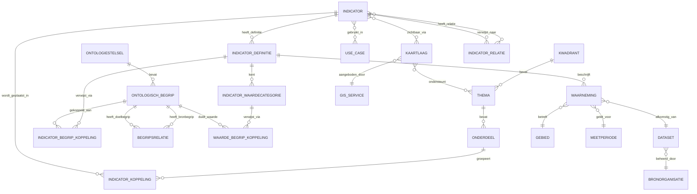

# Aanvullende review v2: Kompas Taxonomie Studio

**Onderwerp:** inhoudelijke en architecturale review van de uitbreiding met 3D-vectorruimte, koppellagen, vrije X/Y/Z-assen en ontologische begrippen  
**Basisdocument:** `concept-visueel-taxonomie-indicatorenbeheer.md`  
**Datum review:** 21 november 2026  
**Versie:** 2.0 — uitbreiding met ontologie als semantisch domein  
**Status:** Aanvullende ontwerp- en architectuurreview — bedoeld als input voor een RFC / GitHub Epic  
**Karakter:** Advies en denkrichting; geen vastgesteld functioneel ontwerp of technisch datamodel

---

## 1. Doel en afbakening van deze review

Deze review bouwt voort op het concept *Kompas Taxonomie Studio: Visueel beheer van de Kompas-taxonomie, themaboom en indicatoren*. Het basisdocument beschrijft de samenvoeging van de huidige beheeronderdelen **Indicatoren** en **Hiërarchie**, met een visuele graaf of sunburst, een contextuele inspector en een tabelweergave. Ook wordt voorgesteld om **Data Kwaliteit** als afzonderlijke beheeromgeving te behouden en kwaliteitsmarkers zichtbaar te maken in de taxonomieweergave.

De aanvullende denkrichting voegt drie mogelijke visualisatieperspectieven toe:

1. **Semantische 3D-vectorruimte:** indicatoren verkennen op basis van inhoudelijke overeenkomst van embeddings.
2. **Gelaagde 3D-architectuur:** de Kompasstructuur en de relaties met gebruik, bronnen, GIS, waarnemingen en governance in samenhang tonen.
3. **Vrije X/Y/Z-assen:** de beheerder kiest dimensies om patronen en uitzonderingen te analyseren.
4. **Ontologie en semantische begrippen:** bestaande ontologische gegevens per indicator worden ontsloten als betekenisvolle begrippen en relaties, zodat de indicator ook inhoudelijk kan worden verbonden met concepten, entiteiten, waarden en toepassingen.

Deze review onderzoekt of die drie perspectieven inhoudelijk en technisch goed op elkaar aansluiten, welke aannames aangescherpt moeten worden en welke onderdelen in het onderliggende informatiemodel ontbreken.

De review vervangt het basisdocument niet. Het is een aanvulling die helpt om vóór de RFC scherper te bepalen **wat het systeem moet modelleren**, **welke relaties betekenisvol zijn** en **welke visualisaties daarbij werkelijk iets toevoegen**.

### 1.1 Wat deze review niet vaststelt

De beschikbare conceptinformatie beschrijft onder meer bestaande tabbladen, een aantal API-endpoints, `pgvector`, embeddings, indicatoren, taxonomietabellen, GIS-issues en mogelijke configuraties. Deze review behandelt die onderdelen als uitgangspunten uit het concept, maar verifieert niet de actuele implementatie, databaseconstraints, volledige API-contracten of kwaliteit van de bestaande data.

Daarom worden concrete tabelnamen, velden en endpoints waar nodig als **genoemde bestaande of voorgestelde onderdelen** behandeld. Nieuwe entiteiten en relaties zijn conceptuele aanbevelingen; ze zijn niet automatisch al aanwezig in de database.

---

## 2. Samenvattend oordeel

De denkrichting is sterk en biedt een kans om de huidige indicatoren- en hiërarchiebeheeromgeving door te ontwikkelen tot een veel rijkere **relatiegerichte Kompas Taxonomie Studio**.

De belangrijkste verschuiving die nodig is, is deze:

> Ontwerp niet in de eerste plaats een 3D-applicatie. Ontwerp één samenhangend informatiemodel voor het Kompas en bied daarop verschillende perspectieven aan: hiërarchisch, relationeel, semantisch, ruimtelijk en tabelgericht.

De drie voorgestelde modi hebben ieder een eigen functie, maar zijn niet gelijkwaardig als kern van de oplossing:

| Modus | Beoordeling | Voorgestelde rol |
|---|---|---|
| A — Semantische 3D-vectorruimte | Behouden, met inhoudelijke en technische waarborgen | Verkenning van semantische verwantschap en kandidaat-doublures |
| B — Gelaagde 3D-architectuur | Verder uitwerken | Mogelijk krachtig perspectief op relaties tussen Kompas, gegevens, bronnen en gebruik |
| C — Vrije X/Y/Z-assen | Later onderzoeken | Aanvullende analysefunctie voor beheerders en analisten |

De belangrijkste aanbeveling is om de architectuur niet rond drie 3D-modi of een vast aantal visuele lagen op te bouwen, maar rond een onderscheid tussen:

- **Entiteiten:** de objecten waarover informatie wordt vastgelegd.
- **Relaties:** de betekenisvolle verbindingen tussen die objecten.
- **Eigenschappen:** kenmerken van een entiteit of relatie.
- **Waarnemingen:** concrete meetresultaten die bij een indicator, bron, gebied en tijd horen.
- **Presentatieconfiguratie:** regels voor kleur, vorm, positie, zichtbaarheid en visualisatie.
- **Ontologische begrippen:** betekenisvolle concepten en eventuele entiteiten uit een begrippenstelsel of ontologie, gekoppeld aan indicatoren en waar relevant aan de waarden die zij bevatten.

Dit onderscheid voorkomt dat eigenschappen als polariteit, kleurenschema of status ten onrechte als zelfstandige relaties of architectuurlagen worden behandeld.

### 2.1 Vier belangrijke ontwerpkeuzes

1. **Het informatiemodel is leidend; de visualisatie volgt.** Een relatie moet inhoudelijk te verklaren zijn, ook wanneer de 3D-weergave uitstaat.
2. **Semantische nabijheid is een signaal, geen besluit.** Een hoge similarity-score bewijst geen duplicaat en een lege zone in een projectie bewijst geen inhoudelijk hiaat.
3. **Een indicator is meer dan een naam in een taxonomie.** Definitie, meetmethode, ontologische betekenis, waarnemingen, tijd, geografisch niveau, bron, herkomst en eigenaarschap zijn nodig om de indicator verantwoord te kunnen beheren en interpreteren.
4. **Ontologie is een expliciete betekenislaag, geen synoniem voor embeddings.** Een bestaand ontologisch begrip of een bestaande entiteitswaarde kan een inhoudelijke relatie vastleggen die niet uit tekstuele gelijkenis alleen kan worden afgeleid.

---

## 3. Beoordeling van de drie 3D-modi

### 3.1 Modus A — Semantische 3D-vectorruimte

#### Voorgesteld idee

De bestaande 384-dimensionale embeddings uit `public.indicator_embeddings` worden met bijvoorbeeld PCA of UMAP teruggebracht naar drie coördinaten. De indicatoren worden als punten in een 3D-ruimte getoond. Nabijheid staat voor inhoudelijke verwantschap; hoge cosine similarity kan kandidaten voor doublures opleveren.

#### Wat hier sterk aan is

Deze modus kan helpen om verbanden te ontdekken die niet uit de bestaande taxonomie blijken. Een indicator uit het ene Kompas-thema kan inhoudelijk verwant zijn aan een indicator in een ander thema. Dat kan leiden tot:

- ontdekking van themadoorsnijdende onderwerpen;
- signalering van mogelijk overlappende indicatoren;
- ondersteuning bij het vinden van verwante indicatoren;
- verkenning van de samenhang tussen indicatoren, definities en beschrijvingen.

De 3D-weergave kan voor verkenning aantrekkelijk zijn, maar de onderliggende semantische vergelijking is belangrijker dan de gekozen ruimtelijke presentatie.

#### Gap A1 — De 3D-coördinaten zijn geen inhoudelijke waarheid

Een embedding bestaat uit 384 dimensies. PCA of UMAP brengt die terug tot drie dimensies, zodat mensen de onderlinge structuur visueel kunnen verkennen. Daarbij gaat informatie verloren. De drie resulterende assen hebben op zichzelf geen inhoudelijke betekenis zoals 'gezondheid', 'leefomgeving' of 'welvaart'.

Daarom geldt:

- De X-, Y- en Z-coördinaten zijn projectiecoördinaten, geen inhoudelijke eigenschappen van een indicator.
- Nabijheid in de 3D-projectie is een benadering van de oorspronkelijke vectorrelatie.
- Afstanden en buurrelaties kunnen veranderen als de dataset, modelversie, invoertekst of projectie-instellingen veranderen.
- De projectie kan visueel overtuigend ogen zonder dat alle onderliggende relaties nauwkeurig behouden zijn.

**Aanbeveling:** sla de 3D-coördinaten niet op als canonieke eigenschappen van een indicator. Bewaar de oorspronkelijke embedding en metadata over de embedding-generatie. Behandel geprojecteerde coördinaten als een afgeleide visualisatie-uitkomst.

Leg bij een projectie ten minste vast:

- gebruikte embedding-modelnaam en modelversie;
- versie of hash van de invoertekst / indicatorinhoud;
- projectiemethode en configuratie;
- datum van berekening;
- dataset- of corpusversie;
- eventuele random seed waar de methode die gebruikt.

Zo kan een beheerder begrijpen waarom een positie is veranderd en kan een projectie reproduceerbaar worden gemaakt.

#### Gap A2 — Een lege zone in de projectie bewijst geen inhoudelijk hiaat

Het voorstel stelt dat lege gebieden in de 3D-bol kunnen laten zien waar wel thema's zijn, maar weinig semantische dekking. Dat is een interessante verkenningshypothese, maar geen betrouwbare conclusie op basis van alleen de projectie.

Een leeg gebied kan ontstaan door:

- de verdeling van de bestaande embeddings;
- de manier waarop PCA of UMAP de punten ordent;
- de gekozen tekst voor de embedding;
- de omvang en samenstelling van de dataset;
- clustering- en visualisatie-instellingen.

Een inhoudelijk hiaat vraagt om een andere toets: welke onderwerpen, maatschappelijke opgaven of beleidsvragen moeten volgens een expliciet kader worden gedekt, welke indicatoren zijn beschikbaar en waar ontbreekt meetinformatie?

**Aanbeveling:** scheid twee analyses:

1. **Semantische spreiding:** welke indicatoren lijken inhoudelijk op elkaar en welke indicatoren liggen verder uit elkaar?
2. **Inhoudelijke dekking:** welke onderwerpen of meetbehoeften zijn relevant, welke zijn opgenomen en welke ontbreken of zijn onvoldoende onderbouwd?

Een vectorprojectie kan de eerste analyse ondersteunen, maar kan de tweede niet zelfstandig uitvoeren.

#### Gap A3 — Semantische overeenkomst is niet hetzelfde als een duplicaat

Een similarity-score is een indicatie van overeenkomst tussen de teksten die als input zijn gebruikt. Het is geen bewijs dat twee indicatoren hetzelfde meten.

Voorbeeld:

- *Percentage woningen met een slecht energielabel*;
- *Percentage huishoudens met energiearmoede*.

Deze indicatoren kunnen inhoudelijk verwant zijn, maar hebben een andere meetbetekenis. Omgekeerd kunnen twee indicatoren verschillende namen hebben en toch in de praktijk dezelfde populatie, periode, eenheid en meetmethode beschrijven.

Een duplicaatbeoordeling moet daarom ook rekening houden met:

- de meetdefinitie;
- de populatie of eenheid waarop de indicator betrekking heeft;
- de meeteenheid;
- de teller en noemer, als die van toepassing zijn;
- de geografische afbakening;
- de meetperiode en frequentie;
- de bron en methode;
- eventuele transformaties of berekeningen.

**Aanbeveling:** gebruik minimaal drie afzonderlijke relatiestatussen:

| Status / relatie | Betekenis |
|---|---|
| Semantisch verwant | De indicatoren hebben inhoudelijke raakvlakken. |
| Mogelijk dubbel | Er zijn aanwijzingen dat indicatoren hetzelfde of grotendeels hetzelfde meten; onderzoek is nodig. |
| Bevestigd duplicaat | Een bevoegde beheerder heeft vastgesteld dat de indicatoren dezelfde meetbetekenis vertegenwoordigen. |

De cosine similarity is een hulpmiddel om kandidaten te vinden. Een beheerder of inhoudelijk deskundige neemt het besluit.

#### Gap A4 — Drempelwaarde 0,85 moet worden gevalideerd

Een vaste drempel zoals `cosine similarity > 0,85` kan bruikbaar zijn als startpunt voor een experiment, maar is niet zonder meer een universele grens tussen verwantschap en duplicatie.

De betekenis van een score hangt onder meer af van:

- het gebruikte embedding-model;
- de taal en vakterminologie;
- de lengte en kwaliteit van de invoertekst;
- de vraag of alleen de naam of ook de definitie wordt ingebed;
- de verdeling van scores in de eigen indicatorenset.

Voor de genoemde set van ongeveer 267 indicatoren zijn er **35.511 unieke paren** die onderling kunnen worden vergeleken. Dat aantal is klein genoeg om in een eerste proef alle paren te berekenen en te laten beoordelen. Een complex schaalbaarheidsontwerp is hiervoor niet nodig.

**Aanbeveling:** bouw een kleine validatieset met voorbeelden van:

- echte doublures;
- verwante maar verschillende indicatoren;
- indicatoren die inhoudelijk niet verwant zijn;
- lastige gevallen met vergelijkbare woorden maar verschillende definities.

Gebruik die set om te bepalen welke scorebanden nuttig zijn voor kandidaatselectie. Behandel drempels als configureerbare signaleringsregels, niet als harde bedrijfsregels.

#### Gap A5 — Geschiktheid van het embedding-model voor Nederlands

In het concept wordt `all-MiniLM-L6-v2` genoemd. Het model levert 384-dimensionale sentence embeddings en is bedoeld voor onder meer semantische vergelijking, clustering en retrieval. De modelkaart vermeldt echter ook de taal-tag **English** en beschrijft een trainingsbasis die grotendeels uit Engelstalige datasets bestaat.

Dat betekent niet automatisch dat het model geen bruikbare Nederlandse resultaten kan geven. Het betekent wel dat de geschiktheid voor Nederlandstalige gemeentelijke definities, beleidsbegrippen en lokale terminologie niet zonder test mag worden aangenomen.

**Aanbeveling:** toets het huidige model op een representatieve Nederlandstalige testset voordat de semantische resultaten als beheerinformatie worden aangeboden. Vergelijk waar nodig met een aantoonbaar meertalig embedding-model. Beoordeel niet alleen algemene tekstsimilariteit, maar juist de gemeentelijke begrippen en meetdefinities.

#### Gap A6 — Embeddings vervangen de aanwezige ontologie niet

De indicatorgegevens kunnen al ontologische informatie bevatten. Die informatie is een belangrijke bron voor het begrijpen van de betekenis van een indicator en de verbanden met andere begrippen, entiteiten en toepassingen. De ontologie moet daarom niet worden behandeld als alleen een validatiestatus of als extra tekst die in de embedding wordt opgenomen.

Maak onderscheid tussen:

- **Expliciete ontologische koppeling:** een indicator of indicator-definitie verwijst naar een vastgelegd begrip, concept of entiteit.
- **Semantische embedding:** een model berekent op basis van tekst een vector waarmee overeenkomst kan worden onderzocht.
- **Afgeleide suggestie:** het systeem stelt een mogelijke relatie voor op basis van similarity of andere regels.

Een expliciete ontologische relatie heeft een andere herkomst en bewijskracht dan een berekende overeenkomst. De relatie moet bij voorkeur verwijzen naar een stabiele conceptidentificatie of naar de bestaande ontologische sleutel uit de brondata. De exacte vorm hangt af van de bestaande implementatie.

**Aanbeveling:** inventariseer eerst hoe de ontologie nu per indicator is vastgelegd. Stel vast of het gaat om een URI, concept-ID, code, label, vrije tekst, JSON-object, verwijzing naar een extern stelsel of een combinatie daarvan. Behoud de oorspronkelijke waarde en herkomst. Normaliseer of migreer pas nadat betekenis, cardinaliteit en gebruik zijn vastgesteld.

De ontologie kan vervolgens worden gebruikt om indicatoren inhoudelijk te verbinden met maatschappelijke begrippen, domeinen, objecten, categorieën en use cases. Embeddings blijven aanvullend: ze kunnen mogelijke verbanden ontdekken die nog niet expliciet in de ontologie zijn vastgelegd.

#### Voorgestelde positionering van modus A

Behoud modus A als **semantische verkenningsfunctie**. Maak de belangrijkste functionaliteit niet afhankelijk van een 3D-projectie. De kern is:

- zoeken naar semantisch verwante indicatoren;
- signaleren van kandidaat-doublures;
- tonen van similarity-score en gebruikte modelversie;
- vergelijken van definities en meetcontext;
- een relatie voorstellen, afwijzen of bevestigen;
- de herkomst en validatiestatus van een relatie vastleggen.

De 3D-wolk is één mogelijke presentatie van die informatie.

---

### 3.2 Modus B — Gelaagde 3D-architectuur

#### Voorgesteld idee

Het Kompas wordt op het horizontale vlak geordend: kwadranten, thema's, onderdelen en indicatoren. De Z-as toont aanvullende lagen, bijvoorbeeld gebruik en doelgroep boven de kern, en bronnen en GIS onder de kern. Verbindingslijnen tonen relaties tussen de lagen.

#### Wat hier sterk aan is

Van de drie modi heeft deze voor mij de meeste potentie als overkoepelend visualisatieconcept. De beheerder kan vanuit een indicator of thema omhoog en omlaag navigeren:

- Welke beleids- of gebruiksvragen hangen hiermee samen?
- Wie gebruikt deze informatie?
- Welke datasets en bronnen leveren de waarden?
- Welke kaartlagen maken de informatie ruimtelijk zichtbaar?
- Welke waarnemingen zijn beschikbaar, op welk gebied en over welke periode?
- Welke kwaliteits- of governancekwesties zijn bekend?

Hiermee verschuift de studio van een editor voor een taxonomische boom naar een omgeving waarin samenhangende informatie kan worden onderzocht en beheerd.

#### Gap B1 — De Z-as is een presentatiekeuze, geen eigenschap van het informatiemodel

De voorgestelde lagen `Z +2`, `Z +1`, `Z 0` en `Z -1` geven een begrijpelijke visuele ordening. Maar die ordening mag niet de fysieke structuur van de database bepalen.

Een indicator kan bijvoorbeeld tegelijkertijd:

- bij meerdere onderdelen horen;
- in meerdere use cases worden gebruikt;
- door meerdere bronnen worden gevoed;
- aan meerdere kaartlagen gekoppeld zijn;
- op meerdere geografische niveaus waarnemingen hebben.

Dat zijn geen nette, uitsluitend verticale relaties. Het zijn veel-op-veelrelaties die in de visualisatie als lijnen tussen lagen kunnen worden weergegeven.

**Aanbeveling:** behandel de Z-lagen als schakelbare visualisatiegroepen. Modelleer de daadwerkelijke relaties expliciet en onafhankelijk van de ruimtelijke positionering.

#### Gap B2 — De zeven koppellagen zijn verschillende soorten concepten

De zeven genoemde koppellagen zijn inhoudelijk niet van hetzelfde type:

| Genoemd onderdeel | Conceptueel type | Voorbeeld |
|---|---|---|
| Taxonomie & Kompas | Structuur / hiërarchische relaties | Thema bevat onderdeel; onderdeel groepeert indicatoren |
| Semantische vectoren | Afgeleide analyse / kandidaatrelatie | Indicator A lijkt op indicator B |
| Gebruikersgroep & use cases | Gebruiksrelaties en governance | Use case gebruikt indicator; rol mag informatie zien |
| Kleuring & classificatie | Presentatieconfiguratie en classificatieregels | Waardebereik krijgt een label of kleur |
| Polariteit & weging | Inhoudelijke eigenschappen en rekenregels | Lager is beter; indicator telt mee in aggregatie |
| Externe kaartlagen | Bron- en visualisatierelaties | Kaartlaag toont geografische informatie voor thema |
| Status & datakwaliteit | Kwaliteitskenmerken en lifecycle-status | Inactief, ongevalideerd, ontbrekende waarneming |

Als al deze onderdelen als gelijkwaardige koppellagen worden gemodelleerd, ontstaat een onnodig ingewikkeld en mogelijk inconsistent gegevensmodel.

**Aanbeveling:** maak in het informatiemodel onderscheid tussen entiteiten, relaties, eigenschappen, metingen en presentatieconfiguratie. De studio mag ze gezamenlijk visualiseren, maar de opslag en bedrijfsregels moeten hun verschillende betekenis behouden.

#### Gap B3 — Een indicator mist meetcontext als die alleen als knooppunt wordt behandeld

Een indicator is niet alleen een naam of een bol in de graaf. Om de indicator betrouwbaar te kunnen interpreteren, is een expliciete meetdefinitie nodig.

Denk aan:

- inhoudelijke definitie en omschrijving;
- meetmethode of berekeningsregel;
- meeteenheid;
- teller en noemer, indien van toepassing;
- populatie of doelobject;
- geografische afbakening;
- meetfrequentie;
- referentieperiode;
- eventuele norm, streefwaarde of referentiewaarde;
- beperkingen en interpretatieafspraken.

Zonder deze informatie kan de studio wel een indicator tonen, maar niet goed helpen beoordelen of twee indicatoren vergelijkbaar zijn, of een waarde goed geïnterpreteerd wordt en of een bron geschikt is.

**Aanbeveling:** voeg indicator-definitie en meetcontext expliciet toe aan het model. Overweeg een versieerbare indicator-definitie wanneer betekenis of meetmethode kan veranderen.

#### Gap B4 — Waarnemingen, tijd en gebiedsniveau ontbreken als expliciete gegevensobjecten

Het voorstel verbindt indicatoren met bronnen en kaartlagen, maar maakt nog onvoldoende expliciet onderscheid tussen:

1. **Indicator:** wat willen we meten?
2. **Waarneming:** welke waarde is daadwerkelijk vastgesteld?
3. **Bron of dataset:** waar komt de informatie vandaan?
4. **Gebied:** op welk geografisch niveau geldt de waarde?
5. **Tijd:** op welke periode of peildatum heeft de waarde betrekking?

Voorbeeld:

- Indicator: Hittestress.
- Waarneming: 46%.
- Gebied: gemeente of buurt.
- Referentieperiode: 2024.
- Bron: een benoemde dataset of registratie.
- Methode: een vastgelegde berekening of meetwijze.

Een indicator kan tientallen waarnemingen hebben, verdeeld over gebieden en tijdvakken. Een enkele koppeling naar een WMS- of WFS-laag is daarvoor niet voldoende.

**Aanbeveling:** behandel waarnemingen als afzonderlijke gegevensobjecten. Daarmee worden historische trends, actualiteit, vergelijkbaarheid en datadekking veel beter beheersbaar.

Maak daarnaast onderscheid tussen verschillende redenen waarom een waarde ontbreekt:

- geen meting uitgevoerd;
- bron heeft geen waarde aangeleverd;
- waarde is niet van toepassing;
- waarde is nog niet beschikbaar;
- waarde is verouderd;
- waarde bestaat, maar is niet toegankelijk voor deze gebruiker.

`aantal_metingen = 0` is dus niet genoeg om de toestand te verklaren.

#### Gap B5 — Bron, dataset, service en kaartlaag zijn verschillende objecten

In de GIS-koppellaag worden WMS, WFS en SLD samen genoemd. Ze hebben echter verschillende functies:

- **WMS:** levert een gegeorefereerde kaartweergave als afbeelding.
- **WFS:** biedt toegang tot geografische objecten en hun eigenschappen.
- **SLD:** beschrijft regels voor de visuele vormgeving van geografische objecten of kaartinhoud en breidt de WMS-weergave aan die kant uit.

SLD is dus niet hetzelfde type object als een databron of geografische service.

Een bruikbaar onderscheid in het model is:

- bronorganisatie;
- dataset of gegevensverzameling;
- service-endpoint;
- service-type en versie;
- aangeboden kaartlaag of feature type;
- geografisch referentieniveau;
- stijl of symbologie;
- relatie met indicator, thema of use case.

Een kaartlaag kan meerdere indicatoren ondersteunen. Eén indicator kan op zijn beurt meerdere kaartlagen, datasets of geografische weergaven hebben.

**Aanbeveling:** modelleer bron, dataset, service, kaartlaag en stijl afzonderlijk. Houd ook rekening met alternatieve of modernere ontsluitingsvormen; leg de keuze van standaarden niet onnodig vast in het conceptuele model.

#### Gap B6 — Gebruikersgroep, use case en toegangsrecht moeten uit elkaar blijven

Deze drie begrippen zijn aan elkaar gerelateerd, maar betekenen niet hetzelfde:

| Begrip | Vraag die het beantwoordt |
|---|---|
| Gebruikersgroep | Voor wie is de informatie relevant of bedoeld? |
| Use case | Voor welke taak, analyse of beleidsvraag wordt de informatie gebruikt? |
| Rol / recht | Wat mag een gebruiker daadwerkelijk bekijken of wijzigen? |
| Toegangsclassificatie | Welke beperkingen gelden voor de informatie zelf? |

`openbaar` en `intern` zijn classificatie- of toegangskenmerken. Het zijn geen vervangers voor autorisatie.

**Aanbeveling:** toon gebruikersgroepen en use cases als gebruikscontext, maar laat de backend de daadwerkelijke toegangscontrole afdwingen. Een visuele instelling, filter of verborgen knooppunt is nooit voldoende als beveiligingsmaatregel.

#### Gap B7 — Eigenaarschap, herkomst en versiebeheer ontbreken als expliciete governance-informatie

De beheeromgeving moet uiteindelijk niet alleen laten zien dat twee objecten gekoppeld zijn, maar ook waarom die relatie bestaat en wie ervoor verantwoordelijk is.

Voorbeelden van vragen:

- Wie is eigenaar van de indicator?
- Wie beheert de bron of dataset?
- Wie is verantwoordelijk voor de inhoudelijke definitie?
- Wie heeft de relatie met een thema of kaartlaag gelegd?
- Is de relatie door AI voorgesteld of door een mens vastgesteld?
- Wanneer is de relatie gewijzigd?
- Welke versie van een definitie gold op een bepaalde datum?
- Wanneer is de bron voor het laatst gecontroleerd?

**Aanbeveling:** leg herkomst, verantwoordelijkheid, validatiestatus en geldigheid vast bij entiteiten en vooral bij relaties. Maak minimaal onderscheid tussen een automatisch voorstel, een gecontroleerde relatie en een formeel vastgestelde relatie.

Mogelijke metadata voor relaties:

- `relationship_type`;
- `status`;
- `assertion_source` of `created_by_process`;
- `confidence` (alleen waar een score betekenisvol is);
- `validated_by`;
- `validated_at`;
- `valid_from`;
- `valid_to`;
- `created_at`;
- `updated_at`.

Niet ieder veld is voor iedere relatie verplicht. De betekenis moet per relatiecategorie worden vastgesteld.

---

#### Gap B8 — Ontologie is een volwaardige betekenislaag, niet alleen een validatieveld

In de huidige denkrichting komt ontologie vooral terug als `ontologie_status` of als onderdeel van semantische analyse. Dat is te beperkt wanneer de indicatorgegevens zelf ontologische begrippen, entiteitswaarden of verwijzingen bevatten. Die bestaande informatie kan helpen om de onderliggende betekenis en gebruikscontext van indicatoren expliciet te maken.

De ontologie moet daarom als eigen semantisch domein in het informatiemodel worden opgenomen. Daarbij is een belangrijk onderscheid nodig tussen:

1. **Ontologie of begrippenstelsel:** het stelsel waarin begrippen, concepten en hun onderlinge relaties zijn gedefinieerd.
2. **Begrip of concept:** een betekenisvolle eenheid binnen dat stelsel, bijvoorbeeld een domeinbegrip, categorie of type object.
3. **Entiteit of instantie:** een concreet object waarover gegevens worden vastgelegd, voor zover de gebruikte ontologie dat onderscheid maakt.
4. **Indicator-begripskoppeling:** de betekenisvolle relatie tussen de indicator(definitie) en een of meer ontologische begrippen.
5. **Waarde-begripskoppeling:** een optionele relatie tussen een gecodeerde indicatorwaarde of categorie en een ontologisch begrip. Dit is vooral relevant wanneer waarden zelf een domeinbetekenis hebben.

Een indicator kan meerdere begrippen adresseren en een begrip kan bij meerdere indicatoren voorkomen. Ook kunnen begrippen onderling relaties hebben, zoals breder, smaller, gerelateerd of equivalent. Wanneer een indicator een afgebakende set codes of categorieën kent, kan een afzonderlijke waarde-/categorie-entiteit naar een ontologisch begrip verwijzen. Dat is niet hetzelfde als iedere losse meetwaarneming aan een begrip koppelen. De precieze relatiecategorieën moeten aansluiten op het aanwezige ontologiemodel en mogen niet vooraf worden ingevuld zonder de brondata te onderzoeken.

**Aanbeveling:** behandel bestaande ontologiegegevens als een betekenisvolle bron die moet worden ontsloten, niet als iets dat eerst vervangen moet worden. Maak de bestaande waarde, identificatie, herkomst en eventuele versie zichtbaar. Voeg pas een generieke conceptentiteit of mappingtabel toe als de huidige opslagvorm dat nodig maakt.

### 3.3 Modus C — Vrije Multi-As Kubus

#### Voorgesteld idee

De beheerder kiest zelf welke dimensie op X, Y en Z staat. Voorbeelden zijn:

- Kompasthema × polariteit × kleurenschema;
- gebruikersgroep/use case × bron × toegangsclassificatie.

#### Wat hier sterk aan is

Deze modus kan helpen om configuratiefouten, uitzonderingen en patronen te ontdekken. Denk aan:

- indicatoren met een bepaalde polariteit die een afwijkend kleurenschema gebruiken;
- bronnen die voor veel indicatoren worden gebruikt;
- use cases waarvoor weinig indicatoren beschikbaar zijn;
- thema's met relatief veel indicatoren zonder actuele waarnemingen.

#### Gap C1 — Een as is niet altijd een natuurlijke of zinvolle dimensie

Thema, polariteit, bron en kleurenschema zijn grotendeels categorische kenmerken. Ze hebben niet vanzelf een betekenisvolle numerieke afstand tot elkaar.

Als `hoger_is_beter`, `neutraal` en `lager_is_beter` op een as worden geplaatst, ontstaat een visuele ordening. Dat betekent niet dat deze categorieën inhoudelijk een rangorde vormen.

Hetzelfde geldt voor bronnen als CBS, RIVM en SWF. De positie op een as zegt niets over de kwaliteit, betrouwbaarheid of inhoudelijke afstand van de bronnen.

**Aanbeveling:** noem dit liever een **multidimensionale verkenningsmodus** dan een vrije 3D-kubus. Laat gebruikers dimensies kiezen, maar bied afhankelijk van het datatype ook alternatieve encoderingen aan:

- positie voor numerieke waarden;
- kleur of vorm voor categorieën;
- grootte voor een relevante maat;
- filters en groeperingen voor selectie;
- matrix- of tabelweergave waar categorische combinaties beter te begrijpen zijn.

#### Gap C2 — Analyse en beheer moeten gescheiden blijven

Een analyseweergave kan een patroon of afwijking zichtbaar maken, maar een beheerwijziging vraagt om een aparte bevestigde actie.

Bijvoorbeeld: als een indicator in een onverwachte combinatie van polariteit en kleurenschema voorkomt, kan de studio een waarschuwing tonen. De beheerder moet vervolgens de onderliggende configuratie, validatieregel en impact kunnen beoordelen.

**Aanbeveling:** gebruik modus C in eerste instantie voor verkenning en signalering. Laat wijzigingen plaatsvinden via de contextuele inspector of een expliciete beheeractie met validatie, rechtencontrole en auditregistratie.

#### Voorgestelde positionering van modus C

Niet opnemen als harde eis voor de eerste ontwikkelfase. Wel opnemen als mogelijke uitbreiding nadat de entiteiten, relaties en eigenschappen goed zijn gemodelleerd en de belangrijkste 2D-beheerprocessen werken.

---

## 4. Aanbevolen aanvullingen op de koppellagen

De oorspronkelijke zeven koppellagen zijn een bruikbaar inventarisatiepunt, maar moeten conceptueel anders worden gegroepeerd. De volgende aanvullingen zijn belangrijk.

### 4.1 Aanvulling: indicator-definitie en meetcontext

Een indicator moet inhoudelijk voldoende zijn beschreven om deze correct te kunnen begrijpen, vergelijken en gebruiken.

Minimaal te overwegen kenmerken:

- naam en code;
- korte en uitgebreide omschrijving;
- inhoudelijke definitie;
- meetmethode of berekeningsregel;
- eenheid;
- teller en noemer, indien van toepassing;
- populatie of doelobject;
- geografische afbakening;
- meetfrequentie;
- referentieperiode;
- norm- of referentiewaarde, indien van toepassing;
- interpretatiebeperkingen;
- eigenaar en inhoudelijk verantwoordelijke.

Niet alle kenmerken zijn voor iedere indicator relevant. Het datamodel moet daarom onderscheid kunnen maken tussen verplichte, optionele en niet-toepasselijke kenmerken.

### 4.2 Aanvulling: waarnemingen, tijd en datadekking

Een indicator beschrijft wat wordt gemeten; een waarneming bevat een concrete waarde. Dit onderscheid is nodig om datadekking en trendinformatie goed te kunnen beoordelen.

Een waarneming kan conceptueel onder meer bevatten:

- verwijzing naar indicator en definitieversie;
- waarde en eenheid;
- referentieperiode of peildatum;
- geografisch gebied of gebiedsniveau;
- bron/dataset;
- meet- of berekeningsmethode;
- laad- of registratiedatum;
- kwaliteitsstatus;
- eventuele onzekerheidsinformatie;
- reden van ontbrekende of niet-toepasselijke waarde.

Dit maakt inzicht mogelijk in:

- actualiteit;
- volledigheid;
- geografische dekking;
- historische beschikbaarheid;
- vergelijkbaarheid tussen gebieden en perioden;
- ontbrekende waarden en de reden daarvan.

### 4.3 Aanvulling: herkomst, eigenaarschap en versiebeheer

Herkomst en verantwoordelijkheid zijn dwarsdoorsnijdend. Ze moeten niet alleen in een 3D-laag zichtbaar zijn, maar onderdeel zijn van het beheer- en auditmodel.

Leg waar relevant vast:

- inhoudelijk eigenaar;
- gegevensbeheerder of datasteward;
- bronhouder;
- technische beheerder;
- verantwoordelijke voor de definitie;
- herkomst van een relatie of wijziging;
- validatiestatus;
- geldigheidsperiode;
- wijzigingshistorie.

### 4.4 Aanvulling: ontologie, begrippen en entiteitswaarden

De indicatorgegevens kunnen al ontologische informatie bevatten. Deze informatie moet expliciet worden meegenomen in de Taxonomie Studio, omdat zij kan aangeven op welke begrippen, concepten of entiteiten een indicator betrekking heeft. Daarmee ontstaat een semantische verbindingslaag tussen de indicator, het Kompas, de onderliggende gegevens en de toepassingen waarvoor de informatie wordt gebruikt.

#### Wat moet het model kunnen onderscheiden?

| Onderdeel | Betekenis | Voorbeeld / aandachtspunt |
|---|---|---|
| Ontologie / begrippenstelsel | Het georganiseerde stelsel waarin begrippen en hun betekenis zijn vastgelegd | Een bestaand domeinmodel of extern begrippenregister |
| Begrip / concept | Een betekenisvolle eenheid binnen het stelsel | Energiearmoede, woning, gezondheid of een formele categorie |
| Entiteit / instantie | Een concreet object of een concrete instantie waarover gegevens worden vastgelegd | Een specifieke woning, gebiedseenheid of organisatie, als de bron dit onderscheid maakt |
| Conceptidentificatie | Een stabiele sleutel waarmee het begrip eenduidig kan worden herkend | URI, concept-ID, code of bestaande interne sleutel |
| Begripsrelatie | Een vastgelegde relatie tussen begrippen | Breder, smaller, gerelateerd, equivalent of een domeinspecifieke relatie |
| Indicator-begripskoppeling | De relatie tussen een indicator(definitie) en een begrip | Een indicator adresseert of operationaliseert een begrip |
| Waarde-begripskoppeling | De relatie tussen een gecodeerde waarde/categorie en een begrip | Een categoriecode of label verwijst naar een formeel begrip |

#### Twee niveaus van ontologische koppeling

Maak onderscheid tussen twee mogelijke niveaus. Ze kunnen allebei voorkomen, maar hoeven niet allebei in de eerste versie te worden uitgewerkt.

**1. Indicatorniveau**

De indicator als geheel wordt gekoppeld aan één of meer ontologische begrippen. Bijvoorbeeld: een indicator over energiearmoede kan verwijzen naar begrippen rond energie, inkomen en woningkwaliteit. De koppeling legt vast waar de indicator inhoudelijk over gaat.

**2. Waarde- of categorieniveau**

Een specifieke waarde, code of categorie binnen de indicator wordt gekoppeld aan een ontologisch begrip. Dit is relevant wanneer de mogelijke waarden zelf betekenisvolle domeinobjecten of classificaties vertegenwoordigen. Bijvoorbeeld: een indicator met categorieën of codes voor woningtypen, energielabels of een formele classificatie. Een numerieke meetwaarde hoeft niet automatisch een ontologisch begrip te krijgen.

Deze twee niveaus mogen niet worden samengevoegd tot één generiek tekstveld. Anders is later niet meer duidelijk of een ontologie de indicator als geheel beschrijft of een specifieke waarde binnen de indicator.

#### Eerst bestaande data begrijpen, dan modelleren

Voor de technische uitwerking is een gerichte inventarisatie nodig van de huidige indicatorgegevens:

- Welke velden of objecten bevatten ontologie-informatie?
- Is de waarde een label, code, URI, concept-ID, JSON-structuur of verwijzing naar een andere tabel?
- Kan één indicator meerdere ontologische begrippen bevatten?
- Zijn er relaties tussen de begrippen zelf beschikbaar?
- Is het ontologiestelsel intern beheerd of afkomstig uit een externe bron?
- Zijn versie, taal, definitie, synoniemen en herkomst beschikbaar?
- Wordt `ontologie_status` gebruikt voor de inhoudelijke status, de technische aanwezigheid of de validatie van de koppeling?
- Worden ontologische waarden ook gebruikt bij indicatorwaarden, classificaties, zoekfuncties of use cases?

**Belangrijke ontwerpregel:** behoud de bestaande ontologische gegevens en hun oorspronkelijke herkomst. Leid niet uit alleen een label af dat twee begrippen identiek zijn. Gebruik bij voorkeur stabiele identifiers wanneer die bestaan. Als de huidige data alleen tekst bevat, behandel die dan als een bestaande waarde die nog moet worden geïnterpreteerd en gevalideerd; verzin geen URI of concept-ID.

#### Relatie met SKOS, OWL en andere begrippenstandaarden

Onderzoek of de bestaande structuur aansluit op bestaande semantische standaarden, zoals SKOS voor begrippenstelsels en OWL voor rijkere ontologische modellering. Dit is een onderzoeksvraag, geen voorschrift om de huidige data direct naar één standaard te migreren. De bestaande semantiek en het feitelijke gebruik zijn leidend.

**Aanbeveling:** neem ontologie expliciet op in het conceptuele model en in de inspector. Begin met uitlezen en tonen van de bestaande ontologiegegevens; voeg beheer of normalisatie pas toe nadat duidelijk is hoe de huidige velden en relaties worden gebruikt.

### 4.5 Samengevoegd overzicht van de conceptuele domeinen

Onderstaande indeling vervangt de gedachte van tien gelijksoortige lagen door een indeling in domeinen. De domeinen kunnen in de visualisatie als lagen of filters worden getoond, maar hoeven niet één-op-één als database- of API-laag te worden geïmplementeerd.

| Domein | Voorbeelden van entiteiten | Voorbeelden van eigenschappen / relaties |
|---|---|---|
| 1. Kompas-taxonomie | Kwadrant, thema, onderdeel, indicator | Bevat, behoort tot, volgorde, status |
| 2. Indicatorbetekenis en meetcontext | Indicator-definitie, meetmethode, eenheid | Definitie, teller/noemer, populatie, polariteit |
| 3. Ontologie en semantische begrippen | Ontologiestelsel, begrip/concept, entiteit/instantie, begripsrelatie | Identificatie, label, definitie, breder/smaller/gerelateerd, indicator-begripskoppeling |
| 4. Semantische analyse | Embedding, modelversie, similarity-kandidaat | Similarity-score, model, projectieversie, validatiestatus |
| 5. Waarnemingen | Waarneming, meetreeks | Waarde, periode, gebied, kwaliteit, meetmethode |
| 6. Bronnen en lineage | Bronorganisatie, dataset, service | Levert, is afgeleid van, wordt bijgewerkt door |
| 7. GIS en ruimtelijke context | GIS-service, kaartlaag, feature type, stijl, gebied | Toont, representeert, geldt voor, gebruikt stijl |
| 8. Gebruik en toepassing | Use case, gebruikersgroep | Gebruikt, ondersteunt, is bedoeld voor |
| 9. Governance en toegang | Rol, recht, classificatie, eigenaar | Mag lezen/wijzigen, is verantwoordelijk voor |
| 10. Kwaliteit en lifecycle | Kwaliteitsbevinding, validatie, status | Geconstateerd, beoordeeld, vervangen door, actief/inactief |
| 11. Presentatieconfiguratie | Kleurenschema, classificatieregel, visualisatie-instelling | Kleurt, classificeert, toont als, gebruikt drempels |

---

## 5. Het centrale onderscheid: entiteiten, relaties en eigenschappen

Dit is de belangrijkste architecturale aanbeveling uit deze review.

### 5.1 Entiteiten — waarover leggen we informatie vast?

Voorbeelden:

- kwadrant;
- thema;
- onderdeel;
- indicator;
- indicator-definitie of definitieversie;
- waarneming;
- bronorganisatie;
- dataset;
- GIS-service;
- kaartlaag;
- gebied;
- meetperiode;
- use case;
- gebruikersgroep;
- rol;
- kleurenschema;
- kwaliteitsbevinding;
- ontologiestelsel of begrippenregister;
- ontologisch begrip/concept;
- eventuele entiteit/instantie uit de ontologie;
- begripsrelatie;
- indicator-begripskoppeling;
- eventuele waarde-begripskoppeling.

### 5.2 Relaties — hoe hangen entiteiten met elkaar samen?

Voorbeelden:

- thema bevat onderdeel;
- onderdeel groepeert indicator;
- indicator wordt gebruikt in use case;
- indicator wordt geleverd door dataset;
- dataset is afkomstig van bronorganisatie;
- waarneming betreft indicator;
- waarneming geldt voor gebied en periode;
- kaartlaag visualiseert een dataset of indicator;
- kaartlaag ondersteunt een thema;
- indicator is semantisch verwant aan andere indicator;
- indicator(definitie) verwijst naar ontologisch begrip;
- ontologisch begrip is breder, smaller, gerelateerd aan of equivalent aan een ander begrip;
- een gecodeerde indicatorwaarde verwijst naar een ontologisch begrip;
- indicator is vervangen door andere indicator.

Relaties moeten een expliciet type hebben. Een relatie `is_verwant_aan` mag niet worden verward met `is_dubbel_van`, `wordt_geleverd_door` of `behoort_tot`.

### 5.3 Eigenschappen — wat weten we over een entiteit of relatie?

Voorbeelden bij een indicator:

- naam;
- omschrijving;
- eenheid;
- polariteit;
- status;
- eigenaar;
- definitieversie.

Voorbeelden bij een relatie:

- status;
- bron van de relatie;
- validatiedatum;
- beoordelaar;
- geldigheidsperiode;
- toelichting;
- eventuele betrouwbaarheidsscore.

Voorbeelden bij een kleurenschema:

- kleurwaarden;
- klassengrenzen;
- labels;
- toepassingsbereik;
- versie.

Voorbeelden bij een ontologisch begrip:

- stabiele identificatie;
- voorkeurslabel en alternatieve labels;
- definitie of toelichting;
- begrippenstelsel en versie;
- taal;
- bron en herkomst;
- status en geldigheidsperiode.

### 5.4 Waarom dit onderscheid belangrijk is

Een polariteit is een eigenschap van een indicator of indicator-definitie. Een kleurenschema is een configuratie. Een semantische overeenkomst is een afgeleide relatie. Een meetwaarde is een waarneming. Een WMS-endpoint is een service. Een ontologisch begrip is een betekenisvolle conceptuele eenheid met een eigen identificatie en eventuele relaties. Deze zaken kunnen in één visualisatie samenkomen, maar mogen niet als hetzelfde soort object worden behandeld.

Dit maakt het model uitbreidbaar. Een nieuwe use case, een nieuw begrip of een nieuwe bronsoort hoeft dan niet te leiden tot een nieuw speciaal 3D-systeem.

### 5.5 Ontologie: bestaande waarden ontsluiten zonder de betekenis te verliezen

De aanwezigheid van ontologie-informatie per indicator vraagt om een expliciete modellering van de koppeling tussen indicator en begrip. De indicator moet daarbij niet automatisch worden gelijkgesteld aan het ontologische begrip: de indicator meet of beschrijft iets, terwijl het begrip de betekenis of het domeinobject benoemt waarop de indicator betrekking heeft.

Hanteer voor de uitwerking de volgende regels:

1. **Behoud de bronwaarde.** Leg vast welke ontologie-informatie nu al per indicator beschikbaar is en behoud de oorspronkelijke representatie.
2. **Maak de identificatie expliciet.** Als een stabiele concept-ID of URI bestaat, gebruik die als referentie; gebruik een label niet als enige sleutel.
3. **Ondersteun meerdere koppelingen.** Ga niet uit van één ontologisch begrip per indicator tenzij de bestaande domeinregels dat aantoonbaar voorschrijven.
4. **Leg het type koppeling vast.** Een indicator kan een begrip beschrijven, meten, adresseren, operationaliseren of gebruiken. Kies alleen relatietypen die inhoudelijk betekenisvol zijn voor de bestaande data.
5. **Houd indicatorniveau en waardenniveau uit elkaar.** Een begrip dat de indicator als geheel beschrijft is iets anders dan een begrip dat aan een mogelijke waarde of categorie is gekoppeld.
6. **Bewaar herkomst en versie.** Registreer waar het begrip vandaan komt en welke versie of geldigheidsperiode van toepassing is, voor zover die informatie beschikbaar is.
7. **Scheid ontologievalidatie van aanwezigheid.** Een indicator kan ontologiegegevens hebben die nog niet gevalideerd zijn; afwezigheid, ongeldigheid en nog-niet-beoordeeld zijn verschillende toestanden.

De exacte implementatie is afhankelijk van de huidige vorm van de ontologiegegevens. Een genormaliseerde begrippentabel met koppeltabel kan passend zijn, maar is geen doel op zich wanneer de huidige structuur al stabiele verwijzingen levert.

---

## 6. Voorstel voor een conceptueel gegevensmodel

Onderstaande schets is bedoeld als denkmodel voor architectuur en RFC. Het is geen definitief relationeel schema en schrijft geen exacte tabelnamen of databaseconstraints voor.

### 6.1 Vereenvoudigd model

De diagramvorm vereenvoudigt de cardinaliteiten. De precieze relaties moeten per domein worden uitgewerkt. Vooral bij indicatorplaatsing, use cases, kaartlagen, ontologische begrippen en semantische relaties kunnen veel-op-veelrelaties nodig zijn. De ontologische onderdelen in het diagram zijn conceptueel: als de huidige indicatorgegevens de ontologie al op een andere manier opslaan, moet eerst worden vastgesteld of aanvullende tabellen nodig zijn of dat bestaande sleutels rechtstreeks kunnen worden hergebruikt.

### 6.2 Belangrijke modelkeuzes

**Meerdere taxonomische plaatsingen**  
Onderzoek of een indicator uitsluitend bij één onderdeel mag horen of op meerdere plekken kan worden gepresenteerd. Als meerdere plaatsingen inhoudelijk zijn toegestaan, modelleer die als expliciete koppelingen met eventueel een primaire plaatsing. Voorkom dat één indicator kunstmatig wordt gekopieerd om hem op meerdere plekken te tonen.

**Definitieversies**  
Als een definitie, meetmethode of eenheid verandert, moet duidelijk blijven welke definitie bij welke historische waarneming hoorde. Een versieerbare definitie voorkomt dat historische waarden achteraf een andere betekenis krijgen.

**Relatietypen**  
Maak een beheersbare lijst van relatietypen. Begin niet met een volledig vrije graaf waarin iedere gebruiker elk willekeurig relatielabel kan verzinnen. Dit geldt ook voor ontologische relaties: hergebruik bestaande relatiebetekenissen als die beschikbaar zijn en introduceer geen eigen synoniemen voor bestaande conceptrelaties.

**Relatiestatus**  
Maak onderscheid tussen voorgesteld, in beoordeling, gevalideerd, afgewezen, vervallen en eventueel vervangen. Gebruik statuswaarden die bij de levenscyclus passen.

**Bron en lineage**  
Een bronorganisatie, dataset en service zijn niet hetzelfde. Een dataset kan via meerdere services beschikbaar komen. Een service kan meerdere lagen of feature types aanbieden. Ontologische begrippen hebben eveneens herkomst: leg vast uit welk begrippenstelsel of welke bron een begrip afkomstig is.

**Waarnemingen**  
Waarnemingen horen niet als losse attributen op de indicator zelf wanneer er meerdere perioden, gebieden of bronnen zijn. Een aparte waarnemingsstructuur is dan nodig.

---

## 7. Aanbevolen semantische vergelijkings- en deduplicatieaanpak

### 7.1 Houd de oorspronkelijke embedding leidend voor de berekening

De bestaande `indicator_embeddings` en `pgvector` kunnen de basis blijven voor semantische vergelijking, mits modelversie, invoertekst en berekeningswijze voldoende worden geregistreerd.

De 3D-projectie hoort daar bovenop als presentatie- of analysefunctie.

### 7.2 Maak onderscheid tussen embedding, kandidaatrelatie en vastgesteld beheerbesluit

Een aanbevolen proces:

1. De indicatorinhoud wordt ingebed met een vastgelegde modelversie.
2. Het systeem berekent similarity met andere indicatoren.
3. Het systeem maakt kandidaatrelaties op basis van instelbare signaleringsregels.
4. De beheerder ziet de twee indicatoren, hun definities en meetcontext naast elkaar.
5. De beheerder kiest een passende uitkomst: verwant, mogelijk dubbel, bevestigd duplicaat, niet relevant of nader onderzoek nodig.
6. Het besluit, de beoordelaar, datum en toelichting worden vastgelegd.

Een score mag niet zelfstandig een indicator deactiveren, samenvoegen of uit de taxonomie verwijderen.

### 7.3 Vergelijk niet alleen de naam

Overweeg om voor embeddings een zorgvuldig samengestelde representatietekst te gebruiken, bijvoorbeeld met:

- naam;
- definitie;
- omschrijving;
- meeteenheid;
- populatie;
- meetmethode.

De precieze tekstsamenstelling moet getest worden. Een lange tekst kan door modelbeperkingen worden afgekapt; de genoemde modelkaart van `all-MiniLM-L6-v2` meldt truncatie boven 256 word pieces. Vermijd daarom ongerichte concatenatie van alle metadata.

Bewaar bij iedere embedding welke tekst of tekstversie daadwerkelijk is gebruikt.

Ontologische begrippen kunnen aan die representatie context toevoegen, maar moeten niet zonder onderscheid als gewone tekst worden samengevoegd. Bewaar expliciete ontologische koppelingen afzonderlijk van de embedding. Gebruik ze desgewenst als aanvullende kenmerken in de analyse of als filter bij kandidaatselectie. Een gedeeld concept kan een sterke aanwijzing zijn voor inhoudelijke verwantschap, maar bewijst nog steeds niet dat twee indicatoren hetzelfde meten.

### 7.4 Bouw een kleine beoordelingsset

Een eerste validatie kan praktisch worden uitgevoerd met de bestaande indicatorenset:

- genereer de 35.511 paren;
- sorteer paren op similarity;
- selecteer voorbeelden uit meerdere scorebanden;
- laat inhoudelijk deskundigen de relaties beoordelen;
- registreer wat als verwant, mogelijk dubbel of bevestigd dubbel wordt gezien;
- beoordeel of de gekozen drempels bruikbare kandidaten opleveren.

Dit levert een beter onderbouwde signaleringsregel op dan een vooraf gekozen universele grens.

---

## 8. GIS, geografische context en datalijn

### 8.1 Maak de GIS-objecten afzonderlijk herkenbaar

Aanbevolen conceptuele onderdelen:

| Object | Betekenis |
|---|---|
| Bronorganisatie | Organisatie die gegevens beheert of publiceert |
| Dataset | Herkenbare gegevensverzameling met inhoud en definitie |
| GIS-service | Technisch ontsluitingspunt, bijvoorbeeld WMS of WFS |
| Kaartlaag / feature type | Afzonderlijk aangeboden geografisch onderdeel |
| Stijl | Visuele weergaveregels, bijvoorbeeld SLD of andere symbologie |
| Gebied / geografie | Gemeente, wijk, buurt of andere ruimtelijke eenheid |
| Waarneming | Indicatorwaarde voor een gebied en tijdvak |

### 8.2 Maak de koppeling inhoudelijk expliciet

Een kaartlaag kan:

- een indicator rechtstreeks tonen;
- een dataset visualiseren waaruit een indicator wordt afgeleid;
- context geven aan een thema zonder één-op-één aan een indicator gekoppeld te zijn;
- meerdere indicatoren ondersteunen.

Leg daarom vast wat de aard van de koppeling is. Bijvoorbeeld `visualiseert`, `levert_data_voor`, `geeft_context_bij` of `ondersteunt_thema`. Gebruik niet één generieke GIS-koppeling voor alle situaties.

### 8.3 Houd rekening met actualiteit en beschikbaarheid

Bij een GIS-service is het nuttig om onder meer te beheren:

- service-URL en service-type;
- aangeboden lagen of feature types;
- eigenaar of beheerder;
- laatste controle op bereikbaarheid;
- beschikbare geografische dekking;
- coördinatenstelsel waar relevant;
- legenda of stijl;
- eventuele beperkingen en gebruiksvoorwaarden.

De studio moet onderscheid maken tussen een service die technisch niet bereikbaar is, een kaartlaag die geen gegevens bevat en een indicator waarvoor geen meetwaarde beschikbaar is. Dat zijn verschillende kwaliteitsproblemen.

---

## 9. Polariteit, weging, classificatie en kleurenschema

Deze begrippen liggen dicht bij elkaar in de gebruikersinterface, maar moeten conceptueel gescheiden blijven.

| Begrip | Betekenis | Voorbeeld |
|---|---|---|
| Polariteit | Richting waarin een waarde doorgaans gunstig of ongunstig wordt geïnterpreteerd | `hoger_is_beter`, `lager_is_beter`, `neutraal` |
| Weging | Relatieve bijdrage van een indicator aan een samengestelde score of aggregatie | Gewicht 0,2 binnen een index |
| Classificatieregel | Regels die een waarde in een klasse indelen | A t/m E op basis van drempels |
| Kleurenschema | Visuele kleuren die bij klassen of waarden horen | Palet voor de kaart of grafiek |
| Presentatievorm | Vorm, icoon of label waarmee de indicator wordt weergegeven | Pijl, ruit, ring of badge |

Een indicator met `lager_is_beter` krijgt niet automatisch een bepaald kleurenschema. Dat hangt af van de gekozen classificatie- en presentatieregels.

### 9.1 Aanbevolen validatieregels

Mogelijke signaleringen:

- polariteit ontbreekt waar deze verplicht is;
- gekozen classificatieregel past niet bij het datatype of meetbereik;
- kleurenschema heeft overlappende of niet-afgedekte drempels;
- een classificatieregel is gekoppeld aan een niet-passende indicator;
- een samengestelde score gebruikt een indicator zonder vastgelegde weging;
- een weging is niet genormaliseerd waar dat volgens de rekenmethode vereist is.

De precieze regels moeten worden afgestemd op de bestaande reken- en visualisatielogica van het Kompas.

---

## 10. Kwaliteit, status en lifecycle

Het basisdocument stelt voor om kwaliteitsmarkers in de graaf te tonen en Data Kwaliteit als afzonderlijke auditomgeving te behouden. Dat is een verstandige scheiding: de taxonomiestudio kan signaleren, terwijl gespecialiseerde kwaliteitsprocessen in hun eigen omgeving plaatsvinden.

### 10.1 Maak statuscategorieën expliciet

Niet alle statussen betekenen hetzelfde. Overweeg afzonderlijke categorieën:

- **Lifecycle-status:** actief, inactief, vervallen, vervangen.
- **Inhoudelijke validatie:** concept, in beoordeling, gevalideerd, afgewezen.
- **Databeschikbaarheid:** actueel, verouderd, geen waarneming, gedeeltelijk beschikbaar.
- **Technische status:** bron bereikbaar, bron niet bereikbaar, servicefout.
- **Kwaliteitsbevinding:** mogelijk duplicaat, definitie ontbreekt, inconsistentie gevonden.

Eén globale kleur of één statusveld is waarschijnlijk onvoldoende om die verschillen zuiver te kunnen weergeven.

### 10.2 Gebruik niet één kleur voor meerdere betekenissen

Het basisdocument en de aanvullende opzet gebruiken verschillende kleurassociaties. Leg daarom één consistente visuele taal vast.

Aanbeveling:

- kleur voor een beperkt aantal primaire statussen;
- vorm of icoon voor een andere statusdimensie;
- rand, badge of patroon voor waarschuwingen;
- tekstlabel en tooltip als aanvullende uitleg;
- kleur nooit als enige informatiedrager.

Voorbeelden van afzonderlijke visuele dimensies:

- lifecycle: actief/inactief;
- validatie: concept/gevalideerd;
- datadekking: volledig/gedeeltelijk/ontbrekend;
- semantische kandidaat: verwant/mogelijk dubbel.

De exacte kleuren moeten in het bestaande design system worden vastgelegd en ook in de tabel en inspector consistent terugkomen.

### 10.3 Data Kwaliteit blijft een eigen werkproces

Behoud de oorspronkelijke gedachte:

- de taxonomiestudio toont signalen en context;
- Data Kwaliteit voert gespecialiseerde controles, vergelijkingen, reconciliatie en samenvoegacties uit;
- vanuit een kwaliteitsmarker kan de beheerder doorklikken naar de juiste kwaliteitsworkflow.

Dit voorkomt dat de Taxonomie Studio een overbelaste alles-in-één-editor wordt.

---

## 11. Architectuur- en API-aanbevelingen

### 11.1 Houd het informatiemodel onafhankelijk van de visualisatie

De API moet de gegevens en relaties leveren die de interface nodig heeft. De frontend bepaalt vervolgens of deze als boom, graaf, matrix, tabel of 3D-projectie worden getoond.

Daarom is een endpoint met een naam als `GET /api/admin/taxonomie/3d-graph` mogelijk te specifiek. Een neutralere naam zoals:

`GET /api/admin/kompas/graph`

sluit beter aan bij een model dat meerdere visuele perspectieven ondersteunt.

Dit is een naamgevingsadvies; het bestaande endpoint `GET /api/admin/kompas/tree` uit het basisdocument hoeft niet zonder meer te worden vervangen.

### 11.2 Denk in afzonderlijke API-verantwoordelijkheden

Mogelijke verantwoordelijkheden:

| API-verantwoordelijkheid | Voorbeeldfunctie |
|---|---|
| Taxonomie lezen | Boomstructuur en taxonomische relaties ophalen |
| Graafcontext lezen | Geselecteerde knooppunten met relevante relaties ophalen |
| Indicator beheren | Indicatorgegevens en definities bijwerken |
| Relatie beheren | Relatie voorstellen, valideren, afwijzen of beëindigen |
| Waarnemingen lezen | Meetwaarden per indicator, gebied en periode ophalen |
| Bron/GIS beheren | Bronnen, services en kaartlagen beheren |
| Semantische analyse | Similarity-kandidaten en projectiegegevens ophalen |
| Ontologie lezen/beheren | Begrippen, ontologische koppelingen en waar relevant begripsrelaties ophalen of beheren |
| Kwaliteit lezen | Kwaliteitsbevindingen en statusinformatie ophalen |

Niet al deze endpoints hoeven meteen te worden gebouwd. Het doel is om functionele verantwoordelijkheden niet te vermengen.

### 11.3 Scheid semantische projectie van de kern-Graaf-API

De kern-graaf bevat entiteiten en feitelijke of gevalideerde relaties. Een semantische projectie is afgeleide analyse-informatie.

Overweeg daarom afzonderlijke parameters of een afzonderlijke analyse-endpoint voor:

- projectiecoördinaten;
- similarity-kandidaten;
- model- en projectieversies;
- filters voor minimale similarity;
- selectie van projectiemethode.

Zo wordt voorkomen dat elke reguliere taxonomie-aanvraag onnodig embeddings of 3D-coördinaten moet ophalen. Ontologische gegevens zijn daarentegen expliciete betekenisdata en kunnen via de graafcontext of een aparte ontologieverantwoordelijkheid worden ontsloten. Ze moeten niet worden behandeld als projectiegegevens.

### 11.4 Mutaties moeten expliciete beheeracties zijn

Een klik of drag-and-drop in een visualisatie kan een relatie voorstellen, maar mag niet automatisch een definitieve wijziging uitvoeren zonder passende validatie.

Bij mutaties zijn nodig:

- autorisatie aan de backend;
- validatie van het relatietype en de cardinaliteit;
- controle op mogelijke conflicten of cycli waar relevant;
- auditregistratie;
- terugkoppeling van fouten aan de gebruiker;
- mogelijkheid om de wijziging te annuleren of te herstellen waar dat vereist is.

### 11.5 PostgreSQL en pgvector

Op basis van de beschreven omvang en functionaliteit is er geen directe reden om voor deze uitbreiding een aparte graph database als uitgangspunt te nemen. PostgreSQL kan het relationele informatiemodel en de relaties ondersteunen; `pgvector` kan worden gebruikt voor semantische vergelijkingen.

Een aparte graph database moet pas worden overwogen als concrete eisen rond querypatronen, schaal, beheer of performance niet goed binnen de bestaande architectuur kunnen worden ingevuld.

---

## 12. UX- en interactieprincipes

### 12.1 Meerdere perspectieven op dezelfde selectie

De oorspronkelijke opzet met een visuele graaf en een gesynchroniseerde tabel is een sterke basis. Breid die uit zonder iedere weergave als een eigen waarheid te behandelen.

Aanbevolen perspectieven:

1. **Taxonomie / hiërarchie:** waar hoort de indicator in het Kompas?
2. **Relatiegraaf:** welke andere entiteiten zijn ermee verbonden?
3. **Tabel:** welke indicatoren en relaties zijn beschikbaar, en welke acties zijn mogelijk?
4. **Semantische verkenning:** welke indicatoren lijken inhoudelijk op elkaar?
5. **Ruimtelijke 3D-weergave:** welke extra inzichten ontstaan door relaties in lagen te tonen?

Niet elk perspectief hoeft in de eerste release beschikbaar te zijn.

### 12.2 Contextuele inspector

De inspector moet meebewegen met het geselecteerde objecttype.

Voor een indicator bijvoorbeeld:

- naam en code;
- definitie en omschrijving;
- meetmethode en eenheid;
- polariteit en eventuele weging;
- taxonomische plaatsing;
- waarnemingen en datadekking;
- bron- en GIS-relaties;
- use cases en gebruikersgroepen;
- eigenaar en beheerder;
- kwaliteits- en validatiestatus;
- ontologische begrippen en de aard van de koppeling;
- eventuele begripsrelaties en gekoppelde entiteits-/waardecategorieën;
- semantisch verwante indicatoren;
- wijzigingshistorie.

Voor een kaartlaag bijvoorbeeld:

- bronorganisatie en dataset;
- service-type en URL;
- aangeboden laag of feature type;
- stijl en legenda;
- geografische dekking;
- gekoppelde indicatoren en thema's;
- technische controle- en kwaliteitsstatus.

De inspector hoeft niet alle velden tegelijk te tonen. Gebruik secties, tabbladen of uitklapbare groepen.

### 12.3 Selectie en navigatie

Bij selectie van een knooppunt:

- markeer directe relaties duidelijk;
- onderscheid directe relaties van relaties op grotere afstand;
- laat zien waarom een relatie bestaat;
- toon of een relatie voorgesteld of gevalideerd is;
- voorkom dat alle verbindingen tegelijk zichtbaar moeten zijn;
- bied filters op relatietype en status.

Een beheerder moet kunnen vaststellen of een getoonde lijn een taxonomische koppeling, ontologische begripsrelatie, indicator-begripskoppeling, bronrelatie, semantische suggestie of gebruiksrelatie vertegenwoordigt. Toon bij een ontologische koppeling waar het begrip vandaan komt en of de koppeling expliciet aanwezig, voorgesteld of gevalideerd is.

### 12.4 2D, tabel en toegankelijkheid

De 3D-weergave moet niet de enige manier zijn om informatie te vinden of te beheren. De tabel- en tekstuele alternatieven moeten de onderliggende gegevens en beheeracties volwaardig ontsluiten.

Neem toegankelijkheid mee als ontwerpeis voor alle perspectieven:

- toetsenbordbediening;
- duidelijke focusvolgorde;
- tekstuele labels naast kleur en iconen;
- voldoende contrast;
- screenreader-beschrijvingen waar relevant;
- alternatief voor ruimtelijke navigatie;
- geen essentiële informatie uitsluitend via diepte of beweging.

Het basisdocument noemt WCAG 2.1 AA als uitgangspunt. Bevestig met de verantwoordelijke toegankelijkheids- en architectuurfunctie welke normversie voor deze ontwikkeling formeel moet gelden.

---

## 13. Risico's en beheersmaatregelen

| Risico | Mogelijk gevolg | Beheersmaatregel |
|---|---|---|
| 3D-projectie wordt als feitelijke waarheid geïnterpreteerd | Verkeerde conclusies over verwantschap of hiaten | Projectie expliciet labelen als afgeleid perspectief; oorspronkelijke scores en definities tonen |
| Similarity-score wordt als duplicaatbesluit gebruikt | Onterechte samenvoeging of deactivering | Menselijke validatie en expliciete relatiestatus |
| Taxonomie en algemene relaties raken vermengd | Onduidelijk beheer en inconsistente structuur | Relatietypen en domeinregels expliciet modelleren |
| Waarnemingen worden niet apart gemodelleerd | Geen betrouwbare tijd- en gebiedsdekking | Afzonderlijke waarnemingsentiteit met tijd, gebied en bron |
| GIS-service en dataset worden gelijkgesteld | Onjuiste lineage en beheer | Bron, dataset, service, kaartlaag en stijl onderscheiden |
| 3D wordt de primaire beheerroute | Slechtere toegankelijkheid en efficiëntie | Tabel en 2D als volwaardige beheerperspectieven behouden |
| Kleur heeft meerdere betekenissen | Verkeerde interpretatie van status | Visuele semantiek standaardiseren en kleur niet als enige signaal gebruiken |
| Beheerwijzigingen via visualisatie zijn te direct | Onbedoelde of niet-geautoriseerde mutaties | Backend-validatie, rechtencontrole en auditlog |
| Model of embedding wijzigt zonder traceerbaarheid | Similarity-resultaten zijn niet reproduceerbaar | Model-, tekst- en projectieversie registreren |
| Scope groeit te snel | Te groot en risicovol ontwikkeltraject | Faseren; eerst model en 2D-prototype, daarna 3D-proef |
| Ontologie wordt alleen als tekstlabel opgeslagen | Betekenis en unieke identiteit van begrippen gaan verloren | Bestaande sleutel, URI, stelsel en herkomst inventariseren en behouden |
| Indicatorbegrip en waarde-/categoriebegrip worden vermengd | Onduidelijk wat de ontologie precies beschrijft | Indicatorniveau en waardenniveau afzonderlijk modelleren |
| Bestaande ontologie wordt opnieuw gemodelleerd zonder inventarisatie | Dubbele of strijdige begrippenstructuur | Eerst huidige opslag, cardinaliteit en gebruik onderzoeken; daarna pas normaliseren |
| Ontologische koppeling wordt gelijkgesteld aan embedding-similarity | Expliciete betekenis en berekende suggestie raken vermengd | Ontologische relaties en AI-suggesties apart opslaan en visualiseren |

---

## 14. Voorgestelde fasering

De huidige roadmappositionering in het basisdocument houdt de mijlpaal 0.7.0 gericht op viewer, kaartlagen en kleine beheeracties, en plaatst de Taxonomie Studio als mogelijke ontwikkeling voor 0.8.0. Die fasering kan worden behouden, maar de inhoud moet in stappen worden opgesplitst.

### Stap 1 — Conceptueel informatiemodel

**Doel:** overeenstemming bereiken over de betekenis van entiteiten, relaties, eigenschappen, waarnemingen en statussen.

Op te leveren:

- begrippenlijst;
- entiteitenoverzicht;
- relatietypen en cardinaliteiten;
- eigenaarschap en governance-attributen;
- model voor indicator-definitie en waarneming;
- inventarisatie van bestaande ontologievelden, begripsidentificaties en relaties;
- keuze hoe indicator-begripskoppelingen en eventuele waarde-begripskoppelingen worden ontsloten;
- onderscheid tussen bron, dataset, service, kaartlaag en stijl;
- status- en lifecyclemodel.

**Klaar wanneer:** de belangrijkste beheer- en analysevragen met het model kunnen worden beantwoord zonder afhankelijk te zijn van een specifieke visualisatie.

### Stap 2 — 2D-prototype en contextuele inspector

**Doel:** de bestaande Indicatoren- en Hiërarchie-functionaliteit samenbrengen op basis van het model.

Op te leveren:

- taxonomische graaf of sunburst;
- gesynchroniseerde tabel;
- contextuele inspector;
- beheer van bestaande indicator- en taxonomierelaties;
- kwaliteitsmarkers met vaste semantiek;
- toetsenbord- en tekstuele bediening.

**Klaar wanneer:** een beheerder de belangrijkste taxonomische gegevens kan vinden, begrijpen en beheren zonder 3D.

### Stap 3 — Semantische proef

**Doel:** vaststellen of de embeddings bruikbare semantische kandidaten opleveren voor de Kompas-indicatoren.

Op te leveren:

- testset met Nederlandstalige indicatoren en definities;
- vergelijking van embedding-resultaten;
- analyse van scoreverdeling;
- kandidaatrelaties;
- beoordelingsworkflow;
- registratie van modelversie en herkomst;
- analyse hoe ontologische koppelingen aanvullend kunnen helpen bij kandidaatselectie zonder als vervanging voor menselijke beoordeling te dienen.

**Klaar wanneer:** inhoudelijke deskundigen de kwaliteit en bruikbaarheid van de kandidaten hebben beoordeeld.

### Stap 4 — 3D-prototype van de gelaagde architectuur

**Doel:** toetsen of de 3D-presentatie extra inzicht oplevert boven de 2D-graaf en tabel.

Op te leveren:

- beperkte set knooppunten en relatietypen;
- schakelbare visuele groepen of lagen;
- selectie en contextuele inspectie;
- filters op relatietype en status;
- vergelijking met dezelfde taken in 2D.

**Klaar wanneer:** uit gebruikerstests blijkt dat de 3D-weergave een concreet voordeel heeft voor bepaalde verkennings- of analysetaken.

### Stap 5 — Multidimensionale analyse

**Doel:** onderzoeken of vrije dimensies aanvullende beheersignalen of inzichten opleveren.

Op te leveren:

- selectie van relevante dimensies;
- passende visuele encodering per datatype;
- detectie van uitzonderingen;
- koppeling naar onderliggende beheerobjecten.

**Klaar wanneer:** duidelijk is welke analysetaken hiermee beter worden ondersteund en de functie niet alleen visueel aantrekkelijk is.

---

## 15. Voorgestelde RFC / GitHub Epic

Onderstaande tekst kan als basis dienen voor een RFC of Epic. De tekst houdt de oplossingsruimte bewust open, maar maakt de inhoudelijke randvoorwaarden expliciet.

### Titel

**RFC / Epic: Kompas Taxonomie Studio — relatiegericht beheer van taxonomie, indicatoren en gegevenscontext**

### Aanleiding

De beheeronderdelen Indicatoren en Hiërarchie zijn momenteel afzonderlijk ingericht. De Kompas-indicatoren ontlenen hun betekenis aan de taxonomie, maar hebben daarnaast relaties met definities, meetmethoden, ontologische begrippen en entiteitswaarden, bronnen, waarnemingen, geografische context, kaartlagen, use cases en kwaliteitsinformatie.

De huidige conceptuele opzet voor de Kompas Taxonomie Studio voorziet in een interactieve visuele beheeromgeving met een graaf- of sunburstweergave, tabel en contextuele inspector. De aanvullende verkenning onderzoekt hoe semantische verwantschap en relaties tussen de verschillende gegevensdomeinen hierin kunnen worden opgenomen.

### Centrale vraag

Hoe kunnen we één samenhangend informatiemodel en een beheeromgeving ontwikkelen waarmee beheerders de Kompas-taxonomie, indicatoren, hun ontologische betekenis en hun relaties met gegevens, bronnen, waarnemingen, GIS, gebruik en governance kunnen begrijpen, valideren en beheren?

### Uitgangspunten

1. Het informatiemodel is leidend; visualisaties zijn verschillende perspectieven op dat model.
2. Entiteiten, relaties, eigenschappen, waarnemingen en presentatieconfiguratie worden onderscheiden.
3. De bestaande PostgreSQL-architectuur en `pgvector` blijven uitgangspunt, tenzij concrete eisen anders aantonen.
4. De 2D-graaf en tabel blijven volwaardige beheerperspectieven.
5. Semantische similarity levert kandidaten en signalen, geen automatische inhoudelijke besluiten.
6. 3D wordt als prototype onderzocht en pas structureel toegevoegd als het aantoonbaar meerwaarde heeft.
7. Relaties en wijzigingen moeten herleidbaar, controleerbaar en geautoriseerd zijn.
8. Data Kwaliteit blijft een eigen audit- en reconciliatieomgeving, maar levert kwaliteitsinformatie aan de Taxonomie Studio.
9. Bestaande ontologiegegevens per indicator worden eerst geïnventariseerd en waar mogelijk als expliciete betekenisrelaties ontsloten; zij worden niet zonder analyse vervangen of opnieuw gemodelleerd.
10. Ontologische begrippen, indicator-begripskoppelingen en eventuele waarde-begripskoppelingen worden onderscheiden van embedding-similarity en AI-voorgestelde relaties.

### Gevraagd besluit

1. Akkoord op het uitwerken van het conceptuele informatiemodel vóór verdere 3D-implementatie.
2. Akkoord op het samenbrengen van Indicatoren en Hiërarchie in een geïntegreerde Taxonomie Studio.
3. Akkoord op een gesynchroniseerde graaf- en tabelweergave met contextuele inspector.
4. Akkoord op een afzonderlijke semantische proef om de kwaliteit van embeddings en kandidaatrelaties te valideren.
5. Akkoord op een afgebakend 3D-prototype voor de gelaagde architectuur, voorafgegaan door heldere gebruikerstaken.
6. Akkoord dat de multidimensionale vrije-assenmodus buiten de eerste scope blijft.

### Scope eerste functionele stap

- Taxonomische structuur en indicatoren geïntegreerd beheren.
- Relaties en eigenschappen expliciet onderscheiden.
- Contextuele inspector voor indicator, thema en relevante gekoppelde objecten.
- Bestaande ontologie-informatie per indicator uitlezen en in de inspector tonen, inclusief beschikbare identificatie en herkomst.
- Ontologische begrippen en koppelingen zichtbaar onderscheiden van AI-voorgestelde semantische relaties.
- Tabel en graaf synchroon laten werken.
- Kwaliteitsmarkers uniform toepassen.
- Relaties en beheeracties valideren en auditen.

### Buiten scope eerste stap

- Volledig uitgewerkte 3D-productieomgeving.
- Automatische deduplicatie of automatische samenvoeging van indicatoren.
- Volledig generieke vrije graaf waarin gebruikers onbeperkt relatietypen kunnen maken.
- Volledig uitgewerkte multidimensionale analyseomgeving.
- Vervanging van Data Kwaliteit als afzonderlijke beheerfunctie.
- Nieuwe graph database zonder onderbouwde architectuurbehoefte.
- Vervanging of migratie van de bestaande ontologierepresentatie voordat de huidige structuur en het gebruik zijn geïnventariseerd.

### Acceptatiecriteria — eerste stap

1. De vier kwadranten, thema's, onderdelen en indicatoren zijn vanuit één beheeromgeving te benaderen.
2. Een selectie in de graaf correspondeert met de juiste selectie in de tabel en omgekeerd.
3. De contextuele inspector toont per objecttype de relevante eigenschappen en relaties.
4. Taxonomische relaties zijn te onderscheiden van andere relatiecategorieën.
5. De belangrijkste beheerwijzigingen worden gevalideerd en geregistreerd.
6. Kwaliteitsmarkers hebben een eenduidige betekenis en zijn niet uitsluitend op kleur gebaseerd.
7. De tabel biedt een volwaardig alternatief voor navigatie en beheer.
8. De bestaande Data Kwaliteit-workflow blijft beschikbaar en kan vanuit relevante signalen worden geopend.
9. Als ontologiegegevens bij een indicator aanwezig zijn, kunnen die in de inspector worden ingezien zonder dat de oorspronkelijke waarde of herkomst verloren gaat.
10. De interface maakt onderscheid tussen expliciete ontologische koppelingen, niet-gevalideerde ontologiegegevens en semantische AI-suggesties.

### Acceptatiecriteria — ontologie-ontsluiting

1. De huidige velden en opslagvormen voor ontologie per indicator zijn geïnventariseerd en gedocumenteerd.
2. De bestaande ontologische waarde en herkomst blijven behouden.
3. Waar een stabiele conceptidentificatie aanwezig is, wordt deze gebruikt om het begrip eenduidig te herkennen.
4. De inspector toont het ontologische begrip en de aard van de indicator-koppeling voor zover de brondata dat ondersteunt.
5. Indicatorniveau-koppelingen zijn te onderscheiden van eventuele waarde- of categoriekoppelingen.
6. Ontologische relaties worden niet verward met embedding-similarity of AI-suggesties.
7. Een eventuele normalisatie of migratie wordt pas voorgesteld na beoordeling van de bestaande structuur en het feitelijke gebruik.

### Acceptatiecriteria — semantische proef

1. De gebruikte model- en invoerversies zijn traceerbaar.
2. De resultaten zijn op een representatieve Nederlandstalige set beoordeeld.
3. Similarity wordt als kandidaat- of signaalinformatie getoond.
4. De beheerder kan kandidaten inhoudelijk vergelijken en beoordelen.
5. Een bevestigde duplicaatrelatie vereist een expliciet beheerbesluit.
6. De 3D-projectie wordt niet als canonieke indicatorcoördinaat opgeslagen.

### Acceptatiecriteria — 3D-prototype

1. Het prototype toont een afgebakende set entiteiten en relatietypen.
2. De getoonde relaties zijn vanuit het onderliggende informatiemodel herleidbaar.
3. De gebruiker kan relatietypen en visuele groepen aan- en uitzetten.
4. Een geselecteerd object opent de contextuele inspector.
5. Dezelfde relevante informatie is ook via 2D of tabel beschikbaar.
6. Er is aantoonbare meerwaarde voor vooraf benoemde verkenningstaken.

---

## 16. Open ontwerpvragen vóór technische uitwerking

Deze vragen hoeven niet allemaal in één sessie te worden beantwoord, maar moeten in de RFC of het ontwerptraject expliciet worden geadresseerd.

### Taxonomie en indicatoren

1. Mag één indicator aan meerdere onderdelen of thema's gekoppeld zijn?
2. Is er één primaire taxonomische plaatsing en zijn andere plaatsingen aanvullende relaties?
3. Hoe worden indicatoren vervangen, samengevoegd of uitgefaseerd zonder historische context te verliezen?
4. Welke velden zijn verplicht voor een indicator-definitie?

### Waarnemingen en dekking

5. Worden meetwaarden in deze omgeving zelf opgeslagen of alleen als externe gegevens ontsloten?
6. Wat is de canonieke sleutel van een waarneming?
7. Hoe worden gebiedsniveau, meetperiode, bron en definitieversie vastgelegd?
8. Wanneer noemen we een indicator actueel, volledig of voldoende gedekt?
9. Hoe onderscheiden we ontbrekende, niet-toepasselijke, niet-beschikbare en niet-toegankelijke waarden?

### Bronnen en GIS

10. Wat is het onderscheid tussen bronorganisatie, dataset, service, kaartlaag en stijl in de huidige implementatie?
11. Kan één kaartlaag meerdere indicatoren ondersteunen?
12. Kan één indicator meerdere bronnen of kaartlagen hebben?
13. Hoe worden servicebeschikbaarheid, geografische dekking en actualiteit gecontroleerd?

### Semantiek en AI

14. Welke velden worden gebruikt om embeddings op te bouwen?
15. Is het huidige embedding-model voldoende geschikt voor Nederlandstalige gemeentelijke begrippen?
16. Hoe worden kandidaatrelaties beoordeeld en gevalideerd?
17. Wie mag een semantische relatie formeel bevestigen?
18. Hoe worden model- en projectiewijzigingen beheerd?

### Ontologie en begrippen

19. Welke bestaande velden, objecten of verwijzingen bevatten ontologie-informatie per indicator?
20. Zijn dit labels, codes, URI's, concept-ID's, JSON-structuren of relaties naar andere tabellen?
21. Kan een indicator meerdere ontologische begrippen hebben en kunnen begrippen bij meerdere indicatoren voorkomen?
22. Gaat de ontologie alleen over de indicator als geheel, of zijn er ook ontologische koppelingen op waarde- of categorieniveau?
23. Welke begripsrelaties bestaan al en hoe worden die geïdentificeerd?
24. Welke bron, versie, taal en validatiestatus horen bij een ontologisch begrip?
25. Is de bestaande structuur gebaseerd op een standaard of een intern begrippenmodel?
26. Welke rol spelen ontologische begrippen nu al bij zoeken, classificeren, berekenen of gebruik in use cases?

### Governance en toegang

27. Wie is inhoudelijk eigenaar van een indicator?
28. Wie is bronhouder en wie is technisch beheerder?
29. Welke rollen mogen relaties voorstellen, wijzigen, valideren of beëindigen?
30. Hoe worden wijzigingen en besluiten geaudit?
31. Welke informatieclassificatie geldt voor indicatoren, waarnemingen en bronnen?

### UX en visualisatie

32. Welke concrete taken moeten met 3D beter worden ondersteund dan met 2D?
33. Welke relaties moeten standaard zichtbaar zijn en welke pas na selectie?
34. Welke visuele codering krijgt iedere statusdimensie?
35. Welke toegankelijkheidsnorm is formeel van toepassing?
36. Welke prestaties zijn acceptabel bij de verwachte hoeveelheid knooppunten en relaties?

---

## 17. Eindadvies

De voorgestelde uitbreiding is inhoudelijk interessant, maar de grootste waarde zit niet in het toevoegen van meer ruimtelijke assen. De grootste waarde zit in het expliciet maken van de samenhang tussen:

- de Kompas-taxonomie;
- de betekenis en meetdefinitie van indicatoren;
- de ontologische begrippen en entiteitswaarden waarop indicatoren betrekking hebben;
- daadwerkelijke waarnemingen door de tijd en op verschillende gebieden;
- bronnen, datasets, services en kaartlagen;
- gebruikersgroepen en use cases;
- eigenaarschap, autorisatie, herkomst en kwaliteit.

De drie 3D-modi kunnen daarin een rol spelen, maar moeten voortkomen uit een goed informatiemodel.

**Daarom luidt het advies:**

1. Behoud modus A als semantische verkenning en kandidaatdetectie, met validatie van modelkwaliteit en menselijke beoordeling.
2. Werk modus B verder uit als mogelijk extra perspectief op de relaties tussen Kompas, gegevens, gebruik, bronnen en governance.
3. Parkeer modus C als latere analysefunctie totdat duidelijk is welke analysetaken ermee worden opgelost.
4. Breid het conceptuele model uit met indicator-definities, meetcontext, ontologische begrippen en eventuele entiteits-/waardekoppelingen, waarnemingen, tijd, gebied, herkomst, eigenaarschap en versiebeheer.
5. Modelleer entiteiten, relaties, eigenschappen en presentatieconfiguratie afzonderlijk.
6. Ontsluit de bestaande ontologie per indicator eerst read-only en behoud de bronrepresentatie; besluit pas daarna of normalisatie of uitgebreider beheer nodig is.
7. Behoud de 2D-graaf, tabel en afzonderlijke Data Kwaliteit-workflow als volwaardige onderdelen.
8. Start de RFC met het informatiemodel en de eerste 2D-beheerervaring; laat de 3D-proef aantonen waar 3D daadwerkelijk toegevoegde waarde heeft.

De belangrijkste ontwerpregel is:

> **Voeg niet primair meer assen toe aan de visualisatie. Maak de betekenis, ontologische context, herleidbaarheid en kwaliteit van de informatie expliciet in het informatiemodel achter de visualisatie.**

Daarmee ontstaat geen losse 3D-editor, maar een uitbreidbare Kompas Taxonomie Studio waarin beheerders vanuit verschillende perspectieven dezelfde samenhangende informatie kunnen begrijpen, onderzoeken en beheren.

---

## 18. Bronnen en referenties

### Intern uitgangspunt

- `concept-visueel-taxonomie-indicatorenbeheer.md` — aangeleverd conceptdocument *Concept & Visie: Kompas Taxonomie Studio*, d.d. 20 november 2026.

### Externe technische referenties

- Hugging Face, `sentence-transformers/all-MiniLM-L6-v2` modelkaart: <https://huggingface.co/sentence-transformers/all-MiniLM-L6-v2>. De modelkaart beschrijft 384-dimensionale embeddings, de beoogde toepassingen zoals clustering en semantische vergelijking, de `English`-taaltag en truncatie boven 256 word pieces.
- Open Geospatial Consortium, Web Feature Service (WFS): <https://www.ogc.org/standards/wfs/>. Beschrijft fijnmazige toegang tot geografische objecten en eigenschappen.
- Open Geospatial Consortium, Styled Layer Descriptor (SLD): <https://www.ogc.org/standards/sld/>. Beschrijft de uitbreiding voor gebruikersgedefinieerde symbolisering en kleuring van geografische informatie in samenhang met WMS.
- Open Geospatial Consortium, Web Map Service (WMS) implementatiespecificatie: <https://docs.ogc.org/is/01-047r2/01-047r2.pdf>.
- W3C, SKOS Simple Knowledge Organization System Reference: <https://www.w3.org/TR/skos-reference/>. Als mogelijke standaard voor het representeren en uitwisselen van begrippenstelsels.
- W3C, OWL 2 Overview: <https://www.w3.org/TR/owl2-overview/>. Als mogelijke basis voor rijkere ontologische modellering; alleen toepassen als de bestaande informatiebehoefte dit vraagt.

---

## Bijlage A — Beknopte vergelijking van de drie modi

| Aspect | Modus A: Semantische vectorruimte | Modus B: Gelaagde architectuur | Modus C: Vrije dimensies |
|---|---|---|---|
| Primaire vraag | Welke indicatoren lijken inhoudelijk op elkaar? | Hoe hangen Kompas, gegevens, bronnen en gebruik samen? | Welke patronen ontstaan als ik kenmerken combineer? |
| Databasis | Embeddings en indicatorinhoud | Entiteiten en gevalideerde relaties | Eigenschappen en meet-/kwaliteitsgegevens |
| Betekenis van positie | Afgeleide semantische projectie | Visuele ordening van domeinen/lagen | Door gebruiker gekozen encodering |
| Belangrijkste risico | Projectie of similarity verkeerd interpreteren | Relaties en eigenschappen door elkaar halen | Categorieën een schijnbare ruimtelijke rangorde geven |
| Geschikte toepassing | Verwantschap, kandidaat-doublures | Navigeren door gegevenscontext en governance | Uitzonderingen en combinaties verkennen |
| Advies | Behouden als analysefunctie | Verder uitwerken als prototype | Later onderzoeken |

## Bijlage B — Begrippenlijst

| Begrip | Werkdefinitie in deze review |
|---|---|
| Indicator | Een benoemd meetobject dat een onderwerp of verschijnsel kwantitatief of kwalitatief beschrijft. |
| Indicator-definitie | De inhoudelijke en methodische beschrijving van wat de indicator meet en hoe de waarde tot stand komt. |
| Ontologie / begrippenstelsel | Een geordend stelsel van begrippen, concepten en eventuele relaties daartussen. |
| Ontologisch begrip / concept | Een betekenisvolle eenheid met bij voorkeur een stabiele identificatie binnen een begrippenstelsel. |
| Entiteit / instantie | Een concreet object of een concreet geval waarover gegevens worden vastgelegd; onderscheid dit van een algemeen begrip of type. |
| Indicator-begripskoppeling | Een expliciete relatie tussen een indicator(definitie) en een ontologisch begrip. |
| Waarde-begripskoppeling | Een expliciete relatie tussen een gecodeerde indicatorwaarde of categorie en een ontologisch begrip. |
| Waarneming | Een concrete waarde van een indicator voor een bepaalde periode en geografische context. |
| Embedding | Een numerieke vectorrepresentatie van tekst, bedoeld om semantische vergelijkingen mogelijk te maken. |
| Ontologische relatie | Een expliciet vastgelegde betekenisrelatie tussen begrippen of tussen een indicator en een begrip. |
| Cosine similarity | Een maat voor de hoekovereenkomst tussen twee vectoren; hier gebruikt als signaal voor semantische overeenkomst. |
| Projectie | Het terugbrengen van een hoog-dimensionale vectorruimte naar een lager aantal dimensies voor analyse of visualisatie. |
| Entiteit | Een object waarover het systeem gegevens vastlegt. |
| Relatie | Een betekenisvolle verbinding tussen twee of meer entiteiten. |
| Eigenschap | Een kenmerk van een entiteit of relatie. |
| Datadekking | De mate waarin verwachte meetwaarden beschikbaar zijn voor relevante gebieden en perioden. |
| Lineage / herkomst | Informatie over de oorsprong, verwerking en relaties van gegevens. |
| GIS-service | Een technische dienst waarmee geografische gegevens of kaartweergaven worden ontsloten. |
| Kaartlaag | Een afzonderlijk geografisch informatieonderdeel dat in een kaart kan worden weergegeven. |
| Use case | Een concrete taak, analyse of beleidsvraag waarvoor informatie wordt gebruikt. |
| Lifecycle-status | De status in de levensloop van een object, zoals actief, inactief, vervallen of vervangen. |

---

*Einde aanvullende review.*
