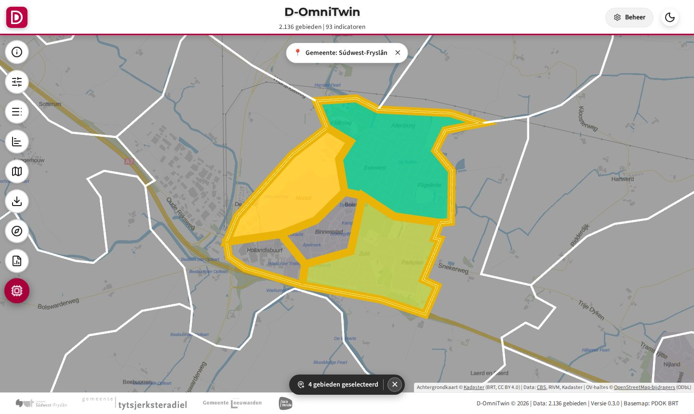
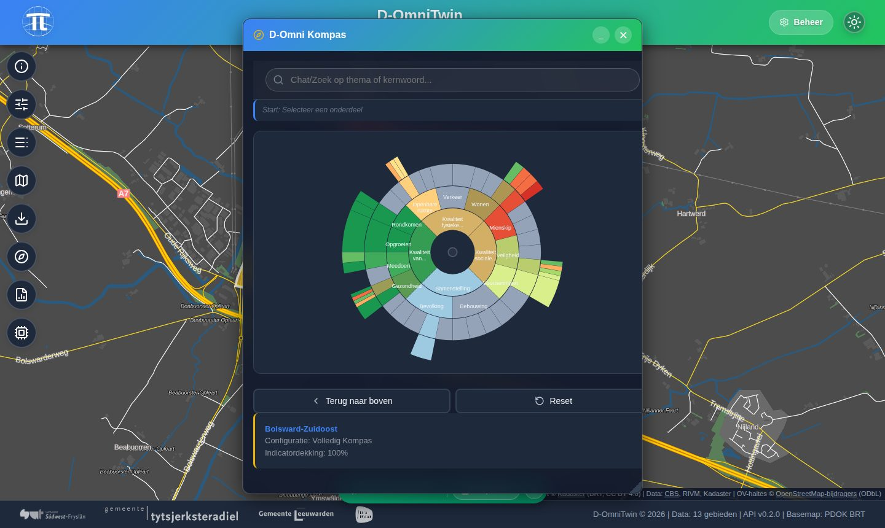
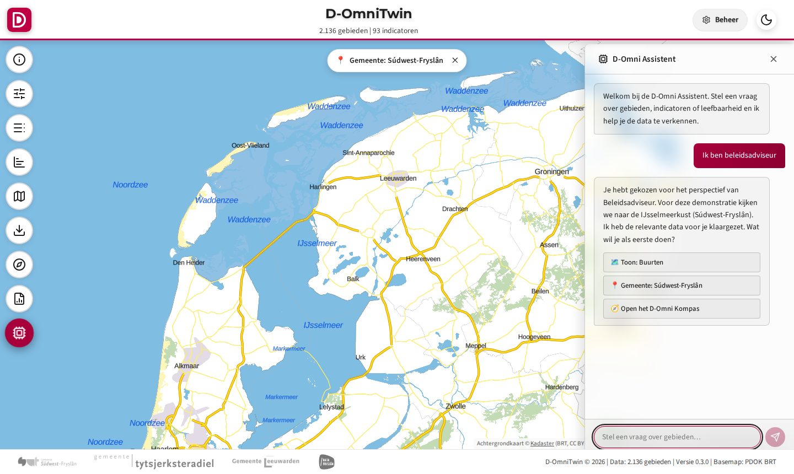
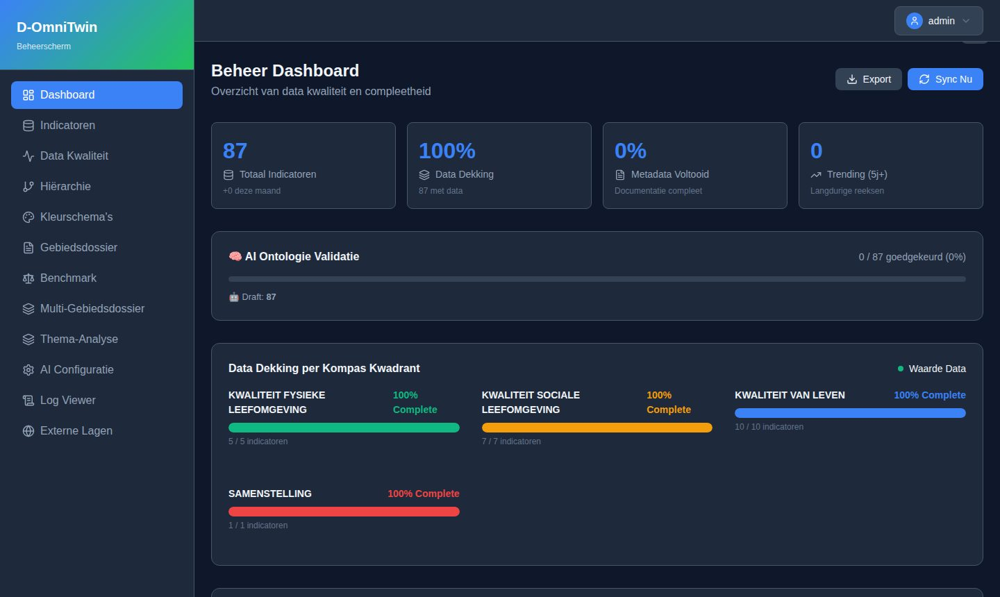

# D-OmniTwin in het kort

Wat D-OmniTwin is, hoe het eruitziet en hoe het is opgebouwd. Dit stond tot [#377](https://github.com/Sudwest-Fryslan/D-OmniTwin/issues/377) in de [README](../README.md). Installeren: de [installatiegids](./9-beheer/installatie.md).

## Wat is D-OmniTwin?

Gemeenten en provincies werken aan opgaven als energietransitie, klimaatadaptatie, sociale cohesie en brede welvaart. De data daarvoor is er vaak wel, maar verspreid over organisaties en systemen. D-OmniTwin brengt die data per buurt samen in één beeld, voor beleidsmakers, wijkfunctionarissen en inwoners:

- **Kaart** (MapLibre GL, deck.gl, PDOK-achtergrondkaart): buurten gekleurd op een indicator, met externe kaartlagen en 3D-panden (3DBAG).
- **D-Omni Kompas** (D3.js-sunburst): indicatoren in 12 thema's, gekleurd met Z-scores ten opzichte van een referentiegroep.
- **Rapporten:** gebiedsdossier, benchmark en deelgebiedsanalyse, met export.
- **D-Omni Assistent:** een chat die de kaart en het Kompas aanstuurt en datavragen met cijfers uit de database beantwoordt. Het taalmodel draait standaard lokaal (Ollama); zonder taalmodel werkt de rest gewoon.
- **Beheeromgeving** (`/admin`): indicatoren, Kompas-indeling, kaartlagen, prompts, AI-configuratie, datakwaliteit en logs.

D-OmniTwin is bedoeld als **open methodiek met referentie-implementatie**, niet als product of SaaS-dienst. De architectuur is voorbereid op dataspaces (data blijft bij de bron), zoals de Fryslân Data Space (FRLDS).

De repository bevat **use cases** als installeerbare pakketten: vragen van gebruikers (energiearmoede, hittestress, brede welvaart, sociale cohesie, beleidsadviseur) en de bronnen eronder. Bij de eerste start laden ze **open data** voor heel Fryslân: CBS-kerncijfers 2019–2026 en gebiedsindelingen, de RIVM-gezondheidsmonitor, RIVM-hitte en -boomkroon en politiecijfers. Wat (nog) niet open is, staat als gemarkeerde demodata in de bron. Testbuurt is Bolsward-Zuidoost (BU19000002). Zie de galerij in de [README](../README.md#use-cases) en [`usecases/`](../usecases/README.md).

## Zo ziet het eruit

Schermafbeeldingen van versie 0.3.0 met het SWF-thema (dagstand) op een verse installatie: open data en de SWF-gegevens die bij de use cases horen, ingezoomd op Bolsward.


*Kaart na de hittestress-vraag aan de assistent: buurten gekleurd op "Afstand tot koele plek", de vier Bolsward-buurten geselecteerd, PDOK-achtergrondkaart.*


*D-Omni Kompas voor de vier Bolsward-buurten uit de vraag (gemiddelde): alle indicatoren in thema's, gekleurd ten opzichte van de referentiegroep.*


*D-Omni Assistent: het scenario "Beleidsadviseur" zet kaart en Kompas klaar.*


*Beheerscherm (`/admin`, inloggen via Keycloak): indicatoren, datakwaliteit, AI-configuratie en rapportage.*

De screenshots maak je opnieuw met [`scripts/docs/maak_screenshots.py`](../scripts/docs/maak_screenshots.py). Actuele schermen per use case, gemaakt bij elke release, staan in de README van elke use case (zie [`usecases/`](../usecases/README.md)).

## Opbouw

| Onderdeel | Technologie | Via Traefik |
|-----------|-------------|-------------|
| Gateway | Traefik (security-headers op alle routes) | poort 80 op de host |
| Backend | FastAPI, Python-pakket [`src/omnitwin/`](../src/omnitwin/) | `/`, `/api/*`, `/health`, `/docs` |
| Web | nginx met de bestanden van de viewer (`static/`) en de beheeromgeving | `/static`, `/admin/`, `/rapport` |
| Data-API | PostgREST, alleen-lezen views in schema `api` | `/api/data` |
| Geo-API | pg_featureserv (OGC API Features) | `/api/geo` |
| Database | PostgreSQL 15 met PostGIS, pgvector en pg_trgm | niet van buiten Docker bereikbaar |
| Frontend | Vanilla JS zonder build-stap (`static/`, `templates/`) | `/` |
| Beheeromgeving | React + TypeScript, gebouwd met Vite naar `static/admin-panel/` | `/admin/` |

```
Browser (kaart, Kompas, chat, beheer)
   │ HTTP, poort 80
   ▼
Traefik ──► /api/data  ► PostgREST       ─┐
        ──► /api/geo   ► pg_featureserv  ─┤
        ──► statisch   ► web (nginx)      │
        ──► overig     ► FastAPI-backend ─┤──► PostgreSQL + PostGIS + pgvector
                             │            │
                             └─► taalmodel (Ollama lokaal, optioneel via LiteLLM)
```

Databaseschema, migraties en stuurdata staan in [`db/`](../db/README.md). Technische details: [`AGENTS.md`](../AGENTS.md) en [`docs/2-architectuur/`](./2-architectuur/architecture/ARCHITECTURE_TECHNICAL_OPERATION.md).

## AI in het kort

De chat en de AI-rapportteksten gebruiken een taalmodel; AI-zoeken gebruikt een meertalig embeddingmodel (`multilingual-e5-small`) dat in de image zit en offline werkt, samen met een synoniemenlijst (`db/stuurdata/synoniemen.json`).

- **Lokaal (standaard):** Ollama op de host, bijvoorbeeld `ollama pull qwen3:30b-instruct` (of kleiner: `qwen3:4b-instruct`). Kies in de beheeromgeving onder **AI Configuratie** de URL `http://host.docker.internal:11434` en het model.
- **OpenAI-compatibel:** in **AI Configuratie** het API-type `OpenAI-compatibel` (vLLM, LM Studio, de `/v1`-API van Ollama of een aanbieder, [ADR 0001](./2-architectuur/adr/0001-llm-koppeling-openai-standaard.md)). Een sleutel zet je als `LLM_API_KEY` in `.env`, nooit in de database.
- **LiteLLM-gateway** (optioneel, `docker compose --profile llm-gateway up -d`): vaste aliassen voor Ollama, Claude, OpenAI en Gemini, wisselen met `scripts/llm/kies_provider.py`.

Met een externe aanbieder verlaten vragen en gebiedsdata de organisatie (AVG, IAMA). Alle stappen: [installatiegids, LLM](./9-beheer/installatie.md#7-llm-optioneel).
