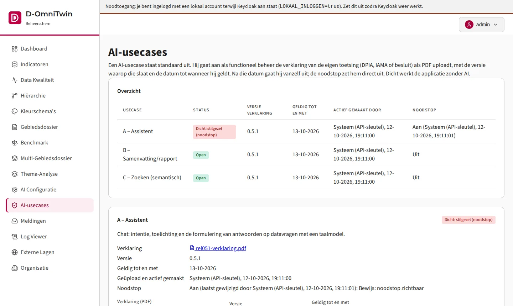
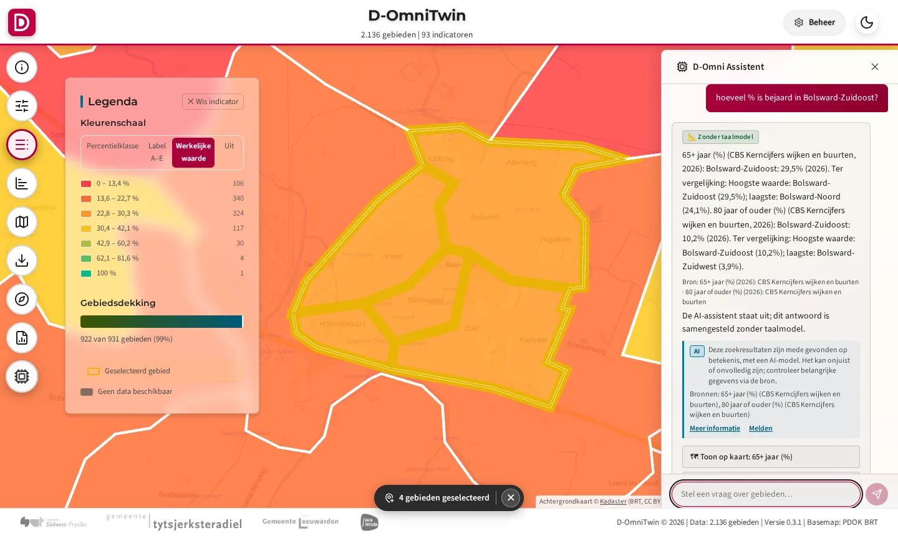
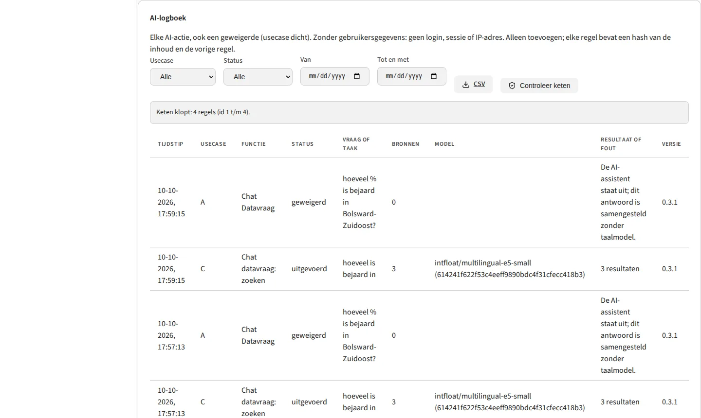
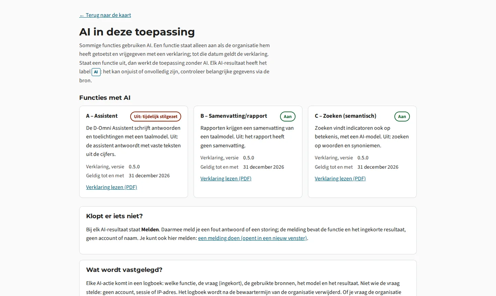

# Use case: AI volgens de afspraken (ai-compliance)

**Vraag:** kan ik als functioneel beheerder laten zien dat AI in D-OmniTwin alleen draait na een verklaring, herkenbaar is voor de gebruiker, gelogd wordt zonder gebruikersgegevens en direct uit kan, terwijl de applicatie zonder AI blijft werken?
**Issue:** deel van [#314](https://github.com/Sudwest-Fryslan/D-OmniTwin/issues/314); bouwt op [#307](https://github.com/Sudwest-Fryslan/D-OmniTwin/issues/307) (vrijgave), [#313](https://github.com/Sudwest-Fryslan/D-OmniTwin/issues/313) (logging), [#312](https://github.com/Sudwest-Fryslan/D-OmniTwin/issues/312) (herkenbaar) en [#233](https://github.com/Sudwest-Fryslan/D-OmniTwin/issues/233) (zoeken zonder embeddings).
**Automatische test:** `tests/integration/test_usecases.py` (de controles hieronder), `tests/integration/test_ai_vrijgave_stack.py`, `tests/unit/test_ai_vrijgave.py`, `tests/unit/test_ai_logboek.py`, `tests/unit/test_ai_herkenbaar.py`.

**Let op:** deze use case laat zien wat de **software** levert. Hij zegt niets over de toetsing van een organisatie. De verklaring hier is een **testverklaring** ([`data/testverklaring.pdf`](data/testverklaring.pdf): "TESTVERKLARING - voorbeeld, geen echte toetsing"). Elke organisatie doorloopt haar eigen toetsing (DPIA, IAMA of besluit volgens haar AI-beleid) en uploadt daarna haar eigen verklaring.

## Eisen en waar ze zichtbaar zijn

Bron: het routeplan van de AI Officer (10-10-2026) en het AI-beleid van SWF (§6), uitgewerkt in de issues hierboven. AI-usecases: **A** Assistent (taalmodel in de chat), **B** Samenvatting/rapport (taalmodel), **C** Zoeken op betekenis (embeddingmodel).

| Eis (routeplan) | Waar zichtbaar | |
|---|---|---|
| **Vrijgave op basis van een verklaring**: AI staat standaard uit, ook na een update; aan na upload van een verklaring (PDF) met versie en geldig tot; uit na geldig tot | Bewijs *vrijgave* (Beheer › AI-usecases: overzicht en per usecase); `GET /api/ai/usecases`; verse installatie en verlopen: `tests/integration/test_ai_vrijgave_stack.py` | ✓ |
| **Menselijk toezicht**: functioneel beheer zet een usecase direct stil (noodstop) en weer aan; wie en wanneer staat erbij | Bewijs *vrijgave* (A stilgezet) en *logboek* (logboek aan- en uitzetten) | ✓ |
| **Fail-closed**: mislukt het loggen of klopt de hashketen niet, dan automatisch dicht (door `systeem`, met reden); niet vanzelf weer open | `tests/unit/test_ai_vrijgave.py` (automatische noodstop); Beheer › AI-usecases toont "Automatische noodstop" met reden | ✓ |
| **Fallback zonder AI**: dicht werkt de applicatie gewoon, met een korte melding | Bewijs *assistent*: A staat uit, het antwoord komt uit de cijfers met "De AI-assistent staat uit"; rapport zonder samenvatting en zoeken op trefwoorden: `tests/unit/test_ai_vrijgave.py` | ✓ |
| **Transparantie**: elk AI-resultaat heeft het label AI, de waarschuwing dat het onjuist of onvolledig kan zijn, de bronnen en *Meer informatie* (de verklaring) | Bewijs *assistent* (label bij zoeken op betekenis, C; *Meer informatie* opent de uitlegpagina) en *uitleg* (pagina "AI in deze toepassing", ook via Info in de viewer: per functie aan of uit, verklaring met versie, geldig tot en PDF); `GET /api/ai/usecases` | ✓ |
| **Melden**: bij elk AI-resultaat een melding, met usecase, soort (AI-fout of systeemfout) en het ingekorte resultaat; meldplek per instantie | Bewijs *assistent* (Melden); Beheer › Organisatie › Meldplek; `GET /api/organisatie` (`meld_url`) | ✓ |
| **Logging en traceerbaarheid**: elke AI-actie, ook geweigerd, met usecase, vraag, bronnen, model, versie en resultaat; geen gebruiker, sessie of IP; alleen toevoegen; hashketen | Bewijs *logboek* (tabel en "Keten klopt"); CSV-export op dezelfde pagina; `tests/integration/test_ai_vrijgave_stack.py` (geen UPDATE/DELETE) | ✓ |
| **Bewaartermijn**: per instantie, standaard 365 dagen; opschonen via een aparte databaserol en zelf gelogd | Beheer › AI-usecases › AI-logboek (bewaartermijn); `tests/unit/test_ai_logboek.py` | ✓ |

## Inrichten

Op een installatie met sample-data (`LOAD_SAMPLE_DATA=true`) en een beheerder:

1. Beheeromgeving › **AI-usecases**: upload bij A, B en C `data/testverklaring.pdf`, versie (bijv. de versie van D-OmniTwin) en geldig tot; je login komt bij de usecase te staan. Of met een script (`ADMIN_API_KEY` uit `.env`; dan staat er "Systeem (API-sleutel)"):

   ```bash
   for uc in A B C; do
     curl -fsS -H "X-Admin-Key: $ADMIN_API_KEY" -F "bestand=@usecases/ai-compliance/data/testverklaring.pdf;type=application/pdf" \
       -F versie=test -F geldig_tot=2027-12-31 "http://localhost/api/admin/ai/usecases/$uc/verklaring"
   done
   ```

2. Zet A stil: **Noodstop: zet stil** bij A (of `POST /api/admin/ai/usecases/A/noodstop`).

Zonder taalmodel is dit de toestand van het bewijs: B en C open, A stilgezet.

## Stappen

1. **Verse installatie:** Beheer › AI-usecases toont A, B en C als *Dicht: geen verklaring*. De chat antwoordt zonder taalmodel, met "De AI-assistent staat uit"; een rapport heeft geen AI-samenvatting maar een melding op die plek.
2. **Vrijgeven:** upload de testverklaring bij A, B en C (zie Inrichten). Elke usecase staat open, met versie, geldig tot en wie/wanneer.
3. **Herkenbaar:** stel in de chat "hoeveel % is bejaard in Bolsward-Zuidoost?". Onder het antwoord staat het label AI (zoeken op betekenis), met de waarschuwing, de bronnen, *Meer informatie* (opent de verklaring) en *Melden* (opent een vooringevuld issue). Met een taalmodel en A open krijgt ook de tekst van het antwoord het label.
4. **Logboek:** Beheer › AI-usecases › AI-logboek toont de acties zonder gebruikersgegevens; "Keten klopt" na de controle bij het openen.
5. **Noodstop:** zet A stil. De chat werkt meteen zonder taalmodel. De **automatische noodstop** (kapotte hashketen of logboek niet te schrijven) toetsen de unittests; in een testomgeving kun je hem nabootsen door als databasebeheerder één regel van `ai_logboek` te wijzigen met de trigger tijdelijk uit (`ALTER TABLE ai_logboek DISABLE TRIGGER ai_logboek_bewaak`). Doe dat nooit in productie: de keten blijft daarna gebroken.

## Bewijs

<!-- bewijs:start -->
*Gemaakt op 10-10-2026 met D-OmniTwin 0.4.0 (use case 0.1.0); geslaagd. Verslag: [`bewijs/bewijs.json`](bewijs/bewijs.json). Opnieuw maken (bij een release): `python -m omnitwin.usecases bewijs ai-compliance`.*


*Vrijgave op basis van een verklaring: B en C open met versie, geldig tot en wie/wanneer; A stilgezet met de noodstop*


*Label AI bij zoeken op betekenis (C), met waarschuwing, bronnen, Meer informatie en Melden; A staat uit, dus het antwoord komt zonder taalmodel*


*AI-logboek: elke actie, ook geweigerd, zonder gebruikersgegevens; de hashketen klopt*


*Transparantie voor iedereen: 'AI in deze toepassing' met per functie aan of uit, wat hij doet, de verklaring (versie, geldig tot, PDF) en hoe je meldt*
<!-- bewijs:end -->
