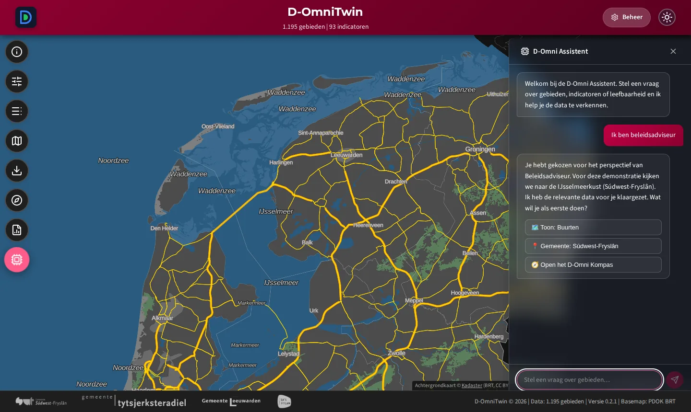
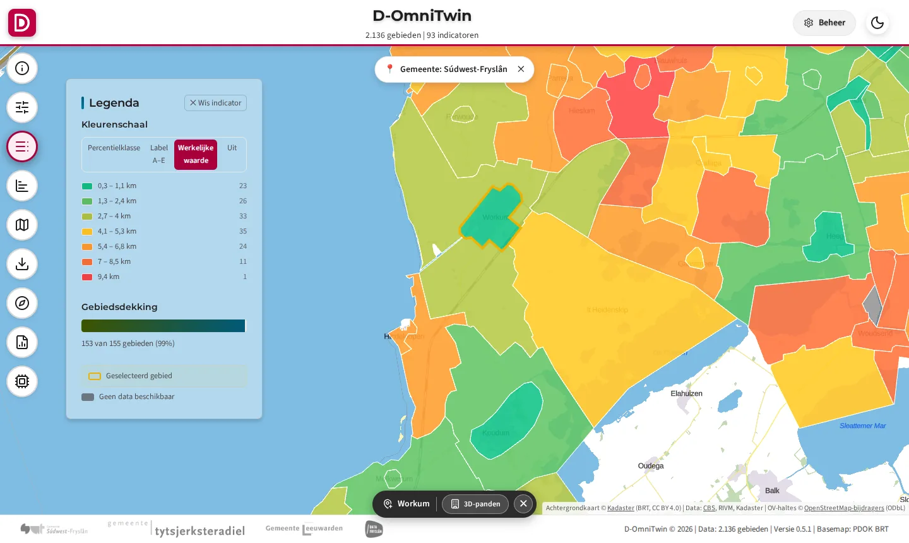
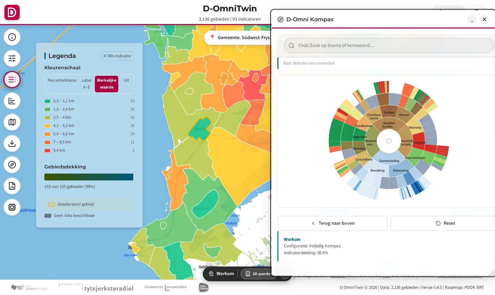

# TC-06-001 — Use case: beleidsadviseur verkent kernen in Súdwest-Fryslân

**Bron:** [TC-06-001](../../docs/testcases/06-integratie-e2e/TC-06-001_beleidsadviseur-ijsselmeerkust.md), [TC-06-003](../../docs/testcases/gebiedsagenda_ijselmeerkust/TC-06-003_gebiedsagenda_ijsselmeerkust_usecase.md) (gebiedsagenda IJsselmeerkust)
**Status:** ⚠️ Data en scenario aanwezig; de stappen staan uitgewerkt in TC-06-001
**Automatische test:** `tests/integration/test_usecases.py`, `tests/integration/test_sample_stack.py` (chatscenario Beleidsadviseur), e2e TC-06-001

Een bundel van data, inrichting en stappen. Dit pakket bevat de tien sample-buurten buiten Bolsward. De vier Bolsward-use cases bevatten de andere drie.

## Persona

- **Rol:** beleidsadviseur leefbaarheid / ruimtelijke ordening, gemeente Súdwest-Fryslân
- **Besluit:** onderbouwing voor de gebiedsagenda IJsselmeerkust
- **Start in de chat:** "Ik ben beleidsadviseur"

## 1. Data

**Gebieden:** Hindeloopen, Workum, Koudum, Warns, Hemelum, Witmarsum, Heidenschap, Boazum, Bomenbuurt, Woudsend. De waarden komen via de laad-API uit `cbs-kerncijfers` (afstand tot huisarts en grote supermarkt, woningvoorraad, Participatiewet) en `sample-bronbibliotheek` (OV-haltes, OpenStreetMap; adapter volgt). Zie [demodata naar open data](../../docs/3-data-engineering/demodata-naar-open-data.md).

**Kernindicatoren:** OV-haltes, afstand tot huisarts en grote supermarkt, woningvoorraad, Participatiewet (zie [`usecase.json`](./usecase.json)).

**Ontbreekt nog:** Makkum (staat in TC-06-001, maar niet in de testbuurten), reistijd OV.

## 2. Inrichting

| Onderdeel | Waarde |
|---|---|
| Kompas-profiel | Volledig Kompas |
| Chatscenario | `beleidsadviseur` (zet buurten, de gemeente Súdwest-Fryslân en het Kompas klaar) |

## 3. Stappen

Zie [TC-06-001](../../docs/testcases/06-integratie-e2e/TC-06-001_beleidsadviseur-ijsselmeerkust.md). Workum en Koudum zijn aanwezig; voor Makkum geldt "ontbreekt nog".

## Bewijs

<!-- bewijs:start -->
*Gemaakt op 04-10-2026 met D-OmniTwin 0.3.0 (use case 0.2.0); geslaagd. Verslag: [`bewijs/bewijs.json`](bewijs/bewijs.json). Opnieuw maken (bij een release): `python -m omnitwin.usecases bewijs beleidsadviseur-swf`.*

*Scenario Beleidsadviseur: de D-Omni Assistent zet kaart en Kompas klaar*

*Afstand tot huisarts in de kernen aan de IJsselmeerkust, Workum geselecteerd*

*Kompas voor Workum: alle indicatoren in thema's*
<!-- bewijs:end -->
