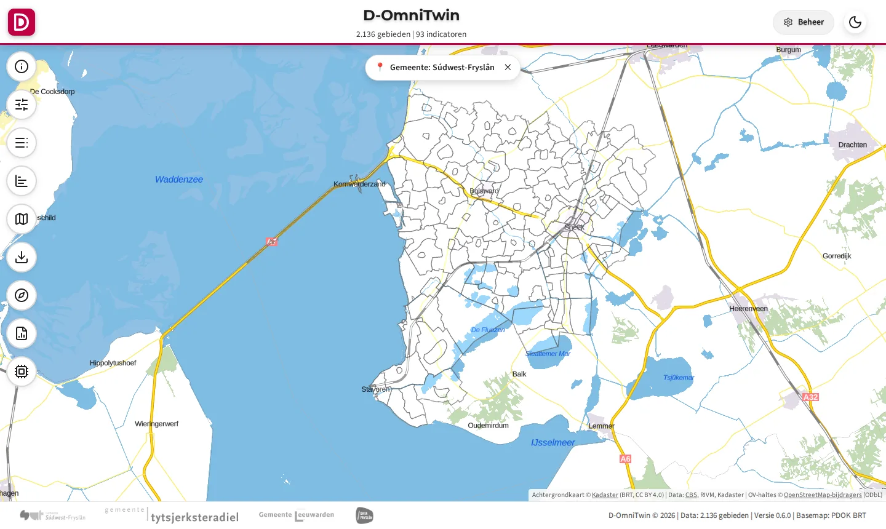
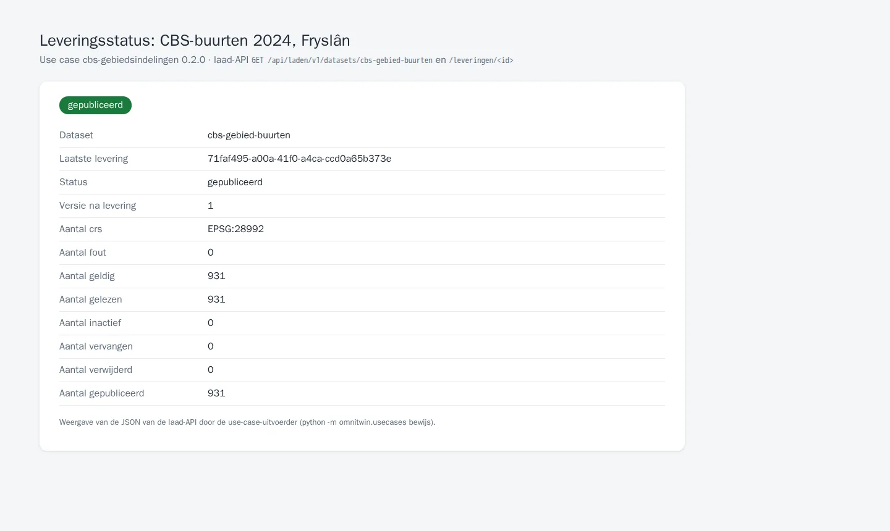

# TC-07-001 — CBS-gebiedsindelingen (buurten, wijken, gemeenten) via de laad-API

**Status:** ontwerp (de laad-API is nog niet gebouwd; deze use case is de specificatie en straks de acceptatietest)
**Versie:** 0.2.0 · **Afhankelijk van:** –
**Manifest:** [`usecase.json`](usecase.json) · **Controleren:** `python -m omnitwin.usecases controleer cbs-gebiedsindelingen`

## Vraag

- **Gebruiker:** beheerder D-OmniTwin
- **Vraag:** "Ik wil de CBS-buurten, -wijken en -gemeenten van Fryslân in D-OmniTwin, met dezelfde codes als het CBS, zodat elke andere use case er waarden aan kan hangen."
- **Rechten:** `realm-rol beheerder (registreren)`, `dataset:cbs-gebied-buurten:laden`, `dataset:cbs-gebied-wijken:laden`, `dataset:cbs-gebied-gemeenten:laden`

CBS-gebiedsindelingen komen in veel use cases terug. Daarom een eigen use case waar andere op `afhankelijk_van` kunnen: de buurten, wijken en gemeenten van Fryslân uit de open CBS-gebiedsindelingen op PDOK, als drie datasets met profiel `gebiedsindeling`. Niets staat in de repo; de adapter `wfs` downloadt bij het controleren of installeren, met cache in `$DATA_CACHE/bronnen/wfs`.

Geen SWF-specifieke data: deze use case werkt voor elke Friese gemeente. Het jaar (2024) staat in de URL van de bron; een nieuwe jaargang is een nieuwe versie van de use case.

## Data

| Dataset | Route | Profiel | Formaat | Bron | Toegang | Licentie | Rol |
|---|---|---|---|---|---|---|---|
| [`cbs-gebied-buurten`](datasets/cbs-gebied-buurten.json) | laden | gebiedsindeling | geopackage | PDOK CBS-gebiedsindelingen 2024 (open, CC BY 4.0) | open | CC BY 4.0 | `dataset:cbs-gebied-buurten:laden` |
| [`cbs-gebied-wijken`](datasets/cbs-gebied-wijken.json) | laden | gebiedsindeling | geopackage | PDOK CBS-gebiedsindelingen 2024 (open, CC BY 4.0) | open | CC BY 4.0 | `dataset:cbs-gebied-wijken:laden` |
| [`cbs-gebied-gemeenten`](datasets/cbs-gebied-gemeenten.json) | laden | gebiedsindeling | geopackage | PDOK CBS-gebiedsindelingen 2024 (open, CC BY 4.0) | open | CC BY 4.0 | `dataset:cbs-gebied-gemeenten:laden` |

Verwacht:

- `cbs-gebied-buurten`: features 931; codes BU + 8 cijfers, uniek; 155 in Súdwest-Fryslân
- `cbs-gebied-wijken`: features 246
- `cbs-gebied-gemeenten`: features 18

### Lokaal gecontroleerd

`python -m omnitwin.usecases controleer cbs-gebiedsindelingen` op 02-10-2026 (export van februari 2026, open bronnen van die dag). Alleen aantallen, geen meetwaarden.

| Dataset | Bron → levering | Resultaat |
|---|---|---|
| cbs-gebied-buurten | 1.977 binnen de bbox → 931 in Fryslân | geldig (931 unieke codes, MultiPolygon, EPSG:28992) |
| cbs-gebied-wijken | 493 → 246 | geldig |
| cbs-gebied-gemeenten | 44 → 18 | geldig |

## Stappen

1. Levering(en) maken en lokaal controleren tegen het profiel (zonder API):
   ```bash
   python -m omnitwin.usecases controleer cbs-gebiedsindelingen --uit /tmp/cbs-gebiedsindelingen
   ```
2. Token halen (client credentials; tokenendpoint uit `/.well-known/openid-configuration` van realm `omnitwin`):
   ```bash
   TOKEN=$(curl -s -u "$CLIENT_ID:$CLIENT_SECRET" -d grant_type=client_credentials \
     https://omnitwin.example.nl/auth/realms/omnitwin/protocol/openid-connect/token | jq -r .access_token)
   API=https://omnitwin.example.nl/api/laden/v1
   ```
3. Registreren (eenmalig, realm-rol `beheerder`; de uitvoerder stuurt alleen `id`, `bronId`, `beschrijving` en `laadprofiel`):
   ```bash
   jq '{id, bronId, beschrijving, laadprofiel}' datasets/cbs-gebied-buurten.json | \
     curl -s -X POST "$API/datasets" -H "Authorization: Bearer $TOKEN" -H "Content-Type: application/json" -d @-
   ```
   Daarna in Keycloak de client-rol `dataset:cbs-gebied-buurten:laden` op `omnitwin-api` aanmaken en toekennen aan de machineclient `etl-cbs`.
4. Leveren:
   ```bash
   curl -s -X POST "$API/datasets/cbs-gebied-buurten/leveringen?wacht=true" -H "Authorization: Bearer $TOKEN" \
     -H "Idempotency-Key: cbs-gebied-buurten-$(date +%Y%m%d)" -H "Content-Type: application/geopackage+sqlite3" \
     --data-binary @/tmp/cbs-gebiedsindelingen/cbs-gebied-buurten/cbs-gebied-buurten.gpkg
   ```
5. Status volgen: `curl -s "$API/leveringen/<id>" -H "Authorization: Bearer $TOKEN" | jq '{status, versie, aantallen}'`.
6. Controleren in de API en de viewer (zie Acceptatiecriteria). Overige datasets van deze use case op dezelfde manier.

## Acceptatiecriteria

| # | Type | Wat | Verwacht |
|---|---|---|---|
| 1 | aantal | `cbs-gebied-gemeenten` — 18 Friese gemeenten (indeling 2024) | gelijk 18 |
| 2 | aantal | `cbs-gebied-buurten` — alle buurten in Fryslân (CBS 2024) | gelijk 931 |
| 3 | aantal | `cbs-gebied-wijken` | gelijk 246 |
| 4 | api | `GET /api/data/v1/gebieden?id=eq.BU19000002&select=id,naam,gebiedstype_id` (anoniem) — Bolsward-Zuidoost bestaat, als CBS-buurt | HTTP 200, ≥ 1 resultaten |
| 5 | api | `GET /api/geo/v1/collections` (anoniem) — de gebieden staan in de geo-API | HTTP 200 |
| 6 | idempotent | `cbs-gebied-gemeenten` twee keer leveren — dezelfde levering twee keer = één versie | zelfde versie, geen tweede publicatie |

`aantal` en `bewerking` controleert `controleer` nu al op de lokaal gemaakte levering; de andere vragen de laad-API en een draaiende installatie.

## Bewijs

<!-- bewijs:start -->
*Gemaakt op 03-10-2026 met D-OmniTwin 0.3.0-rc.1 (use case 0.2.0); geslaagd. Verslag: [`bewijs/bewijs.json`](bewijs/bewijs.json). Opnieuw maken (bij een release): `python -m omnitwin.usecases bewijs cbs-gebiedsindelingen`.*


*De CBS-buurten van Súdwest-Fryslân op de kaart (gemeentefilter)*


*Leveringsstatus van de CBS-buurten (laad-API)*
<!-- bewijs:end -->

## Bekende afwijkingen

- Gebiedstype 'CBS wijken' (0fdd1ab2) bestaat nu alleen via de SWF-definities (swf-definities); voor andere gemeenten moet het in de stuurdata.
- De SWF-gebiedstypen 'CBS gemeentegrenzen' (1e6b3c18) en 'CBS provinciegrenzen' (e1de90ae) dubbelen 'Gemeente' en 'Provincie' van D-OmniTwin; deze use case vult alleen 'Gemeente'. Besluit nodig: alias of samenvoegen.
