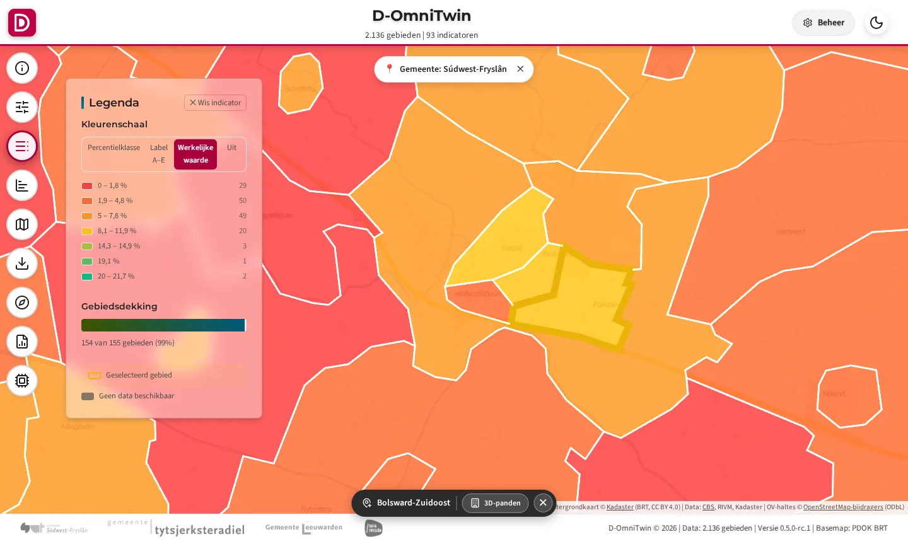
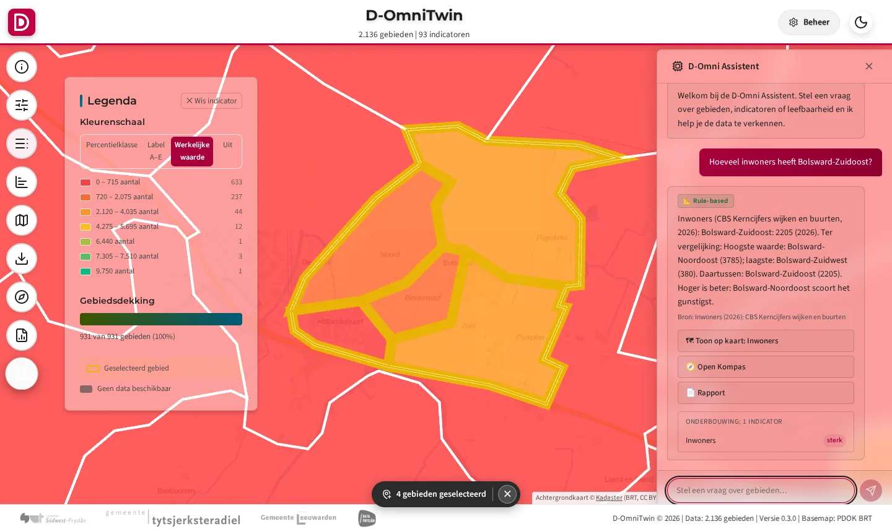
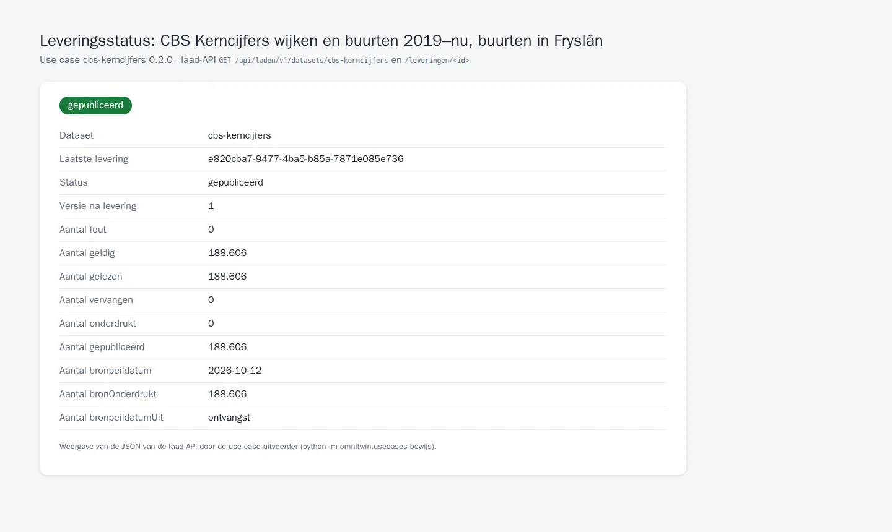

# TC-07-002 — CBS Kerncijfers wijken en buurten via de laad-API

**Status:** ontwerp (de laad-API is nog niet gebouwd; deze use case is de specificatie en straks de acceptatietest)
**Versie:** 0.2.0 · **Afhankelijk van:** [cbs-gebiedsindelingen](../cbs-gebiedsindelingen/README.md)
**Manifest:** [`usecase.json`](usecase.json) · **Controleren:** `python -m omnitwin.usecases controleer cbs-kerncijfers`

## Vraag

- **Gebruiker:** beheerder D-OmniTwin
- **Vraag:** "Ik wil de CBS Kerncijfers van alle jaargangen sinds 2019 per buurt in D-OmniTwin, als één dataset die elk jaar met één levering wordt bijgewerkt."
- **Rechten:** `realm-rol beheerder (registreren)`, `dataset:cbs-kerncijfers:laden`

De CBS Kerncijfers wijken en buurten (2019 tot nu) als één dataset met profiel `waarnemingen`. De bestaande downloader (`init_data/scripts/download_cbs_kerncijfers.py`, recept `init_data/cbs/datapackage.json`) is de adapter `cbs-odata`: zelfde tabellen, kolom-mapping, indicator-UUID's en cache in `$DATA_CACHE/cbs`. De demopakketten (hittestress e.a.) hangen er optioneel van af: zolang de laad-API er niet is, laden ze CBS zoals nu via `laad_cbs.py`.

## Data

| Dataset | Route | Profiel | Formaat | Bron | Toegang | Licentie | Rol |
|---|---|---|---|---|---|---|---|
| [`cbs-kerncijfers`](datasets/cbs-kerncijfers.json) | laden | waarnemingen | datapackage | CBS OData, Kerncijfers wijken en buurten 2019–2026 (open, CC BY 4.0) | open | CC BY 4.0 | `dataset:cbs-kerncijfers:laden` |

Verwacht:

- `cbs-kerncijfers`: regels 186.756 (heel Fryslân, 8 jaargangen; gelijk aan controle.rijen_totaal in init_data/cbs/datapackage.json); n leeg: CBS onderdrukt zelf (bron-onderdrukt)

### Lokaal gecontroleerd

`python -m omnitwin.usecases controleer cbs-kerncijfers` op 02-10-2026 (export van februari 2026, open bronnen van die dag). Alleen aantallen, geen meetwaarden.

| Dataset | Bron → levering | Resultaat |
|---|---|---|
| cbs-kerncijfers | 186.756 regels (8 jaargangen, heel Fryslân) | geldig; gelijk aan controle.rijen_totaal in init_data/cbs/datapackage.json |

## Stappen

1. Levering(en) maken en lokaal controleren tegen het profiel (zonder API):
   ```bash
   python -m omnitwin.usecases controleer cbs-kerncijfers --uit /tmp/cbs-kerncijfers
   ```
2. Token halen (client credentials; tokenendpoint uit `/.well-known/openid-configuration` van realm `omnitwin`):
   ```bash
   TOKEN=$(curl -s -u "$CLIENT_ID:$CLIENT_SECRET" -d grant_type=client_credentials \
     https://omnitwin.example.nl/auth/realms/omnitwin/protocol/openid-connect/token | jq -r .access_token)
   API=https://omnitwin.example.nl/api/laden/v1
   ```
3. Registreren (eenmalig, realm-rol `beheerder`; de uitvoerder stuurt alleen `id`, `bronId`, `beschrijving` en `laadprofiel`):
   ```bash
   jq '{id, bronId, beschrijving, laadprofiel}' datasets/cbs-kerncijfers.json | \
     curl -s -X POST "$API/datasets" -H "Authorization: Bearer $TOKEN" -H "Content-Type: application/json" -d @-
   ```
   Daarna in Keycloak de client-rol `dataset:cbs-kerncijfers:laden` op `omnitwin-api` aanmaken en toekennen aan de machineclient `etl-cbs`.
4. Leveren:
   ```bash
   curl -s -X POST "$API/datasets/cbs-kerncijfers/leveringen?wacht=true" -H "Authorization: Bearer $TOKEN" \
     -H "Idempotency-Key: cbs-kerncijfers-$(date +%Y%m%d)" -H "Content-Type: application/zip" \
     --data-binary @/tmp/cbs-kerncijfers/cbs-kerncijfers/cbs-kerncijfers.zip
   ```
5. Status volgen: `curl -s "$API/leveringen/<id>" -H "Authorization: Bearer $TOKEN" | jq '{status, versie, aantallen}'`.
6. Controleren in de API en de viewer (zie Acceptatiecriteria). Overige datasets van deze use case op dezelfde manier.

## Acceptatiecriteria

| # | Type | Wat | Verwacht |
|---|---|---|---|
| 1 | aantal | `cbs-kerncijfers` — alle jaargangen voor heel Fryslân (nu 186.756) | minimaal 180000 |
| 2 | api | `GET /api/data/v1/gebied_data?gebied_id=eq.BU19000002&indicator_uuid=eq.31f70dff-c116-4267-bef0-d15b0ff4c020&select=jaar,waarde` (anoniem) — Inwoners van Bolsward-Zuidoost voor 2019–2026 | HTTP 200, ≥ 8 resultaten |
| 3 | idempotent | `cbs-kerncijfers` twee keer leveren | zelfde versie, geen tweede publicatie |
| 4 | viewer | Kompas openen voor Bolsward-Zuidoost, indicator Inwoners | trendlijn 2019–2026 |

`aantal` en `bewerking` controleert `controleer` nu al op de lokaal gemaakte levering; de andere vragen de laad-API en een draaiende installatie.

## Bewijs

<!-- bewijs:start -->
*Gemaakt op 13-10-2026 met D-OmniTwin 0.6.0 (use case 0.2.0); geslaagd. Verslag: [`bewijs/bewijs.json`](bewijs/bewijs.json). Opnieuw maken (bij een release): `python -m omnitwin.usecases bewijs cbs-kerncijfers`.*


*80 jaar of ouder (%) per buurt in Bolsward (CBS Kerncijfers 2026)*


*Datavraag beantwoord uit de CBS Kerncijfers*


*Leveringsstatus van de CBS Kerncijfers (laad-API)*
<!-- bewijs:end -->

## Bekende afwijkingen

- n ontbreekt: de CBS-tabellen hebben geen aantallen per waarde; minimumN 0 en bron-onderdrukt (CBS onderdrukt zelf).
- Overlap met swf-basismonitor-waarden: 5 indicator-UUID's (2.598 waarden vanaf 2019) zitten in beide; zie de README van swf-basismonitor-waarden.
