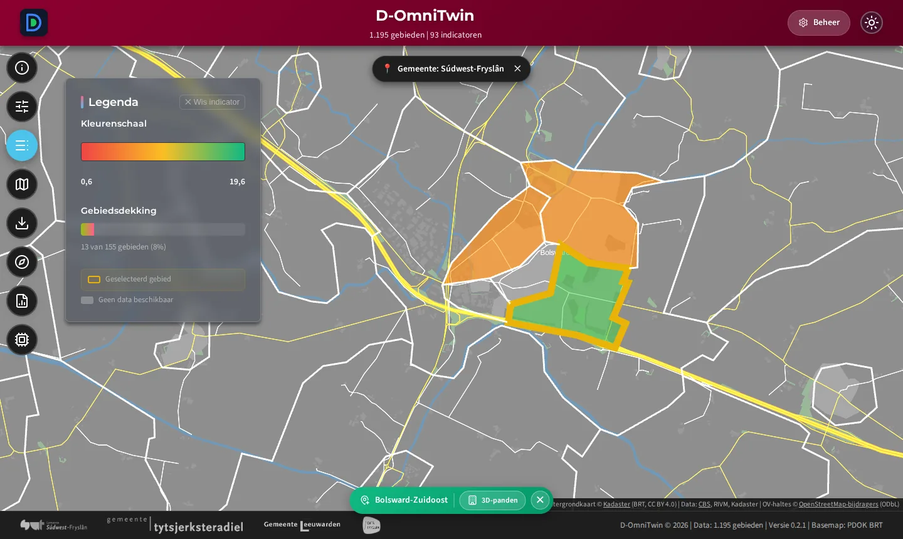
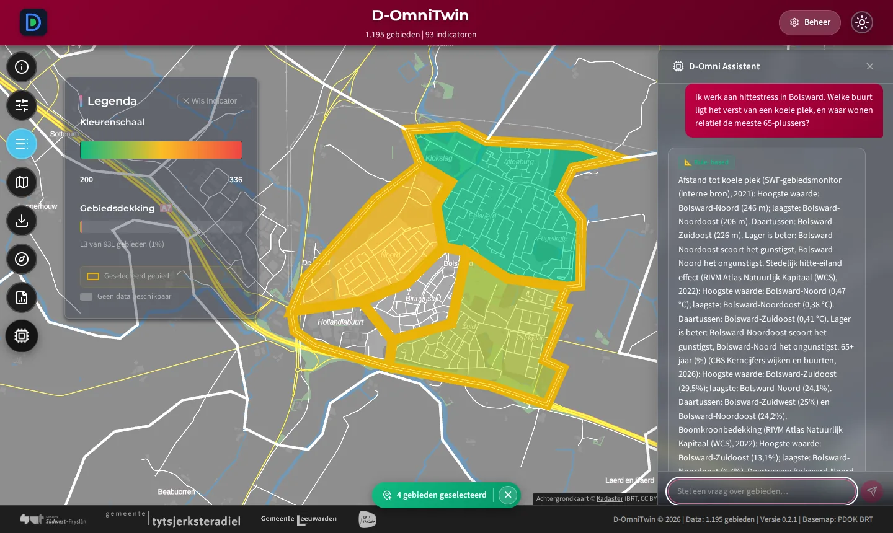
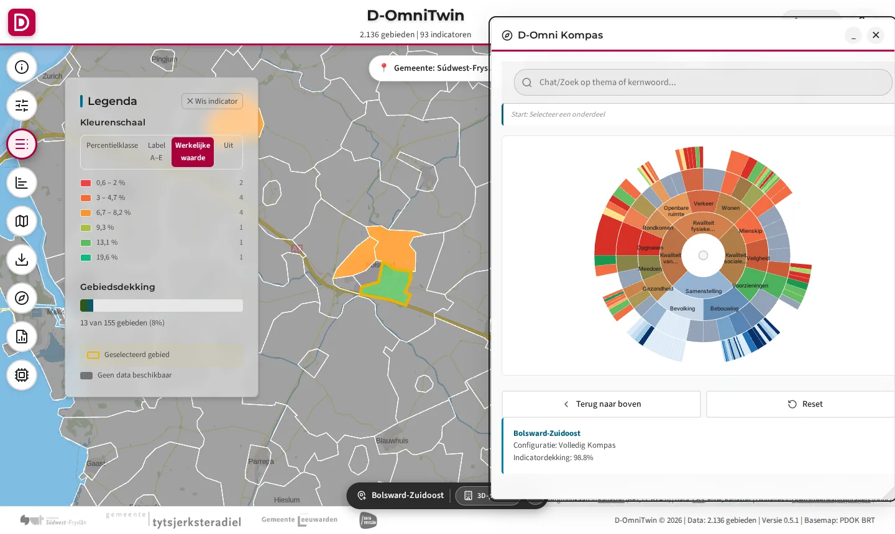
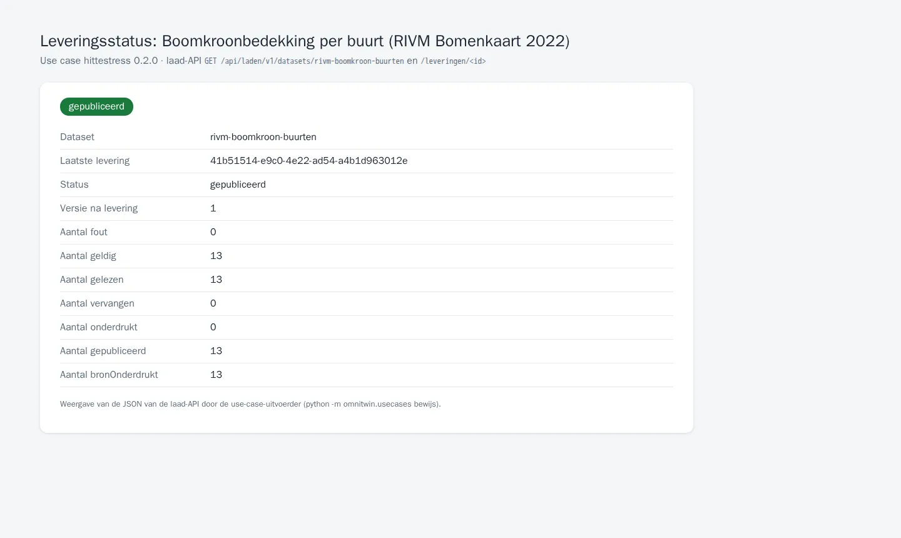

# TC-06-006 — Use case: Klimaatadaptatie: hittestress en kwetsbaarheid

**Bron:** innovatieaanvraag Digitale Overheid 2026, use cases; `docs/8-communicatie/usecases/data-science_use-cases.md`
**Status:** actief (https://github.com/Sudwest-Fryslan/D-OmniTwin/issues/236: data via de laad-API uit open bronnen; drie indicatoren DEMODATA)
**Automatische test:** `tests/integration/test_usecases.py` (leest [`usecase.json`](./usecase.json))

Een use case is een **bundel**: data + inrichting + stappen. Alle drie staan hier; `usecase.json` is de machineleesbare versie.

## Persona

- **Rol:** Stedenbouwkundige / GGD
- **Besluit:** Waar eerst vergroenen en koele plekken inrichten?
- **Vraag aan de assistent:** "Ik werk aan hittestress in Bolsward. Welke buurt ligt het verst van een koele plek, en waar wonen relatief de meeste 65-plussers?"

## 1. Data

- **Data:** via de laad-API (https://github.com/Sudwest-Fryslan/D-OmniTwin/issues/236). Afhankelijk van `cbs-gebiedsindelingen`, `cbs-kerncijfers`, `rivm-gezondheidsmonitor` en `sample-bronbibliotheek`; eigen datasets voor de RIVM-rasters. Gebiedstype CBS Buurten.
- **Gebieden:** Bolsward-Noord (BU19000001), Bolsward-Zuidoost (BU19000002), Bolsward-Noordoost (BU19000004). Focus: Bolsward-Zuidoost. (De CBS-indeling 2024 heeft ook Bolsward-Zuidwest, BU19000003; die staat sinds #236 ook in D-OmniTwin.)

| Indicator | Richting | Bron |
|---|---|---|
| Afstand tot koele plek | lager is beter | **DEMODATA**, plaatsvervanger voor de interne bron SWF-gebiedsmonitor (`sample-bronbibliotheek`) |
| Oppervlak groen per inwoner | hoger is beter | **DEMODATA**, idem |
| Verhouding oppervlakte water / verharding | hoger is beter | **DEMODATA**, idem |
| 65+ jaar | neutraal | CBS Kerncijfers 2019-2026 (`cbs-kerncijfers`) |
| 65+ jaar (%) | neutraal | CBS Kerncijfers, afgeleid in het recept (zelfde jaar) |
| 80 jaar of ouder (%) | neutraal | CBS Kerncijfers 2026 (`k_80JaarOfOuder_13` ÷ inwoners), `cbs-kerncijfers` |
| Ervaren gezondheid | hoger is beter | RIVM Gezondheidsmonitor 2012-2024 (`rivm-gezondheidsmonitor`) |
| Boomkroonbedekking | hoger is beter | RIVM Atlas Natuurlijk Kapitaal, Bomenkaart 2022 (dataset [`rivm-boomkroon-buurten`](datasets/rivm-boomkroon-buurten.json)) |
| Stedelijk hitte-eiland effect | lager is beter | RIVM Atlas Natuurlijk Kapitaal, Stedelijk hitte-eiland effect v2 (dataset [`rivm-hitte-eiland-buurten`](datasets/rivm-hitte-eiland-buurten.json)) |

### Eigen datasets (RIVM-rasters)

Kernadapter `wcs-zonaal` (vervangt het vroegere `maak_data.py`): per buurt een uitsnede van het raster via WCS 2.0.1 (`https://data.rivm.nl/geo/ank/wcs`, GeoTIFF in RD New) en het gemiddelde over de 10m-cellen met het middelpunt in de buurt. De buurtgrenzen komen van PDOK (CBS-gebiedsindeling 2024, dezelfde download als `cbs-gebiedsindelingen`). Voor de 13 testbuurten. Licentie: Public Domain Mark 1.0. De uuid per indicator is `uuid5` op de naam (namespace van `laad_usecase.py`).

| Dataset | Coverage | Jaar | Methode |
|---|---|---|---|
| `rivm-boomkroon-buurten` | `ank__rivm_20231221_bomenkaart_2022` (bomen > 2,5 m) | 2022 | gemiddelde; cel zonder bomen = 0% (`nodata_als: 0`) |
| `rivm-hitte-eiland-buurten` | `ank__Stedelijk_hitte_eiland_effect_01062022_v2` | 2022 | gemiddelde; nodata telt niet mee |

| Buurt | 65+ (%) | 80+ (%) | Boomkroon (%) | Hitte-eiland (°C) | Afstand koele plek (DEMODATA) |
|---|---|---|---|---|---|
| Bolsward-Noord (BU19000001) | 24,1 | 9,5 | 7,4 | 0,47 | 246 m |
| Bolsward-Zuidoost (BU19000002) | 29,5 | 10,2 | 13,1 | 0,41 | 226 m |
| Bolsward-Noordoost (BU19000004) | 24,2 | 6,2 | 6,7 | 0,38 | 206 m |

Gemeten op een verse installatie op 02-10-2026. Boomkroon en hitte-eiland wijken 0,1-0,2 af van de vroegere `maak_data.py` (toen de buurtgrenzen uit de sample, nu de gegeneraliseerde grenzen van PDOK).

**Ontbreekt nog** (#138):
- **% 75+:** CBS publiceert per buurt alleen 65-80 en 80+ (Kerncijfers 2026). 80+ is opgenomen; dat is ook de groep die het kwetsbaarst is bij hitte.
- **Gevoelstemperatuur (Klimaateffectatlas):** voor Fryslân niet als open download of WCS beschikbaar (op data.overheid.nl alleen van Zuid-Holland, Overijssel en Zeeland). Vervangen door het stedelijk hitte-eiland effect van het RIVM.
- **Afstand tot koele plek, groen per inwoner, water/verharding:** interne bron; nu DEMODATA. Met `SWF_DUMP_DIR` laadt `sample-bronbibliotheek` de echte waarden (variant `intern`).

## 2. Inrichting

| Onderdeel | Waarde |
|---|---|
| Kompas-profiel | Klimaat Kompas: op een verse installatie gevuld met de klimaatindicatoren hierboven (thema's hittestress, hemelwateroverlast, droogte) en labels A–E, voorlopig op kwintielen ([#256](https://github.com/Sudwest-Fryslan/D-OmniTwin/issues/256), [labels_methodiek.md](../../docs/3-data-engineering/labels_methodiek.md)) |
| Chatscenario | — (nog geen eigen scenario) |
| Polariteit | volgens de kolom *Richting* hierboven |

## 3. Stappen

| # | Actie | Verwacht | Resultaat 01-10 |
|---|---|---|---|
| 0 | Installeer: `python -m omnitwin.usecases installeer hittestress` (db-init doet dit automatisch bij `LOAD_SAMPLE_DATA=true`, met de laadstraat in-process) | De datasets zijn gepubliceerd, de richting is gezet; `python -m omnitwin.usecases test hittestress` is groen | ✅ (verse stack, 02-10) |
| 1 | Open de app, kies **Kaart Configuratie → CBS Buurten** | 13 buurten op de kaart | ✅ |
| 2 | Kies indicator **Afstand tot koele plek**, zoom in op Bolsward | Buurten gekleurd; **rood = slechter**, legenda met eenheid | ✅ Richting klopt: gecorrigeerd in de definities (#120) |
| 2b | Kies indicator **Stedelijk hitte-eiland effect** | Buurten met data krijgen elk een kleur naar hun waarde, ook bij weinig gebieden; legenda in °C, groen = laag | ✅ 03-10: [#161](https://github.com/Sudwest-Fryslan/D-OmniTwin/issues/161) opgelost; bij minder unieke waarden dan kleurklassen krijgt elke waarde een eigen klasse |
| 3 | Klik op **Bolsward-Zuidoost** | Selectiebalk met de buurtnaam | ✅ |
| 4 | Open het **Kompas** (Klimaat Kompas) | Zonnediagram voor Bolsward-Zuidoost, dekking 100% | ✅ (Volledig Kompas) |
| 5 | Stel de vraag aan de **D-Omni Assistent** | Antwoord noemt de relevante indicatoren en buurten. Verwacht: relatief de meeste 65-plussers in Bolsward-Zuidoost (29,5%, CBS 2026). Afstand tot een koele plek (DEMODATA, de assistent meldt dat): Bolsward-Noord het verst (246 m), Bolsward-Noordoost het dichtst bij (206 m). | ✅ zonder taalmodel (vaste tekst, `tests/integration/test_chat_datavragen.py`); met model zie #139 |
| 6 | **Rapport → Gebiedsdossier** voor Bolsward-Zuidoost | Dossier met AI-samenvatting, label "AI-gegenereerd" | ✅ (eerdere ronde, ~2 min met lokaal model) |

## Resultaat

- **Data:** de indicatoren zijn aanwezig en gevuld voor de drie Bolsward-buurten. Vier ervan komen uit echte open data (CBS 2026, RIVM 2022), ook voor Bolsward-Zuidoost.
- **Uitkomst met echte data:** relatief de meeste 65- en 80-plussers wonen in Bolsward-Zuidoost (29,5% en 10,2%). Die buurt heeft ook de meeste boomkroon (13,1%). Bolsward-Noord heeft het sterkste hitte-eiland effect (0,47 °C) en ligt het verst van een koele plek.
- **Inrichting:** het pakket zet de richting goed en voegt afgeleide percentages toe. Een eigen Kompas-profiel en chatscenario per use case ontbreken nog (#138).

## Bewijs

<!-- bewijs:start -->
*Gemaakt op 11-10-2026 met D-OmniTwin 0.5.0-rc.1 (use case 0.3.0); geslaagd. Verslag: [`bewijs/bewijs.json`](bewijs/bewijs.json). Opnieuw maken (bij een release): `python -m omnitwin.usecases bewijs hittestress`.*

*Boomkroonbedekking per buurt in Bolsward (RIVM, 2022)*

*Datavraag over hittestress: afstand tot een koele plek en 65-plussers*

*Kompas voor Bolsward-Zuidoost*

*Leveringsstatus van de eigen dataset boomkroon (laad-API)*
<!-- bewijs:end -->
