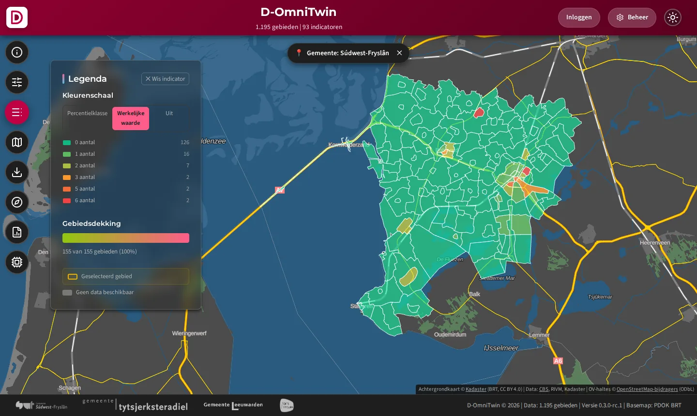
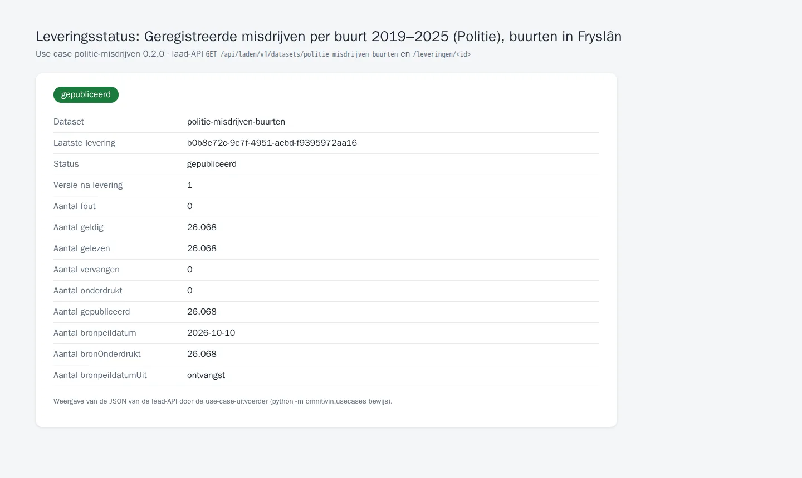

# TC-07-022 — Politie: geregistreerde misdrijven per buurt via de laad-API

**Status:** actief · **Versie:** 0.2.0 · **Afhankelijk van:** [cbs-gebiedsindelingen](../cbs-gebiedsindelingen/README.md)
**Manifest:** [`usecase.json`](usecase.json) · **Controleren:** `python -m omnitwin.usecases controleer politie-misdrijven`

## Vraag

- **Gebruiker:** beheerder D-OmniTwin
- **Vraag:** "Ik wil het aantal woninginbraken, fietsdiefstallen, diefstallen uit auto's en vernielingen per buurt sinds 2019 in D-OmniTwin."
- **Rechten:** `realm-rol beheerder (registreren)`, `dataset:politie-misdrijven-buurten:laden`

De Politie publiceert *Geregistreerde misdrijven; soort misdrijf, wijk, buurt, jaarcijfers* op StatLine van derden (`dataderden.cbs.nl`, tabel 47018NED). De kernadapter `cbs-statline` haalt vier soorten misdrijf op voor de buurten in Fryslân, 2019-2025. Buurtcodes die niet in de CBS-indeling 2024 staan, vallen af (`buurt-niet-in-indeling-2024`), omdat de laad-API alleen waarden op bestaande gebieden accepteert.

Tot #236 stonden deze waarden in de sample (2024, zonder bron, met demodata voor Bolsward-Zuidoost).

## Data

| Dataset | Route | Profiel | Formaat | Bron | Toegang | Licentie | Rol |
|---|---|---|---|---|---|---|---|
| [`politie-misdrijven-buurten`](datasets/politie-misdrijven-buurten.json) | laden | waarnemingen | datapackage | Politie StatLine 47018NED via https://dataderden.cbs.nl/ODataFeed/odata/47018NED | open | CC BY 4.0 | `dataset:politie-misdrijven-buurten:laden` |

| Indicator (D-OmniTwin) | Soort misdrijf in 47018NED |
|---|---|
| inbraak woning | 1.1.1 Diefstal/inbraak woning |
| inbraak auto | 1.2.1 Diefstal uit/vanaf motorvoertuigen |
| diefstal fiets | 1.2.3 Diefstal van brom-, snor-, fietsen |
| beschadiging auto's | 2.2.1 Vernieling cq. zaakbeschadiging |

Verwacht: 26.068 regels (4 soorten, buurten in Fryslân, 2019-2025), 140 afgewezen (buurten van vóór de indeling 2024). Bronvermelding: Politie.

## Stappen

1. `python -m omnitwin.usecases controleer politie-misdrijven --uit /tmp/politie` (zonder API).
2. `python -m omnitwin.usecases installeer politie-misdrijven`, of bij een verse installatie automatisch.
3. Controleren: `GET /api/data/v1/gebied_data?gebied_id=eq.BU19000002&indicator_uuid=eq.d90d2b4c-4bce-428c-834a-1cc8113958e4&select=jaar,waarde,bron`.

## Acceptatiecriteria

| # | Type | Wat | Verwacht |
|---|---|---|---|
| 1 | aantal | `politie-misdrijven-buurten` | minimaal 25.000 |
| 2 | bewerking | `buurt-niet-in-indeling-2024` | maximaal 500 (nu 140) |
| 3 | api | Woninginbraken in Bolsward-Zuidoost (anoniem) | HTTP 200, ≥ 7 resultaten (2019-2025) |
| 4 | idempotent | `politie-misdrijven-buurten` twee keer leveren | zelfde versie |

## Bewijs

<!-- bewijs:start -->
*Gemaakt op 11-10-2026 met D-OmniTwin 0.5.0 (use case 0.2.0); geslaagd. Verslag: [`bewijs/bewijs.json`](bewijs/bewijs.json). Opnieuw maken (bij een release): `python -m omnitwin.usecases bewijs politie-misdrijven`.*

*Woninginbraken per buurt in Súdwest-Fryslân (Politie)*

*Leveringsstatus van de misdrijven per buurt (laad-API)*
<!-- bewijs:end -->

## Bekende afwijkingen

- *beschadiging auto's* (naam uit de vroegere sample) is in de bron *Vernieling cq. zaakbeschadiging*, niet alleen auto's; *inbraak auto* is *Diefstal uit/vanaf motorvoertuigen*. Het Kompas noemt bij *inbraak auto* 1.2.2 (*Diefstal van motorvoertuigen*); de waarden in de vroegere sample waren 1.2.1.
- Buurten die na een herindeling een nieuwe code kregen, hebben alleen waarden vanaf het jaar van de nieuwe indeling.
