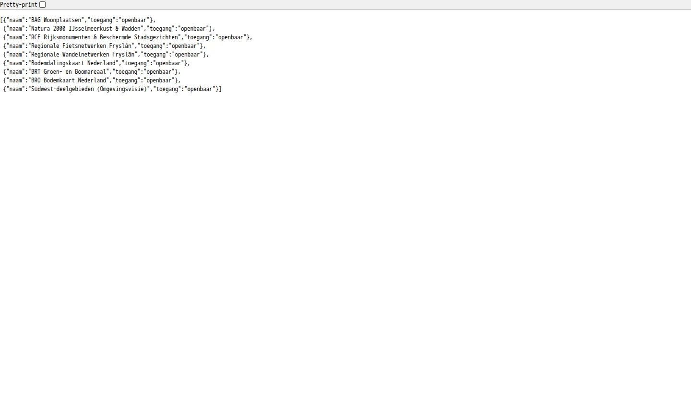
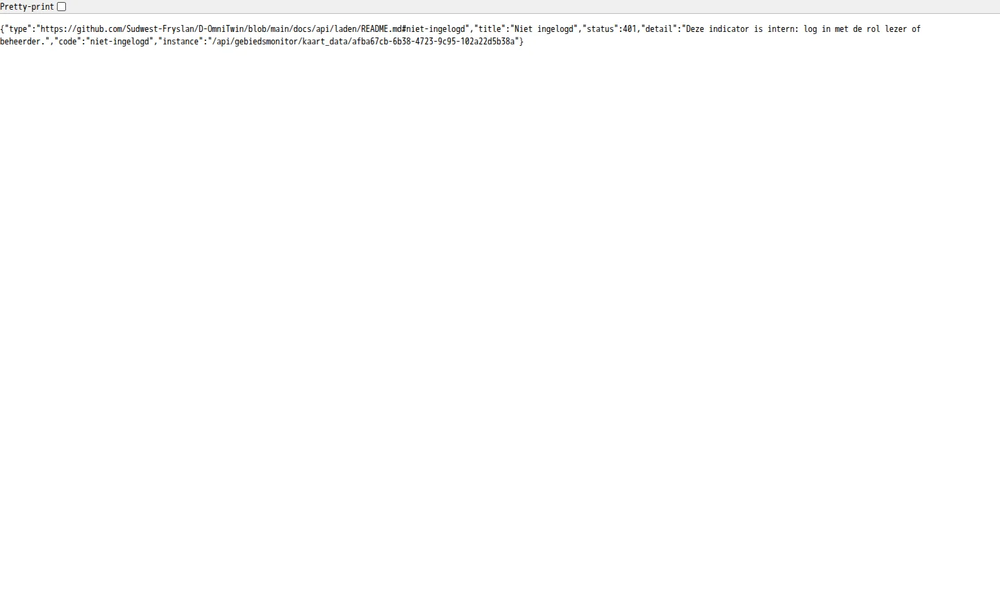
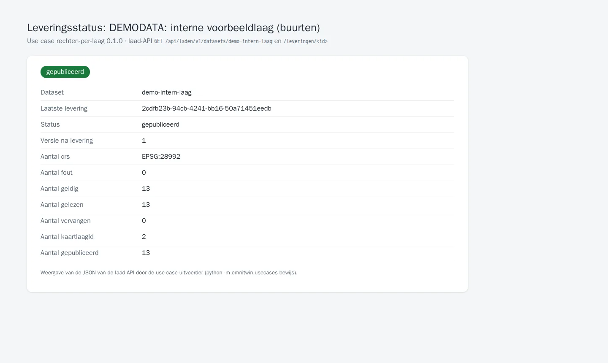

# TC-07-024 — Rechten per laag: interne lagen en indicatoren alleen na inloggen

**Status:** actief · **Versie:** 0.1.0 · **Afhankelijk van:** [cbs-gebiedsindelingen](../cbs-gebiedsindelingen/README.md)
**Manifest:** [`usecase.json`](usecase.json) · **Controleren:** `python -m omnitwin.usecases controleer rechten-per-laag`

## Vraag

- **Gebruiker:** beheerder D-OmniTwin
- **Vraag:** "Ik wil dat een laag of indicator uit een interne bron alleen zichtbaar is voor ingelogde medewerkers (rol lezer of beheerder), ook bij een directe aanroep van de API, en dat open data voor iedereen zichtbaar blijft."
- **Rechten:** `realm-rol beheerder (registreren)`, `dataset:demo-intern-definitie:laden`, `dataset:demo-intern-waarden:laden`, `dataset:demo-intern-laag:laden`, `realm-rol lezer` (interne lagen en indicatoren zien)

Toont toegang per laag en bron (https://github.com/Sudwest-Fryslan/D-OmniTwin/issues/254, [ADR 0010](../../docs/2-architectuur/adr/0010-toegang-per-laag-en-bron.md)). Toegang is data: `dct:accessRights` in de registratie van de dataset. `PUBLIC` is openbaar, `RESTRICTED` (of `NON_PUBLIC`) is intern. Wat een interne dataset publiceert (kaartlaag, indicator, waarden), zie je alleen met de realm-rol `lezer` of `beheerder`. Anoniem staat het niet in de lijsten, en een directe aanroep geeft 401 (ingelogd zonder rol: 403).

## Data

Alles is **DEMODATA**: een denkbeeldige interne bron, zodat elke installatie het verschil laat zien.

| Dataset | Route | Profiel | Formaat | Bron | Toegang | Licentie | Rol |
|---|---|---|---|---|---|---|---|
| [`demo-intern-definitie`](datasets/demo-intern-definitie.json) | laden | definities | datapackage | [`intern-definitie.json`](intern-definitie.json): één indicator, *DEMODATA: interne voorbeeldindicator* | intern | onbekend (demodata) | `dataset:demo-intern-definitie:laden` |
| [`demo-intern-waarden`](datasets/demo-intern-waarden.json) | laden | waarnemingen | datapackage | [`intern-waarden.csv`](intern-waarden.csv): 13 buurten van de sample | intern | onbekend (demodata) | `dataset:demo-intern-waarden:laden` |
| [`demo-intern-laag`](datasets/demo-intern-laag.json) | laden | kaartlaag | geopackage | `${REPO}/init_data/sample/2_brondata/sample_buurten.geojson`: de 13 buurten als vlakken | intern | onbekend (demodata) | `dataset:demo-intern-laag:laden` |

Verwacht: 1 indicator, 13 waarden, 13 vlakken. In de viewer heten ze *DEMODATA: …* en hebben ze het label **intern**.

## Stappen

1. `python -m omnitwin.usecases controleer rechten-per-laag`.
2. `python -m omnitwin.usecases installeer rechten-per-laag`, of bij een verse installatie automatisch.
3. Anoniem: `GET /api/data/v1/externe_kaartlagen?select=naam,toegang` toont alleen openbare lagen; `GET /api/gebiedsmonitor/kaart_data/<buurten>?indicator_uuid=e36c5cab-2e36-4be0-bd8f-ade7924975a6` geeft 401.
4. Inloggen als lezer (demo: `gebruiker`/`gebruiker`): de laag en de indicator staan in de lijsten, met het label *intern*.

## Acceptatiecriteria

| # | Type | Wat | Verwacht |
|---|---|---|---|
| 1 | aantal | `demo-intern-definitie` (indicatoren), `demo-intern-waarden`, `demo-intern-laag` | 1, 13, 13 |
| 2 | api | anoniem: interne indicator, waarden en laag via PostgREST | 0 resultaten |
| 3 | api | anoniem: kaartdata van de interne indicator (FastAPI) | 401 |
| 4 | api | anoniem: openbare waarden (Afstand tot koele plek) | ≥ 1 resultaat |
| 5 | recht | lezer bekijkt de interne indicator; machineclient zonder `lezer` niet | toegestaan; 403 |
| 6 | recht | beheerder registreert, etl-intern levert alleen eigen datasets, lezer laadt niet | zoals de rollen |
| 7 | viewer | zonder inloggen: lagenlijst en indicatorkeuze | zonder de interne laag en indicator |
| 8 | viewer | ingelogd als lezer | met de interne laag en indicator, label *intern* |

Criteria 7 en 8 toetst `tests/e2e/test_toegang_per_laag.py` in de browser; `tests/integration/test_toegang_per_laag.py` toetst ook de lezer via PostgREST en FastAPI.

## Bewijs

<!-- bewijs:start -->
*Gemaakt op 10-10-2026 met D-OmniTwin 0.4.0 (use case 0.1.0); geslaagd. Verslag: [`bewijs/bewijs.json`](bewijs/bewijs.json). Opnieuw maken (bij een release): `python -m omnitwin.usecases bewijs rechten-per-laag`.*

*Zonder inloggen: de lagenlijst (PostgREST) heeft alleen openbare lagen*

*Zonder inloggen: een directe aanroep van de interne indicator geeft 401*

*De interne laag is gepubliceerd via de laad-API (dct:accessRights RESTRICTED)*
<!-- bewijs:end -->

## Bekende afwijkingen

- De aantallen in de indicatorenlijst (`aantal_gebieden_met_data`) tellen alle waarden van een openbare indicator, ook interne.
- Een gebiedsindeling met `dct:accessRights` RESTRICTED krijgt toegang intern in de registratie, maar de gebieden zelf blijven zichtbaar (nog niet afgedwongen).
