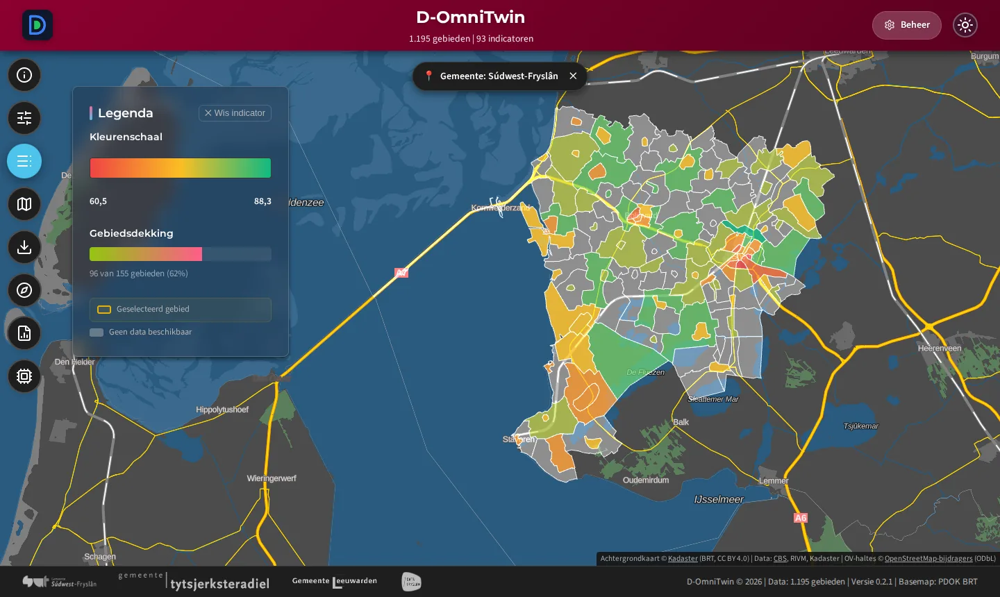
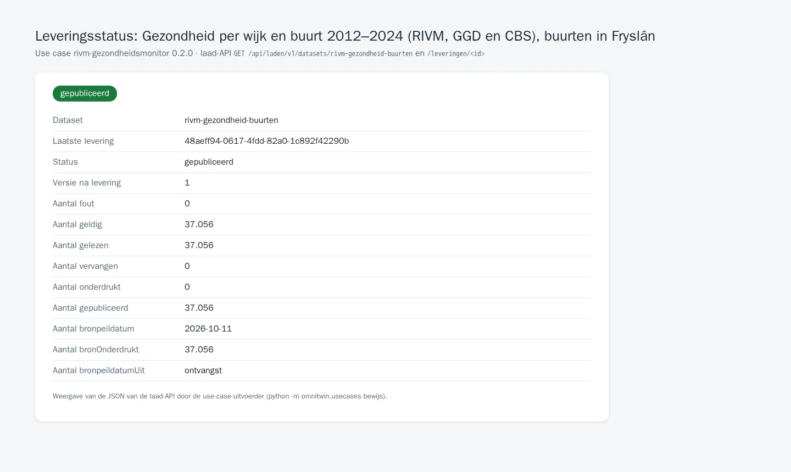

# TC-07-021 — RIVM Gezondheidsmonitor per buurt via de laad-API

**Status:** actief · **Versie:** 0.2.0 · **Afhankelijk van:** [cbs-gebiedsindelingen](../cbs-gebiedsindelingen/README.md)
**Manifest:** [`usecase.json`](usecase.json) · **Controleren:** `python -m omnitwin.usecases controleer rivm-gezondheidsmonitor`

## Vraag

- **Gebruiker:** beheerder D-OmniTwin
- **Vraag:** "Ik wil de gezondheidscijfers per buurt (ervaren gezondheid, eenzaamheid, mantelzorg, vrijwilligerswerk, moeite met rondkomen, leefstijl) uit de Gezondheidsmonitor in D-OmniTwin, met de trend sinds 2012."
- **Rechten:** `realm-rol beheerder (registreren)`, `dataset:rivm-gezondheid-buurten:laden`

De RIVM-tabel *Gezondheid per wijk en buurt; 2012/2016/2020/2022/2024 (indeling 2024)* staat op StatLine van derden (`dataderden.cbs.nl`, tabel 50150NED). De kernadapter `cbs-statline` haalt hem op (ODataFeed, gepagineerd) en pakt hem uit per kolom; de dataset koppelt elke kolom aan een indicator van D-OmniTwin. Leeftijd 18 jaar en ouder, de puntschatting (geen marges). Alleen buurten uit de CBS-indeling 2024 (die van [cbs-gebiedsindelingen](../cbs-gebiedsindelingen/README.md)).

Gebruikt door de demo-use cases [hittestress](../hittestress/README.md), [energiearmoede](../energiearmoede/README.md), [brede-welvaart](../brede-welvaart/README.md) en [sociale-cohesie](../sociale-cohesie/README.md). Tot #236 stonden deze waarden in de sample, met demodata voor Bolsward-Zuidoost.

## Data

| Dataset | Route | Profiel | Formaat | Bron | Toegang | Licentie | Rol |
|---|---|---|---|---|---|---|---|
| [`rivm-gezondheid-buurten`](datasets/rivm-gezondheid-buurten.json) | laden | waarnemingen | datapackage | RIVM StatLine 50150NED via https://dataderden.cbs.nl/ODataFeed/odata/50150NED | open | CC BY 4.0 | `dataset:rivm-gezondheid-buurten:laden` |

| Indicator (D-OmniTwin) | Kolom in 50150NED |
|---|---|
| Ervaren gezondheid | `GoedErvarenGezondheid_4` |
| Eenzaamheid | `Eenzaam_25` |
| Mantelzorger | `Mantelzorger_30` |
| Vrijwilliger | `Vrijwilligerswerk_31` |
| Moeite met rondkomen | `MoeiteMetRondkomen_32` |
| Overgewicht | `Overgewicht_33` |
| Obesitas | `ErnstigOvergewichtObesitas_34` |
| Roken | `RooktTabak_35` |
| Overmatig drinken | `OvermatigDrinken_37` |
| Bewegen | `VoldoetAanDeBeweegrichtlijn_40` |
| Gezondheid | `HoogRisicoAngststoornisOfDepressie_14` (zie bekende afwijkingen) |

Verwacht: 37.056 regels (11 indicatoren, buurten in Fryslân, peiljaren 2012, 2016, 2020, 2022 en 2024); `kwaliteit` = `geschat` (modelberekening van het RIVM); per waarde `bron` = "RIVM, GGD en CBS: Gezondheidsmonitor <jaar> (StatLine 50150NED)".

Bronvermelding: Gezondheidsmonitor Volwassenen en Ouderen, GGD'en, CBS en RIVM.

### Lokaal gecontroleerd

Bron → levering op 02-10-2026: 37.056 regels, niets afgewezen. Bolsward-Zuidoost 2024: eenzaamheid 46,5%, goed ervaren gezondheid 72,7%, vrijwilligerswerk 29,0%, mantelzorg 13,8%, moeite met rondkomen 12,9%.

## Stappen

1. `python -m omnitwin.usecases controleer rivm-gezondheidsmonitor --uit /tmp/rivm` (zonder API).
2. `python -m omnitwin.usecases installeer rivm-gezondheidsmonitor` (met machineclient, zie [use cases](../README.md#uitvoeren)), of bij een verse installatie automatisch (`db-init`, in-process).
3. Controleren in de API: `GET /api/data/v1/gebied_data?gebied_id=eq.BU19000002&indicator_uuid=eq.4661dcb9-b7c4-42f8-b7c5-a61c12568806&select=jaar,waarde,bron`.

## Acceptatiecriteria

| # | Type | Wat | Verwacht |
|---|---|---|---|
| 1 | aantal | `rivm-gezondheid-buurten` | minimaal 35.000 |
| 2 | api | Eenzaamheid in Bolsward-Zuidoost (anoniem) | HTTP 200, ≥ 5 resultaten (2012-2024) |
| 3 | idempotent | `rivm-gezondheid-buurten` twee keer leveren | zelfde versie |

## Bewijs

<!-- bewijs:start -->
*Gemaakt op 13-10-2026 met D-OmniTwin 0.7.0 (use case 0.2.0); geslaagd. Verslag: [`bewijs/bewijs.json`](bewijs/bewijs.json). Opnieuw maken (bij een release): `python -m omnitwin.usecases bewijs rivm-gezondheidsmonitor`.*

*Ervaren gezondheid per buurt in Súdwest-Fryslân (RIVM Gezondheidsmonitor)*

*Leveringsstatus van de Gezondheidsmonitor per buurt (laad-API)*
<!-- bewijs:end -->

## Bekende afwijkingen

- Indicator *Gezondheid* is in de bron *Hoog risico angststoornis of depressie* (naam uit de vroegere sample); de richting staat als hoger is beter, dat klopt niet. Vervolg: definitie corrigeren.
- 2012 en 2016 hebben minder buurten (kleine buurten onderdrukt of niet berekend).
