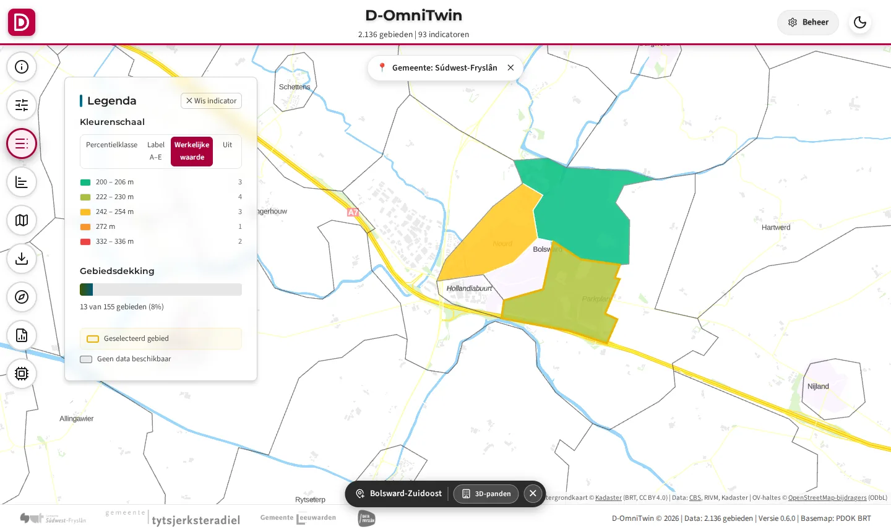
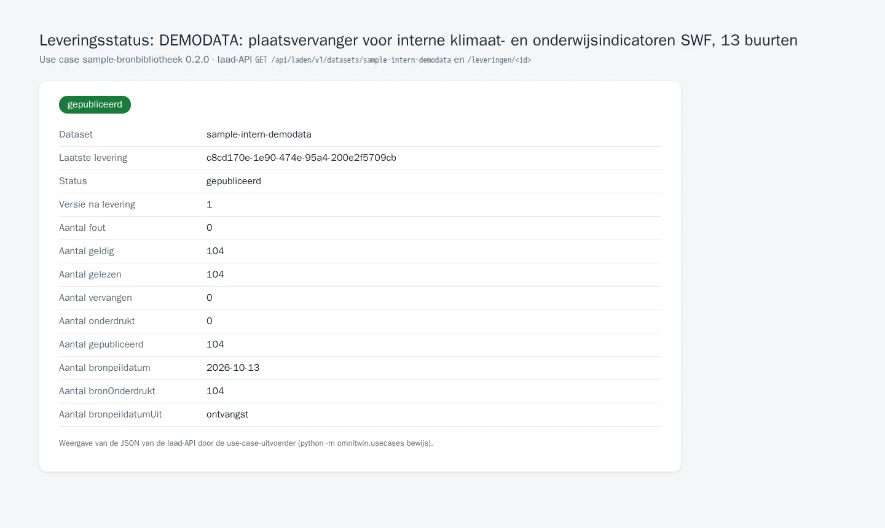

# TC-07-023 — Sample: wat nog niet open is of nog geen adapter heeft (gemarkeerd)

**Status:** actief · **Versie:** 0.1.0 · **Afhankelijk van:** [cbs-gebiedsindelingen](../cbs-gebiedsindelingen/README.md)
**Manifest:** [`usecase.json`](usecase.json) · **Controleren:** `python -m omnitwin.usecases controleer sample-bronbibliotheek`

## Vraag

- **Gebruiker:** beheerder D-OmniTwin
- **Vraag:** "Ik wil de demo's laten werken met de indicatoren waarvoor nog geen open bron met adapter is, zonder dat iemand demodata voor echte cijfers aanziet; met de echte interne bron als die er lokaal is."
- **Rechten:** `realm-rol beheerder (registreren)`, `dataset:sample-open-zonder-adapter:laden`, `dataset:sample-intern-demodata:laden`

Sinds #236 komt alles wat open en te downloaden is uit een use case met een kernadapter (CBS, RIVM, Politie, RIVM-rasters). Wat overblijft in [`init_data/sample/`](../../init_data/sample/README.md) laadt deze use case via de laad-API, in twee datasets, zodat het herkenbaar en later vervangbaar is. De inventaris staat in [demodata naar open data](../../docs/3-data-engineering/demodata-naar-open-data.md).

## Data

| Dataset | Route | Profiel | Formaat | Bron | Toegang | Licentie | Rol |
|---|---|---|---|---|---|---|---|
| [`sample-open-zonder-adapter`](datasets/sample-open-zonder-adapter.json) | laden | waarnemingen | datapackage | `${REPO}/init_data/sample/2_brondata/sample_indicatoren.csv`: Kadaster BAG (21), RVO EP-Online (6), OpenStreetMap (5), per buurt berekend | open | volgt de bron (BAG PDM/CC0, EP-Online te bevestigen, OSM ODbL) | `dataset:sample-open-zonder-adapter:laden` |
| [`sample-intern-demodata`](datasets/sample-intern-demodata.json) | laden | waarnemingen | datapackage | DEMODATA in de sample, plaatsvervanger voor de interne bron SWF-gebiedsmonitor (8 indicatoren); variant `intern`: `${SWF_DUMP_DIR}` | open (demodata) / beperkt (intern) | onbekend | `dataset:sample-intern-demodata:laden` |

**Demodata herkenbaar:**

- `sample-intern-demodata`: in de DCAT `dct:type` `demodata`, een beschrijving die zegt dat het een plaatsvervanger is voor de interne bron *SWF-gebiedsmonitor*, en `prov:wasDerivedFrom` met die functionele naam.
- Per waarde begint de `bron` met `DEMODATA` (in de API en de viewer): bij de 8 interne indicatoren altijd, bij BAG, EP-Online en OpenStreetMap alleen voor Bolsward-Zuidoost (gemiddelde van de buren).

**Echte interne bron:** de variant `intern` (`als_beschikbaar`) leest de export van de huidige gebiedsmonitor uit `${SWF_DUMP_DIR}/output/api_data_dump.json`, alleen deze 8 indicatoren op CBS-buurten. Is `SWF_DUMP_DIR` gezet en staat de export er, dan laadt de uitvoerder die echte waarden (met `dct:type` `brondata` en toegang `RESTRICTED`); anders de demodata. De echte data komt nooit in git.

Verwacht: `sample-open-zonder-adapter` 416 regels (32 x 13 buurten), `sample-intern-demodata` 104 regels (8 x 13 buurten).

## Stappen

1. `python -m omnitwin.usecases controleer sample-bronbibliotheek` (demodata); `SWF_DUMP_DIR=… python -m omnitwin.usecases controleer sample-bronbibliotheek --variant intern` (echte interne bron).
2. `python -m omnitwin.usecases installeer sample-bronbibliotheek`, of bij een verse installatie automatisch.
3. Controleren: `GET /api/data/v1/gebied_data?gebied_id=eq.BU19000002&bron=like.DEMODATA*&select=indicator_uuid,waarde,bron`.

## Acceptatiecriteria

| # | Type | Wat | Verwacht |
|---|---|---|---|
| 1 | aantal | `sample-open-zonder-adapter` | 416 |
| 2 | aantal | `sample-intern-demodata` (zonder `SWF_DUMP_DIR`) | 104 |
| 3 | api | Afstand tot koele plek, Bolsward-Zuidoost, bron begint met `DEMODATA` (anoniem) | HTTP 200, ≥ 1 resultaat |
| 4 | idempotent | `sample-intern-demodata` twee keer leveren | zelfde versie |

## Bewijs

<!-- bewijs:start -->
*Gemaakt op 03-10-2026 met D-OmniTwin 0.2.1 (use case 0.1.0); geslaagd. Verslag: [`bewijs/bewijs.json`](bewijs/bewijs.json). Opnieuw maken (bij een release): `python -m omnitwin.usecases bewijs sample-bronbibliotheek`.*

*Afstand tot koele plek (DEMODATA, plaatsvervanger voor de interne bron)*

*Leveringsstatus van de demodata (laad-API, dct:type demodata)*
<!-- bewijs:end -->

## Bekende afwijkingen

- BAG (21 indicatoren), EP-Online (6, API-sleutel nodig) en OpenStreetMap (5) hebben nog geen kernadapter: de waarden komen uit de vroegere sample, voor 13 buurten. Zie het vervolg in [demodata naar open data](../../docs/3-data-engineering/demodata-naar-open-data.md#wat-nog-niet-open-is-of-nog-geen-adapter-heeft-vervolg).
- De demodata van de interne indicatoren zijn de waarden uit de vroegere sample (herkomst: uploads in de SWF-gebiedsmonitor, niet herleidbaar; Bolsward-Zuidoost synthetisch).
- De variant `intern` is niet getest met een echte export (niet beschikbaar in de testomgeving).
