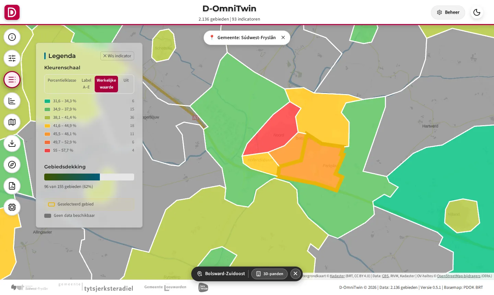
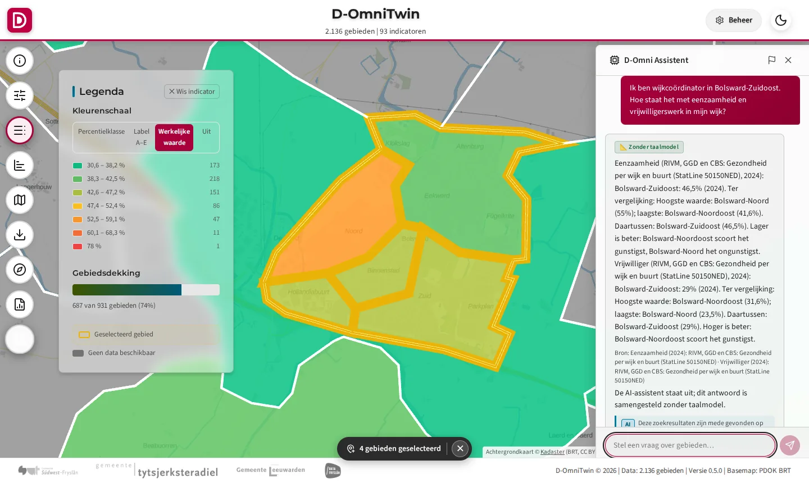
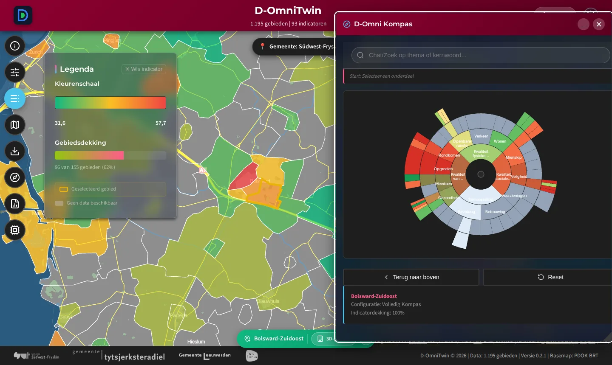

# TC-06-008 — Use case: Zorgzwaarte en sociale cohesie

**Bron:** innovatieaanvraag Digitale Overheid 2026, use cases; `docs/8-communicatie/usecases/data-science_use-cases.md`
**Status:** ⚠️ Nagespeeld op 2026-10-01: kaart en Kompas werken met het pakket; AI-assistent nog niet (zie Resultaat)
**Automatische test:** `tests/integration/test_usecases.py` (leest [`usecase.json`](./usecase.json))

Een use case is een **bundel**: data + inrichting + stappen. Alle drie staan hier; `usecase.json` is de machineleesbare versie.

## Persona

- **Rol:** Wijkcoördinator / wijkcontactfunctionaris
- **Besluit:** Waar zetten we sociaal werk en buurthuisactiviteiten in?
- **Vraag aan de assistent:** "Ik ben wijkcoördinator in Bolsward-Zuidoost. Hoe staat het met eenzaamheid en vrijwilligerswerk in mijn wijk?"

## 1. Data

- **Data:** via de laad-API uit de datasets van de afhankelijkheden (`cbs-gebiedsindelingen`, `cbs-kerncijfers`, `rivm-gezondheidsmonitor`), gebiedstype CBS Buurten. Open data wordt bij de installatie gedownload; wat nog niet open is of nog geen adapter heeft, komt uit `sample-bronbibliotheek` en is gemarkeerd (`DEMODATA` in de bron van de waarde). Zie [demodata naar open data](../../docs/3-data-engineering/demodata-naar-open-data.md). Deze use case draait volledig op open data.
- **Gebieden:** Bolsward-Noord (BU19000001), Bolsward-Zuidoost (BU19000002), Bolsward-Noordoost (BU19000004). Focus: Bolsward-Zuidoost.

| Indicator | Richting | Bron |
|---|---|---|
| Eenzaamheid | lager is beter | RIVM Gezondheidsmonitor 2012-2024 (`rivm-gezondheidsmonitor`) |
| Vrijwilliger | hoger is beter | idem |
| Mantelzorger | neutraal | idem |
| Eenpersoonshuishoudens | neutraal | CBS Kerncijfers (`cbs-kerncijfers`) |
| Eenpersoonshuishoudens (%) | neutraal | CBS Kerncijfers, afgeleid in het recept (zelfde jaar) |

**Ontbreekt nog** (#138):
- Verhuismobiliteit
- Psychische klachten (RIVM)
- Sociale samenhang (Leefbaarometer)

## 2. Inrichting

| Onderdeel | Waarde |
|---|---|
| Kompas-profiel | Volledig Kompas |
| Chatscenario | wijkcontactfunctionaris |
| Polariteit | volgens de kolom *Richting* hierboven |

## 3. Stappen

| # | Actie | Verwacht | Resultaat 01-10 |
|---|---|---|---|
| 0 | Installeer: `python -m omnitwin.usecases installeer sociale-cohesie` (db-init doet dit automatisch bij `LOAD_SAMPLE_DATA=true`, met de laadstraat in-process) | De datasets van de afhankelijkheden zijn gepubliceerd; daarna zet `laad_usecase.py --inrichting` de richting | ✅ (verse stack, 02-10) |
| 1 | Open de app, kies **Kaart Configuratie → CBS Buurten** | 13 buurten op de kaart | ✅ |
| 2 | Kies indicator **Eenzaamheid**, zoom in op Bolsward | Buurten gekleurd; **rood = slechter**, legenda met eenheid | ✅ Richting klopt: gecorrigeerd in de definities (#120) |
| 3 | Klik op **Bolsward-Zuidoost** | Selectiebalk met de buurtnaam | ✅ |
| 4 | Open het **Kompas** (Volledig Kompas) | Zonnediagram voor Bolsward-Zuidoost, dekking 100% | ✅ (Volledig Kompas) |
| 5 | Stel de vraag aan de **D-Omni Assistent** | Antwoord noemt de relevante indicatoren en buurten. Verwacht: Bolsward-Zuidoost: eenzaamheid 46,5% (RIVM 2024; tussen Noord 55,0% en Noordoost 41,6%), vrijwilligers 29,0%. | ⚠️ Actie 'Toon: Bolsward-Zuidoost' klopt; scenario 'wijkcontactfunctionaris' wordt niet herkend bij 'wijkcoördinator'; geen indicatoren (#139) |
| 6 | **Rapport → Gebiedsdossier** voor Bolsward-Zuidoost | Dossier met AI-samenvatting, label "AI-gegenereerd" | ✅ (eerdere ronde, ~2 min met lokaal model) |

## Resultaat

- **Data:** de indicatoren zijn aanwezig en gevuld voor de drie Bolsward-buurten.
- **Inrichting:** het pakket zet de richting goed en voegt afgeleide percentages toe. Een eigen Kompas-profiel en chatscenario per use case ontbreken nog (#138).

## Bewijs

<!-- bewijs:start -->
*Gemaakt op 03-10-2026 met D-OmniTwin 0.3.0-rc.1 (use case 0.2.0); geslaagd. Verslag: [`bewijs/bewijs.json`](bewijs/bewijs.json). Opnieuw maken (bij een release): `python -m omnitwin.usecases bewijs sociale-cohesie`.*

*Eenzaamheid per buurt in Bolsward (RIVM Gezondheidsmonitor)*

*Datavraag van de wijkcoördinator over eenzaamheid en vrijwilligerswerk*

*Kompas voor Bolsward-Zuidoost*
<!-- bewijs:end -->
